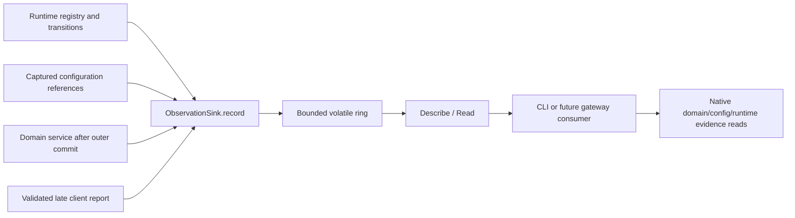

# Observation events, correlation and retention

Native event declarations and bounded journal behavior now exist in [events.rs](../../src/observability/events.rs) and [journal.rs](../../src/observability/journal.rs). Those sources own exact declarations; this document retains meaning, mappings and evidence limits. The [current implementation Task](../../.controller/observability/implementation-tasks/events.md) owns execution and handoff; the [completed design Delivery](../../.controller/observability/delivery.md) retains historical design acceptance. Owner-authored [journal cases](../../src/observability/journal_tests.rs) have not been executed by this owner; native integration owns build, runtime and consumer acceptance. Runtime and configuration own their payload facts and state transitions, while Events owns collection, stream identity, read consistency, losses and retention.

## Source-grounded baseline

| Existing authority | Current facts and limits |
| --- | --- |
| [Native event service](../../src/events/service.rs), [event adapter](../../src/events/store.rs) | `EventQuery` reads durable domain events, with `EventId`-like local integer bounds, event predicates, at most 1,000 events and 2 MiB per page. `EventPage.next_after` and a database generation fence describe current-store continuation; events are presently JSON domain projections. This is not runtime telemetry. |
| [History adapter](../../src/events/history_store.rs) | `HistoryCursor` refers to a retained peer/invocation/generation-bound source manifest. Sources have independent labels, file identities, optional generation and frozen ID watermarks; merge order is `(timestamp, source label, local id)`. This is a watermark window, not a retained database transaction. A replaced source fails with `StaleFence`. Manifests remain until explicit end or reset. |
| [Temporary observers](../../src/events/observer_store.rs), [CLI consumer](../../src/cli/commands/events_client.rs) | Exact peer and participant observers use advisory wake endpoints; postcommit wakes do not advance domain or output cursors. CLI output/wait/interruption and fallback polling belong to the host. A temporary observer is different from the existing business subscription/listen lifetime. |
| [Append and notification](../../src/db/events.rs), [postcommit effects](../../src/db/post_commit.rs) | Domain event rows are durable SQLite facts. Deferred notifications are discarded on rollback and flush after outer commit. The in-memory effect list is not a durable external-effect queue. |
| [Invocation and caller](../../src/service/context.rs), [client](../../src/service/client.rs) | Native `RequestId` can be stable for an operation that promises durable deduplication; it is not one transport attempt. Invocation environment is a claim, OS peer process is observed evidence, and a lost reply does not establish failure or non-commit. |
| [Daemon wire](../../src/daemon/wire.rs), [admission/dispatch](../../src/daemon/server.rs), [frames](../../src/daemon/frame.rs) | One short operation follows a Hello per connection; at most 32 workers and a 16-job application queue, with an 8 MiB frame bound. Queue, dispatch, application result and reply write are separately observable boundaries. Holding one application call waiting for an event would obstruct business dispatch. |
| [Messaging contract](../../src/messaging/service.rs), [inbox evidence](../../src/messaging/inbox.rs) | Durable message acceptance, prepared/issuing/uncertain claims and exact delivery/output confirmation are distinct facts. `DeliveryReceipt` proves its stated host/provider boundary, never model work completion. Observation cannot issue a receipt or advance delivery. |
| [Generation authority](../../src/db/reset.rs) | Database generation survives daemon restart and changes only on managed-data replacement/reset. Reset clears managed domain/observer metadata transactionally. Neither an event ID nor a daemon process ID can replace that generation boundary. |

## Collection boundary and early producer contract

The selected mechanism is one bounded, volatile observation ring per daemon and current database generation. Durable domain events and receipts remain with their owners. No new SQLite telemetry table, durable stream/outbox, background broker, long-lived IPC call or subscription registration is selected. A consumer uses short Describe/Read operations and a local polling timer. Existing archive history and temporary domain-event observer operations remain independent.



Arrows denote supplied observations and queries, not ownership transfer. Runtime/configuration update their own state before attempting best-effort collection. Domain producers publish committed facts only after their actual commit boundary. Event insertion cannot change the result of the business operation.

The concrete sink boundary is native:

The authoritative [`ObservationSink`, `RecordDisposition` and `DropReason`](../../src/observability/events.rs) declarations are consumed through the public Events leaf. It re-exports `ObservationJournal`; [journal.rs](../../src/observability/journal.rs) implements construction, epoch publication/withdrawal, stream replacement, sink creation, read handling, pruning, suppression and closure.

`record` performs bounded validation/serialization and a nonblocking collector lock attempt; it never opens storage, waits for IPC, calls a provider, wakes a port, retries, or propagates an error into the caller's business result. `note_drop` updates only fixed stream-local counters for a known skipped preparation attempt, using checked atomic increments; it does not serialize a record or acquire the journal/SQLite lock. It is not an external operation. A record failure accounts for itself once; callers do not double-charge it through `note_drop`. The producer retains its own facts even when insertion fails. All observation Describe/Read and report-transport infrastructure is suppressed from detailed runtime event capture; accepted origin reports themselves are explicit records. Loss accounting is fixed-size and does not recursively record telemetry about telemetry.

Selected budgets are 8,192 retained records **and** 16 MiB retained encoded bytes, at most 16 KiB for one complete record, and a maximum age of 15 minutes measured by the collector's monotonic clock. The collector evicts oldest accepted records to satisfy all three constraints before inserting a valid new one. An oversized record is rejected whole; no silent truncation changes the meaning of a typed fact. Contention or retired-generation input is dropped, not queued without a bound. Drop counters are returned out of band by every read/head operation. Severity never grants durability or priority over the business path.

Runtime's authoritative payload is `RuntimeEvent { at: ObservationTime, source: RuntimeProducer, correlation: RuntimeCorrelation, fact: RuntimeFact }` in the [runtime event contract](runtime.md#runtime-event-contract). `RuntimeCorrelation` retains `daemon: DaemonRef`, optional `ObservationEpoch`, `ConnectionId`, `RequestObservationId`, `ClientAttemptId` and native `RequestId` in their separate namespaces. Runtime owns lifecycle/admission/dispatch/reply facts, connection/request observation IDs and optional originating client attempts. Events imports this declaration verbatim; `ClientAttemptReport` from [originating attempt/report admission](runtime.md#originating-attempts-and-report-admission) stays a separate reported-origin family and cannot become a server-observed stage. Configuration publishes the exact `ConfigObservationEvent` family and captured references rather than raw environment/configuration content. Shared references and time/evidence types are imported from the [architecture contract](contracts.md); Events does not redefine them.

## Stream identity and read contract

The native read contract is usable independently of payload consumers. Shared `ObservationEpoch` is the exact daemon/scope/database generation reference from [architecture](contracts.md#shared-references). The stream's additional nonce belongs to Events and can change without changing that shared epoch. Neither reference is an authorization token.

The exact `ObservationStreamId`, `ObservationCursor`, `ObservationWindow`, `ObservationRead`, `ObservationHead`, `ObservationPage`, request, response and result declarations are in [events.rs](../../src/observability/events.rs). `ObservationReader` supplies Describe/Read; `ObservationJournal::handle` maps the typed request to its typed response. A sequence is a `u64` append position; zero means before first, and an empty retained ring reports `oldest = newest + 1`. The stream nonce is a UUID v4 independent of the shared epoch.

`Describe` atomically captures stream and retained bounds, plus the separately sampled fixed-size loss counters described below. `Read` accepts `0 <= after.sequence <= through <= head.newest` in one matching stream. Future or inverted boundaries return `InvalidInput`, never silent clamping. Validate selected scope first, then shared epoch, then stream nonce, then numeric boundaries; an old stream's higher sequence must not become a misleading future-boundary error against a replacement's low sequence. Wrong scope is rejected at the existing transport scope boundary. A same-scope changed daemon instance or database generation returns `EpochChanged`; a changed stream nonce in an equal epoch returns `StreamChanged`. Neither is an empty success or automatic rebinding. The caller explicitly decides to abandon the old stream and open a new window. Following restart, a caller first validates a fresh inspection Hello/daemon binding before submitting its retained old stream cursor; the event result does not silently reconnect an old `InspectionCall.expected_daemon`.

To start a retained window, Describe returns `H`; the caller sets `after.sequence = H.oldest - 1` and `through = H.newest`. To tail from a previous position, it sets `after` to that position and gets a fresh `through` from Describe. A new append above `through` belongs to the next poll window. No per-reader manifest, lease or snapshot pin is created. This is a **fixed append frontier over retained records**, not a guarantee that the records remain available until a reader finishes.

For each Read, expire old records, return an empty complete Page if `after == through`, otherwise test `after.sequence + 1 < oldest`. If that nonempty requested window intersects an evicted prefix, return `Gap { first_missing: after + 1, last_missing: min(through, oldest - 1), head }` and no records. A cursor gap is distinct from collection drops before sequence assignment. A filter that matched no records can return a complete empty page without a gap, while losses still disclose incomplete capture.

A page returns at most 256 records and 512 KiB for the complete response, scanning at most 1,024 retained candidates. Nonmatching records advance `next.after`; a matching record that would exceed the byte budget is left for the next call. Stop before advancing over that unreturned match. Reaching the requested record count ends the page immediately after that accepted record. `next.after.sequence == next.through` means complete; otherwise the caller continues the **same** window. Describe/Read use the architecture's separately bounded passive inspection lane and never enqueue a waiting Application job or call SQLite. The per-page scan bound limits contention with producers and other diagnostic reads. Only scanned sequence boundaries advance; the last returned matching record is not generally the continuation authority.

Read copies one bounded page while holding the collector's short lock and releases it before transport serialization. Accepted records are immutable. Filter evaluation, source time or newly arriving reports cannot change an already retained record. A repeated read can replay the same records while they remain retained; after eviction it returns Gap. Consumers deduplicate display/output using `(stream, sequence)` if their own output acknowledgement is lost. An observation cursor grants no business replay, receipt or idempotency authority.

Cancellation drops only the caller's polling loop and any short request resources. There is no server observer to end. The timer defaults to one second with caller-side jitter/backoff; no busy loop on an empty head. Daemon/client errors retain native `ServiceError` and transport unknown-outcome meaning. A read failure is an observation failure, not a failed domain request. A future Web adapter can forward these short operations; Web hosting/transport is outside this event contract.

## Envelope, payloads and correlation

The public contract is [events.rs](../../src/observability/events.rs), with the private collector in [journal.rs](../../src/observability/journal.rs). Shared references, clocks and evidence classes are imported from [native context](../../src/observability/context.rs), runtime payloads from [native runtime](../../src/observability/runtime.rs), and the configuration family from [native configuration](../../src/observability/configuration.rs). Each owner retains its payload rules.

The exact `ObservationInput`, `ObservationRecord`, closed `ObservationPayload` enum, `ClientReportObservation`, derived family/severity and safe domain projection declarations are in [events.rs](../../src/observability/events.rs). They import the actual sibling public contracts; the journal retains their bounded encoded form rather than an unbounded decoded duplicate.

`ObservationRecord.cursor.stream.epoch == input.epoch` is required. The destination stream is selected by trusted composition; no caller supplies a synthetic current epoch to upgrade old server facts. `source.origin` and `source.at` are constructed by the mapping adapter from the payload's actual producer; they are not free caller labels. Runtime input requires `correlation.daemon == input.epoch.daemon`, `correlation.epoch == Some(input.epoch)` and `source.at == RuntimeEvent.at`; process-only facts with no generation remain outside the dataset stream. Host/runtime refs embedded in a RuntimeFact also require that same daemon. Domain refs match the scope/database generation of `input.epoch`. Domain `actor` comes only from a successful exact domain identity resolution; unresolved/anonymous is `None`, never a synthetic participant derived from a name, PID or environment.

| Family | Source provenance/time | What the record establishes |
| --- | --- | --- |
| Runtime | `DaemonBoundary`; runtime producer's `at` and typed `source` | That producer observed that exact stage. An application result is the native result class, not generic proof of domain commit or external completion. Kernel-peer details retain their own `OsObserved` evidence inside Runtime. |
| ClientReported | `ClientReported`; `report.ended_at` time/clock, retained separately from journal collection time; `submitted_by` is current intake evidence | What the originating client claims it attempted/received. The report can refer to a previous daemon/epoch; `input.epoch` identifies where it was collected, not where the attempt ran. A missing destination/epoch or absent daemon contact stays explicit in Runtime's report. |
| Configuration | `SnapshotPublished` retains its `origin` and original `captured_at`; `CaptureSkipped` and `SnapshotsRetired` use the emitting configuration boundary's time/origin | A captured/published immutable configuration reference or its bounded removal. It does not disclose raw values or preserve the snapshot's lifetime. |
| DomainCommitted | `StoredDomainFact`; producer's observation immediately after outer commit | The domain committed or replayed the named fact and associated exact references. The stamp is an after-commit observation, not an invented exact transaction commit timestamp. |

The collector assigns `collected_at` using its own clock. This time controls age retention. Producer wall clocks can move backwards and source clocks differ; neither controls sorting. Historical source time and current collection time can be far apart for late reports. Freshness/age for source evidence is meaningful only within comparable clock IDs or the owner's returned age. Immutable records remain historical facts until evicted; a health view must query the runtime/configuration owner for current truth.

`ClientReportObservation` is created only by the restricted intake adapter from separately authenticated `AcceptedPeer`; a caller cannot deserialize one to acquire trust. The submitted peer/connection belongs to the **current receiving daemon**, and must match `input.epoch.daemon`. It establishes who submitted this report now, not who historically ran the attempt. The original report retains `last_ready`, `original_epoch` and independent source clock exactly as claimed. Identical attempt UUIDs from different authenticated peers remain distinguishable in journal records; unknown process incarnation remains connection-local rather than being equated with another `None`.

`ObservationFamily` and severity are pure derived accessors, not independently writable record state. Severity order is `Info < Notice < Warning < Error`, and `minimum_severity` includes that level and above. The following rules are evaluated top to bottom using the payload owner's exact enum variants; there is no arbitrary text matching. Severity classifies the observed boundary and never changes native outcome meaning. Unknown client outcome remains unknown even when displayed as Warning.

| First matching condition | Derived severity |
| --- | --- |
| Runtime lifecycle Failed; runtime reason Internal/ScopeOwnershipLost; application ReturnedError(Internal); reported failure/result explicitly classifies Internal | Error |
| Runtime AdmissionRejected/DispatchRejected, ReplyWaitAbandoned, ReplyWriteFinished with failure; ConnectionClosed ReadFailure/WriteFailure/Deadline/Rejected; ApplicationReturned(ReturnedError(_)); client `failure` present or knowledge MayHaveBeenWritten/ReceivedFailure/ReceivedApplicationResult(ReturnedError(_)); configuration CaptureSkipped | Warning |
| Configuration SnapshotsRetired; runtime lifecycle Draining/Stopping or host association Released/InvalidatedByReset | Notice |
| All other validated runtime facts, successful/NotWritten/DiscoveryOnly client reports, configuration SnapshotPublished and every DomainCommitted projection | Info |

Optional correlation means “not supplied or not established at this boundary.” It is not proof that the related thing does not exist. `RequestObservationId` denotes one decoded server Call, `ClientAttemptId` one possible client Call write, native `RequestId` a domain logical-operation key where supported, native activation `AttemptId` a different live host offer, and `BatchId` a durable frozen inbox claim. Equality or ordering across these namespaces is invalid. A request ID filter may return several client attempts/server observations; none grants business replay authority.

The source owns causal relationships: a runtime fact carries its native connection/request/attempt refs; domain commit carries only exact refs available at its own boundary. There is no required fabricated parent, span tree, global request counter or total trace. The stream sequence orders collector acceptance only. A delayed client report or domain postcommit publication may appear after the reply event; source chronology and explicit keys explain the relationship without reordering retained records.

## Domain and host evidence boundaries

The initial domain producer surface covers durable event append, message acceptance, inbox phase and exact output/delivery confirmation. It is a selective diagnosis projection. It is not a second audit log, event source for reconstruction, universal mutation result, or durable commit notification service.

Each `DomainCommitFact` has additional validation: durable event IDs are positive and output-confirmation frontiers are nonnegative; generation and key strings are nonempty; `MessageAccepted` points to the same event and generation as the native acceptance result; replay retains the original request/event and sets `replayed` without inventing a second commit. A claim matches exact target/batch. `DeliveryConfirmationStored` is a projection made only after native receipt/claim/frontier validation and a successful `Confirmation::Advanced` or `AlreadyConfirmed`; `DeliveryBoundary` drops raw turn IDs and the receipt frontier so an observation is not a serialized confirmation command. Native `StaleFence`/`WrongBatch` and errors do not construct a successful stored confirmation. `OutputConfirmationStored` is emitted only after the unmanaged output confirmation transaction returns successfully; its fresh `OutputObservationId` is never native `OutputToken.id` or a hash of it, and has no exported reverse mapping. Replayed confirmation may receive a fresh observation ID while native request correlation remains intact. Claimed output uses `DeliveryConfirmationStored`. `DomainEventKind::Other` preserves an unclassified domain event reference without copying arbitrary JSON.

The domain adapter queues only bounded reference projections for publication after the outer commit, using the existing transaction/savepoint boundary. One outer transaction and all nested savepoints share a budget of 64 projections and 64 KiB encoded projection bytes. Savepoint rollback discards that savepoint's projections and restores its budget; outer rollback discards all of them. Excess observation preparation updates fixed loss accounting and does not fail domain work. After a successful outer commit, publication drains the list outside SQLite with at most 64 best-effort calls. No ring lock is held in a business transaction, and no ring failure rolls back the business fact. Commit and stream append are intentionally **not atomic**: a crash or collector drop after commit can lose the observation. The durable fact remains discoverable only through the owner's actual native operations and lifetime. A future requirement for guaranteed durable commit feed would need a separately justified owner-backed outbox; this design makes no such guarantee.

| Referenced evidence | Supported investigation and important limit |
| --- | --- |
| `DurableEventRef` | In the current matching generation, native `Events::Query` can read `after = id - 1`, `through = id`, empty filters, oldest first and limit 1. The adapter must retain that generation fence and distinguish a missing result from telemetry absence. Event payload and business interpretation stay with Events/domain. |
| `MessageAcceptanceRef` | Existing `Messages::Acceptance { request_id }` returns the durable accepted result under the existing actor/generation rules. A new transport attempt does not issue another Submit. No matching acceptance alone does not prove that arbitrary unrelated external work never happened. |
| `InboxClaimRef` | Existing exact `InboxOperation::Outstanding { target }` can expose an unresolved current/predecessor claim according to its domain rules. It is not arbitrary historical receipt lookup. Absence of an outstanding claim cannot by itself prove which batch was delivered. |
| `DeliveryConfirmationStored` projection | Reports the accepted normalized boundary and exact claim ref, e.g. output written or provider input recorded. Full native receipt/frontier/turn evidence stays in domain storage and is not copied into telemetry. This proves neither turn completion nor agent work. Current public APIs do not offer universal historical `GetReceipt(batch)`; no such operation is silently added here. |
| `OutputEvidenceRef` | Identifies one successful output-confirmation observation with a fresh observation-only ID. It cannot look up or reconstruct native `OutputToken` and is not advertised as a domain receipt key. Native confirm operations remain mutations and are never invoked to “look up” evidence. Arbitrary completed output readback is not promised. |
| Archived event location | Existing `HistoryCursor`/manifest and its `(timestamp, source, id)` position remain separate. An archive label is a display/source label, not durable source identity or a path accepted from a consumer. A previously returned archive row may be retained by the consumer as history evidence; its cursor can expire/end or fail on source replacement. This stream does not forge `DurableEventRef` for an archive whose generation is unknown. |

The evidence chain is `client possible write -> server decoded/queued/dispatched -> native domain acceptance/commit -> external host output/input -> exact native confirmation -> optional client receipt`. Only the relevant owner can establish each arrow. Server reply write success does not establish client receipt. Prepared/Issuing claims with no confirmation retain uncertainty; timeouts, connection closure, ring expiry or missing host evidence do not release them. Host cleanup plans, attachment retirement and process observations likewise retain their existing domain authority; they are not rewritten as generic “host complete” events.

No new generic `HostEffectReport`, `PublishObservation` or capability-bearing event endpoint is offered. Domain hosts continue to submit existing exact receipts to their native owner. External input reaches the journal only through Runtime's restricted originating-client report path or Configuration's validated safe snapshot publication; it cannot select the Runtime/DomainCommitted variant or claim server stages/host effect completion. A client that cannot contact the daemon may have useful evidence only in its own bounded local report; daemon absence of that report is not evidence of no attempt.

## Filtering, errors and collection losses

The native [`ObservationFilter`, `ObservationReadError`, `ReadInputError` and fixed loss counters](../../src/observability/events.rs) are authoritative. Filter matching, severity and cross-owner fence validation are pure source behavior; [journal.rs](../../src/observability/journal.rs) supplies nonblocking admission, expiry and page construction.

All filter fields combine with AND. `None` is unrestricted; an explicit ref matches only if that family contains the same exact ref. No name-to-participant resolution, arbitrary JSON path, raw SQL, regular expression, free-text search, source-time range or filesystem path supplied as a selector is offered. Runtime/configuration are responsible for exposing their actual keys to the pure event matcher. Filter serialization is limited to 8 KiB, and native reference validation runs before scanning. A filter participant must include exact incarnation; a config reference has an exact shared epoch; an event ref has its scope/generation. For client reports a source-era filter matches the payload's original reference, while the cursor still identifies the collection-era stream.

The local `ObservationFilter.request: RequestObservationId` is always qualified by `window.after.stream.epoch.daemon`, equivalent to `RequestObservationRef { daemon: that_daemon, id }`. It never matches a naked request number from another daemon. Runtime event extraction uses its checked correlation daemon; DomainCorrelation uses its checked input epoch's daemon. Terminal ClientAttemptReport contains no proven server RequestObservationRef, so it does not match this server-request filter solely through its claimed UUID/RequestId. Origin attempt matching is a literal claim match and may return several peers' reports; it does not prove those peers or attempts identical. Configuration filtering extracts only `SnapshotPublished.snapshot`; skipped/prefix-retirement records have no individual snapshot ref and do not match. Participant matching uses exact DomainCorrelation actor, claim/output participant or runtime's actual HostAssociation projection when that payload exposes it; it performs no live registry join. Runtime HostAssociationObserved currently carries only host ref/state, so that event cannot match a participant filter without a future owner-approved contract change.

The complete `ObservationWindow`, including filter and inclusive `through`, is echoed as the continuation value. There is no server-side manifest able to detect a caller editing its own value. Changing the filter or frontier intentionally starts a different selection window; it cannot claim complete coverage of the old selection. Conforming adapters carry the returned window verbatim except for page limit and explicitly finish before opening the next tail window. A filter that was valid for a previous native schema is not silently reinterpreted under a later incompatible build; the shared protocol epoch must change for incompatible filter semantics; build identity alone does not gate compatibility.

`ObservationReadError` is a typed inner domain result carried by the composition-owned passive inspection response. Native OS/transport/deadline/compatibility failure stays `DaemonError`; it is not collapsed into these errors. `Busy` means a nonblocking bounded read-lock/admission attempt could not obtain a snapshot; the cursor remains unchanged and the caller may back off the **read**. `GenerationUnavailable` means there is no published dataset epoch yet, and runtime process diagnosis remains available. `Unavailable` means the collector/inspection lifetime is stopping or failed. `Forbidden` is admission/disclosure rejection, not absence of records. Gap, EpochChanged and StreamChanged are typed observation outcomes with a new head; they are not generic service error text. Observation reads can safely be retried as reads; this does not authorize repeating the underlying business call.

Outcome remains the payload owner's typed stage/result, client knowledge, configuration publication or domain committed fact. There is no flattened common success/failure field. The record's collection age can be computed only when `collected_at.clock` equals the head's `observed_at.clock`; source age additionally requires the source clock to match. A 15-minute collector age is a retention bound, not a universal freshness promise for configuration, runtime state or domain facts. Historical captures do not become current truth; incomparable/missing source clocks leave age unknown. A reader queries the owner for current health or native outcome.

Accepted records receive contiguous sequences starting at 1; failed capture attempts receive no sequence. Prefix eviction leaves an exact numeric missing interval detectable on Read. The counter `dropped` counts records never admitted to the stream by reason, including projections skipped at the bounded postcommit preparation boundary; the counter `evicted` counts previously accepted records removed by the first satisfied removal reason (age first, then count, then bytes). A record is charged once. `suppressed` counts intentional observation-self traffic and is not a capture-loss count. Its update is best effort: no active stream or collector-lock contention leaves no suppression sample; it is not an exact inspection traffic meter. Normal observation traffic must not generate its own detail records or self-amplifying losses.

Head bounds and page contents are one collector-lock view. Producer drop counters may update without that lock, so `losses` is a monotone fixed-size sample at `sampled_at`, **not** an atomic completeness certificate for `(after, through]`. It does not know the exact lost payload, ref, source interval or filter match. Even no gap plus zero sampled drops cannot prove universal instrumented coverage or no business effect; a process can crash before its producer call. Comparing two samples within one stream can reveal known capture loss, never reconstruct the missing facts.

Counters and sequence arithmetic use checked increments. Accepted `newest` cannot exceed `u64::MAX - 1`, preserving a representable empty `oldest = newest + 1`. Before that sequence limit or any counter/monotonic increment would overflow, the collector stops accepting that stream, exposes Unavailable, and composition constructs a fresh nonce with zeroed counters in the same shared epoch. Readers see StreamChanged after replacement, and never wrap to apparent sequence 0. Retired producer handles are not redirected to the new stream; composition must explicitly supply a new handle at the actual lifecycle boundary. This impractical-in-normal-use path remains specified so fixed-width counters have no undefined meaning.

## Retention, state transitions and resource ownership

| Resource/fact | Construction/update owner | Lifetime, cleanup and pressure |
| --- | --- | --- |
| Observation stream and records | Daemon composition constructs one stream-fenced sink/reader; collector serializes append/eviction | At most 8,192 records, 16 MiB encoded bytes and 15 min collection age. First limit reached wins. Restart/reset drops the stream; a new nonce never restores it. There is no disk telemetry export by default. |
| Query window/cursor | Consumer constructs from exact returned head/cursor | Pure bounded values with no server registration, heartbeat, held transaction, subscription or retained source snapshot. They do not pin data. Dropping the consumer releases only its own timer/output state. |
| Runtime registry | Runtime updates stage/gauge state before attempting event capture | Its own active/completed retention policy; a missing stream event never decrements active work or fabricates a terminal result. Querying the current registry is a separate stamped observation. |
| Configuration snapshots | Configuration producer/store owns admission and immutable payload | Its independent limits/removal states. `ConfigObservationEvent::SnapshotsRetired` is a bounded prefix summary, and events referring to old snapshots never retain them. Reset may remove all snapshots without a readable final event. |
| Domain events/acceptance/claims | Existing SQLite/domain owners | Existing durable policy survives telemetry eviction and daemon restart. Reset/generation replacement invalidates current-generation refs. This design introduces no TTL or cleanup migration for durable facts. |
| Original client reports | Runtime's originating-client memory and report-admission adapter | Before reachability, only the origin has them. Safe later publication remains claimed historical evidence. Collection does not read another process's files/environment or promise recovery of an exited origin's report. |
| Existing archive manifests, temporary domain observers and subscriptions | Current Events service and originating host | Preserve existing peer/generation/source fences and explicit End/cleanup behavior. They neither pin nor continue observation telemetry; no new metadata is written into their KV records. |

The 16 MiB budget counts serialized immutable record bytes including references and cursor identity, not raw producer input or SQLite history. Native storage may retain pre-encoded record bytes plus one bounded index entry per record (at most 8,192); it must not keep an additional unlimited decoded copy or interning table. One producer's bounded encoded scratch is at most one 16 KiB record. A read decodes candidates individually, retains at most one 512 KiB encoded reply budget and holds bounded typed page objects; Rust allocation overhead is additional. Concurrent scratch is bounded by the daemon's already finite producer/inspection worker counts. This is a chosen engineering envelope, not a measured heap/RSS or rate guarantee.

Encoding uses the same bounded representation as size admission, and a capped writer must abort at 16 KiB rather than allocate an arbitrary producer object first. Consumer response sizing includes the outer enum/head/window/loss envelope and uses the actual serde encoding, reserving space before adding a record. The native implementation measures the complete `ObservationResponse` envelope and reserves a further 128 bytes for the passive inspection wrapper; composition must keep that fixed wrapper within this reserve. At least one maximum-sized admitted record fits within a valid 512 KiB page. Reference/path/string size violations reject the complete input; no content truncation changes a receipt's identity. If a page cannot encode its valid envelope, return a typed invalid-input error rather than a partial success. This remains far below the existing 8 MiB IPC frame limit.

The collector expires old prefixes on every Describe, Read and record admission using `collected_at` monotonic age (`age >= 900_000 ms` expires). The daemon lifecycle's bounded control tick also prunes at least once per second during idle periods. No collector lock spans SQLite, source resolution, provider effect, transport write or output flush. There is no per-ref unbounded secondary index; the 1,024-candidate bounded scan supplies the initial query implementation. Caller-supplied high-cardinality IDs appear only within retained records/short query values, never as immortal metrics labels.

| Current collector state | Trigger/guard | Next state, recorded result and unchanged authority |
| --- | --- | --- |
| No published generation | Runtime startup/control evidence | No dataset stream; Describe/Read returns GenerationUnavailable. Runtime process-only snapshot remains valid. |
| Active stream | Valid matching-epoch producer input, lock available | Expire/evict prefix, append next immutable record, return Recorded. Business state/result is unchanged. |
| Active stream | Lock contended, oversized/invalid input or unavailable collector | Drop whole capture and update fixed reason counter if stream counters remain available; no sequence, wait or business error. |
| Active stream | Reader behind oldest but before its through | Return exact Gap and no records; no automatic skip, replay, mutation or data pin. |
| Active stream | Reset commits a new durable generation | Retire old stream and all old handles; publish new shared epoch and nonce only after committed mirror changes. Old continuation returns EpochChanged. Reset's own request result retains its native before/after era meaning. |
| Active stream | Collector replacement or checked counter limit | Retire old nonce; publish fresh nonce in same epoch. Old continuation returns StreamChanged. |
| Active stream | Stop/crash/restart | Admission stops and outstanding readers close according to daemon lifecycle. New daemon instance starts a new epoch; no readable terminal event is guaranteed. Durable domain state follows its own recovery. |
| Retired stream handle | Late domain/runtime publication | Drop RetiredEpoch against that handle; never redirect an old server fact into a new epoch. Historical client-report admission is separate and explicitly source labeled. |

Reset synchronization is a composition obligation: once new generation is published, inspection must not return an old dataset as current. It either obtains the new fenced stream or returns Unavailable while rotating. A producer that captured the old epoch before reset can finish later, but its old handle only drops. A crash between durable reset commit and mirror/stream publication exposes no false new epoch; next startup obtains the committed key. Late external receipt validity remains the native domain's decision, not the stream's.

Duplicate producer calls create distinct observation records and do not imply duplicate business effects. Message acceptance replay explicitly retains `replayed`; the collector performs no unbounded dedup table or exactly-once promise. For display, cursor deduplication prevents printing a retried page twice. For correlation, native request/attempt/batch keys preserve identity, and no stream event is consumed as an effect command.

Redaction happens before serialization and collection. Payload families are closed enums, with codes/refs and safe typed runtime/configuration data only. Never retain arbitrary environment, argv, body/message text, raw configuration/error strings, launch context JSON, transcript, actor capability, secret/token, native output receipt ID, full `DeliveryReceipt`, provider turn IDs, raw provider frames, stdout/stderr buffers or a raw content fingerprint. Joining telemetry fields must not reconstruct the omitted native output token or full delivery receipt; output uses a fresh non-authorizing observation UUID and delivery omits the exact frontier/turn. Permitted scope/process/participant refs may still be identifying; the passive local authenticated adapter applies its existing disclosure boundary. Collection grants no network/browser export permission. Invalid disclosure is rejected instead of copied into a generic JSON payload.

## Typed scenario fixtures and read traces

These are semantic fixtures for integration, with owner-authored executable cases in [journal_tests.rs](../../src/observability/journal_tests.rs). They are not captured runtime evidence or executable tests. Rust value notation uses previously bound, correctly typed fixture refs/times; helpers such as `cursor`, `all` and `family` stand only for construction of the exact records/filter above. Each fixture declares expected observation results and the separate owner read needed to establish a business outcome. Runtime-owned fact/report fields must be taken from the runtime release, never inferred from these event examples.

### Fixed-frontier handoff and replay

| Step with stream S, initially retained sequences 1–2 | Exact result/next operation |
| --- | --- |
| `Describe` returns `{stream:S, oldest:1, newest:2, ...}` | Construct `W = {after:(S,0), through:2, filter:all}`. |
| `Read {window:W, limit:1}` | Page contains sequence 1, next window is `{after:(S,1), through:2, filter:all}`. |
| Producer appends sequence 3 | The existing window's frontier remains 2; no page or cursor is mutated. |
| Read the exact returned next window | Page contains sequence 2, next after is 2 and this window is complete. Sequence 3 is deliberately outside that fixed window. |
| New Describe returns newest 3; open `{after:(S,2), through:3, same_filter}` | Page contains sequence 3. The append between pages was not skipped. |
| The caller lost its local output acknowledgement and repeats one prior Read | Same immutable matching records can replay while retained; deduplicate by exact cursor. Later prefix expiry returns Gap instead of replay completeness. |

The first useful result does not require a new subscription resource or an atomic Describe+Read. Eviction between either step is explicitly Gap, while append above the frontier waits for the next window. Two independent consumers have no shared continuation or cleanup authority.

### Accepted request with lost reply and uncertain host effect

```rust
let input = ObservationInput {
    epoch: epoch_a,
    source: EvidenceStamp { origin: EvidenceOrigin::StoredDomainFact, at: daemon_time },
    payload: ObservationPayload::DomainCommitted(DomainCommitObservation {
        correlation: DomainCorrelation {
            request: Some(req_obs),
            client_attempt: Some(attempt_a),
            request_id: Some(req_id),
            actor: None,
        },
        fact: DomainCommitFact::MessageAccepted {
            acceptance: acceptance_ref,
            event: event_ref,
            replayed: false,
        },
    }),
};
```

Bind `acceptance_ref = MessageAcceptanceRef { scope: epoch_a.daemon.scope, database_generation: epoch_a.database_generation, request_id: req_id }` and `event_ref = DurableEventRef { scope: same_scope, database_generation: same_generation, event: EventId(42) }`. The producer emits this only after native acceptance commits; a later lookup can corroborate it while retained. Runtime's application-result class alone cannot construct it. In the deciding trace the client has an unknown reply outcome and the domain committed event 42; if the inbox claim is Issuing without exact normalized confirmation, the external result remains uncertain. `Messages::Acceptance` and existing inbox reads are the next operations. Client claims never become server reply facts, and none of these records authorizes a second Submit.

### Empty filtered interval versus retention gap

```rust
let head = ObservationHead { stream: stream_1, oldest: 10, newest: 12, observed_at: t, losses: losses_0 };
let no_match = ObservationRead {
    window: ObservationWindow { after: cursor(stream_1, 9), through: 12, filter: request(req_other) },
    limit: 64,
};
// -> Page { records: [], next.after: cursor(stream_1, 12), ... }

let behind = ObservationRead {
    window: ObservationWindow { after: cursor(stream_1, 1), through: 12, filter: all() },
    limit: 64,
};
// -> Gap { first_missing: 2, last_missing: 9, head }
```

The first page is complete because every retained sequence in its fixed frontier was scanned and none matched. The second cannot claim that sequences 2–9 had no matching records: they were evicted, so it returns no suffix that could silently look complete. A nonzero `losses.dropped` may accompany either result but does not itself identify a sequence gap.

### Scanned frontier is distinct from the last matching record

```rust
// Retained records: 20 matches filter, 21 and 22 do not, 23 matches.
let read = ObservationRead {
    window: ObservationWindow { after: cursor(stream_1, 19), through: 23, filter: family(Runtime) },
    limit: 64,
};
// -> Page { records: [seq 20, seq 23], next.after: cursor(stream_1, 23) }
```

`seq 23` is the scanned frontier and the last returned match in this example; the rule still does not identify the frontier with the last match. If the records were `20 match, 21 nonmatch, 22 nonmatch` and the fixed frontier ended at 22, the page would return only 20 and `next.after` would be 22. If a matching record would exceed the page byte budget, scanning stops before that record and `next.after` remains the prior sequence. Integration must assert this distinction so a continuation never skips an unreturned match.

### Daemon restart, reset and stream replacement

```rust
let old = ObservationCursor { stream: ObservationStreamId { epoch: epoch_a, nonce: nonce_a }, sequence: 44 };
// Restart: daemon_instance changes, durable generation remains equal.
// Read(old) -> EpochChanged { requested: epoch_a, head: head_b }.

// Reset: daemon_instance may remain equal, database_generation changes.
// Read(old) -> EpochChanged { requested: epoch_a, head: head_c }.

// Collector replacement: compare a cursor already in epoch_c; only nonce changes.
let in_c = ObservationCursor { stream: stream_c, sequence: 8 };
// Read(in_c) -> StreamChanged { requested: stream_c, head: head_d }.
```

The consumer must explicitly open a new Describe window and label the result as a new era. It may retain old records for a historical display, but it cannot concatenate sequence 45 from the new stream after sequence 44 from the old one. A reset's durable domain result and the observation stream's `EpochChanged` are separate facts; either can be observed without the other because stream publication is not an atomic outbox.

### Pressure, drops and slow readers

```rust
let disposition = sink.record(oversized_or_contended_input);
// -> Dropped(Oversize) or Dropped(Contended), no sequence allocated.

// Later accepted records evict sequences 1..=2 by age/count/bytes.
let head = describe(); // oldest = 3, newest = 8194, losses.evicted.count_pressure >= 2
let read = read(window_after_0_through_8194);
// -> Gap { first_missing: 1, last_missing: 2, head }, no records
```

The producer still completes its runtime/configuration/domain update when `record` drops. A slow reader does not reserve a slot or hold a transaction; it receives Gap once its window crosses the retained prefix. The count-only numeric example assumes small records, no age/byte pressure and 8,194 successful appends. The integration fixture must separately assert that the native durable acceptance lookup is unaffected; it must retain the explicit limit on arbitrary historical receipt readback. A dropped event before sequence assignment cannot be reconstructed by choosing another cursor.

### Inaccessible origin or host evidence

| Fixture input supplied by Runtime/native owner | Expected Events result |
| --- | --- |
| Origin attempt `attempt_b` reports a connect failure before a daemon was reached, with source clock/time and no proven server request ref | Later safe admission records `ObservationPayload::ClientReported` with `EvidenceOrigin::ClientReported`; no Runtime or DomainCommitted payload is synthesized. |
| Exact native inbox claim is Issuing, host disconnects and there is no validated confirmation | No delivery-confirmation projection exists; retain native uncertainty and query its actual recovery owner. |
| Earlier config publication points to a snapshot now evicted from the configuration store | Event ref remains historical; lookup reports the configuration owner's removal/unknown outcome. Event presence does not pin or reconstruct the payload. |

If the origin process exits before report admission, the stream has no negative evidence. If a host disconnects after an `Issuing` claim, the claim remains governed by inbox recovery and exact reconciliation; no timeout, missing event or PID reuse proves no external effect. These fixtures preserve partial visibility instead of fabricating a total-order trace.

### Source replacement and independently retained evidence

| Deciding fixture | Required result and boundary |
| --- | --- |
| Current native event 42 is referenced by `DurableEventRef(scope,G1,42)` and telemetry expires | Native Events Query remains fenced to G1. No telemetry deletion removes event 42 or its native acceptance. |
| A frozen archive `HistoryCursor` names source label L with manifest file identity F1; the file at L is replaced by F2 | Existing history continuation returns `ServiceError::StaleFence` from the manifest/file-identity check. It must not resume against F2 by label/id/timestamp. Observation Gap or StreamChanged cannot continue that archive cursor. |
| A matching label/event number appears in a different archive or database generation | It is a different source fact; no numeric/local label join upgrades it into the original durable reference. Pre-daemon archives with unknown generation cannot be relabeled with the current generation. |
| Two safe identical terminal reports arrive from one known peer incarnation/attempt | Runtime's report intake applies its own duplicate validation/retention behavior. Any two journal publications still receive separate cursors; no exact-once stream promise or business repetition follows. |
| Two authenticated peers claim the same attempt UUID | `submitted_by` remains different; the matcher can return both claim records but cannot merge identities or attach either to a server request without Runtime's exact origin/peer relation. |
| The consumer closes during a read/follow loop | Only short inspection connection, bounded reply and local timer/output state close. No inbox claim, participant, host, native domain observer or stream lifetime changes. |

## Planned implementation obligations and evidence limits

The selected obligations now consume native sources. This stable design-handoff heading also retains the completed Task's evidence link; actual executable acceptance remains with independent integration.

| Obligation | Current owner/home | Required behavior and integration evidence |
| --- | --- | --- |
| Shared epoch/time/evidence types | Architecture, `src/observability/context.rs` | Consume [native shared contracts](../../src/observability/context.rs); reject empty/mixed clocks and preserve no-generation process-only state. A type check cannot prove clock or generation construction. |
| Runtime event and report production | Runtime, `src/observability/runtime.rs` and `registry.rs` | Update exact gauges/state before best-effort sink insertion; emit one client attempt per possible Call write and one server request per decoded Call; preserve all stage/outcome/unknown distinctions. Integration must exercise pre-reachability, queue expiry, reply loss and late reports. |
| Configuration event publication | Configuration, `src/observability/configuration.rs` and `configuration_store.rs` | Publish exact `ConfigObservationEvent` refs without raw values; keep original capture stamp on late reports and independent snapshot retirement. Integration must compare two invocation revisions and an evicted/withheld snapshot. |
| Event envelope/journal | Events, `src/observability/events.rs` and `journal.rs` | Enforce validation, redaction, fixed sequence/stream fences, byte/count/age bounds, checked counters, no blocking/provider/storage calls, and explicit drop/eviction samples. Focused cases must prove no sequence is allocated for a drop and no old handle redirects. |
| Domain projection adapters | Domain owners with Events mapping, after existing outer commit | Emit only exact durable event/acceptance/claim/confirmation projections; rollback drops the projection; telemetry loss never rolls back or changes business result. Evidence must show the owner query still governs after stream eviction. |
| Passive inspection adapter | Architecture/daemon composition, `src/daemon/observation.rs` and wire additions | Keep short bounded Describe/Read separate from the sole Application queue and SQLite; enforce scope/peer/disclosure/deadline and existing frame limits. A successful read proves only observation availability. |
| Consumer and future Web/CLI mapping | Integration, consumer boundary and implementation tasks | Consume exact windows/results/errors, render no-match/gap/era/loss distinctly, and route native acceptance/receipt reads to their owners. No UI or adapter may open live SQLite or issue a business mutation through an event. |

The promoted event/journal source implements the selected native behavior, and [owner-authored cases](../../src/observability/journal_tests.rs) cover filtered scanning, frozen frontiers, replay, exact gaps, reset/restart, byte/count/age bounds, drops, poison and checked limits. No formatter, compiler, test, package, daemon, CLI or live-host probe was run by the Events owner. Source inspection and authored cases do not establish executable backend acceptance; the [independent native integration Task](../../.controller/observability/implementation-tasks/native-integration.md) owns fixed-candidate execution, actual producer/endpoint scenarios and their evidence. Runtime/configuration behavior and current support remain owned by their original implementation Tasks and receipts. Existing business event history/observer behavior retains its own authority.
