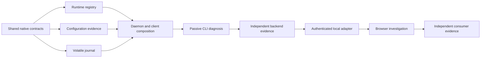

# Observation implementation plan

The [authorized implementation Delivery](../../.controller/observability/implementation.md) is active and owns stages and formal dependencies. Its [implementation team](../../.controller/observability/implementation-team.md) and [current assignments](../../.controller/observability/controller.md#implementation-assignments) govern execution; each original Task owns its actual state. The [engineering map](engineering.md) owns source structure, the domain documents own behavior, and [scenarios](scenarios.md) own complete investigation outcomes. This plan connects those authorities to concrete implementation results without copying the contracts.

The [accepted native backend](../../.controller/observability/implementation-evidence/native.md#final-independent-backend-handoff) is preserved independently. Actual adapter/Web source and scoped HTTP/browser outcomes now live in [consumer evidence](../../.controller/observability/implementation-evidence/consumer.md); the [original consumer Task](../../.controller/observability/implementation-tasks/consumer-integration.md) owns the completed package/check/cleanup handoff; the Delivery controller owns formal acceptance. This evidence route does not reopen design acceptance or establish installed/live support.

Arrows are release dependencies. Exact cross-domain declaration references may be prepared in parallel, but no consumer release can rely on an unimplemented provider, a scripted successful fixture or an unknown operation result rewritten as failure.

## Original implementation work

| Task | Meaningful result | Native/module write owner | Scenario and evidence obligation |
| --- | --- | --- | --- |
| [Native contracts](../../.controller/observability/implementation-tasks/native-contracts.md) | Canonical shared refs/time/evidence and module ownership | `observability/{mod,context}.rs`, native module guide; public domain declarations remain their owners' responsibility | Exact scope/epoch/clock semantics; remove promoted shared design copies |
| [Runtime](../../.controller/observability/implementation-tasks/runtime.md) | Bounded registry and passive query/producer offerings | `observability/{runtime,registry}.rs` | OBS-01/02/06/07/08/09/10; author transitions, budget and unknown tests |
| [Configuration](../../.controller/observability/implementation-tasks/configuration.md) | Immutable capture/resolution evidence and safe comparison | `observability/{configuration,configuration_store}.rs` | OBS-04/06/08/09/10; old versus current resolution, hidden and evicted facts |
| [Events](../../.controller/observability/implementation-tasks/events.md) | Bounded append/read journal with truthful gaps and era changes | `observability/{events,journal}.rs` | OBS-03/05/08/09/10; exact scanned frontier, rejected inputs and capture losses |
| [Composition](../../.controller/observability/implementation-tasks/composition.md) | Actual originating/daemon evidence and independent inspection lane | `daemon/observation.rs`, additive existing daemon/service/configuration/domain producer sites and `main.rs` | Real load/commit/flush boundaries, separate admission budgets and cleanup; no DB on inspection workers |
| [Diagnostics](../../.controller/observability/implementation-tasks/diagnostics.md) | Complete passive local investigation path | `cli/commands/observe.rs`, named CLI parser/router/help additions | OBS-01..10 at consumer mapping; local stdout/errors and interruption preserve native semantics |
| [Native integration](../../.controller/observability/implementation-tasks/native-integration.md) | Independent executable backend/CLI receipt | Named test leaves, controlled fixture support, `implementation-evidence/native.md` | Fixed-source/product cases, busy dispatcher, alias/PID/era/pressure and exact cleanup |
| [Local adapter](../../.controller/observability/implementation-tasks/local-adapter.md) | Actual browser bootstrap/authenticated read API and bindings | `observability/web/{mod,api,session}.rs`, additive executable route under transfer | Finite native mappings, denied access, scope/disclosure and bounded session/poll lifetime |
| [Web](../../.controller/observability/implementation-tasks/web.md) | Browser investigation using ready API | `web/observability/` and only its build/asset wiring | Actual API, contextual links, gaps/offline evidence and narrow-screen path; no mock-as-product claim |
| [Consumer integration](../../.controller/observability/implementation-tasks/consumer-integration.md) | Independent native-to-browser outcome and cleanup | Consumer fixtures/evidence and `implementation-evidence/consumer.md` | Actual rendered/interaction/API evidence; distinguish Agent walkthrough from user acceptance |

## Shared writes and declaration release

Foundation Tasks implement cohesive modules and may import each other's public declarations, never private stores. Each offering author publishes its exact declarations before dependent behavior is filled. If an import is not yet available, coordinate a bounded declaration release; do not create a duplicate placeholder type or add a hidden task dependency. The shared native Task does not design domain rules for them.

Composition is the sole writer of actual client/daemon/config/domain insertion sites and wire envelopes. It receives a concrete callback/input contract and the exact source boundary from each foundation owner. Native module guides/design promotion edits have one region per owning domain; shared route changes go through their current writer. After the CLI result, native integration owns any failing production correction only through a bounded return to the implementation owner, preserving independent validation responsibility.

Adapter and Web work may read ready contracts and prepare scenario models earlier. Their implementation readiness is the backend acceptance boundary, then the callable API boundary. The local adapter must publish native-to-browser request/result/error mappings and binding authority before Web chooses a framework or writes view logic. A generic native operation tunnel or direct DB read is not an acceptable shortcut.

## Verification and current limits

Each owner authors selected normal, boundary, interacting-state, unknown/failure and resource cases beside its Task/native module. Native foundations, composition and the CLI now have released implementations; independent backend evidence distinguishes their completed source/behavior checks, actual CLI process steps and final packaged-artifact outcome. Integration executes only the necessary cases and required repository checks for the selected candidate; a passed unrelated daemon suite is neither a prerequisite nor observation evidence. Preserve actual platforms/toolchains/providers, source/artifact attribution and cleanup in the executable receipt.

The completed design's [acceptance](acceptance.md) has only source analysis, professional contract walkthroughs and bounded document checks. Active implementation and its executable limits are recorded in the original Tasks and [native evidence](../../.controller/observability/implementation-evidence/native.md); later consumer evidence belongs to the consumer integration Task. The historical design receipt does not establish a built observation binary, CLI command, local API, generated browser client, rendered management experience or live deployment.
