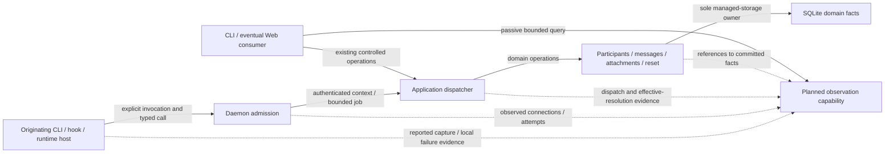

# Observation domain model

## Current basis and selected change

The [completed daemon Delivery](../../.controller/domain-daemon/delivery.md#accepted-local-outcome) and current [service](../../src/service/AGENTS.md), [daemon](../../src/daemon/AGENTS.md), [storage boundary](../model/storage-boundary.md) are the current implementation basis. The shared native [`RequestContext`](../../src/service/context.rs) already separates invocation claims, OS process evidence, daemon incarnation and durable database generation. The planned change is a bounded observation capability; no instrumentation, query lane or management Web support is claimed here.

The present [server](../../src/daemon/server.rs) authenticates peers, answers Hello before enqueueing one Call, bounds admission at 32 workers and the sole application queue at 16 jobs, and runs SQLite/use cases only on the dispatcher. Hello readiness does not prove that a later call was admitted or dispatched. Independent admission is not complete diagnostic availability: exhausted workers and a busy Application can still prevent ordinary clients obtaining useful detail.

| Source basis | Design consequence |
| --- | --- |
| [`service/context.rs`](../../src/service/context.rs), [`service/client.rs`](../../src/service/client.rs) | Explicit captured invocation and caller-generated `RequestId`; observed process and trusted request context are not decoded as caller authority. Most lifecycle errors currently flatten through `service_error`, so the new diagnostic client must preserve structured local failure stages. |
| [`daemon/scope.rs`](../../src/daemon/scope.rs), [`wire.rs`](../../src/daemon/wire.rs), [`transport.rs`](../../src/daemon/transport.rs) | Lease instance, compatibility, canonical scope and generation are distinct. `prepare` and endpoint preparation create/private directories, so passive inspection needs its own non-creating resolver/connector. |
| [`service/application.rs`](../../src/service/application.rs), [`db/reset.rs`](../../src/db/reset.rs), [`maintenance_store.rs`](../../src/service/maintenance_store.rs) | Only durable application state creates generation; post-handler reconciliation occurs even if result construction failed. Observation must not infer reset failure from an error/lost reply or invent a second generation owner. |
| [`agents/attachments.rs`](../../src/agents/attachments.rs), [`runtime/hosts.rs`](../../src/runtime/hosts.rs) | Exact participant/attachment/controller and observed long-lived process lifetimes survive beyond a transient RPC. Observation refs omit capability secrets and grant no host effects. |
| [`events/service.rs`](../../src/events/service.rs), [`events/AGENTS.md`](../../src/events/AGENTS.md), [`messaging/inbox.rs`](../../src/messaging/inbox.rs) | Existing bounded history/observer and exact receipt/cursor promises remain domain authority; a new volatile stream supplies diagnostic correlation only. |

These are source-inspection facts and consequences, not a rerun of the completed Delivery's process/platform acceptance.

## Context and authority map

Solid arrows are existing runtime authority/calls; dashed arrows are planned evidence flow. The consumer-to-observation query and observation capability are planned. Evidence flow never transfers process, storage or business authority. Provider protocols remain external domains; engineering collaboration uses AgentX itself.

## Subjects and relationships

| Subject | Owner / identity | Relationship and invariant |
| --- | --- | --- |
| Canonical AgentX scope | Existing daemon scope; shared planned `ScopeRef` | One canonical root → at most one live storage owner; aliases are the same scope. Explicit other scopes remain independent. |
| Daemon incarnation | Existing lease instance; planned `DaemonRef` | One scope → successive daemon incarnations. PID/build ID do not replace incarnation. Application generation can be unavailable during initialization/failure. |
| Dataset observation epoch | Shared `ObservationEpoch` | Exact daemon plus committed DB generation. Reset changes generation without implying daemon restart; restart changes daemon without implying DB replacement. |
| Logical client call | Existing `RequestId` and explicit invocation context | One logical request → zero or more transport attempts where its domain permits them. Stable request ID alone supplies no replay guarantee. |
| Client attempt / server connection / observed request | Runtime-owned refs | An attempt may fail before any server evidence. A connection may never carry a Call. Server correlation is explicit, never guessed from PID/name/time. |
| Persistent runtime host | Existing runtime-host capability and observed process identity | A host can originate many calls and own specific attachments; a transient IPC connection does not create or retire it. Missing process incarnation is not takeover authority. |
| AgentX participant and attachment | Existing `ParticipantRef` / `ActivationTarget` | A participant has at most one current attachment. Participant incarnation, execution, binding, owner and Provider session remain separate fenced identities. |
| Invocation capture / effective config snapshot | Configuration-owned refs | One capture can be resolved by several domain load sites. Captured input is a claim; selected declaration is not necessarily validated/resolved effective behavior. Daemon startup environment is a different source. |
| Volatile observation record / stream | Events-owned refs plus epoch | Retained bounded evidence, not event-sourced domain state. Eviction or a gap says nothing negative about a business outcome. |
| Durable domain event / receipt / message | Existing owning domain identifier plus dataset/source qualification | Referenced rather than copied into a second authority. Existing archive windows and domain reconciliation promises retain their own lifetimes. |

## Evidence validity and state ownership

The shared [evidence contract](contracts.md#evidence-and-time) defines provenance, known/absent/unknown/withheld and comparable clocks. Its generic wrapper does not own a universal health state, TTL or evidence lattice. Runtime owns current-state interpretation and cleanup; configuration owns immutable captures/resolutions and disclosure; events owns observation retention/frontiers/gaps. Durable entities and receipt validity remain with their original domain.

Each selected observation object must have a construction point, producing source, update/immutability rule, fence, memory bound, cleanup/reset behavior and supported read. Domain owners define those rules in their offering. Composition may retain partial results with their original stamps but cannot present a globally atomic view across independently captured owners. A reset/restart between reads produces fenced/partial diagnosis, never a fabricated single snapshot.

### Shared lifecycle boundary

This table defines the cross-domain epoch obligation; owner-local request/configuration/stream transitions remain in their respective designs. It is not a second implementation of daemon lifecycle or reset.

| Trigger and existing authority | Shared interpretation | Required observer behavior |
| --- | --- | --- |
| Scope lease acquired; Application has not published committed generation | `DaemonRef` exists; no dataset `ObservationEpoch` exists | Process/initialization diagnostics may be present. Dataset/config/event reads return their explicit unavailable/not-captured branch. Do not synthesize a generation. |
| Application publishes valid durable generation | Exact epoch becomes available | Start generation-bound captures/stream with that value; no claim of evidence predating instrumentation. |
| Maintenance commits replacement and application publishes new generation | Same daemon, new epoch; old business work retains its original fence | Retire old generation-bound state/handles before publishing new evidence. Concurrent readers receive a consistently stamped result or changed/unavailable, never rows relabeled with the successor epoch. |
| Generation mirror invalidates or cannot be published | Current dataset observation unavailable; no authorization to read the old DB | Preserve only explicitly historical/process evidence within the owning lifetime. Existing fail-closed admission/stop remains authoritative. |
| Daemon stops/restarts without replacing DB | New daemon ref and observation epoch; durable generation may be unchanged | Retire volatile observation state; old client evidence remains local historical evidence. No cursor/clock/connection continuity is inferred. |
| An observation collector alone is replaced | Same shared epoch can remain; events owns fresh stream nonce | Invalidate that stream's continuation through its own error/result. Do not rotate the durable generation or pretend the daemon restarted. |
| Telemetry is evicted, skipped or dropped | Evidence coverage shrinks; domain state/effects do not change | Surface owner-specific loss/unknown/retention result. Do not stop a participant, release a claim or automatically retry. |

For a dataset join, `compatible(a, b) := a.epoch == b.epoch` is necessary, and each specific relationship must additionally match its native reference (attempt, capture, participant/attachment or domain-event source). Epoch equality alone does not prove a causal relationship. Local pre-connect evidence has no server epoch; attach it only through the explicitly accepted peer/attempt-report relationship, preserving its original reported provenance. An equal PID, name, wall timestamp or local sequence is never that relationship.

## Decisions and proportionality

| Decision | Selected boundary and reason | Rejected alternative / revisit trigger |
| --- | --- | --- |
| Scope discovery | Explicit current/selected known scope; passive observation must not create/start the daemon or scan unrelated directories | Machine-global registry or recursive process/filesystem discovery has no current requirement or completeness proof. Revisit only with a separately owned discovery capability. |
| Mutation | Read-only diagnosis composes existing controlled management use cases, preserving their original context, authority, fences and unknown outcomes | Generic telemetry PATCH, arbitrary SQL, force-kill/restart and observation-derived authority are outside this foundation. |
| Congestion | A separately bounded inspection lane under the same daemon lease reads volatile snapshots; no Application or DB access | Merely adding a Query variant to the busy business queue cannot meet busy-dispatch diagnosis. Runtime owns exact worker/deadline limits and startup/stop semantics. |
| Retention | Bounded volatile diagnosis; reference existing durable domain history/receipts through their owners | New telemetry database, durable event bus and universal recovery index would duplicate authority. Revisit only if an explicit durable audit scenario exceeds existing history guarantees. |
| Frameworks | Existing Rust modules, native types, serde/framing and OS-peer adapters; no new framework selected | A Web/event framework is not needed to establish semantics; integration owns the bounded future consumer adapter. |

Final cross-domain reconciliations belong in [contracts](contracts.md); implementation work and independent scenario evidence belong to integration rather than this model.
