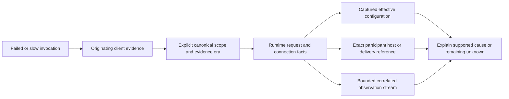

# Observation investigation scenarios

These scenarios own the complete investigation outcomes for the [selected design](../proposals/agentx-observability.md). They were derived from current source before consuming the specialist solutions. All new observation capabilities and fixtures below are planned. Existing daemon support retains the [completed local acceptance](../../.controller/domain-daemon/delivery.md#accepted-local-outcome); no fixture in this document is a recorded runtime result.

## Investigation model

The actor is a local operator or originating client developer who needs to explain one affected invocation. The entry may be a failed command, a delayed response, a participant/delivery reference or a retained event cursor. A complete result identifies the scope and evidence era, distinguishes what was observed from what is unknown, follows the relevant owners, and gives the next supported read or reconciliation step. Read-only diagnosis is the complete work path; it does not require new stop, retry, reset or configuration mutation controls.

| Subject | Needed relationship | Authoritative basis |
| --- | --- | --- |
| Originating invocation | Requested scope, cwd/configuration claims, request identity and local failure chronology | [`InvocationContext`, `CallerContext`, `RequestId`](../../src/service/context.rs) |
| Canonical scope | Path aliases select the same singleton; distinct scopes have independent state | [`DaemonScope`](../../src/daemon/scope.rs), [`resolve_agentx_dir_from_env`](../../src/paths.rs) |
| Daemon era | Authenticated peer, daemon instance, build cohort and database generation are distinct | [`DaemonInfo`](../../src/daemon/wire.rs), [`RequestContext`](../../src/service/context.rs) |
| Request | Connection/admission/queue/application/reply observations explain only their own stage | [Admission and dispatcher](../../src/daemon/server.rs), [transport](../../src/daemon/transport.rs) |
| Participant/host/delivery | Exact domain identity, claim and receipt fences govern business effects | [Attachments](../../src/agents/attachments.rs), [hosts](../../src/runtime/hosts.rs), [messaging](../../src/messaging/service.rs) |
| Configuration | A new scoped resolution and an earlier invocation's captured resolution have different temporal meaning | [`AgentxConfig`](../../src/config.rs), [config file adapter](../../src/config/file.rs), [client capture](../../src/service/client.rs) |
| Event evidence | Current durable domain history differs from planned volatile observation retention | [Existing event service](../../src/events/service.rs), [history/observer rules](../../src/events/AGENTS.md) |



The arrows describe an investigation, not source dependencies or a single atomic database snapshot. Cross-domain joins must retain the scope/era and each source's freshness and coverage. A name, numeric PID, wall timestamp or missing row cannot supply a stronger relationship.

## Case derivation and coverage

| ID | Trigger and goal | Deciding state combination | Required result and invalid inference |
| --- | --- | --- | --- |
| OBS-01 | A client cannot contact the daemon; find the failure boundary | No server evidence; scope resolution, endpoint connection or compatibility can fail separately | Return local attempted scope/stage and bounded error evidence. Preserve an earlier cached observation as stale; never infer that the daemon is stopped or open SQLite as fallback. |
| OBS-02 | A request is slow while the endpoint still answers | Listener remains live while the sole application dispatcher is busy; queued work may expire | Separate admission, queue wait, application duration and reply timing where observed. Unknown duration is absent evidence, not zero. A responsive handshake does not establish application readiness. |
| OBS-03 | A mutation or delivery has no reply; determine what may have happened | Work may have committed before reply loss; external delivery may be Issuing or uncertain | Keep client transport outcome, service result and domain effect evidence separate. Reconcile through the original domain identity; missing runtime evidence never authorizes replay. |
| OBS-04 | Two clients in the same scope behave differently | Different captured environments, overrides or source revisions; current config may have changed | Compare exact retained effective evidence, show provenance and unavailable/redacted facts, and identify whether comparison is historical or a new resolution. Never substitute daemon startup environment. |
| OBS-05 | A follower returns after a backlog | Volatile ring evicted entries; filters may match no rows; durable domain history may still exist | Distinguish an empty filtered interval from a retention gap and from a scope/era mismatch. Advance only through the declared scanned frontier; explain what cannot be recovered. |
| OBS-06 | An operator supplies an alias or investigates another scope | Two lexical paths resolve to one root; two roots may have identical names/PIDs/sequences | Canonical aliases share one identity. Distinct scopes stay separate through references, cursors, configuration and output. No machine-global enumeration or implicit cross-scope query is required. |
| OBS-07 | A host disconnects and its PID is reused | Same numeric PID with different observed incarnation; incarnation may be unavailable | Do not merge clients or attach old request/host evidence to the successor. Unknown process evidence remains unknown. Closing an IPC connection does not prove the host or Provider session stopped. |
| OBS-08 | Daemon restarts with the same database | New daemon instance, same durable generation; retained client evidence references old instance | Begin a new volatile observation era. Old records remain historical if locally retained; no cursor/time continuity is inferred. Domain history may continue under its own generation-scoped contract. |
| OBS-09 | Reset replaces data while a caller remains connected | Same daemon instance, new durable generation; queued requests retain the old generation | Reject stale work and old observation continuations explicitly. Clear/retire projections according to their owners; a recycled name or row ID never links generations. |
| OBS-10 | Observers or capture reach their bounds | Active requests, retained completions, configuration captures, ring bytes and subscriptions pressure independently | Product dispatch and durable outcomes keep their meaning. Report bounded loss/coverage, release observer resources, and retain unknown evidence. Diagnostic reads must remain useful when the application dispatcher is congested. |

These are selected combinations, not an exhaustive Cartesian product. OBS-02/09 cover queue expiry versus generation replacement; OBS-03/08 cover a lost reply across restart; OBS-04/10 cover unavailable configuration after eviction; OBS-05/08/09 distinguish retention gaps from invalid eras. Remote-machine fleet discovery, arbitrary process inspection, remote browser access and new business mutation actions are outside this foundation.

## Required supply and contract walkthroughs

This section is the integration point for exact released contracts. Runtime supplies local attempts, request/connection/lifecycle evidence and bounded observation reads. Configuration supplies effective evidence, provenance and comparison. Events supplies typed payloads, ordered cursors and loss/reset behavior. Architecture supplies shared identities, availability/error meaning and native composition. Integration consumes those declarations rather than defining substitute shared types.

The following walkthroughs consume selected owner declarations. Fixture values are semantic design examples, not a second editable schema, serde-wire promise or executed process result. [Acceptance](acceptance.md) records the exact selected inputs and dispositions.

### Fixture identities and era boundary

Use shared constructors from [valid construction](contracts.md#valid-construction-and-failure). `A = ScopeRef { canonical_scope: "/fixtures/obs/a" }` and `B = ScopeRef { canonical_scope: "/fixtures/obs/b" }` are hypothetical already-canonical roots. `D1 = DaemonRef { scope: A, daemon_instance: "daemon-one" }`; `D2` changes only the instance to `"daemon-two"`. `G1 = "11111111-1111-4111-8111-111111111111"`; `G2 = "22222222-2222-4222-8222-222222222222"`. `E1 = ObservationEpoch { daemon: D1, database_generation: G1 }`, `E2 = { daemon: D2, database_generation: G1 }` and `E3 = { daemon: D1, database_generation: G2 }`.

Restart is `E1 -> E2`; reset is `E1 -> E3`. These are mutually distinct values even when PID, participant name or integer sequence repeats. Runtime can also return D1 without a valid generation; no fixture invents `ObservationEpoch { database_generation: "" }`. Cross-clock `ObservationTime::elapsed_since` returns `ObservationValueError::ClockMismatch`, so a client wall/monotonic timestamp cannot be subtracted from daemon stage time to manufacture server latency.

### OBS-03: loss of reply and durable evidence

Consume [event/domain evidence boundaries](events.md#domain-and-host-evidence-boundaries), the corrected [observation envelope](events.md#envelope-payloads-and-correlation), native [message acceptance](../../src/messaging/service.rs) and [inbox claim rules](../../src/messaging/inbox.rs).

| Step and exact capability | Representative result or transition | Investigation consequence |
| --- | --- | --- |
| The originating `Messages::Submit` has possible transport write, then no complete reply | Existing `DaemonError::OutcomeUnknown` / `ServiceError::OutcomeUnknown`; native `RequestId("send-one")` retained | Transport outcome does not negate a committed message or external effect. Do not construct another Submit. |
| Optional correlated `DomainCommitFact::MessageAccepted` | `MessageAcceptanceRef { scope: A, database_generation: G1, request_id: RequestId("send-one") }`, matching `DurableEventRef`, `replayed: false` | This is a postcommit observation; crash/drop between commit and capture remains possible. Missing observation means unknown capture, not no acceptance. |
| Query native `Messages::Acceptance { request_id: RequestId("send-one") }` under the original permitted actor and generation | `Response::Acceptance(Some(Acceptance { event: EventId(41), recipients: ["recipient"], replayed: false }))`, `None`, an owner error or unavailable normal dispatcher | A matching result establishes durable acceptance only. `None` is interpreted within that exact domain lookup; unreachability or stale generation cannot be converted to `None`. No universal mutation-recovery lookup is promised. |
| Read one current-domain event if permitted | Native `Events::Query(EventQuery { after: Some(40), through: Some(41), limit: 1, oldest_first: true, include_archives: false, ... })`, retaining G1 and exact event identity | The current-generation event can supply domain detail; observation sequence 41 is an unrelated namespace. Archives keep their existing manifest/source limits. |
| Inspect existing unresolved claim with `InboxOperation::Outstanding { target }` | `InboxOutcome::Outstanding(Ok(Some(OutstandingClaim { phase: ClaimPhase::Issuing or Uncertain, ... })))`, or the native absent/error branch | The exact target/batch retains uncertainty and predecessor fences. Empty history, elapsed time, telemetry loss and reconnection cannot release it. |
| Consume optional `DomainCommitFact::DeliveryConfirmationStored` after the native owner accepted its exact receipt | Only the owner's safe `InboxClaimRef`, `DeliveryBoundary` and `ConfirmationDisposition` projection crosses observation | This identifies the confirmed boundary; it does not expose a complete confirmation command or prove agent work. No arbitrary historical receipt readback is invented. |

The consumer can finish with “accepted; delivery boundary still unknown” or “exact boundary confirmed; work completion unobserved.” If all optional observations are missing and the owning read is unavailable, the complete truthful result is an unresolved diagnosis with the original identities. Runtime registry completion cannot strengthen it. The composition Task must publish stored facts after outer commit, discard rolled-back projections and keep tokens/capabilities outside telemetry.

### OBS-01/02: originating failure and a congested dispatcher

Consume [runtime passive inspection](runtime.md#passive-inspection-and-structured-local-failures), [originating reports](runtime.md#originating-attempts-and-report-admission), [snapshot/read operations](runtime.md#snapshot-metrics-and-read-contracts) and [native transitions](runtime.md#state-transitions-and-failure-meaning).

| Step and exact input | Representative result/error | Supported diagnosis |
| --- | --- | --- |
| Passive resolve `ExistingScopeInput { requested: "/fixtures/obs/missing", cwd: "/fixtures" }` | `ScopeLookup::Missing` and local `LocalFailure { stage: ScopeLookup, kind: MissingScope, ... }` | No scope/daemon identity is invented and no directory/endpoint is created. The failure describes this attempt, not the machine's daemon state. |
| Resolve existing A, then endpoint/compatibility attempt fails | `LocalFailureKind::EndpointMissing`, `ConnectionRefused`, `TimedOut`, `Incompatible` or `Unsupported` at the actual `ClientStage` | Preserve stage, source clock and safe OS code before ordinary `ServiceError` flattening; historical cached facts remain labeled historical. |
| Client normal Call might have written, then ReplyRead times out | Terminal `ClientAttemptReport { kind: Call, knowledge: MayHaveBeenWritten, failure: Some(...), original_epoch: Some(E1), ... }` | Local duration uses only the source clock. Report absence on the daemon proves nothing; later `ReportClient` admission stays ClientReported and does not replay the Call. |
| Inspection Hello reaches D1 while Application has no published generation | `InspectionReady.generation = Evidence { value: Unknown(GenerationUnavailable), ... }` | Process/lifecycle information is available; Configuration/Events return their `GenerationUnavailable` branches instead of fabricated dataset rows. |
| `RuntimeReader::read(&D1, &accepted_peer, RuntimeRequest::Snapshot)` while R1 holds Application and 16 jobs queue | `RuntimeResponse::Snapshot` with `activity: Running(R1)`, `gauges: { business_connections: 32, queued_jobs: 16, executing_jobs: 1, inspection_connections: 1 or 2 }`, actual stamps/coverage | Separate inspection admission permits diagnosis despite normal saturation. A second inspection saturation can still fail/return Busy; this is bounded usefulness, not a hard latency guarantee. |
| `Requests { select: Active, page: RuntimeList { before: None, limit: 64 } }`, then `RequestDetail(R2)` | A live `RuntimePage` and exact `RequestObservation`; queued state, reply-wait and execution dimensions remain separate | Queue wait is enqueue-to-dequeue within server clock. A still queued R2 with an abandoned wait has not thereby been proven unexecuted. |
| R2 expires before dispatch, then actual dispatcher dequeues it | `ExecutionObservation::NotRun { reason: NotRunReason::Dispatch(Deadline), ... }`; reply wait may already be `ReplyWaitObservation::Abandoned` | This positive dispatch edge establishes that this attempt did not call Application. It cannot be inferred earlier from timeout or a missing row. |
| R1 Application returns after caller timed out; reply write fails | `Returned { result: ApplicationResultClass::ReturnedOk, ... }` with `ReplyObservation::Observed { wait: Abandoned { ... }, write: Failed { ... } }` | Wait abandonment and later reply-write failure both survive. Route effect interpretation to OBS-03. ReturnedOk is not a generic commit/delivery/work-completed state. |

The consumer can explain “compatible daemon, one application operation running, this request queued/expired at dispatch” using actual source ages. A 5,000 ms slow indication is a diagnostic display threshold only; a snapshot older than 2,000 ms by consumer receive-age is stale for a live view. Neither authorizes stop/retry or derives a deadlock from an old dispatcher tick. Server queue/application/reply durations and local acquisition/call durations remain distinct; histogram counts do not invent percentiles. `RequestObservation.effective_deadline` is `EvidenceValue<ObservationTime>`: an already-expired decode guard can return `Unknown(NotCaptured)` rather than inventing a valid deadline. `accepted_peer` is supplied only by the actual current inspection connection; it is not a body parameter. `resolve_existing_scope(ExistingScopeInput)` and `inspect_existing(&scope, expected, InspectionRequest)` are the actual planned adapter entry functions; returned `InspectionResult.received_at` is on the consumer clock while Ready and owner stamps remain on their producer clocks.

The [producer/report ports](runtime.md#native-producer-and-report-ports) make the enforcement owner concrete: `RuntimeRecorder` allocates/updates finite connection/request/peer/host refs, lifecycle/gauges and source stamps; `RuntimeReporter::report_client` requires both expected daemon and current `AcceptedPeer`. `RuntimeCapture::Tracked { detail_retained: false }` preserves active ref/accounting while explaining unavailable detail. The queue producer gate encloses preparation plus nonblocking try_send, and dequeue records under the same gate; otherwise a fast dispatch could produce Queued after Returned. No lock spans Application, transport serialization or business I/O. Reply/dispatcher guards independently release pins so a timed-out worker cannot evict still queued/running work.

A successful report receipt exposes `Option<ClientReportRef>` independently from event `RecordDisposition`. `ClientReports(RuntimeList)` and `ClientReportDetail(ClientReportRef)` can return the actual `RetainedClientReport`, including original terminal report and Events-owned `ClientReportObservation { report, submitted_by: AcceptedPeer }`. Its current intake peer is not historical process authentication. Unknown incarnation prevents cross-connection dedup/join, and a second peer's identical claimed invocation/attempt UUID cannot overwrite another accepted report. If the source exits without explicit safe output/report, diagnosis can truthfully end with lost client-side evidence.

### OBS-04: compare actual configuration uses

Consume [configuration source rules](configuration.md#resolution-rules-to-preserve), [snapshot subjects/provenance](configuration.md#snapshot-subjects-and-provenance), [capture/publication](configuration.md#capture-and-publication-operations), [lookup/compare](configuration.md#retained-lookup-and-comparison) and [disclosure policy](configuration.md#disclosure-policy). Define `C1/C2` as runtime-issued invocation IDs and `I1/I2 = InvocationCaptureRef { invocation: C1/C2, revision: 0 }`; `K1/K2 = ConfigSnapshotRef { epoch: E1, sequence: 1/2 }`. Both K1/K2 have `ConfigStage::ScopedEffective`, purpose `ActualResolution` and `resolution_scope: Present(A)`, with their own subjects/source receipts and supported matching meaning revisions. A retained report's epoch is the store's identity; it does not alone prove which root that source evaluated.

Bind `timeout` below to the valid closed-catalog `ConfigFieldId::Setting` for the existing `FIELDS` name `timeout`; this fixture does not invent a constructor or arbitrary-key API.

```rust
let input = CompareConfig {
    left: K1,
    right: K2,
    fields: ConfigFieldSelection::Only(vec![timeout]),
};
// reader.compare(input)
// -> ConfigurationRead { epoch: E1, observed_at, result:
//      CompareConfigResult::Compared { basis, fields } }
```

The consumer obtains K1/K2 through the exact request `ConfigurationTrace::Captured` uses or safe publication result. `ConfigurationTrace::NotEvaluated`, a skipped capture or `omitted_uses` never becomes an invented default snapshot.

| Deciding inputs | Exact comparison/lookup meaning | Explanation and boundary |
| --- | --- | --- |
| K1 effective timeout 7 seconds from invocation environment; K2 timeout 31 seconds from scoped file | `ValueRelation::Different`, `ProvenanceRelation::DifferentClass`, actual ComparisonBasis | Two clients sharing D1 need not share effective configuration. Daemon startup timeout cannot replace either captured use. |
| Both values 31, environment versus file | `Equal` with `DifferentClass` | Equal observed field values do not prove equal whole environment, launch plan or behavior. |
| File timeout 31, selected environment is invalid integer | Captured effective default 86400 seconds with safe `Defaulted`/`InvalidInteger` reason | No fallback to 31. Raw `get_for_scope` text is not the effective value. |
| Invalid file candidate overwritten by valid environment 7 | File step `Shadowed` plus parser-known invalidity, or `NotEvaluated` where semantic validation never occurred | Preserve the actual single pass; do not run another validator/read merely to complete telemetry. |
| A concealed credential field, including K1 compared with itself | `ValueRelation::Unknown(ComparisonUnknown::Withheld)` and policy-approved provenance only | No hidden equality, absence, hash, source-presence or joined-token signal leaks through a diagnostic comparison. |
| Original file value later edited to 44 | Lookup K1 retains its old safe value/receipts. Explicit `capture_current_resolution` supplies a separate operand with `DiagnosticReevaluation` and no consumed fields. | New-read purpose/time is visible. Distinct SourceRead receipts do not by themselves prove a file content change. |
| K1 sequence was successfully issued but retired through 1; K2 remains | `CompareConfigResult::Unavailable { left: Missing { reason: NoLongerRetained { retired_through: 1 }, ... }, right: Found(...) }` | The available side remains useful. Do not reconstruct K1 from current file value or treat missing as Equal. A sequence greater than last_issued is `NeverIssued`. |
| Operands have distinct scope, epoch, stage or meaning revision | `Incomparable(DifferentScope/DifferentEpoch/DifferentStage/DifferentMeaningRevision)` | Show separately labeled evidence if useful; do not compare a launch plan as current host state. A direct old-ref lookup uses `ConfigurationQueryError::EpochChanged`. |
| Retention epoch matches but a scoped operand has unknown evaluated root | `Incomparable(ScopeUnestablished)` | Common retention is insufficient scope evidence. ComparisonBasis retains each resolution scope, common stage and each purpose, so DiagnosticReevaluation cannot masquerade as ActualResolution. |
| Generation unpublished, read lock unavailable or invalid field selection | `GenerationUnavailable`, `Busy`, `UnknownField` / `InvalidSelection` | These are read availability/input errors, not absence or equal configuration. Valid Only selectors are 1..64 unique recognized fields. |

Client clones share the invocation revision allocator: two independent `with_invocation` changes obtain distinct revisions even when they derive from one parent. Configuration body/subject/source time stay immutable. Reports carry observed intake peer separately and remain ClientReported; they cannot manufacture `ApplicationResolved`, participant or validated-host authority. The browser consumes safe retained reads and cannot re-evaluate a historical client environment it does not possess.

The exact passive facade is `ConfigurationRequest::{Head,Lookup,Compare,ReportSafeCapture}` with matching `ConfigurationResponse::{Head,Snapshot,Comparison,Reported}` and `ConfigurationError::{Query,Report,DaemonChanged}`. Runtime's `InspectionRequest::Configuration` embeds it in `src/daemon/observation.rs`. `ConfigPeerBinding` aliases runtime `AcceptedPeer`; it is not deserialized from report bodies. `InvocationCaptureHandle::{begin,revise,reference,capture_invocation_inputs,capture_current_resolution,capture_resolved}` makes local revision/snapshot allocation explicit. Owned capture/report admission compares expected epoch under its insertion lock, so a G1 result finishing after reset cannot acquire a G2 label. Configuration allocator/frontier never restarts in the same epoch, including collector replacement.

### OBS-06/07/08/09/10: identity, lifecycle and bounded composition

| Scenario and contract | Structured example/transition | Consumer completion and actual implementation owner |
| --- | --- | --- |
| OBS-06 passive aliases/scope | Runtime returns identical A for two aliases; B remains a distinct ScopeRef. Configuration `DifferentScope` and Events `InvalidInput(WrongScope)` reject incompatible selection. | One explicit local scope per diagnosis; no global census. Passive runtime resolver owns canonicalization without repair/start. |
| OBS-07 authenticated peer reuse | `(pid=100, incarnation="old")` and `(pid=100, incarnation="new")` have distinct `PeerObservationRef { daemon: D1, id }`; unknown-incarnation connections each get a fresh peer ID. `AcceptedPeer` carries exact accepted ConnectionRef/time. | Group by actual refs, never numeric PID/claimed invocation UUID. Runtime/transport owns process observation; host domain owns registered resources. |
| OBS-07 host continuity | `HostObservation { state: Registered, last_validated_at: T, ... }` may coexist with `open_connections: 0`; `RuntimeCoverage.full_host_census == false` | Show last validation and missing coverage. A closed connection, expired projection or restart without a new owner operation cannot prove no hosts. |
| OBS-08 restart | `inspect_existing(&A, Some(D1), any family)` on D2 -> route-neutral `InspectionResponse::DaemonChanged { expected: D1, actual: D2 }` before the leaf; only after explicitly binding D2 do old K1/S1 produce their owner `EpochChanged` branches | Start new observation context, keep previously loaded records historical, and preserve durable G1 domain read rules. Fresh Head(None)/Describe cannot bypass expected-daemon selection. New clocks/IDs/counters start; no old observation continuation survives. |
| OBS-09 reset | A current request ref stays daemon-scoped D1 with explicit decode G1 and after-return G2; queued G1 request -> `NotRun(Dispatch(StaleGeneration))`; old config/event refs reject the changed epoch | Runtime may retain process chronology while dataset projections rotate. Native application publishes committed generation; stores never choose one from a stale payload. |
| OBS-09 concurrent owner reads | A runtime sample and a config/event read can linearize on opposite sides of reset | Keep exact stamps/refs, then label partial/fenced evidence or explicitly reread. No consumer constructs a globally atomic bundle from individually valid reads. |
| OBS-10 pressure | Runtime completed history <=1,024 rows/2 MiB/5 min; config <=1,024 snapshots/8 MiB/15 min; event journal <=8,192 records/16 MiB/15 min | Independent expiry explains a still-retained event referring to unavailable runtime/config detail. No cross-store pin or unsafe historical reconstruction is assumed. |
| OBS-10 active/reader bounds | Runtime <=64 active request slots and <=2 inspection workers/1,000 ms; config <=128 KiB read; event pages <=256 records/512 KiB and <=1,024 scanned candidates | Composition owns complete outer IPC sizing, accept/drop and shutdown; readers cannot enqueue Application work or hold its lease past owner shutdown. Same-user flooding/scheduler delays remain explicit availability limits. |

In all cases, observer exit releases only its local read/timer/output state. Existing participant/attachment/Provider executions, claims, durable event history and lifecycle policy remain unchanged. Every event/config request is embedded in the actual finite passive facade after owner reconciliation; no generic native operation tunnel is introduced.

### OBS-05/08/09/10: append frontier, gaps and stream replacement

Consume [exact stream/read declarations](events.md#stream-identity-and-read-contract), [filter/error/loss meaning](events.md#filtering-errors-and-collection-losses) and [retention transitions](events.md#retention-state-transitions-and-resource-ownership). Define `S1 = ObservationStreamId { epoch: E1, nonce: "33333333-3333-4333-8333-333333333333" }`; `S1b` changes only nonce. `S2` uses E2 and a fresh nonce; `S3` uses E3 and a fresh nonce. `F` is an `ObservationFilter` with all selectors `None`; `Frequest` selects one exact runtime request observation. A head's drop/eviction sample retains its actual `sampled_at`; it is not assumed atomic with producer counters.

```rust
// Planned owner types and illustrative values; no wire encoding is asserted.
let head = reader.describe()?; // ObservationHead { stream: S1, oldest: 8, newest: 12, losses }
let input = ObservationRead {
    window: ObservationWindow {
        after: ObservationCursor { stream: S1, sequence: 7 },
        through: 12,
        filter: Frequest,
    },
    limit: 2,
};
let result = reader.read(input); // Result<ObservationReadResult, ObservationReadError>
```

| Interleaving/input | Exact branch and continuation | What the consumer may conclude |
| --- | --- | --- |
| Seq 8..10 do not match, 11 matches, 12 is scanned; a producer appends 13 | `Page { records: [record at 11], next.after.sequence: 12, next.through: 12, ... }` | The fixed selection through 12 is complete. Obtain a new Describe frontier for the next tail window; do not extend the old through silently. |
| No entries 8..12 match Frequest | Empty `Page`, `next.after.sequence == next.through == 12` | No matching retained records within that scanned selection. This is distinct from no request, no effect or no capture loss. |
| One matching record cannot fit after preceding matches fill a valid page | Page stops before that unreturned match; `next.after` identifies the preceding scanned sequence | Resume the same filter/through; a byte/count limit cannot skip an unreturned matching record. |
| A first page ends at 9, then retention advances oldest to 11 | `Gap { first_missing: 10, last_missing: 10, head }` | Exact requested prefix missing; no records accompany Gap. Explicitly abandon/rebase to `head.oldest - 1` to read the retained remainder while preserving the gap in output. |
| `after == through == 9`, but retention has since passed 9 | Complete empty Page in the same stream | An already-finished selection does not gain a fictitious missing suffix. It says nothing about later windows. |
| Capture was dropped before sequence assignment | `CollectionLosses.dropped` advances; retained sequence may be contiguous and no Gap occurs | Known capture loss exists; the lost payload/filter/source interval cannot be reconstructed. Suppression is separately counted. |
| Same E1 but collector nonce changed S1 -> S1b | `StreamChanged { requested: S1, head with S1b }` | No continuity for the old collector, despite unchanged data/daemon era. Reopen explicitly. |
| Daemon restarted E1 -> E2, or reset replaced E1 -> E3 | `EpochChanged { requested: E1, head with S2 or S3 }` | Retire old dataset/stream joins. Restart may preserve durable G1 history; reset does not. No automatic old cursor rebinding. |
| No committed generation, contended reader, invalid limit/frontier or wrong scope | `GenerationUnavailable { daemon: D1 }`, `Busy`, or `InvalidInput(ReadInputError)` respectively | Process diagnosis can remain available without a dataset. Back off/retry reads only; invalid inputs do not become empty successes. |

Short read cancellation releases only transport/polling resources; the selected contract has no server subscription, history pin or telemetry transaction to end. Durable domain event history, its archive manifests and existing mailbox observers keep their separate lifetimes. Native counters/sequence use checked arithmetic and collector replacement, never rollover into apparent earlier evidence.

## Implementation evidence obligations

Each future authored case must name its scenario and the owner that enforces the result. Native domain cases establish the owning transition; adapter cases establish the mapping; independent integration establishes the complete path through the real supported entry. Preserve rejection/unknown branches and cleanup rather than asserting a scripted happy path.

The [implementation plan](implementation-plan.md) will bind these cases to concrete Tasks. The [consumer boundary](consumer-boundary.md) owns the non-Web path and future browser prerequisites. [Design acceptance](acceptance.md) records the eventual semantic walkthroughs and bounded document checks separately from future executable evidence.
