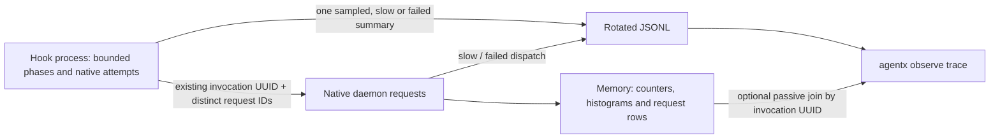

# AgentX telemetry coverage and optimization

The goal is to locate delay or failure from the caller to a native operation and its real effect, even when a daemon is busy. Build on the [accepted observation foundation](../../.controller/observability/implementation.md#accepted-local-implementation-outcome) and [file diagnostics](../architecture/runtime-diagnostics.md). The business journal, receipts and exact lifecycle remain authoritative; telemetry is incomplete evidence and never authorizes a retry.

For the source-only review of callback latency, see the [Codex Hook critical path](./codex-hook-latency.md) for request counts, mandatory waits and data-dependent work.

| Scenario | Metric or outcome | Trace boundary | File evidence |
| --- | --- | --- | --- |
| Codex or Claude hook delays a turn | Native admissions, busy, queue/application/reply histograms; sampled host latency with explicit selection | First AgentX code → environment/dev-root → hook input/routing → individual native attempts → stdout/confirmation | One sampled, slow or failed hook summary with phase durations and native IDs |
| CLI/daemon cannot connect or responds slowly | Connection/request pressure, queue age, dispatch/reply outcomes | Acquisition, authenticated Hello, native admission, dispatch and reply | Existing daemon diagnostics; early hook failure also has a local summary even without a native row |
| Message accepted but not delivered | Acceptance, prepare/claim, host wake, output and confirmation as distinct facts | Durable message/event/claim references, exact host and consumer evidence | Explain rejected or uncertain outcomes with safe IDs and reason classes; never log the body |
| Launch, resume or worker fails | Spawn/ready/fail counts and durations by fixed provider/host/outcome | Launch request → process start → binding/ready; HTTP admission is distinct from worker completion | Existing Management operation, worker and HTTP IDs; extend native host/relay coverage next |
| Observation loses records | Existing registry coverage, journal drops and read gaps | Local evidence vs a retained daemon request in its own generation | Sampling, limits and unresolved evidence are visible; absence does not imply nothing happened |

Keep three stores: the current rotated JSONL file, the existing daemon memory metrics, and bounded daemon request/event evidence. Give all calls originating in one hook the same existing invocation UUID and independent request/attempt IDs. The invocation UUID is the trace lookup key; it confers no authority. Local stage times use monotonic clocks; request timestamps from another process are shown separately, never subtracted across clocks. A dev-root exec replacement starts a new visible root; this does not measure Codex spawning AgentX or work before the first AgentX code. Ordinary CLI/HTTP/worker request IDs remain usable independently of the first hook slice.

Record a bounded amount of typed timing in memory per hook: up to 24 local phases, 16 native attempts and 12 transport stages per attempt, with omitted counts. Select slow (500 ms), failed and approximately 1% of normal eligible hooks for one JSONL record; `AGENTX_HOOK_TRACE_SAMPLE_PERCENT` accepts integer values 0–100 and changes only normal success sampling. Fast unsampled success adds no trace file write, report RPC or SQLite work. Do not copy payload, prompt, environment, stdout, arbitrary error text or tokens into the summary. Log attempt operation and classified outcome, independent of the hook exit code. Existing daemon metrics count observed native work at full rate; short-process totals are **sampled evidence**, not a fleet throughput denominator or an unbiased percentile when slow/failure records are included. Retain bounded requests in the existing native registry for drill-down. No collector, exporter, sidecar or telemetry database is required.

Read local logs and retained daemon rows from the existing `observe` CLI, including a local-only path during daemon outage. A missing row is reported as missing from retained evidence, not as an unexecuted request. Scope selects the log and inspection endpoint; daemon instance and generation remain attached to native rows. A slow total is a signal to drill down; Claude Stop polling can intentionally wait, and the total alone does not establish excessive IPC or application time. Use fixed metric dimensions and publish collection cost before expanding any labels or adding more persistence. Keep the existing JSONL lock authoritative; reduce lock hold time and treat new summaries as best-effort on contention.

| Order | Owner boundary | Acceptance question |
| --- | --- | --- |
| 1. Hook and native request timing | Hook entry, local service client, native registry and file diagnostics | Can an operator distinguish input/identity preparation, local IPC, connection/queue pressure and application time for one Hook, even if some observations are missing? |
| 2. Enrollment for other providers, CLI and workers | Native Provider adapters and runtime/Management hosts | Can an operator connect a CLI or HTTP submission to the worker's actual start, ready or failed result, including early exits before daemon contact? |
| 3. Delivery and Relay | Native inbox/activation and actual host effects | Can an operator distinguish accepted, pending, woken, issued, confirmed, or uncertain delivery without inspecting or redisclosing message text? |
| 4. Historical aggregation if needed | Observation consumers | Do operational decisions need unsampled caller rates or retention beyond current windows? Measure coverage, hot-path cost and file usage before adding any exporter or writer. |

The [follow-up task](../../.controller/observability/telemetry-optimization.task.md) owns implementation and validation state. A pre-exit reporting RPC per hook and a new external collector were rejected for this slice: both add load to the path being diagnosed. If profiling attributes material latency to remaining file I/O, consider a bounded daemon writer; do not put shutdown or delivery correctness behind a telemetry filesystem.
