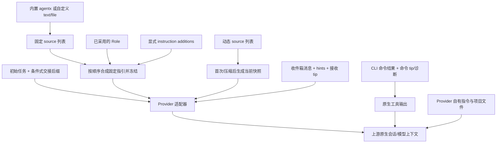

# AgentX Prompt 体系参考

AgentX 传给上游 Agent 的内容来自四条通道：固定指引、动态上下文、任务输入、消息及命令反馈。内置 Bootstrap 只是固定指引中的一个来源。用 `AGENTX_INSTRUCTION_SOURCES` 可以替换这个来源，同时保留已采用的 Role 和额外固定指令；消息 Hint、命令提示、Provider 自身指令则有各自的入口。

本文依据 2026-11-17 工作区源码调研，解释当前实现，不修改行为，也不证明已安装二进制或运行服务采用了这些源码。[生命周期 Delivery](../../.controller/agent-context-lifecycle/delivery.md) 单独记录执行验证状态。文中的“system context”是内容用途，实际模型消息角色取决于 Provider 接口，不能仅凭 XML 标签或变量名判断。

## 阅读路径

| 想解决的问题 | 入口 |
| --- | --- |
| Agent 总共会收到哪些内容？ | [整体结构](#整体结构)与[固定指引](#固定指引的构建) |
| 用文件替换默认引导，保留 Role 和动态上下文 | [配置与替换](#配置与替换) |
| 改文件后为什么旧 Agent 不变？压缩后恢复什么？ | [生命周期](#生命周期与变更生效) |
| 不同 Provider 究竟收到什么角色、什么字段？ | [Provider 通道附录](providers.md) |
| 命令后面的 tip、消息尾部 hints、事件提醒从哪里来？ | [Hint 与反馈附录](hints.md) |
| 查看内置模板与维护源码 | [检查入口与源码地图](#检查入口与源码地图) |

## 整体结构

下图描述内容来源与投递关系，不表示所有内容都会在同一时刻拼成一个字符串，也不表示其模型优先级相同。



| 内容层 | 用途 | 生成入口与来源 | 是否被固定 source 替换控制 |
| --- | --- | --- | --- |
| 内置协作引导 | 教身份、通信、命令、等待与交接规则 | `builtin: "agentx"` → `bootstrap.rs` 模板 | 是：可以不选择 builtin |
| 自定义固定内容 | 使用自己的协作准则、长期约束 | `instructions.sources` 的 `text` / `file` | 是：由列表明确选择和排序 |
| Role 指令 | 专业职责、方法与该 Role 的操作要求 | 启动时采用的 `LaunchCollaboration.role.prompt` | 否：在列表后独立附加 |
| 额外固定指令 | 本次启动额外约束 | 普通 fresh launch 的 `--agentx-system-prompt` → `instruction_additions` | 否：在 Role 后附加 |
| 动态上下文 | 当前事实，供首次请求与上下文恢复使用 | `context.sources`，初始/压缩后重新读取或生成 | 独立列表；旧配置有兼容分流规则 |
| 初始任务 | 让新 Agent 执行实际业务 | `--agentx-prompt`；必要时追加结果回传文字 | 否；交接后缀可单独排除 |
| Resume/Fork 身份提醒 | 解释恢复或继承历史后的当前身份 | `resume_client.rs::build_resume_prompts` | 否：属于原生恢复接入 |
| 消息反馈 | 发件人、intent、thread、正文及投递指导 | 冻结收件箱格式 → Hook/原生输入/显式 listen | 否；hints 有单独配置 |
| 命令反馈 | 教下一步、解释输出、省去查帮助 | CLI tip、预览、数据说明和失败诊断 | 否；不是 Bootstrap 子模块 |
| 原生指令 | Provider 的基础约束、原生用户配置、项目文件 | 上游工具自己的加载机制 | 否；不归 AgentX source 列表管理 |

`--title` 是 Agent 标题，`--bind` 是 Task/Delivery 文件关联。它们不是独立 Prompt 文本模块；绑定文件不会因此自动全文注入模型。常用命令仍应在任务文字中让 Agent 读取绑定文件：

```sh
agentx launch --go --headless --title "Implement feature" --bind ".controller/xx/xx.task.md" --agentx-prompt "Implement the feature."
```

有合适的已知 Role 时加 `--role coder`。默认 Profile 的选择属于运行配置；这条常用路径不需要先 `profile --help`、`profile show` 再启动。缺失默认配置时，解析器才给出恢复诊断，见 [Hint 附录](hints.md#错误诊断和恢复提示)。当前内置引导的简化与旧会话的冻结差异见[指导修正记录](../../.controller/roles-workspaces/tasks/guidance.md#routine-delegation-guidance-correction-2026-11-17)。

## 固定指引的构建

普通启动先采用 Role 和原始额外指令，再在 Provider 子进程启动前生成并冻结固定指引。源码主链为 [launcher.rs](../../src/runtime/launcher.rs) → [bootstrap.rs](../../src/runtime/bootstrap.rs) 的 `get_instructions_client` → [agent_context.rs](../../src/runtime/agent_context.rs) 的 `prepare_instructions` → [context_service.rs](../../src/agents/context_service.rs) / [context_store.rs](../../src/agents/context_store.rs) 的读取和冻结。

逻辑上的拼接顺序是：

```text
source[0] 的非空文本
\n\n
source[1] 的非空文本
...
\n\n
已采用的 Role.prompt（若存在）
\n\n
instruction_additions（若存在）
```

每个 source 保留自己的 `id`，内部结果为 `blocks: [{source, text}]`，最后以两个换行拼接非空块。Role 和 additions 的内部 ID 分别为 `agentx-role`、`agentx-additions`；和用户 ID 冲突时追加 `_`。XML 包装属于 builtin 自己的文本，Role 和其他 sources 不会自动放进 `<agentx_system_context>` 内。排序决定文字顺序，不会为某块创造更高的原生消息角色。

### 内置 Bootstrap 的模块

权威文本集中在 [bootstrap.rs](../../src/runtime/bootstrap.rs)。下表给出主 renderer 的选择条件与用途，保留原英文模板作为源码唯一来源。

| 模块 / 常量 | 包含什么 | 条件 / 排除项 |
| --- | --- | --- |
| `IDENTITY_HEAD` | 原生 Agent 名称、优先响应 `@bigboss`、被谁启动、代用户使用 CLI | `identity` 控制；`Launched by` 仅在可识别的其他 Agent 启动时显示 |
| `MESSAGES` | request/inform/ack；何时响应；AgentX 消息用 `agentx send`，普通用户聊天在聊天中回答 | `messages` |
| `CAPABILITIES` | send/list/transcript/events/bundle/launch/resume/fork/kill/run/term；身份自动解析与失败恢复 | `capabilities` |
| `ROLE_WORKSPACE_GUIDE` | 一步 `launch --go --headless --title --bind --agentx-prompt`；可选 Role；团队继承、成员查询、目录默认接收者 | 在 capabilities 内；按需发现 Role，不教常规 Profile 预检或原生参数转发 |
| `RELAY_NOTICE` | 本地/远程名称、远程事件与目录参数 | capabilities 保留且 Relay 开启 |
| `HEADLESS_NOTICE` | 无人读取聊天输出，应通过 AgentX 发消息沟通 | capabilities 保留且后台运行 |
| `UVX_CMD_NOTICE` | 当前环境使用替代命令路径/启动包装 | capabilities 保留且命令不是裸 `agentx` |
| `RULES` | 不发寒暄；未经要求不把任务交给已有 Agent | `rules` |
| `IDENTITY_TAIL` | 名称形状、名称歧义时查询 list、这段不是立即执行任务 | `identity`；冻结固定指引时移除启动时的活跃名单 |
| `LISTEN_OUTPUT_NOTICE` | 不截断或隐藏 listen 输出 | `messages`；即使排除 identity 也保留 |
| `DELIVERY_AUTO` | 自动收件、结束当前轮接收、进度订阅、等待规则 | messages 保留，且由 AgentX 启动、工具非 adhoc |
| `DELIVERY_ADHOC` | 手动 listen；保持连接时前台阻塞、逐次重新 listen | 其他启动/注册情况；仍由 messages 控制 |
| `CURSOR_DELIVERY` / `COPILOT_DELIVERY` | 裸 `<agentx>` 是唤醒，填充标签才是真实消息；完成后结束当前轮 | 自动投递且相应工具，受 messages 控制 |
| `INLINE_SEND_NOTICE` | 完整阅读命令输出，因为命令可能顺便消费邮件 | adhoc 且 messages 保留 |
| `CLAUDE_ONLY` | 原生 Task 子 Agent 可以自行加入 AgentX；不要给它指定名字或额外 CLI 教学 | Claude 且 capabilities 保留 |
| `HANDOFF_RESULT` | 启动说明里的“完成后通过 AgentX 收到结果” | capabilities 内的文字后缀，受 `handoff` 控制 |
| `NOTES` | 运维配置的附加说明 | builtin 渲染后添加；不受五个排除项控制 |

主 renderer 顺序为：identity head → messages → capabilities 及条件通知 → rules → identity tail/listen notice → delivery → Claude subagent guide → notes，最后包上 `<agentx_system_context>`。空结果不输出包装。Notes 在模板替换后添加，避免用户大括号被展开；替代 CLI 命令重写在更后面进行，并保护 `<agentx>` 标签。

模板输入来自原生记录与发起端环境：名称、启动者、名称生成形状、Relay/后台状态、当前 CLI 命令，以及内置脚本加 scope `scripts/` 中发现的 `.py`/`.sh` 名称。`AGENTX_NOTES` 的标题声明“优先于其他 AgentX 指令”，这是自然语言规则，不会改变模型 API 的消息优先级。

### Role 与额外固定指令

Role 的发现、覆盖与 Profile 组合归[角色文档](../roles-workspaces.md)与 [config/roles](../../src/config/roles) 所有。合成器使用的是启动时已经采用的 `role.prompt`，不是每次请求重读 Role 文件。Role 可以要求 Agent 自行阅读 AGENTS/方法/Skill；这些后续读取的内容不等于 AgentX 已自动把其全部文本注入。

普通 fresh launch 中，[`retain_instruction_additions`](../../src/runtime/launcher.rs) 将 `--agentx-system-prompt` 保存为原始额外固定指令，并避免再通过原生启动参数重复注入。其语义仍是追加，不是替换。恢复过程中产生的临时身份提醒不会覆盖已保存的 additions。共享 Codex app-server 的启动入口有独立通道，详见[Provider 附录](providers.md#两个-codex-启动入口)。

## 动态上下文的构建

`prepare_initial_context` 在首次模型请求前生成；`prepare_compact_context` 在压缩后或适配器支持的下一模型边界重新生成。内部 `InstructionContributor` / `ContextContributor` 是 Rust 类型化回调，不是外部 Bash Hook，也不执行配置里的脚本。

| source 选择 | 固定通道 | 动态通道 |
| --- | --- | --- |
| `builtin: "agentx"` | 内置引导，清除活跃名单后冻结 | 重新渲染完整内置引导，含当时可用名单；通常无需这样配置 |
| `builtin: "agentx-runtime"` | 未注册该固定 contributor，报未知 generator | 当前活跃成员的简短名单 |
| `text` | 原样冻结 | 每次采用该字面量 |
| `file` | 首次读取后冻结 | 每次快照重读文件 |

当前 `agentx-runtime` 实际只返回成员快照：排除自己和 Claude 子 Agent，选择本团队及全局成员，按工具分组，最多列 8 个，多余部分提示 `agentx list`。它没有自动合成所有 Task、进度或工作流事实；任务事实可以由显式文件 source 供给。`SnapshotRequest` 提供 participant、tool、cwd、session 和 reason，并不意味着这些字段都会被渲染进文本。

动态快照使用下面的包装；空快照写 `No current runtime context.`：

```text
<agentx_runtime_context>
Current AgentX runtime snapshot. This supersedes all earlier AgentX runtime snapshots; omitted assignments are no longer current.
...本次 source 合成结果，或 No current runtime context.
</agentx_runtime_context>
```

“supersedes”表示语义上以最新事实为准。插件可以替换自己持有的当前快照，但这不保证 Provider 删除已经进入历史的旧消息。没有动态 source 时，初始入口可以完全不输出；压缩刷新入口会输出空快照标记以清除先前事实。

## 配置与替换

### 三种配置表达

| 配置目的 | CLI key | 环境变量 | TOML |
| --- | --- | --- | --- |
| 固定 sources | `instruction_sources` | `AGENTX_INSTRUCTION_SOURCES` | `instructions.sources` |
| 动态 sources | `context_sources` | `AGENTX_CONTEXT_SOURCES` | `context.sources` |
| builtin 附加说明 | `notes` | `AGENTX_NOTES` | `launch.notes` |
| 排除 builtin 部分 | `bootstrap_exclude` | `AGENTX_BOOTSTRAP_EXCLUDE` | `launch.bootstrap_exclude` |
| 消息尾部提示 | `hints` | `AGENTX_HINTS` | `launch.hints` |

映射来自 [config.rs](../../src/config.rs)。CLI 写所选 AgentX scope 的 `config.toml`；环境值覆盖同名文件配置。环境文件及调用端环境如何加载见[环境架构](../architecture/environment.md)，Prompt 合成不另创一层环境优先级，也不把共享 daemon 的进程环境当成某个 Agent 的配置。

每个 source 是 `{id, builtin}`、`{id, text}` 或 `{id, file}`，三种内容恰选一个，未知字段报错。ID 非空且列表内唯一，最多 64 个配置 sources；每个文件与合成结果有 64 KiB 限制，包含块间分隔符；动态包装后的总长度也检查，共用固定/动态输出的适配器还会检查合并长度。文件相对路径按生成端 `cwd` 解析，绝对路径更便于跨目录使用。需要 UTF-8；文字/文件不展开变量、不执行模板、不运行命令。加载失败会报错，不静默恢复默认。

### 只替换内置指引，保留 Role

先准备自己的 Markdown 文件，例如 `/projects/app/agentx-guide.md`，再为新 Agent 配置：

```sh
export AGENTX_INSTRUCTION_SOURCES='[{"id":"my-guide","file":"/projects/app/agentx-guide.md"}]'
agentx launch --go --headless --role coder --title "Implement feature" --bind ".controller/xx/xx.task.md" --agentx-prompt "Implement the feature."
```

结果是 `my-guide 文件 → 已采用的 coder Role → 显式 additions（若有）`。没有选择 `builtin: "agentx"`，所以默认身份说明、通信教学、能力清单、Notes 与等待教学不会自动出现；原生身份、成员关系和通信能力仍由程序维护。自定义指引应自行提供你希望保留的协作教学。

同一选择可以持久配置：

```sh
agentx config instruction_sources '[{"id":"my-guide","file":"/projects/app/agentx-guide.md"}]'
```

如果还希望明确启用现成的动态成员快照和任务文件，可以完整配置为：

```toml
[instructions]
sources = [{id = "my-guide", file = "/projects/app/agentx-guide.md"}]

[context]
sources = [{id = "runtime", builtin = "agentx-runtime"}, {id = "task", file = "/projects/app/current-task.md"}]
```

这里 dynamic 的变化来自显式 context 配置。单独设置 instruction sources 不会凭空增加一个默认动态名单。若原来已经有独立的 `context.sources` 文件列表，显式 instruction selector 会继续把它用于动态快照；若原来依赖旧配置分流，需对照下一张表迁移，才能准确做到“动态上下文不变”。

### 保留 builtin 后追加，或移除普通 sources

```sh
export AGENTX_INSTRUCTION_SOURCES='[{"id":"guide","builtin":"agentx"},{"id":"extra","file":"/projects/app/team-guide.md"}]'
```

这会得到 `builtin → team-guide → Role → additions`。若用 `AGENTX_INSTRUCTION_SOURCES='[]'`，普通固定 sources 为空，Role/additions 仍会附加。空字符串 `''` 则选择 builtin 默认，和 `[]` 含义不同。

### 新旧选择规则

[`select_sources`](../../src/runtime/agent_context.rs) 保留了旧 `context_sources` 的兼容语义。“未设置 instruction selector”与“显式设置为空”不同：

| instruction selector | context selector | 普通固定 sources | 动态 sources |
| --- | --- | --- | --- |
| 未设置 | 未设置或空字符串 | 默认 builtin agentx | 空 |
| 未设置 | `[]` | 空 | 空 |
| 未设置 | 有 builtin/text/file 的列表 | 其中 builtin 项 | 其中 text/file 项 |
| 未设置 | 只有 file | 空，即旧式替换 builtin | file，随快照重读 |
| 显式 `''` | 未设置或空字符串 | 默认 builtin agentx | 空 |
| 显式 `[]` | 任意非空列表 | 空 | 原样使用 context 列表 |
| 显式自定义列表 | 任意非空列表 | 原样使用 instruction 列表 | 原样使用 context 列表 |

所有行最后仍附加 Role/additions。旧配置里的 builtin 直接分到固定通道，因此 `agentx-runtime` 应在启用独立列表后放入 context，不能当作旧配置中的普通 builtin 随意混用。

### 部分删减与 Notes

```sh
agentx config bootstrap_exclude capabilities,rules
agentx config notes 'Use the project collaboration policy.'
```

支持的排除名恰为 `identity,messages,capabilities,rules,handoff`，另有单独的 `none`、`all`；重复项、未知项、把 none/all 和其他项混用均报错。排除 handoff 既影响引导里的结果提示，也影响普通初始任务的结果回传后缀。排除 all 不会移除 Notes、Role、additions、消息 hints、命令 tip；用 source 列表不选择 builtin，才是整个 builtin 贡献的替换。

通用 `AGENTX_SYSTEM_PROMPT` 未在当前配置中实现；`--agentx-system-prompt` 仍追加。`AGENTX_CODEX_SYSTEM_PROMPT` / `AGENTX_GEMINI_SYSTEM_PROMPT` 是已登记的工具配置字段，本次未发现普通启动链读取这两个字段作为 bootstrap 替换器，不能据命名推断能力。此前讨论的 `AGENTX_BOOTSTRAP_PROMPT` / `_FILE` / `_HOOK`、JSON `data` 协议与 5 秒超时没有实现；[旧提案](../proposals/bootstrap-prompt-customization.md) 已撤回，本需求采用现有 sources。

## 生命周期与变更生效

| 边界 / 操作 | 固定指引 | 动态上下文及其他内容 |
| --- | --- | --- |
| 新的普通 Agent launch | 先读 adopted Role/additions，再生成 sources 并冻结 | 原生 session 绑定后准备初始快照；任务走原生任务入口 |
| 第一次读取成功后改指引文件、Notes、排除项或二进制模板 | 已存在的冻结字节不变 | 动态文件在下次支持的刷新边界重读 |
| 同一逻辑 Agent / 精确原生 session resume | 使用保存的固定文本；文件已被删也可恢复 | 恢复身份文字与当前快照按适配器进入上下文 |
| Compact | 不重新读取固定文件；需要时恢复原冻结文本 | 生成最新快照，必要时用空标记表示旧事实已失效 |
| 新身份 fork | 不把别的 Agent 的身份冻结文本直接当新身份 | 可继承原生历史；另加身份重置提醒，旧历史不宣称被删除 |
| 收新消息 / 执行命令 | 不改变固定内容 | 新的消息、Hints、tip 或工具结果继续出现 |

固定存储先于新配置与文件求值：`get_instructions_client` 找到已冻结文本就直接返回。因此配置修改不是热更新按钮，空的冻结文本也是有效结果。存储按 participant incarnation 与精确工具/session 恢复别名校验；不能用同名进程或另一个会话的文字代替。[context_store.rs](../../src/agents/context_store.rs) 拥有实际持久化边界。

动态快照与邮件收件凭据分别管理。初始上下文有独立的一次准备/确认机制；生成失败释放准备，压缩刷新不创建用户轮次、不发送或确认邮件。各 Provider 的压缩事件支持不同，不能把“下一次输入边界刷新”写成“所有工具都有原生 compact Hook”。

### 初始任务、交接、Resume/Fork

`--agentx-prompt` 是业务输入，由 [registry.rs](../../src/integrations/registry.rs) 的 `InitialPromptShape` 翻译成原生位置参数或 prompt flag。由 Agent 启动、有初始任务、允许 append handoff、且未排除 handoff 时，[launcher.rs](../../src/runtime/launcher.rs) 追加 `HANDOFF_SUFFIX`：`When done, send your result back to @<launcher> via agentx.`。人/API 启动不加该后缀；没有初始任务也不凭空制造任务。Kimi 当前不支持启动时初始 prompt，会提示先启动后 send；共享 Codex app-server 要经原生 turn 协议提交输入。

恢复/Fork 的文字由 [resume_client.rs](../../src/runtime/resume_client.rs) 维护：普通 resume 说明仍是原身份；fork 说明历史继承但身份已更新。已跟踪的 Codex/Qoder fork 把身份重置放进 initial prompt 并跳过回传后缀；Qoder resume 也以 initial prompt 提醒身份以保留其已保存的原生 system prompt。其他路径根据工具放入临时 system/additional 通道，再拼接显式自定义文字。它们不能简单归入“用户自定义 source 已替换的一段 builtin”。

### 两个特殊固定引导入口

1. **Claude 原生 Task 子 Agent**：先收到 `SubagentStart` 的加入提示，调用 start 后使用独立 `SUBAGENT_BOOTSTRAP`，并非普通 `agentx launch` 子进程。当前该 renderer 不经过通用 instruction sources、不追加其 Role/Notes/additions；`bootstrap_exclude=all` 可整体抑制，`capabilities` 可去掉共用的 Role/workspace guide，其他单项排除并不等价于主 renderer 的精细删减。见 [bootstrap.rs](../../src/runtime/bootstrap.rs) 和 [claude/client.rs](../../src/integrations/hooks/claude/client.rs)。
2. **共享 Codex app-server**：先加入 `SHARED_CODEX_BOOTSTRAP`，仅说明线程各自有身份；精确线程再通过 Hook 得到通用合成结果。这个共享入口标记不由 instruction sources 删除。见 [Provider 附录](providers.md#两个-codex-启动入口)。

## 检查入口与源码地图

```sh
agentx config bootstrap show
agentx config bootstrap show capabilities
agentx config bootstrap render koko codex launched
```

`show` 展示 builtin 模板各部分与条件分支，不是某个 Agent 的最终冻结文本。`render` 是当前调用环境下 builtin 的只读预览，不生成冻结快照、不申领消息；它不展示自定义 source、Role、additions 或完整模型请求，还可能显示固定 renderer 实际会清掉的当前名单。对比模板预览与旧 Agent 对话时，应先区分这一点。

| 维护内容 | 权威源码 |
| --- | --- |
| source 声明、校验、顺序、大小限制、生命周期接口、动态包装 | [runtime/agent_context.rs](../../src/runtime/agent_context.rs) |
| builtin 模板、条件、排除、源列表合成、Role/additions 附加、内置 contributors | [runtime/bootstrap.rs](../../src/runtime/bootstrap.rs) |
| 配置映射与有效环境 | [config.rs](../../src/config.rs)、[环境架构](../architecture/environment.md) |
| 固定快照持久化与精确恢复 | [agents/context_service.rs](../../src/agents/context_service.rs)、[agents/context_store.rs](../../src/agents/context_store.rs) |
| adopted collaboration 与 Role 内容 | [agents/workspaces.rs](../../src/agents/workspaces.rs)、[config/roles/reader.rs](../../src/config/roles/reader.rs) |
| fresh launch、原生参数通道、任务交接 | [runtime/launcher.rs](../../src/runtime/launcher.rs)、[integrations/registry.rs](../../src/integrations/registry.rs) |
| resume/fork 身份提醒 | [runtime/resume_client.rs](../../src/runtime/resume_client.rs) |
| Provider 适配与例外 | [Provider 附录](providers.md) |
| 命令 tip、消息 hints、事件通知、恢复提示 | [Hint 附录](hints.md) |

本次完成的是调用链与文本生产者的静态调查。未抓取所有真实 Provider 的最终网络请求，未验证模型遵从性，未重启任何运行资源。已记录的文档/实现差异及检查结果见[调研 Task](../../.controller/prompt-reference.task.md)。
