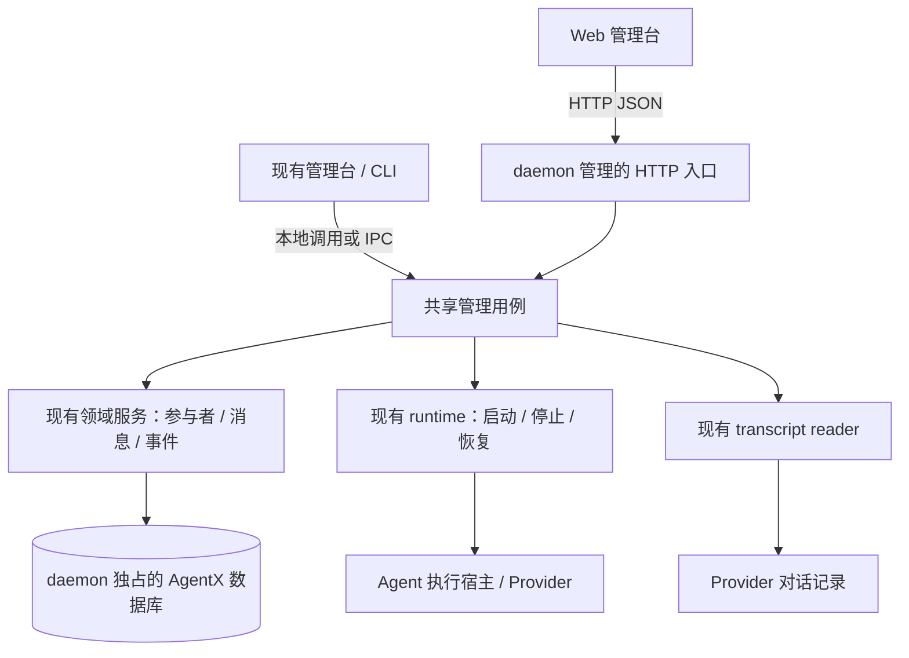

# Agent 管理台的 HTTP 接口

## 用户目标与边界

用户于 2026-11-15 希望通过 AgentX daemon 暴露 HTTP 能力，在 Web 查看 Agent、状态、通信和对话，并启动、发送消息、停止及恢复 Agent。随后明确：目标是直接运行 `agentx` 打开的管理台的 Web 对应物，不是把 Provider 终端搬到浏览器。此澄清覆盖先前关于 PTY 实时输出的理解。

用户已于 2026-11-15 授权完成设计并推进实现。具体接口与进程装配见[设计](../agent-management/design.md)，执行与验收范围见 [Delivery](../../.controller/agent-management/delivery.md)。底层运行方式继续使用现有 PTY、tmux 或 Provider native host；浏览器无需访问其字节流。首个边界是一个 AgentX 数据作用域中的本地 Agent 管理，不自动扩大到多租户、远程设备控制或所有 CLI 命令。

## 现状与可复用部分

| 能力 | 当前来源 | 对目标的意义 |
| --- | --- | --- |
| 参与者、状态、消息与事件读取 | [原生查询](../../src/service/queries.rs)、[事件契约](../../src/events/service.rs) | 复用领域读模型；按页面需要裁剪为 HTTP 投影。 |
| 当前 TUI 读取 | [数据源](../../src/tui/db.rs) | 已经通过类型化 Client 读取 daemon。 |
| 当前 TUI 操作 | [RPC client](../../src/tui/rpc/client.rs)、[命令执行器](../../src/tui/commands.rs) | 当前以同一二进制子进程调用 CLI，再进入原生服务和 runtime；不能声称所有管理操作已经是一个完整 daemon API。 |
| 消息提交及回执 | [消息服务](../../src/messaging/service.rs) | 区分接受、投递、回复；HTTP 成功不等于 Agent 完成工作。 |
| 启动、停止和恢复 | [启动 runtime](../../src/runtime/launcher.rs)、[停止 runtime](../../src/runtime/kill_client.rs)、[恢复 runtime](../../src/runtime/resume_client.rs) | 业务身份和状态在 daemon，进程及宿主效果仍有调用方职责；HTTP 需复用并组合这些职责。 |
| 模型对话历史 | [transcript source](../../src/transcript/service.rs)、[reader](../../src/transcript/client.rs) | daemon 提供来源关联，现有 reader 在宿主读取 Provider 内容；不是现成的数据库查询。 |
| HTTP 宿主及 Web 资源 | [协作适配器](../../src/collaboration/web/mod.rs)、[共享浏览器设施](../../src/browser/mod.rs) | 已有 Axum、同源检查、资源内嵌、类型投影及有限操作，可复用；当前 workbench 仍是独立入口。 |

## 推荐结构

图中表达职责与调用，不要求每个框新增模块、进程或微服务。共享管理用例优先组合现有原生类型和 runtime 函数；只为确实缺失的 Web 消费用例增加类型化契约。HTTP 放在进程装配/适配器层，不让领域代码依赖 HTTP。

daemon 可以拥有监听端口及其启动配置，静态页面与 API 使用同一个源。耗时启动、日志读取和持续连接在独立异步任务或有界工作者执行，通过短调用进入现有领域服务；不得阻塞当前持有 SQLite 的单线程 Application dispatch。后台 Agent 的寿命独立于浏览器请求，刷新或关闭网页不停止 Agent。

CLI、TUI、HTTP 应逐步消费同一套管理用例。无需先重写整个 TUI，HTTP 也不应解析 TUI 屏幕。已有固定 AgentX 子命令可以作为局部过渡实现，但外部仍只接受明确的类型化操作，不提供通用 shell/argv 执行入口，也不把 CLI 输出文本变成长期协议。

## 建议的最小接口轮廓

下表保留提案阶段的资源划分；实现后的准确路径、异步 transcript 操作和轮询方式以[原生 HTTP 设计](../agent-management/design.md#http-contract)为准。

以下路径用于讨论资源边界，不是已实现的端点或第二份可调用 schema。落地时由原生 Rust 声明拥有请求和响应，再生成或推导 HTTP 文档与 TypeScript 类型。

| 用例 | 候选接口 | 返回含义 |
| --- | --- | --- |
| 列表与状态 | `GET /api/v1/agents`、`GET /api/v1/agents/{id}` | 当前状态、工具、工作目录、可用操作及准确的参与者引用。 |
| 启动 | `POST /api/v1/agents` | profile/tool、工作目录、初始消息；返回启动接受及可追踪结果。 |
| 发送管理消息 | `POST /api/v1/agents/{id}/messages` | 文本及可选 thread/reply-to；返回原生消息标识和接受结果。 |
| 查看通信 | `GET /api/v1/agents/{id}/messages` | 来自事件/消息模型的有界分页，不混入 Provider 私有会话内容。 |
| 查看模型对话 | `GET /api/v1/agents/{id}/transcript` | 原生 reader 的结构化投影；不存在或暂不可读明确表示。 |
| 停止 | `POST /api/v1/agents/{id}/stop` | 对准确执行实例发起停止，保留会话和历史。 |
| 恢复 | `POST /api/v1/agents/{id}/resume` | 按 Provider 既有支持创建后续执行实例并返回新引用。 |
| 页面增量更新 | `GET /api/v1/events?after=…` | 先复用有界事件分页和短轮询；持续推送有实际需要时再增加 SSE。 |

“通信”与“模型对话”可在界面并列展示，但来源、顺序、完整性和游标分别保留。默认发送复用现有 AgentX messaging；若后续要求将用户输入直接作为 Provider 原生会话轮次，需要另行明确该操作的语义，不从消息提交推导。仅查看对话不要求 token 级输出，也不要求终端流或 WebSocket。

## 必须保留的行为

- 管理对象是 Agent 参与者及其执行实例，不是任意 PID。名称供展示/选择，写操作解析并验证具体参与者与 incarnation；停止后恢复可能产生新执行实例。
- HTTP 操作者有自己的调用上下文；不能从 daemon 的启动环境继承一个 Agent 身份，也不能把传入名字当成已认证发送者。复用现有外部发送者语义，具体身份显示与访问模式在接口定稿时明确。
- 工作目录、profile 与环境按本次操作解析；不能直接把 daemon 的启动 cwd/env 当成所有 Agent 的配置。
- 有副作用请求需要稳定请求标识和可核对的结果。复用已有回执与去重能力，缺失处补齐；网络断开后不能自动重复启动或发送，未知结果不伪装为失败或成功。只有确实长期执行的操作需要可查询的异步状态，不建立通用工作流系统。
- 读取保持分页和数量边界。更新游标保留数据 generation；过期或换代时明确要求刷新，不混接两段历史。
- 沿用既有同源/请求边界；管理写权限必须由服务启动模式明确启用。当前无需凭据的诊断 LAN 入口不会因本提案自动取得启动/停止权限。

## 取舍与后续决策

选择“管理台能力的 HTTP 化”，而不是 CLI 语法逐项复制。选择复用现有 daemon、领域服务和 runtime，不新增执行框架或独立控制服务。选择结构化状态、消息与对话读取，终端镜像与 token 流不属于当前需求。初期分页/轮询足以复现现有管理台刷新；SSE 是同一读取模型的后续传输选项。

这些提案阶段的决策已在[设计](../agent-management/design.md)中确定：默认本机、显式 LAN 监听，按操作冻结目录并在隔离 worker 解析环境，使用持久操作回执查询结果。验收以“Web 启动一个 Agent → 状态可见 → 发消息 → 查看回执与回复 → 停止 → 保留并查看历史”为第一个完整验证场景；同一调用路径应能由无浏览器 HTTP 客户端使用。

## 调查证据与限制

提案初始调查只阅读现有源码与项目设计，未运行启动/停止或 HTTP / Provider 验证。后续实现与实际执行证据见 [Delivery](../../.controller/agent-management/delivery.md)，不由这份初始调查声明。代码图工具未索引此仓库，因此来源定位使用直接源码搜索；不对完整调用图覆盖作保证。现有支持和未来接口建议已分别标注。
