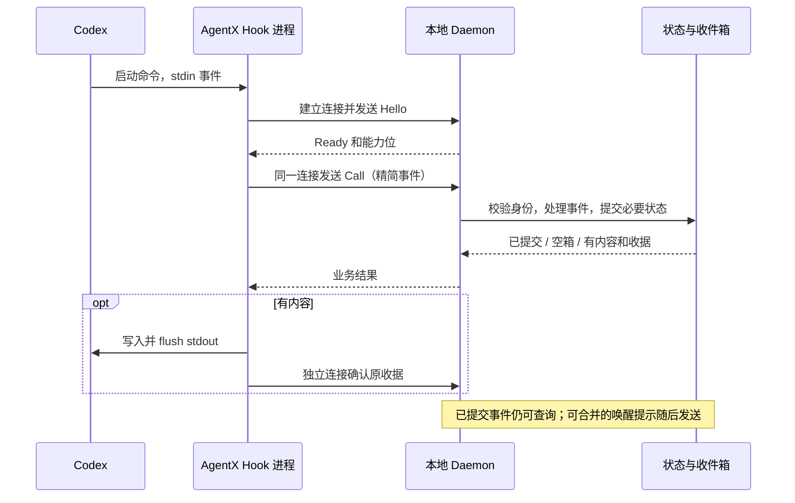

# Codex Hook 性能优化方案

把回调收敛成 **一次有业务含义的 Daemon 请求**。工具状态、模型请求状态等事件等 Daemon 提交就能返回；工具结束时如有消息，再保留一次 stdout 写完后的交付确认。回调真正需要等待的结果由事件类型决定。日志、指标和 Trace 沿用现有机制，部署仍是同一个 AgentX 二进制和本地 Daemon。

本方案以[源码排查](../observability/codex-hook-latency.md)为依据。当前普通 `PreToolUse` 和空箱 `PostToolUse` 各有 3 次业务请求，含 `dev_root` 回退可达 4 次业务请求、6 次握手。重复的位置写入、空箱扫描和状态事件扩散是已确认的路径问题，尚未量化各自对实际几百毫秒的贡献。方案先覆盖受管 Codex PTY，兼容共享 app-server，其他 Provider 等各自的输入和输出语义确认后再接入。

上面的请求数是优化前源码基线。[实施记录](../../.controller/observability/codex-hook-performance.task.md#verification)区分已验证的新路径、旧路径、未上线范围和保留的同步通知。

## 回调等到哪一步

| 回调情形 | 成功返回时承诺 | 热路径目标：业务请求 / 连接握手 |
| --- | --- | ---: |
| 无受管绑定、明确为原生子 Agent、无效或不处理的输入 | 忽略，不触碰其他会话，也不启动 Daemon | 0 / 0，仅限本地可判定的情况 |
| `PreToolUse`、`PreModelRequest`、`PostModelRequest`、普通 `UserPromptSubmit` | 已校验精确身份，按现有规则提交状态或模型请求事实 | 1 / 1 |
| `PostToolUse` 空箱、共享 app-server 的工具结束 | 如有必要已解除审批阻塞；PTY 拿到空箱结果，共享模式继续由原生输入驱动收件 | 1 / 1 |
| `PostToolUse` 或唤醒占位符收到消息 | 第一次请求冻结精确输出；stdout 完整写入并 flush 后再提交相同收据 | 2 / 2 |
| `Stop`、`Interrupt` | 恢复状态与停止／中断语义按现行规则更新；提交后安排已有唤醒，并保持 Codex 预期的 stdout | 1 / 1，唤醒移出等待链后成立 |
| `SessionStart`、compact | 保留绑定规则、正确信息和输出前后核对；初始上下文和压缩刷新单独优化 | 不以一次请求为验收条件 |

目标计数针对支持新入口、已就绪、身份有效的 Daemon；不含启动恢复、旧端回退或后续诊断。未确认收据时不推进游标；Daemon 写入成功、Hook 写入 Provider 输出、模型真正使用这些内容，是三个不同的事实。



## CLI 和本地传输

**受管 Hook 走单独入口。** 在项目环境准备和通用路由之前识别 Launcher 生成的新入口。Launcher 在现有启动解析完成后固定 scope、可执行文件和有效环境，复用[启动环境合同](../architecture/environment.md#existing-sources-and-process-ownership)与已有的变量来源元数据，不把额外环境值写入 Hook 命令文本。先沿普通 PTY 启用；共享 app-server 只有在能传递对应线程的有效环境时才启用，未达到等价的路径继续使用现有入口。新的入口选择只决定是否重读配置，不能证明调用身份。嵌套身份清理必须保留，手动命令、旧版全局 Hook、显式 CLI 配置仍保留当前语义。`dev_root` 从高频回调阶段移到选定 Launcher／启动二进制的阶段；环境或目标程序的变更随重新启动的会话生效，现有会话不因每次工具完成重新选择环境。Daemon 自己负责按既有规则读取确实需要动态生效的业务配置。

**每个事件只解码需要的字段。** `integrations/hooks/codex` 负责把 stdin 变成类型化事件：通用头保留 session、cwd、可选 transcript；工具事件只读取工具身份和原有状态／文件冲突所需的字段；模型事件只读取现有模型状态合同所需字段；普通 prompt 只判断是否为唤醒占位符。跳过未用的 `tool_response`，避免先构造通用 JSON 树再复制子树；未知字段可忽略，不改变已支持的别名。输入有效性和尺寸边界沿适配器现有语义确定，避免因合法的大输出误丢状态。只在本地可判断时短路，精确会话和进程权威留在 Daemon。

**一次握手直接发第一个业务请求。** 在现有 [native transport](../../src/daemon/transport.rs#L111) 加一次性调用路径，复用首条已认证连接的 `Ready` 来确定 scope、实例和数据库代际；不先探活、关 socket、再建连接。后续确认单独使用第一次准备结果的 fence 与收据。保持“一条连接一个 Call”的现行协议和工作线程生命周期，无需连接池。部分写入、超时或回包丢失后继续区分 `Busy`、已拒绝和结果未知；没有确认前不可自动补发或切回旧路径。缺失服务的启动恢复保留在明确的会话启动／显式命令；高频内部 Hook 在可用连接内使用一个总截止时间，失败沿 Codex 现有回调约定结束并留下分类诊断，不在每次工具回调拉起进程或写本地补发队列。初始截止值在后续实现时按已配置的 Provider 超时与 stdout/确认余量选定，不能把 SQLite 等待时间直接当成 Hook 的预算。

**旧端兼容在发送前决定。** 建议在 [Ready](../../src/daemon/wire.rs#L40) 加一个向后兼容的可选能力位，仅代表组合回调操作；缺省走旧路径，不依赖包版本／构建 ID，不发送新变体探错。该位是新操作的单一兼容桥，不引入通用能力注册表。实现前按 [epoch 合同](../model/state-ownership.md#native-build-compatibility)验证旧客户端可读扩展后的 Ready、新客户端可读旧 Ready；如果不满足，不在同 epoch 强行改变格式。旧客户端和已生成的旧命令保持原入口。新旧路线在第一次业务变更前选定。

## Daemon 组合入口与数据所有权

只对高频事件增加一个**内部** `RunCodexHook` 操作，拟由 `src/service` 的应用组合层拥有；它编排已有领域能力，Provider adapter 不直接访问 SQLite，Agent 状态模块也无需导入收件箱实现。声明可按下面的语义落到原生类型，名称在实现时与现有 Service 对齐：

```text
RunCodexHook(CallerContext, CodexHookEvent) → Ignored | Applied | NoOutput | PreparedOutput
ConfirmOutputAndStatus(原收据)               → 已确认 / 重复确认 / 拒绝
```

| 模块边界 | 应承担的工作 |
| --- | --- |
| `integrations/hooks/codex`、Launcher | 生产受管命令、解析 Codex 输入、构造 stdout、真实 flush 后才调用已有确认；执行身份并不由启动标记授权。 |
| `service`、`daemon` | 每次入站用一次 native peer 验证和一次分派，同一请求内组合已有领域端口。保留代际校验、安全拒绝与可观测请求 ID；观测不参与业务结果。 |
| `agents` | 解析实际 process binding 或共享执行的精确 native attachment，校验会话、参与者 incarnation、当前 attachment。向本次请求提供有作用域的有效身份和必要字段；比较位置变化，仅有差异时更新。 |
| `messaging` | 决定是否有待交付内容、选批、保护消费者独占、返回已冻结果、根据真实输出确认。外层 Hook 不传可信游标，也不自己拼收据。 |
| `events`、`runtime/notify` | 状态作为已提交事实，订阅按自己的游标和顺序处理；唤醒只是提示消费者重新读。 |

身份校验结果的复用只限同一分派和适用的存储快照；需要写入时在提交边界保持现有 fence，不把客户端声称的实例名视为权威。合并请求不等于把所有工作包进一个长写事务：位置没有变化就不给它单独写事务和去重记录；状态与对应事件按现有原子边界提交；审批解阻已经成功后若收件箱准备失败，不回滚已成立的状态。沿用要求持久回执的业务契约；不要为无位置变化或只读检查新增请求结果行，也不悄悄改变既有 `ObserveHookPosition`、`ToolActivity` 的旧客户端重放语义。

**Transcript 查找降频。** 有有效路径就按精确会话使用；缺失时保留已知路径，不清空、不从其他线程继承。新路径发现优先放在启动／会话切换和显式 transcript 读取；高频事件缺路径照常更新允许的状态，禁止递归扫描目录。落实前为“首次路径未就绪，随后才出现”的会话补上现有 transcript 读入口的按需发现，并单独验证新旧 session、resume/fork 和压缩后的读取。

## 收件箱先做空箱，再缩小查询范围

1. **先修正空箱行为。** [PrepareOutput](../../src/messaging/service_store.rs#L405) 的 Hook 路径先做经身份校验的只读判断；空箱立即返回 `NoOutput`，不拿写锁、不建 `output_receipt`、不读 hints、不格式化。判断命中才进入已有 claim／收据路径，在同一写快照复核身份、delivery mode、游标和选中窗口。有 attachment 时沿用现有独占 claim，防止与显式 listen、驱动宿主或另一 Hook 重复取信；传统无 attachment 的收据保持当前语义，本方案不新增跨消费者独占承诺。空箱判断后到达的新消息仍未读，照常由提交唤醒或轮询发现；判断失败或投影未就绪不等于空箱。过渡期可以复用原查询语义；要达到与无关消息规模解耦，还需要下一步。
2. **用 SQLite 内部可重建的路由索引限定候选。** `events` 继续是唯一消息事实源。在 DB 层维护仅含事件 ID、发送者和路由键的派生索引：直接消息按 `(canonical_recipient, event_id)` 查，广播按 `event_id` 走独立范围，广播全作用域只存一条；合并两个已排序范围，排除发给自己的消息，仅加载头部有效窗口的正文。直接路由取现有 `mentions` 并对同一事件去重，不能用 `delivered_to` 或场景身份元数据替换历史投递语义；保留缺省广播、Relay、本地名称、系统消息、重名重建后的现有游标规则。先把 `LIMIT` 应用于符合资格的结果；仅在 Rust 提前停止解析合格条目无法解决空箱扫无关消息。广播和自己的广播仍有单独成本，不声称与所有历史消息完全无关。
3. **让索引可回退，保持输出契约。** 索引更新与源事件在同一事务，覆盖本地提交、Relay 导入、历史导入、删除／reset；先接增量维护，再按事件水位分批回填，不把历史重建塞进 Hook 或 Daemon 就绪等待。只有同一数据库代际中已覆盖的查询范围可用新查法；未覆盖、关闭或不一致时走原语义，不返回假空箱。准备数据在事务中只取一次所需的有序窗口并由选中快照生成收据；既有 listen／CLI 的 `remaining` 和 `backlog_end` 必须仍基于同一快照的精确统计，取现有字段的消费者逐一核对。新 Hook 只读需要的窗口，不为精确总数再次扫描。正文预取以现有 50 条上限为基础，并沿现有消息体和帧边界决定输出上限；即使还有积压，确认也只推进本次实际输出的最后一条。关闭新读路径时保留权威事件、游标及已发收据，旧客户端照常处理。

## 提交后的工作、开销与验证

**先做低风险减量。** `apply_patch` 保留每个文件对应的冲突检测事实和顺序，复用一次已校验的状态快照，不为每个后续文件重读实例；同批提交可合并重复的只读观察者唤醒提示，但订阅仍逐事件推进，避免丢失碰撞、request-watch 或 `on-hit`。如果它们仍占用主要执行时间，先为明确声明事件类型的订阅缩小候选；无明确类型或使用通用 SQL 的订阅仍走匹配兜底，监视到期清扫单独核对。之后才考虑是否引入可恢复的订阅处理游标。不能把可靠订阅和反应消息改成满了就丢的后台任务。

**只移出可重试的唤醒提示。** 保持实际状态与事件先提交，再将可合并的 TCP 提示交给 Daemon 内有界、非阻塞的执行器；复用[现有通知模块和 Relay 的后置边界](../model/state-ownership.md#effect-and-knowledge-model)，按 scope、代际和端点注册身份去重，异步消费时淘汰已过期的任务。TCP 只发送无业务内容的提示，不给端口或连接新的身份权力；无法可靠判定注册是否仍有效的消费者保留原路径。只有已核对存在读侧轮询兜底、且降级延迟可接受的消费者才迁移；队列满记录合并／丢弃数，以读侧追赶持久事实，不阻塞 Hook。先缩短回调和 inbox；不用新增外部组件，不为前置优化预建一套后台订阅系统。

**用结构验收，再用实测定预算。** 现阶段验收看请求数、握手数、位置是否无变更不写、空箱是否零写入、查询是否随与该人无关的私聊增长、通知是否在回包前等待。后续沿 [现有 trace 与指标](../observability/telemetry-coverage.md)比较同版本对照的冷／热、输入解析、连接、排队、业务和输出；事件类别与结果使用有限标签，短进程仍只保留慢／失败和抽样，数据规模与可达性使用计数，不记录 payload、进程环境或收据内容。Provider 看到的端到端时长另计进程启动；不要用慢样本估算 P95。数值目标留到隔离验证得到同口径基线之后制定。

取舍：先合并业务而非增加常驻 Hook 代理；先按当前投递规则缩小候选而非将广播展开到每个 Agent；先把可以合并的提醒移出关键路径，不以“socket 已收包”代替状态提交或实际交付。延后处理 SessionStart/compact 的多次快照，以及其他 Provider、长期指标和订阅异步化，直到各自证据表明值得单独修改。具体落地顺序、验收和回退见[实施任务](../../.controller/observability/codex-hook-performance.task.md)。

提交后尚存的工作由[后续方案](daemon-postcommit-performance.md)承接：普通观察者提示先解耦，订阅候选和 request-watch 再分别减量。
