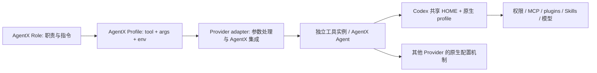

# Role、AgentX Profile 与 Provider 原生配置

## 推荐结论

保留并完善现有 Role → Profile → Provider 启动链路。Role 表达职责和工作指令，AgentX Profile 表达使用哪个工具、携带哪些原生参数和环境变量启动。Codex 原生 profile 是 AgentX Profile 参数中的一个选择，不需要增加 `CodexAgentBinding` 或另建 Codex 角色系统。

用户选择共享 `CODEX_HOME`，通过 Codex `--profile` 使用不同原生配置，复用认证、插件安装和公共资源。需要独立 home 的特殊场景可以沿用同一启动环境机制，不作为本次设计主线。Codex 内部 custom agent、`spawn_agent` 及其父子线程模型不属于这个方案。



这是一种逻辑角色：同一职业 Role 可以选择不同工具配置，同一 Profile 可以启动多个独立实例。Role 和 Profile 的组合决定职责与执行环境，实际权限和工具行为仍由 Provider 原生机制执行。

## 对象与责任边界

| 对象 | 负责什么 | 权威来源 |
| --- | --- | --- |
| AgentX Role | 职责、专业指令、发现、默认负责人、Profile 引用 | 现有 Role Markdown/TOML |
| AgentX Profile | Provider 选择、argv、拟增加的环境覆盖 | AgentX 作用域中的 `launch.profiles` |
| Codex profile | 模型、目录权限、MCP、plugin、Skill 等原生设置中该版本支持的部分 | Codex 原生配置层 |
| Provider adapter | 原生参数处理、AgentX 指令/hooks 接入、入口兼容性 | 对应 Provider 集成源码 |
| AgentX Agent | 独立身份、消息、生命周期、启动来源与恢复 | 原生 participant 与 launch history |

AgentX 不复制 Codex 的配置 schema，不为 MCP、Skill、plugin、目录权限分别建立通用 Profile 字段。不同 Provider 可以用自己的参数表达同样的用途，不要求存在相同的原生功能。

## 配置示例

下面第一段中的 `tool`、`description`、`args` 是现有 AgentX Profile 字段；`env` 是待设计扩展，当前未实现，不能直接把示例当作已支持配置。

```toml
[launch.profiles.codex-review]
tool = "codex"
description = "使用 Codex review 配置"
args = ["--profile", "review"]
env = {REVIEW_WORKSPACE = "/projects/app"}
```

Role 的薄覆盖沿用现有字段：

```toml
profile = "codex-review"
```

其中 `codex-review` 是 AgentX Profile，`review` 是 Codex profile。对本机 `codex-cli 0.169.0`，帮助文本描述 `--profile review` 从 `$CODEX_HOME/review.config.toml` 叠加加载到用户基础配置。旧版本资料中的 `[profiles.NAME]` 不应直接套用于所有版本。

`REVIEW_WORKSPACE` 只是示意一个传给子进程的环境变量，不自动改变目录权限或 cwd。权限、MCP 和资源开关由有效 Codex 配置表达。保留共享 `CODEX_HOME` 即可复用公共状态，无须为每个实例复制目录。

启动继续使用现有 AgentX 选择方式，例如 `agentx launch --role reviewer`；Role 引用上述 Profile。单次显式 `--profile` 继续指向 AgentX Profile，Codex 原生 `--profile` 留在 Profile 的 `args` 中。两个层次的同名选项靠语法边界区分。

不建议第一版同时增加 `codex_profile` 专用字段和等价 `args`，否则需要规定同一值的两处来源和冲突优先级。若以后做表单或便捷选项，应归一化成同一份 argv，避免并行存储。

## 当前实现与缺口

| 已有事实 | 来源 | 对本方案的意义 |
| --- | --- | --- |
| Profile 保存 `tool`、`description`、`args`，拒绝未知字段 | [profiles.rs](../../src/config/profiles.rs) | 原生 `--profile` 不需要新对象；环境覆盖需要真实扩展契约 |
| Role 引用 Profile，启动时一次解析并采用快照 | [launch_profile.rs](../../src/runtime/launch_profile.rs) | 可以直接复用现有角色组合 |
| Resume/fork 沿用历史参数与采用的 Profile，而非重新读取当前定义 | [Profile 用法](../launch-profiles.md) | 新增环境语义必须衔接历史与恢复 |
| Codex home 从有效子进程环境解析 | [Codex launch preprocessing](../../src/integrations/launch_args/codex.rs) | 应在 home 解析和 hook preflight 前应用 Profile 环境 |
| Shared app-server 对 CLI 参数采用受限翻译 | [configuration.rs](../../src/integrations/codex/configuration.rs) | 普通 CLI 的 `--profile` 可用性不证明 shared bridge 支持同一路径 |
| AgentX 注入 developer instructions 与 hooks | [Codex hooks](../../src/integrations/hooks/codex.rs) | 必须验证原生配置和 AgentX 集成不会互相覆盖 |

现有 AgentX Profile 的 argv 已能表达 Codex 原生 profile 选择。真正需要新增的重点是 Profile 环境，以及它在本地、远程、历史、dry-run 和管理端中的一致传播。无需先实现 Codex custom-agent 目录发现。

## 环境与参数的最小契约

建议 `env` 使用进程环境覆盖的通用含义，不执行 shell、不自动展开变量、不读取命令替换。相对路径按哪一个 cwd 解释应由使用该变量的 Provider 规则决定，界面显示有效 cwd 与来源即可。

现有环境来源较多，不能另建一套环境加载器。应在现有启动环境链中增加 Profile 来源，并明确以下顺序约束：

- 调用环境和现有环境文件加载继续由现有机制处理。
- Profile 环境覆盖基础启动环境；显式单次启动环境覆盖 Profile 环境，具体与现有 `--env` 语法对齐。
- AgentX 身份、会话代次、连接等保留变量由运行时最终设置；Profile 不可伪造或覆盖这些字段。`CODEX_HOME` 属于工具设置，不应与身份变量混为一类。
- Profile 参数与单次参数沿用现有 Provider 参数合并机制；原生 `--profile` 的别名和覆盖行为需要纳入对应 adapter 验证。

Profile 只声明有限覆盖项，不保存整个调用者环境。空字符串、取消继承变量及大小写规则需在实现时明确；没有实际需求时不增加变量插值、环境继承 DSL 或多个复杂 merge mode。

环境值可能包含凭据。公开列表、dry-run、日志和 HTTP 输出应遵循现有脱敏规则；不得因持久化完整进程环境而复制所有 token。持久化 Profile 中显式值与使用现有 secret/env 引用机制的取舍，应与现有环境契约统一。

## 配置共享与历史含义

共享 `CODEX_HOME` 能减少重复安装与登录管理，但不等于每个实例具有完全隔离的资源视图。具体字段能否在 profile 中启用/关闭，以及数组和表如何继承，由 Codex 版本和配置层规则决定。项目 `.codex`、managed requirements 和 CLI 覆盖仍可能参与最终结果。

同一 Profile 可以被多个 Agent 并发采用，Profile 本身不是运行实例；修改公共配置也不应由 AgentX 自动替换运行中的 Agent。

冻结 AgentX Profile 和 argv，能够保证恢复时使用相同的选择；不能保证外部 Codex profile 文件、插件版本、OAuth 状态和 MCP 服务永远不变。默认继续引用原生配置，不引入整套外部资源快照系统。记录选择与可获取的版本来源即可；需要完全可复现时应另行明确需求。

## 必须核对的集成行为

1. **指令组合**：现有 bootstrap 主要合并 argv 中的 developer instructions，没有完整求出原生所有层的有效值。验证 `--profile` 中的指令不会被 AgentX 的 `-c developer_instructions` 覆盖。
2. **权限组合**：现有 writable-roots 适配会重写部分配置。验证 Codex profile 的目录权限能保留，并且 AgentX 不擅自扩大 Role 的访问范围。
3. **MCP、plugin、Skill**：配置声明、资源已安装、凭据可用、连接成功和实际工具可调用分别是不同事实；保持 Codex 原生错误诊断，不宣称发现文件即代表可用。
4. **入口差异**：普通 TUI、PTY headless、exec 和 shared app-server 的配置加载方式可能不同。先沿现有受支持路径接入，不可静默忽略不支持的参数。
5. **环境时机**：Profile 环境必须先于 Provider home 选择、认证查找、hooks 安装和进程创建，不能只在最终 spawn 时才追加。
6. **远程**：Profile 和原生配置由目标设备解析；本地同名 Profile 不替代远端事实，环境值也不能无条件携带到远端。
7. **历史**：Profile 修改/删除后，resume/fork 沿用采用的启动描述；外部文件漂移和当前凭据依赖明确呈现。

## 比较与取舍

| 方案 | 成本与效果 | 建议 |
| --- | --- | --- |
| Role → AgentX Profile → 原生参数/环境 | 跨 Provider 复用已有模型，工具配置由原生工具维护 | 推荐 |
| 每个 Role 默认创建独立 Codex home | 重复认证、插件和缓存管理 | 不作为默认方式 |
| 新增 Codex custom-agent binding 实体 | 引入本次不需要的子 Agent 概念和生命周期问题 | 不采用 |
| 把 MCP、plugin、Skill schema 复制到 AgentX | 跟随各 Provider 版本演化的成本很高 | 不采用 |
| 对所有 Provider 强制相同能力字段 | 无法自然表达工具差异 | 不采用 |

## 最小实现与验证范围

建议下一次实现只扩展 AgentX Profile 的环境覆盖，并贯通选择、执行、dry-run、历史恢复和实际使用的管理端。继续复用 `tool + args`，先以 Codex 共享 home + 原生 profile 验证完整链路，无须增加新的 Role 发现系统或插件管理平台。本次仍然仅交付分析文档。

验证场景包括：不同 Role 采用不同 Codex profile；同一个 Profile 启动多个实例；显式单次 Profile/参数/环境覆盖；环境先于 home/preflight 生效；bootstrap 与原生指令、hooks 和权限组合；MCP/plugin/Skill 开关的实际效果；Profile 编辑后的历史恢复；不支持的 shared/remote 路径明确报错。使用临时配置和资源，不修改已有用户服务。

## 调研依据与限制

本次核对本机 `codex-cli 0.169.0` 的 `--help`、`exec --help`、`agents --help`、`plugin --help`，并生成本机 app-server JSON schema；没有执行推理或启动业务 Agent。AgentX Role/Profile 与 Codex 集成关键路径经 codebase-memory 定位并直接读源码，三个主要文件的索引 metadata 匹配，但图覆盖仅为 best-effort。

官方依据：[Codex 配置参考](https://developers.openai.com/codex/config-reference)、[高级配置](https://developers.openai.com/codex/config-advanced)、[插件](https://developers.openai.com/codex/plugins)。[原生 subagent 文档](https://developers.openai.com/codex/multi-agent)用于澄清另一种机制，原生 subagent 的继承限制不应套到本方案的独立进程。

官方手册 helper 和直接请求曾返回 403，之后通过项目 proxy 获取相应页面。官方文档和本机版本不一定同步，配置格式与字段效果应以选定版本的有效配置和执行证据确认。现有 Profile argv 支持不等于 Profile 环境扩展已经实现，也不代表已安装二进制或运行中服务采用本提案。

## 浏览器探索 Role 实例

针对“查看页面结构和当前状态，并根据探索结果生成脚本”的场景，已选择 Microsoft Playwright MCP 作为第一个实例。它使用可访问性树和语义定位进行浏览器操作，当前固定为 `@playwright/mcp@0.0.85`，并启用 `devtools` 能力和 TypeScript codegen。Chrome DevTools MCP 更适合网络、控制台、性能和已有 Chrome 调试；Browser Use 更偏完整浏览器 Agent/云浏览器，因此暂不作为这个 Role 的主 MCP。

这个角色采用 [可迁移的 Role 和 AgentX Profile](../../.agent-guides/local/browser-explorer/README.md)。AgentX Profile 直接通过 Codex 原生参数声明模型、sandbox、推理强度和 Playwright MCP。它复用调用者的 `CODEX_HOME`，无需在其中预装同名文件。原生 `--profile` 仍是其他角色可以选择的方案。

验证范围是配置解析、MCP 注册和 AgentX dry-run；尚未对具体业务页面执行探索，也未证明任意目标站点、登录流程或真实数据状态。
