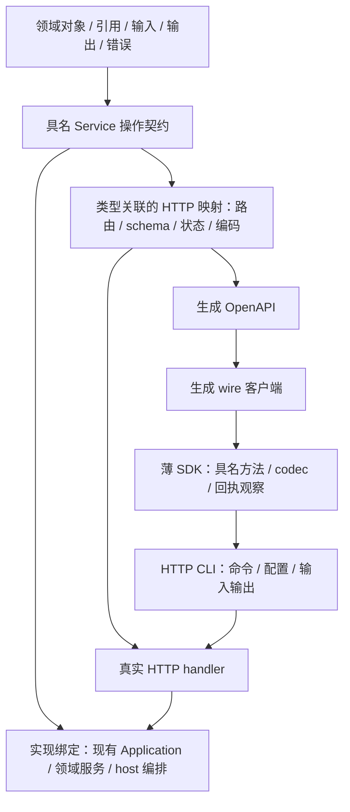

# 从 Service 契约建立 OpenAPI、SDK 与 CLI

用户于 2026-11-17 授权按此方向推进体系建设，要求 rovi 先完善方案与契约设计，再由 Controller lezi 分派 Agent、推进集成与验证。授权范围为全景中现有公开 HTTP 能力的 Service/OpenAPI/SDK/HTTP CLI 链路，五项消息闭环为首个里程碑，不是全项目终点。实际状态由[Delivery](../../.controller/contract-service-projections/implementation.delivery.md)拥有；授权与设计接受不代表已实现或上线。已有[接口全景](../api-panorama/README.md)拥有接口清单；本提案拥有构建顺序，新增[契约设计](../api-panorama/service-contract-design.md)拥有消费者边界与映射决策。

## 起点与目标

AgentX 已有领域声明、`Application::handle`、daemon 单一存储所有者和 HTTP 适配器。目标是在这些能力上建立可消费的具名 Service 边界，把确切输入、输出、错误、身份与效果语义连接起来，再导出真实 HTTP 契约和客户端。第一版保留 Rust/serde 为权威，不为生成 SDK 把业务迁到 TypeScript/oRPC，也不先拆 crate、重写数据库或合并三个 listener。



这里的 Service 是应用能力边界，不等于新建后台进程。不同领域按职责分组，不强制每个资源一个 Service。现有原生 CLI 可以继续通过 IPC；面向 HTTP 的 CLI 复用 SDK。相同业务规则仍由同一个原生拥有者执行。

## 第一批：先交付一条真实可用的契约链

选择 `management.describe`、`agents.list`、`agents.get`、`agents.messages.send`、`operations.get` 五项。调用者可以取得合法输入、发送一次消息、查询结果，并处理同名替换与回复丢失；不以“已生成一批文件”作为完成。

| 批次 | 具体工作 | 可检查的完成结果 |
| --- | --- | --- |
| A：Service 核心 | 定义五项操作的具名签名和输入／输出／错误；连接精确引用、generation、request_id；绑定现有领域／worker 供给 | 一个不依赖 HTTP 语法的实际消费者能走完上述场景；同名替换拒绝、重复 ID 冲突与回复丢失恢复有证据 |
| B：HTTP / OpenAPI | 把五项真实路由的类型关联、参数位置、状态、错误及编码接入同一投影；生成完整小规范 | schema 与真实 listener 一致；成功和关键拒绝分支通过真实 HTTP；重复导出可复现 |
| C：SDK | 选一种语言，建议先 TypeScript；生成 wire 客户端，提供连接、具名方法和回执等待 | 独立消费者从包入口走通场景；取消等待不撤销消息；未知结果保留原 ID |
| D：HTTP CLI | 在 SDK 上实现 describe/list/show/send/operation show/wait 的小命令集合 | 可通过终端完成相同场景；JSON 输出、退出码、无网络帮助和结果未知恢复可用 |

先完成 A 的最小骨架与行为，再做 B；B 可用后才确认生成器和 SDK 公共入口。无需等所有领域的 Service 全部完成才验证派生链路。每批按“设计关键签名 → 形成可编译骨架 → 填入行为 → 集中验证”完成；不按字段反复校验。

## A：Service 核心具体长什么样

下面是结构示意，不是新增可编译源码或对现有 Rust API 的声明。可用普通具名方法及其输入输出类型实现；只有存在实际替换／注入需求时才引入 trait。

```text
ManagementService
  describe(context) -> Descriptor
  list_agents(context, ListAgentsInput) -> AgentPage
  get_agent(context, GetAgentInput) -> AgentView
  submit_message(context, SubmitMessageInput) -> Operation
  get_operation(context, GetOperationInput) -> Operation

契约类型
  Generation / RequestId / 精确 Agent 引用
  分页输入 / 页面输出 / MessageInput
  提交接纳 / Operation 状态与业务结果
  可恢复的业务错误 / 独立传输错误
```

具名方法用于消费者表达与请求／结果的类型关联；内部可以继续转换为现有 Request/Response。若五项操作需要多个真实拥有者，只做有意义的编排与转换，不为统一外观复制业务规则。

| 责任 | 应放置的事实 | 不应混入的事实 |
| --- | --- | --- |
| 领域对象与引用 | 身份、关系、不变量、状态变化、失败原因 | HTTP 路径、CLI 旗标、数据库驱动 |
| Service 操作 | 完整输入／输出、前置条件、接纳／完成含义、重试与查询方式 | 框架 request 对象、CLI stdout 渲染 |
| 服务实现与 host 编排 | 领域调用、事务、外部效果、回执、worker 生命周期 | 第二套同名 CRUD 或 SDK 业务判断 |
| HTTP 投影 | method/path、path/query/body、状态码、错误映射、schema、codec | 新的状态机或身份权限来源 |
| SDK / CLI | 参数供给、显式映射、结果展示、观察与恢复组合 | 擅自接受 Work、改变代次重试、伪造 Agent 权限 |

五项操作必须说明：谁能调用、generation 的来源、名字如何转精确引用、输入大小／分页范围、空与缺省的区别、错误、结果说明、回执归属、是否可重试、断线如何继续。这些语义贴近原生声明维护；HTTP 元数据由表面拥有者维护并与声明类型关联，不创建独立通用 DSL。

**可信 context 与用户输入分开。** scope/project 由实际入口选择或固定；进程／主体身份由可信 host 验证；用户给出的 name、generation、revision、request_id 只是待校验输入。管理 HTTP 的 operator 身份不能被提升成任意 Agent 的身份。不能把整个 InvocationContext 作为公共 JSON 输入导出。

**保留三种不同返回。** 有界读取直接返回页面；异步 host 操作返回可查询的 Operation；Workbench 的原子变更沿用 Change/Rejected，Inspector 分析沿用 AnalysisJob。不为了统一 SDK 把所有调用都包成新的全局 Operation。`Succeeded + Sent` 仅证明消息接纳，不能证明已投递或任务完成。

第一版直接复用管理边界的 AgentRef 序列化，同时在 Service 中保证 incarnation/stopped_event 二选一；如引入更严格的内部 tagged union，需要显式 wire 映射。协作 ParticipantRef 保留其拥有者，不强制改成相同结构。第一批选择闭合公开错误，并由原生边界提供安全映射；不从现有 error 字符串猜测机器错误分类，也不顺便修改全部历史错误存储。

### 结构与落地位置

遵循现有模块拥有者，先建立实际职责，不预先新建整棵框架目录。

| 位置 | 第一批变更方向 |
| --- | --- |
| `src/management/contract.rs` | 复用已有对象；补具名操作所需输入／输出、稳定公开失败及语义；内部 worker ticket 保持私有 |
| `src/management/` 下的 service 模块 | 消费者操作与现有 IPC/worker 的具体绑定；仅在边界职责成立时新增文件 |
| `src/management/web.rs` 与必要的 HTTP 投影模块 | 路由处理消费 Service；类型关联的 HTTP 元数据与导出，保留已有边界检查 |
| 现有构建／脚本入口 | 固定版本的 OpenAPI 导出、校验与 SDK 生成；正式实施再确定工具和路径 |
| 新 SDK 与 CLI 包入口 | 接口导出不拉入 server、数据库驱动或启动副作用；生成文件与手写组合分开 |

不能假定 SQLite dispatch 内的 Service 独自执行外部进程 I/O。管理服务已有 native 接纳与独立 worker；具名 Service 要复用这种协作，避免把启动／发送／转录 I/O 移进数据库事务。只修复第一批真正需要的缺口。

## B：让 HTTP 与规范连接在同一条链上

纯 serde 数据声明不能生成完整 OpenAPI：它没有路径、method、参数位置、HTTP 状态及安全语义。第一批必须选定一个适合 Rust/axum/serde 的投影机制，支持已安装版本和真实序列化。实施时优先评估维护中的原生 schema/OpenAPI 集成（例如 utoipa 及 axum 集成）；生成器选型必须以一个实际导出与客户端试验为准，当前不承诺特定依赖或命令。

需要做的窄适配是：让路由与输入输出类型、operationId、错误和 codec 元数据保持关联，并使 handler 与导出消费这些定义或有可验证的对应。避免分别手写 DTO、OpenAPI YAML 和 SDK 类型。若框架不能共享全部路由定义，可保留表面专属映射，验证其与实际 handler 的覆盖；不为此开发通用编译器。

发布第一批真实 wire 规范后，再补齐管理入口的其余方法／路径（全部共 30 项，含历史别名）。Workbench 与 Observation 保留分别配置的 listener 和规范；同名 `/read` 路径不能不加边界直接合并。OpenAPI 只描述公开能力，不暴露 Application 聚合 Request、Claim、Finish、ticket 或 AgentReport 内部权限操作。

## C、D：派生消费者，而不是重写服务

SDK 的生成部分负责 wire 类型、method/path、请求和基础响应。手写的薄层负责端点配置、实际 codec、具名方法、精确引用和回执观察。当前 Workbench/Observation 的一个 HTTP operation 含多个 enum variant；`works.accept()` 这类方法需要具名封装，普通生成器不会从 oneOf 自动生成领域方法体系。

CLI 复用 SDK，按[全景中的命令树](../api-panorama/README.md#4-cli-命令树与参数全景)逐步提供。基础类型可派生参数校验；命令名、主操作数、文件/stdin、JSON 输出、退出码与中断行为由 CLI 投影明确设计。已有本地 CLI 不因这个新入口而改成 HTTP。

TypeScript SDK 第一批仍需实际验证 u64 精度策略；不能因为关键 ID 已是字符串，就把管理计数和 revision 全当安全 Number。Workbench/Observation 必须保留其整数标记 codec。转换策略应在生成配置／codec 中一次声明，而非分散到每个命令。

## 扩展顺序与后续边界

| 顺序 | 可独立使用的能力组 | 进入条件 |
| --- | --- | --- |
| 1 | 五项消息闭环 + 对应 SDK/CLI | 先证明全链路可派生、可调用、可恢复 |
| 2 | 其余管理：生命周期、labels、目录、附件、信箱与 Inspector | 第一条链可复用；每组仍有具体调用场景与关键失败 |
| 3 | Workbench：读取、创建、分派、检查请求、接受／退回 | 精确参与者转换、revision 与 operator 权限保留；不开放 AgentReport |
| 4 | Observation：运行、配置、事件证据 | 整数 codec、时代／流引用、stale/gap、被动连接语义可端到端保持 |

原生已有但 HTTP 未公开的能力，先按真实消费者场景设计其 Service/权限/效果，再决定 HTTP 暴露。全量原生枚举不是 SDK 路线图。统一 URL、跨互联网授权、多语言 SDK、通用 CLI 生成器都不是第一批前置条件。

## 何时可以说这套基本体系已经建好

首个实际消费者从正式 SDK 包或 CLI 入口出发，经过生成客户端、真实 HTTP、原生 Service 完成发送，并正确处理同名替换、同 ID 同输入重放、同 ID 不同输入冲突、回复丢失后的原回执查询。再生成结果一致，修改源契约能在规范和消费者检查中显现。有限 Mock 可先帮助设计与类型验证，真实 adapter 集成负责最终行为证据。

这条闭环完成后，扩展新能力主要是补领域操作、绑定和表面策略，再运行同一条派生链；不再为每种入口分别设计一套业务。
