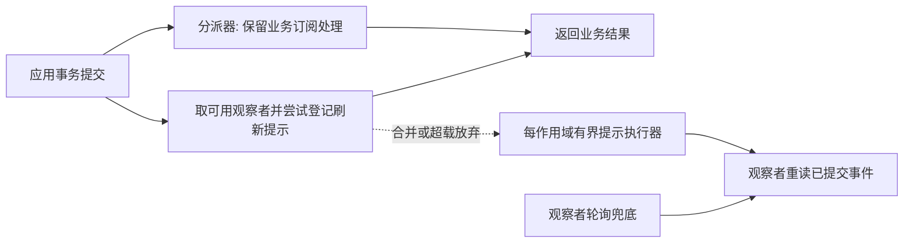

# Daemon 提交后路径优化

已实现的 [Codex Hook 快路](../../.controller/observability/codex-hook-performance.task.md#verification) 减少了客户端往返。下一步处理 Daemon **写完状态、但还没回包**的这段时间：先把可以丢弃的观察者唤醒移到回包之外，再让每条事件只找可能命中的订阅。仍使用现有本地 Daemon、SQLite 和观测机制，没有额外服务。

这个方案关注所有共用该提交路径的调用方。普通 Codex PTY 是首个验收场景；共享 app-server、其他 Provider 和 `SessionStart` 本身的接入方式不在这次变更内。当前源码已合并同一提交的普通观察者唤醒、减少多文件 patch 的实例读回；但 [提交后路径](../../src/db/events.rs#L421) 仍在分派器里处理观察者、特定启动等待者、订阅与 request-watch。订阅命中还可能写消息并触发下一层的唤醒。它们各自占多少时间仍未知。

## 一条事件有三种后果

| 后果 | 回包前必须成立的事 | 可以后移或减少的工作 |
| --- | --- | --- |
| 状态、消息、游标、收据 | 现有事务提交；原来分开的“准备、实际输出、确认”仍分开 | 保留现有成功和失败语义。回包不代表 Provider 已读或已执行。 |
| `events --wait/follow` 的普通刷新提示 | 观察者只能读到已经提交的事实；提示不会改变游标或任何业务状态 | 可合并、允许丢失、可在回包之外发送。旧客户端有最长五秒的重读节奏，匿名观察已有短轮询；饱和时降级是更晚看到事件。 |
| 业务订阅、冲突检查、`--once`、`--on-hit`、request-watch | 本轮沿用逐事件求值、反应顺序和现有失败处理；历史恢复还要遵守原有重放水位 | 缩小候选，避免每个状态事件重复查无关订阅和未到期监视。不会把业务效果放进满了就丢的提示队列，也不改变现有崩溃保证。 |

## A. 只迁移普通观察者提示

第一版只迁移 `ObserverBegin` 注册的、仍有效的 **`events_wait` 普通刷新**。这种消费者已有[超时后的重读](../../src/cli/commands/events_client.rs#L116)，能用自己的游标追赶；`agentx listen` 的通知兜底可到 30 秒，PTY 还有不同的投递状态，`session_start` 可创建会话。它们以及 LaunchWait、原生驱动的 Hook 唤醒、观察者退役通知继续走现有路径。本阶段不把 `Stop` 的所有唤醒都承诺为异步。列表、跟随、邮件交付和程序完成不共享一个“已唤醒”状态。

| 责任 | 建议接口和边界 |
| --- | --- |
| `events/observer_store` | 继续拥有 Begin／Check／End、确切 participant incarnation、peer 身份和端点资格。沿现有检查生成普通提示的安全小投影；退役或需清理的观察者继续走原所有者流程。第一版保留这一小段 SQLite／身份检查，明确先移除的是后面的 TCP 等待。 |
| `db/post_commit`、`service/application` | 只从已提交事件路径提供 `try_hint(epoch, registration)`，不接收泛化回调，也不在回滚时注册提示。应用部署一个 scope 对应一个执行器；测试、无执行器或显式回退可以继续使用原同步通知实现。 |
| `runtime/notify` | 一条提示仅含 scope/daemon 实例/数据库代际、观察者注册 ID、注册版本、原 PID/incarnation、loopback 端口和队列时间。进程内的可撤销注册记录是加速辅助，不能创建或续订观察者。执行器不打开库、不调用 Daemon 业务接口、不执行 Provider I/O。 |

**提交、合并和拥塞。** 外层事务提交后至多发布一次同类提醒。运行时按 `(epoch, observer_registration)` 合并待处理条目，正在发送时若又收到提醒，只追加至多一个待处理标记；同一 Agent 的两个观察者仍各自收到提示。建议首版固定 **256 个待处理注册、最多 4 个并发连接、单次连接上限沿用 50 ms、超过 1 秒的待发送提示丢弃**，都是待验证的容量设定。队列满、锁竞争或执行器退出时立即退回读侧轮询，不同步补发。一个慢端口不占住分派器；不会为每个事件临时创建一组新线程。记录合并、过期、拒绝和发送结果的有界计数。

**端点与代际。** 冻结时和发送前都检查所选代际及注册有效性。Begin 与 End 的本地生效／撤销只能跟随相关事务提交，清理和 participant 退役需要使对应的注册版本失效；reset 切换代际时使旧待发送条目失效，daemon 结束时停止接收并清空待发送。进程身份在发起连接前复核，未知即跳过。禁止跨代际重试，也禁止把端口号当授权。TCP connect 本身仍不是注册身份认证，已发起的旧连接可能与 End 或 reset 交错；它只允许无内容的提示，接收方仍检查自己的观察者和代际。若某类注册无法做到提交后撤销、发送前复核，或需要保证旧连接绝不接触复用端口，该类先保留同步方案，不为这次改动另建通知协议。首版不把 SQLite 读搬到 worker；若后续诊断显示观察者枚举本身还是主要开销，再考虑由 Begin／End 驱动完整的内存投影。

## B. 候选索引只负责排除不可能命中的订阅

今天 [事件匹配](../../src/db/subscriptions.rs#L623) 会读取所有非 `delivery_only` 的订阅，再解析 JSON、判断类型、运行谓词和可能的反应；request-watch [状态转换与清扫](../../src/db/subscriptions.rs#L561) 是另外的工作。将这两部分分开优化：先减少每类事件的匹配候选，再减少监视生命周期的扫描，不能用一条类型索引替代所有规则。

1. **先从可证明的单类型订阅开始。** [现有 filter 编译器](../../src/events/filters.rs#L229) 把事件类型限制作为与其他条件相交的一项。首次只索引在该编译／创建点明确限制为单一 `message`、`status` 或 `life` 的订阅。创建时持久化可选且有版本的 `dispatch_kind` 提示，与该订阅的规范谓词一起更新；加载自历史、只靠 SQL、条件不明确、多个类型或缺少可信元数据的记录归入 `General`。不从 SQL 文本猜测（尤其 `OR` 和子查询），也不只凭历史 `filters` JSON 推断编辑过的谓词。已有 `last_id`、`once`、`caller` 和反应链不变。每次事件访问 `Kind(当前类型) ∪ General` 两个互斥集合，然后执行原谓词和反应代码；`delivery_only` 仍独立过滤。
2. **优先在同一个 SQLite `kv` 做局部表达式索引。** 索引只包含 `events_sub:` 订阅，读取以版本化的单值类型表达式为键，SQL 类型分支和 General 兜底用同一个表达式。无效 JSON 必须有保护，不能让建索引或原有 KV 写入失败。正常更新、`--once` 消费、stop/restore、reset 和旧代码用旧格式写入都由 SQLite 原子维护，没有第二张要同步的业务表。准备索引失败、覆盖无法验证或显式关闭时，从该事件开始用旧选择器；**旧路和新路的切换只能在任何反应副作用之前**，不能在半次匹配后重跑。Daemon 启动时建立缺失的索引，已有索引直接复用，回调中不建索引。旧记录先走通用分支，不批量重写历史。为确保索引确实有用，后续需确认查询只访问命中桶与 General，而非先全扫再过滤。
3. **完整保留恢复、谓词与反应语义。** 在普通模式和 [恢复重放](../../src/db/subscriptions.rs#L402) 中，对照候选、匹配顺序、通知／反应及游标结局。第一版可让恢复重放直接沿用旧候选器，避免历史事件被实时反应跨过。现有匹配查询没有显式排序，不能把新索引的返回顺序当成正确顺序；如顺序可见，先确定并实测两路共用的稳定次序，此前有顺序依赖的集合仍走旧路。碰撞 SQL 的快捷跳过、参数化 SQL、`--once`、`--on-hit` 的反馈链和权限边界保持原判定。低置信度规则的保守结果是多算，不是少通知。

**request-watch 独立后做。** 先给现有存储表达式做两种有窄条件的选择：`(目标、watch)` 用于状态转换，`(grace_until、watch)` 用于已到期的 Antigravity 监视。消息回复取消仍按现有 caller、target 和 reply ID 规则，在可证明的条件内缩小集合；不改模糊历史规则。本轮保留“当前事件先匹配／取消，再检查到期”的顺序，并保留[条件删除作为一次性通知的 claim](../../src/db/subscriptions.rs#L237)。因此在截止点恰好来的回复或恢复状态仍先处理，历史 `only` 限制仍有效。先缩小扫描，只有需要在无新事件时准点触发且得到独立语义决定，才把清扫迁到定时任务。

## 验收、取舍与后续判断

实现与运行证据以[任务记录](../../.controller/observability/daemon-postcommit-performance.task.md)为准。所有使用新版二进制启动的 Daemon 默认使用订阅与请求监视索引；`AGENTX_INDEX_EVENT_SUBSCRIPTIONS=0` 从 Daemon 启动环境回退到旧查询，不删除已有索引、订阅游标或事件。`=1` 仍可显式开启。异步提示独立选择，仍由 Daemon 启动环境 `AGENTX_ASYNC_EVENT_OBSERVERS=1` 开启。提示 worker 使用一个线程；其他容量值用本页设定。对单一类型的加速只标记当前创建器处理的显式单值 `--type`，旧订阅和推断类型先沿用通用分支。

| 问题 | 后续检查和观察 |
| --- | --- |
| Hook 还在等哪一段？ | 沿用 [现有 Hook 和 daemon 关联](../observability/telemetry-coverage.md)，将应用段细分为提交、观察者资格与入队、订阅候选与匹配、request-watch；队列和 socket 发送由 worker 观测。计时与计数都按固定操作、事件类型和结果分类，复用 daemon 内存指标与原抽样。禁止记录端口、正文、SQL 片段和收据；不会为每条事件增加文件写入。 |
| 唤醒有故障还能看到事件吗？ | 用隔离的功能测试阻住 worker，证明业务回包不等待连接；覆盖队列满、同注册合并、不同观察者隔离、End/代际切换、回滚和读侧追赶。已匹配事件与邮件游标不被提示影响。用现有版本相同语义的 `events --wait/follow` 作消费者验证。 |
| 缩小候选有没有漏通知？ | 使用相同事件序列对照旧查询和索引查询。验证单类型、通用 SQL、多类型、碰撞、`--once`、反应链、停止恢复、回放和重置。记录候选数和真正执行的谓词数；大量无关单类型订阅不应增加候选，General 仍是明确的成本下限。 |

上线前的对照分开看：A 看回包是否还等 TCP、提示降级后观察者是否可追赶；B 看候选和谓词数、业务效果是否一致。两块都能独立关闭回到原路径；关闭不改变事件表、收据和游标。首版不做全局消息总线，不把 SQLite 换成另一套存储。可靠订阅如果以后仍需要彻底离开回包路径，要先给其独立定义处理水位、事件顺序、停机恢复和副作用去重，再评估是否需要持久队列；当前没有理由先造一个。

这轮仅做设计，没有运行实验或压测。后续数值目标和实现边界见[实施计划](../../.controller/observability/daemon-postcommit-performance.task.md)；已有通知、订阅、读侧恢复的保证以各自原生合同为准。
