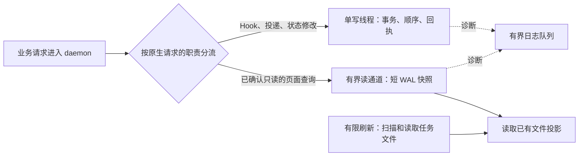

# Daemon 请求隔离与过载恢复

**结论：保留 SQLite 单写者，把单写者的职责收窄。** 当前线上构建让 Hook、邮件投递、只读页面、文件投影和部分诊断共用一个 16 项队列、一个执行线程。一个请求执行几十秒，后面的业务即使只需几毫秒也无法执行。队列满后的 `Busy` 是正确的拒绝机制；故障是相互独立的工作争夺同一条执行路径，以及客户端不断补充可延后或重复的请求。重启清队列、索引减扫描，都不能改变隔离边界。

## 已确认的因果与证据边界

| 现象 | 证据与结论 |
| --- | --- |
| 请求入口正常却大面积 `Busy` | [运行快照](../../.artifacts/project-release-20261120-134940/busy-runtime.json) 同时看到 16 个排队、1 个执行。项目的新旧客户端都遇到拒绝，换二进制不能解释拥堵。手头样本也有成功 Hook。 |
| 索引解决了一类慢工作，但拥堵可以复发 | [发布记录](../../.controller/project-daemon-busy-20261120.task.md#project-rollout-of-default-indexes) 保留了索引开启前后样本：此前模型状态请求中，订阅候选与监视处理合计约 27 秒；开启后一次同类采样的监视处理为 140 微秒。不同调用和负载不能用来计算线上提速比例。之后仍捕获到一条 Management 请求执行 43.681 秒。 |
| 慢标签与慢 HTTP 不一定是同一件事 | [当前线上构建的保留日志摘要](../../.artifacts/daemon-busy-design-20261120/latest-dispatch-summary.json) 有一次 6.281 秒的 `Queries`，同期一条 `Management` 实际只执行 15 毫秒、排队约 3.5 秒。HTTP 慢不能直接归因给该 HTTP 请求对应的 SQL。现有[操作标签](../../src/observability/runtime.rs#L718) 把 Management 变体压成同一个标签，无法把之前那笔 43.681 秒唯一归到某个子操作；当时的磁盘等待也不能单独解释各阶段占比。 |
| 确认有两条重复读取人类信箱的路径 | [OfficeActivity](../../src/management/activity.rs#L21) 每次取事件前读人类信箱；[Space](../../web/agent-space/src/live/controller.ts#L231) 在成功取到活动后会再请求人类信箱。在未建投影时，信箱的精确未处理计数会搜索全历史消息、对候选运行 `json_each`，不受页大小限制。[100,000 事件的隔离 SQL 对照](../../.artifacts/daemon-busy-design-20261120/mailbox-query-probe.json) 结果都是 500 条未处理；派生收件 ID 将 SQLite 指令约从 151.8 万降到 1.5 万。这证明了有一条随无关历史增长的扫描及其修法，不等于已经找到了 43.681 秒的唯一调用。 |
| 饱和会被宿主轮询放大 | [PTY 排查](../../.controller/pty-poll-pressure.task.md) 记录了重复 Poll、失败后 250 毫秒间隔，以及已通过隔离验证的复用和退避。现场日志里大量 `delivery.snapshot_failed` 是结果，也是后续负载的来源。 |

## 目标边界

- **写通道**拥有真实状态变化、持久化顺序、消息接受和结果回执。外部进程探测、文档扫描、诊断写文件不占写通道。已拒绝或尚未执行，与已经提交但回复丢失，必须继续区分。对后者沿现有回执核实，不自动重发。
- **读通道**由 daemon 持有只读 WAL 连接，只接收明确无副作用的原生请求。请求在同一个短快照里读取代次与事实，快照在文件工作前释放，返回前再次核对代次。读队列满时只拒绝该读，不能退回写队列。不要给每个 HTTP 路由建独立数据库连接池，也不要让浏览器或 CLI 直接开生产库。
- **有成本的投影**要按其来源刷新。正确信箱记录由提交时派生的收件 ID 提供，旧事件按批补齐；覆盖未完成时保持结果准确，并给回退读限时。活动页尽量用游标读取新事件；可复用的首屏信箱数据直接消费，历史页和特殊筛选按需读取。文件任务仍以文件为准；普通 Agent 列表使用已有观察结果，文件刷新按项目合并并带上新鲜度。明确刷新仍可查询真实来源。
- **过载和诊断**：按读、写和连接入口分别计量 `Busy`。静态操作名应具体到 `Management.HumanMailbox`、`Management.List`、`Queries.ListAgents`/实际对应变体、`Messages.Poll` 等；串起 HTTP 请求 ID、原生请求 ID 及 Hook trace。记录排队、SQL、文件投影、提交后工作和回复阶段，用有限异步日志传递，避免日志影响原请求。只有证据显示全局连接池仍令写通道饥饿时，才给该入口保留少量控制容量；不扩大总容量来藏住拥堵。

## 推进顺序与验收

| 顺序 | 工作与完成条件 |
| --- | --- |
| **1. 收拢已有改动，先验证隔离** | [I/O 隔离任务](../../.controller/daemon-io-isolation.task.md) 已有独立 reader、信箱派生表和分派日志 worker 的工作树实现；[PTY 修正](../../.controller/pty-poll-pressure.task.md) 已通过隔离验证。统一用一份候选构建。人为阻住只读处理、填满读队列并阻住日志后，真实 native Hook/投递等写请求仍能完成；确认拒绝只发生在读通道，并通过一次代次切换、消息/回执、信箱分页和回填/回滚对照。检验旧宿主是否还在用原 Poll 节奏，不能只看新 daemon 的版本。 |
| **2. 切掉跨通道等待和无效读** | [Agent 列表首页](../../src/management/service.rs#L106) 目前仍同步等 `ReapDeadProcesses`；保留明确维护用途与精确进程复核，把周期清理从普通 GET 的前置条件中移走，并确认页面对刚退出 Agent 的状态表达。把 [文件投影刷新](../../src/service/read_application.rs#L92) 从每次页面请求的依赖中拆开，限制刷新数量/频率和过期策略。消除 Space 重复读取信箱，给重复/隐藏页面读取加合理的合并或降频。检查 `Queries` 的具体慢变体；纯读逐项纳入隔离，有对外副作用的请求仍在写通道。 |
| **3. 用实际负载验收，再替换项目运行版本** | 使用同一脱敏数据快照或等量确定性夹具，对照健康负载与多页面同时刷新，另覆盖历史投影未完成、宿主重试、磁盘/日志受阻和重置。记录同一负载下按请求类别的 P50/P95/P99、队列和拒绝计数、正常 Hook 完成率、WAL/后台任务进度。硬验收：隔离测试中读阻塞不能导致写请求 `Busy` 或写超时；业务结果和事件顺序/代次对照一致；无关历史放大时，已覆盖信箱读的工作量不随之增长。真实磁盘停顿仍可能压住写入，应能在指标上与读队列饥饿区分。候选通过后再替换选定 scope，并记录回滚和旧宿主边界。 |

第一批不换数据库、不放宽超时、不把所有提交后逻辑丢给后台。普通观察提示可合并或丢弃，但业务订阅和 request-watch 仍要求保留当前顺序和效果。如果量化后它们仍长期占住写通道，再单独设计有进度记录和可验证恢复的持久处理；不能用普通提醒队列代替。
