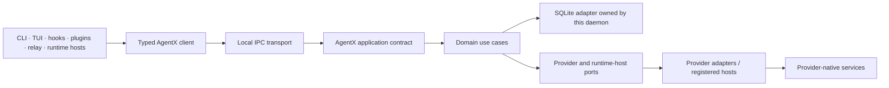

# Domain-driven AgentX and its local daemon

## Direction and current problem

The user selected two connected outcomes: organize AgentX around explicit domain ownership and Rust-native contracts; then make normal AgentX entry points clients of a daemon in the same `agentx` executable. The daemon is the only application process allowed to open or migrate the database for its data scope.

The user has accepted this direction and authorized a professional Agent team to finish design, planning, implementation and integration. The implementation owners resolve the technical questions below against the retained guarantees; ordinary design and code decisions within this scope need no additional user approval. Local build and isolated service acceptance are included. Installation, changes to the user's running services, publishing and remote deployment remain separate outcomes.

The process boundary is currently distributed. CLI dispatch, provider hooks, PTY runtime paths, failure handling and relay workers include direct `AgentxDb::open` paths. `AgentxDb` exposes `conn()` and transaction helpers to callers. The notification TCP endpoints are local wake mechanisms, not an AgentX service API. Consequently, adding a daemon entry alone would leave competing database owners and duplicate business policy.

Representative source evidence: [CLI dispatch](../../src/cli/router.rs), [database construction and transactions](../../src/db/mod.rs), [caller identity/context](../../src/cli/context.rs), [Codex hook](../../src/integrations/hooks/codex.rs), [PTY host](../../src/runtime/pty/mod.rs), [relay worker](../../src/relay/worker.rs) and [wake endpoints](../../src/runtime/notify/mod.rs). The retained delivery model is defined by [attachment contracts](../../src/agents/attachments.rs), [inbox contracts](../../src/messaging/inbox.rs) and [activation contracts](../../src/messaging/activation.rs); [Codex bridge ports](../../src/integrations/codex/bridge.rs) show the existing composition seam. This is targeted source inspection, not a complete opener inventory or a new runtime test result.

The target must consolidate ownership of data and domain operations while retaining the fact that terminal processes, hooks, provider daemons and clients have different lifetimes. It must preserve current multi-provider behavior and the delivery/activation guarantees below.

## Intended boundary

The diagram shows runtime calls. Source dependencies point from consumers and concrete adapters to the native contracts, with concrete adapters supplied by daemon composition. The contract and use cases express AgentX capabilities; transport maps them to requests, responses and optional event streams. The client does not mirror SQL or expose a generic database method. CLI verbs compose use cases for people and scripts rather than mechanically duplicating every Service operation. Domain code does not import Axum, socket types, SQLite handles, terminal state or Codex DTOs.

Logical domain ownership begins with: participants and AgentX identity; provider-session attachments and execution fences; messaging and durable delivery claims/receipts; runtime control and activation; AgentX workflows; and provider-specific integrations such as Codex. The current module map remains the implementation baseline until a concrete capability slice demonstrates that a structural move improves ownership. DDD here means explicit vocabulary, authoritative state, invariants and contracts, not a mandatory package-per-domain design.

## Single binary and database scope

The same executable exposes a daemon entry and ordinary client commands. A client resolves its canonical AgentX data scope locally, discovers that scope's endpoint, connects, and only starts the matching daemon when startup policy permits. Startup uses an OS-level singleton lock and a readiness handshake so simultaneous callers cannot each initialize a daemon. The daemon validates protocol/build compatibility before accepting operations and owns schema migration and reset coordination.

The default should be one daemon per canonical data scope, not one system-wide daemon. `AGENTX_DIR`, home and working-directory rules can select different databases and must be resolved by the client from its invocation context. Endpoint discovery and stale-socket cleanup must not let two daemon instances claim the same database after replacement or restart.

All production callers must move behind the contract before exclusive ownership is claimed. No silent direct-SQL fallback is allowed after daemon connection failure. The daemon reports a typed unavailable/incompatible result and leaves durable work recoverable. The selected [scope maintenance boundary](../model/state-ownership.md#legacy-process-cutover) quiesces invocations and retires old AgentX hosts/clients/relay owners before candidate startup, while preserving unrelated Provider lifetimes. A lock honored only by new code cannot fence a stale binary that ignores it; same-scope mixed old/new deployment and later reintroduction of old binaries are unsupported. Source/build acceptance does not mean this procedure was run on live services.

## Domain and transport contract semantics

Native Rust contracts own operation names, validated IDs/values, typed input/output/error relationships and observable behavior. CLI and selected transport bindings are adapters of those contracts, not parallel authorities. The selected initial Unix transport is a private local stream with length-prefixed serde frames derived directly from native Request/Response enums, one request per connection and bounded frames/deadlines/admission. Existing durable event pages and cursors support observation without introducing a second streaming protocol. Authenticated Windows local transport remains required; an unsupported development branch cannot establish platform acceptance. Exact lifecycle/transport contracts live in [daemon source](../../src/daemon/mod.rs) and [daemon design](../architecture/daemon.md).

Operation groups should follow domain capabilities. Initial examples to validate against real scenarios:

- Participant operations register/resolve an AgentX participant and return the canonical participant reference; user-supplied `--name`, OS PID and provider session IDs alone do not authenticate a live execution.
- Attachment operations bind a provider session to an AgentX participant and a fenced execution/owner generation. A late callback from a retired binding is rejected.
- Message submission returns a durable acceptance identifier only after its database transaction commits. That result does not claim that the target was activated or read the message.
- Delivery claim/confirmation operations preserve the frozen event window, exact receipt, predecessor reconciliation and stale-owner checks of the existing inbox contract. A timeout or a lost response is not proof that input did not reach a provider.
- Runtime activation distinguishes queued/requested, dispatched, provider input observed and delivery confirmed where the selected provider can establish those facts. It uses a Provider capability or a registered runtime-host capability; one provider's wake mechanism is not imposed on all adapters.
- Event subscriptions use durable sequence/cursor values and bounded buffering. IPC notifications are hints; clients resume from the durable cursor after reconnect.

Every mutation that can be retried after a connection loss needs a stable request identity or a read-back/reconciliation operation. If the reply is lost after commit, the client asks for the outcome by request identity; it must not create a second message or blindly repeat an external provider effect. Keep slow provider I/O outside SQLite write transactions and the database writer's critical section.

## Identity and session context

The daemon's process environment is not a substitute for each caller's environment. The client sends explicit, typed invocation/session context: selected AgentX data scope, authenticated local caller context, resolved AgentX actor or execution capability, provider/session key, operation deadline and any session-specific launch configuration owned by the use case. Validate identity against durable participant/attachment state and fence it against the active execution. Do not accept an arbitrary name or environment map as proof of identity.

Where a daemon itself launches a provider process, its launch request must carry the effective per-session environment and configuration through an explicit provider-owned contract. Where a terminal or stdio process owns the provider interaction, that host registers a narrow capability with the daemon; the daemon sends an activation request through that capability and never writes to an unrelated process's terminal/stdio. Which providers need daemon-hosted versus caller-hosted execution is a provider-specific design choice.

AgentX participant identity, native Codex thread/session identity and Paseo agent identity remain distinct. Existing Codex `AttachmentStore`, `PendingInbox` and `ActivationDriver` semantics are retained native authorities, adapted through typed operations rather than rewritten. The official Codex app-server remains an external Codex process; AgentX's daemon is not a synonym for it and does not replace its protocol authority.

## Resource and failure ownership

The daemon owns database handles, migrations, database generation, transaction scheduling and the local AgentX service endpoint. It may use bounded read connections and a bounded command/write path if measurements and rusqlite ownership require them; exclusive process ownership does not imply that every read and provider operation must run serially on one connection. SQLite WAL remains an implementation option, not a substitute for domain transactions.

Short-lived clients connect per invocation. Long-lived hooks, PTY wrappers and subscriptions reconnect with explicit execution/binding generations and durable cursors. Daemon shutdown/restart invalidates transport connections, not AgentX participant identity. On daemon loss, hosts retain no authority to mutate durable state and surface a recoverable unavailable result. On daemon recovery, stale callbacks are rejected by fences and pending claims use the existing evidence-based reconciliation rules.

Local IPC is a privileged control boundary for the current OS user. Endpoint creation, file permissions, peer identity and/or scoped capability tokens must prevent unrelated local processes from impersonating registered hosts. Compatibility negotiation must fail closed for unsupported mutations; version identity, protocol compatibility and database schema version are separate values.

## Resolved choices and remaining evidence

The [state/transaction model](../model/state-ownership.md) owns the semantic derivation; [native handoff](../../.controller/domain-daemon/contracts-handoff.md) owns source responsibilities. These are accepted implementation choices, with runtime support established separately.

| Question | Selected decision | Evidence still needed |
| --- | --- | --- |
| What does “one daemon” scope mean? | One canonical AgentX data scope and an OS-held singleton lease before DB construction | Canonical path/symlink and concurrent-start proof |
| Which transport is authoritative? | Native serde operations, private Unix stream, one bounded request/connection; authenticated Windows binding required | Fixed-artifact Unix/Windows identity, resource and failure cases; no HTTP or loopback second API selected |
| Who owns provider execution? | Real Provider/PTY/stdio host retains process and connection lifetime; daemon requests typed capabilities | [Provider matrix](../architecture/runtime-hosts.md), restart/re-registration and each migrated activation path |
| How is exclusive DB ownership enforced? | Daemon-only managed persistence; no fallback; Provider stores are separate read-only adapters | [Fixed-baseline caller inventory](../model/db-access.md), final guard, actual process/FD and explicit stale-binary cutover evidence |
| What improves performance? | Remove repeated DB opens/migrations and centralize bounded connection management | Baseline and representative IPC/SQLite contention measurements; no unmeasured claim |
| How do retries behave? | Message submission atomically binds generation/request ID, normalized input, actor and accepted outcome; other effects require their declared reconciliation | Lost-reply/conflict/changed-recipient cases; no generic mutation replay |
| How are events delivered? | Bounded typed pages and durable cursor; caller polling/wake hints own waiting, cancellation stops observation | Subscriber backlog/reconnect/cancellation and generation cases |
| How is reset/shutdown handled? | Snapshot before clear; clear + durable generation + reset event commit atomically; publish mirror before next dispatch and invalidate on publication failure | Archive/reset compatibility, queued stale work and failure-before/after-commit cases |
| How is caller authority carried? | Caller configuration is separate from transport-observed PID/incarnation and validated host/actor capabilities | Cross-client isolation, stolen owner token, reused PID and stale binding cases |
| What identifies a compatible native build? | Protocol/package/schema values remain separate from an [embedded build-cohort stamp](../model/state-ownership.md#native-build-compatibility); full-file SHA identifies the audited artifact independently | Native source is released; same-version changed-input rejection, supported Cargo dirty/config/cache invalidation, loaded-image replacement and matched DD-12 evidence remain integration-owned |

## Migration sequence

1. Establish the current domain/scenario map and inventory every production database opener, direct SQL dependency and process owner. Select one end-to-end vertical slice and write its Rust contract before changing composition.
2. Define the daemon lifecycle, per-data-scope discovery/singleton/readiness protocol and a transport prototype across supported operating systems. Prove identity/context passing, bounded request handling, reconnection and idempotent outcome recovery in an isolated scope.
3. Put one capability behind the application contract and daemon persistence adapter. Migrate its CLI/hooks/host callers together; remove those callers' direct DB access. Retain actual transaction, receipt and failure guarantees.
4. Migrate participant/session identity and messaging/delivery as coherent domain slices. Adapt runtime activation per provider, preserving terminal/stdio hosts and the separate official Codex app-server boundary.
5. Move remaining TUI, plugin, relay, lifecycle, diagnostics and reset operations. Make production DB construction private to daemon composition and add a source/dependency guard for the ownership rule.
6. Prove concurrent client startup, daemon restart, schema compatibility, old-process cutover, request replay after lost replies, stale runtime fences, each supported provider's wake path, and representative latency/contention before claiming exclusive ownership or performance improvement.

At every stage, supported commands/providers continue to use the same domain policy and explicit adapter contracts. The old and new paths cannot both be described as exclusively owned; release evidence must identify the point where all relevant entry points have crossed the boundary.

## Rejected defaults

| Alternative | Rejection basis |
| --- | --- |
| Multiple binaries, per-domain microservices or machine-global database owner | The current problem is process ownership of one local data scope, served by cohesive modules in the existing executable. |
| Generic SQL/argv RPC or remote `AgentxDb` facade | Preserves distributed policy/storage coupling and bypasses domain invariants; typed use cases own decisions. Existing `--sql` is only a constrained named read-model predicate contract. |
| Separate generation file or independent transport rotation | Creates two durable authorities around reset. Persist one DB key and publish an in-memory mirror only after commit. |
| Daemon startup environment or daemon PID as every host identity | Conflates independent clients and actual Provider resource owners; explicit invocation and observed host identity preserve session isolation. |
| Paseo as AgentX's mandatory scheduler, wholesale Codex protocol mirroring, or forced PTY delivery | Conflates independent domains and loses existing Provider/native-host behavior. |
| Mandatory CQRS, event sourcing, universal event bus, package-per-domain or DI framework | Adds machinery without a present capability need. Existing Rust declarations, serde, injected ports and transactions cover this scope. |
