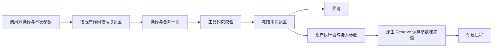

# 可复用的启动 Profile

用户已认可 profile 设计，并于 2026-11-14 授权按本方案实施。本文拥有选定设计；[使用说明](../launch-profiles.md)拥有当前操作指引，[Delivery](../../.controller/launch-profiles/delivery.md)拥有实现、检查和构建状态。设计接受不等于全部外部工具和部署环境均已验证。

## 用户结果与范围

用户为同一工具保存多套参数，设置默认值，通过短命令启动；必要时仅覆盖本次配置，并能在执行前查看实际参数及来源。修改或删除 profile 不改变已保存的 Agent 启动配置。

首个完整实现范围是本地 CLI 的创建、更新、列表、查看、删除、默认选择、启动覆盖、无执行预览和运行来源记录。所有已支持工具复用现有原生参数能力；不承诺新增工具能力。远端启动必须支持目标设备解析同一选择语义。TUI 既有显式工具启动继续可用；新增 profile 选择界面、Web 编辑、继承链、自动同步和角色模板不属于本轮建议范围。

## 现状与设计依据

| 现状 | 来源 | 对设计的约束 |
| --- | --- | --- |
| 每种工具读取一份配置参数，并按工具规则合并 CLI 参数 | [`merge_tool_args`](../../src/runtime/launcher.rs)、[配置目录](../../src/config.rs) | profile 参数仍是 argv 数组，复用适配器语义，不做通用字符串拼接 |
| 已知单值选项后者覆盖，可重复及未知参数保留顺序 | [参数覆盖](../../src/integrations/launch_args/overrides.rs) | “覆盖模型”与“追加目录”等行为不同，不能直接深合并 |
| 文件配置按作用域加载，修改使用稳定锁和原子替换 | [配置文件适配器](../../src/config/file.rs) | 使用现有配置文件，不新建数据库资源或独立配置中心 |
| 运行参数已有持久保存，恢复按工具规则过滤后复用 | [启动参数](../../src/runtime/launcher.rs)、[恢复客户端](../../src/runtime/resume_client.rs) | profile 来源与已解析参数一起保存，恢复不再查当前默认 profile |
| 远端当前在目标端应用目标配置 | [Relay host](../../src/relay/control_host.rs) | 不可在发送端合并一次、目标端再次合并 |
| 产品服务契约由 Rust 原生声明拥有 | [原生契约](../architecture/contracts.md) | 不以 Flow Atlas 中的 Zod 示例替代生产原生契约；TS/oRPC 消费按需投影 |

## 对象与所有权

| 对象 | 建议内容 | 不变量与所有者 |
| --- | --- | --- |
| LaunchProfile | 目录键 `name`、`tool`、可选 `description`、`args: Vec<String>` | config 拥有；名字在作用域内唯一；工具为支持的规范标识；args 保留空字符串和顺序 |
| ProfileDefaults | 可选全局 profile 名、各工具可选默认 profile 名 | config 拥有；引用必须存在，各工具默认必须匹配工具 |
| LaunchSelection | profile、tool、或显式绕过 profile | runtime 拥有；显式 profile 与 tool 不匹配时报错 |
| LaunchOverrides | argv 及 `merge` / `replace` 模式 | runtime 拥有；默认 merge，replace 用于清空或完整替换继承参数 |
| ResolvedLaunchConfiguration | 工具、合成后的可复用参数、选择原因、配置来源、按原始层保留的输入 | 启动准备生成不可变值，预览与实际启动消费同一值 |
| LaunchProvenance | profile 名与采用的定义内容、临时参数覆盖及合并模式 | 随既有 participant 启动记录保存；无 profile 的旧记录允许缺省；不保存整个调用环境 |

Profile 名建议限定为 `[A-Za-z0-9][A-Za-z0-9_-]*`，不支持路径或点号语义。名字作为第一版作用域内的键；不新增 UUID、版本仓库或多级命名空间。工具一经创建不通过 update 改换，换工具时另建 profile。

第一版配置内容集中在工具和原生参数。模型、推理等级等通过对应工具的 args 表达；不得再独立保存同一模型字段，造成双重事实源。后续需要表单时，由工具拥有的解析/渲染适配器提供字段视图，并保留未知参数；只有真实用例要求时才扩大结构化契约。

数量、目录、初始提示、终端、设备、headless/stdio、输出格式和跳过预览保留为请求上下文。系统提示本轮也继续使用现有入口，不引入新的 profile 默认叠加方式。Profile 不定义 Agent 身份、父子关系或角色。

## 文件表达与作用域

使用当前作用域的 `config.toml`；默认仍为 `~/.agentx/config.toml`，`AGENTX_DIR` 继续选择其他作用域。不额外自动查找项目 profile 文件，不跨用户/项目逐字段合并。

```toml
[launch]
default_profile = "codex-daily"

[launch.codex]
default_profile = "codex-daily"

[launch.profiles.codex-daily]
tool = "codex"
description = "日常开发"
args = ["--model", "MODEL_DAILY"]

[launch.profiles.codex-deep]
tool = "codex"
description = "复杂问题"
args = ["--model", "MODEL_DEEP"]
```

全局默认和各工具默认是两个独立的选择指向。全局默认改成 Claude，不改变显式 `--tool codex` 的默认。名为 `default` 的 profile 没有特殊能力，不要求用户创建这个名字。

文件读写复用既有文件锁、保留无关 TOML 内容和原子替换。列表/查看/编辑 profile 不获取 daemon；保存时校验名称、工具、输入结构、现有工具约束和引用关系，不运行工具或自动安装 hooks。配置保存校验不是上游所有原生参数的完整合法性证明。

CLI 的 `--profile` 对应 `AGENTX_PROFILE`，ENV 只在新建启动读取。显式 `--tool` 限制选择范围并屏蔽 ENV profile；显式 `--profile` 优先于 ENV；两者显式同时指定则检查一致性。空的 `AGENTX_PROFILE` 视为未选择。未知的显式/ENV profile 报错，不回退。profile/default 引用在 dotenv 控制作用域选定之后读取，不改变既有环境文件控制作用域冻结规则；内部 prepared child 不重新读取 profile 选择 ENV。

## 选择、合并与校验

按下表从上到下匹配，先确定唯一 base，再合并本次参数。默认 profile 不是继承底座。

| 请求 | 结果 |
| --- | --- |
| `--tool T --no-profile` | 使用 T，base 为空；不读取工具默认或旧工具参数 |
| `--profile P [--tool T]` | 使用 P；若显式 T 不匹配则失败 |
| 仅 `--tool T` | 选择 T 的默认 profile；未配置时走既有 T 默认参数路径 |
| 无上述显式选择，有 `AGENTX_PROFILE=P` | 选择 P |
| 无显式选择或 ENV profile | 选择全局默认；未配置则报错并提示指定工具或设置默认 |

`--no-profile` 要求显式 `--tool`，与 `--profile` 冲突。默认引用失效、选中 profile 格式错误等均在启动前失败，不能静默退回另一份配置。未选中 profile 的工具 args 无须读取；选中 profile 的结构或整个 TOML 语法错误必须报错。

具名 profile 的 base 仅来自其 `args`。旧的 `<tool>_args`、`AGENTX_<TOOL>_ARGS` 不作为隐式底座叠加。现有非 profile 启动保留 `内置 < 文件工具参数 < ENV 工具参数 < CLI 参数` 路径；新路径是 `选中 profile 参数 < CLI 参数`。工具自身读取的原生配置仍由工具拥有，本提案不重排其内部优先级。

merge 复用 `override_args`：已知单值及别名按现有规则后者覆盖；未知/可重复参数顺序保留；空值不丢失；原生分隔符之后保持不透明。replace 完全使用本次 argv，无额外 argv 时得到空数组。CLI 使用 `--replace-args` 表达 replace，不能通过空数组猜测用户要清空还是未提供参数。

没有覆盖时不重写保存的 profile；覆盖后也不自动保存。校验输入关系、数量和工具适配约束，再生成实际执行命令。AgentX 为协议接入注入的必要参数在既有 adapter/backend 阶段应用，不写回 profile；复用参数与最终执行命令明确区分。

## 建议 CLI

以下为选定接口。`profile` 的创建/更新也用 `--` 划分原生参数；当前实现和证据边界见 Delivery。

```text
agentx profile list [--json]
agentx profile show NAME [--json]
agentx profile create NAME --tool TOOL [--description TEXT] [-- native-args...]
agentx profile update NAME [--description TEXT] [--replace-args] [-- native-args...]
agentx profile delete NAME
agentx profile default [NAME | --unset] [--tool TOOL]

agentx launch [--profile NAME | --no-profile] [--tool TOOL] [--count N] [启动选项] [-- native-args...]
agentx launch --profile codex-deep -- --model MODEL_OTHER
agentx launch --profile codex-deep --replace-args
agentx launch --profile codex-deep --dry-run [--json]
```

create 已存在名字时报错；update 不存在名字时报错。update 的原生参数必须带 `--replace-args`，表示整组替换；省略该选项保留原参数，仅更新明确提供的描述；与 launch 的增量覆盖目的不同。description 显式空字符串用于清空。create 无原生参数可创建空配置。

`profile default` 省略 NAME/--unset 时查询当前全局默认；带 `--tool` 时查询或修改该工具默认。删除被任一默认指向的 profile 失败，提示先修改或清除默认；不提供级联修改。运行记录不是删除阻碍，因为记录持有所采用的值。

管理命令不隐式选择运行 Agent。JSON 输出是稳定的数据，进度和诊断走 stderr；参数/引用错误按既有 CLI 非零规则返回，不创建 Agent。交互与机器调用都不弹出工具选择器。

`--dry-run` 仅生成配置预览，不预留 participant、安装 hooks、创建项目权限文件、启动 daemon 或原生工具。输出选择原因、profile、工具、复用参数、覆盖前后变化、既有接入参数调整和待执行上下文；依赖执行阶段才能得到的事实必须显示为未解析。配置值预览是用户显式请求的本地输出，不自动进入观察事件或日志。新建时的强制预览条件必须检查解析后的配置，不只检查 CLI 是否带 argv。

列表展示名字、工具、说明和默认标记；show 展示保存的定义；dry-run 展示本次合并结果；三者不混用“已保存”和“本次有效”的含义。

## 执行、历史和远端



同批次多个 Agent 使用同一解析结果，不能每个子 Agent 重读可变 profile。新终端、PTY、stdio 的内部转交消费 prepared 配置，不再次默认合并；`--stdio -- --version` 既有无副作用探测保持专用路径，不把 profile 对话参数注入工具版本探测。

运行记录保存采用的 profile 定义和合并来源，沿现有 `launch_args` 保存实际可复用参数；不只保存 profile 名。扩展原生 Reserve/记录/ResumeSnapshot 的可选来源字段，并由 daemon 拥有数据库变更。旧记录缺少来源时按原路径恢复，不伪造历史 profile。配置来源是声明，不构成进程身份或授权证据。

resume/fork 默认从历史可复用参数出发，继续使用 `saved_args` 清除旧会话选择、初始任务等不可继承信息，再合并显式参数，不查询 profile 和 `AGENTX_PROFILE`。本轮不增加 resume/fork 的换 profile 选项，以免跨工具、会话锁定参数和提示继承产生含糊语义。

历史快照仅保证 AgentX 保存的配置不随 profile 漂移；原生工具版本、原生配置文件、凭据和环境仍可能变化，不能声称完全可重现。沿用现有敏感配置披露边界：不保留任意 env，不把 raw argv/profile 参数复制进观测事件或浏览器通用诊断；若要求持久化完整原始参数层，实施前必须核对现有保存/读取策略。

远端将未解析的 profile/tool 选择和本次 argv 传给目标设备，在目标作用域解析并执行一次。发送端不读取同名本地 profile，也不注入本地工具默认参数；远端缺少 profile 则明确失败。发送端若采用 `AGENTX_PROFILE`，只将其转换为明确 selector，不转发整个调用环境。目标端不能重新用自己的 selector ENV 改选。

远端 dry-run 需要走有限、只读的目标准备操作返回同一种配置预览；本地只启动通信所必需的既有服务，不创建 Agent。预览与后续真正启动是两次请求，期间目标文件可能改变，故独立 dry-run 不承诺随后执行仍使用相同文件内容。真正启动的一次准备/预览/执行必须使用同一个冻结值。目标文件路径、环境和 cwd 保持目标设备语义。

## 原生契约与源码结构建议

下面是责任和签名草案，正式声明仍需在实施的 skeleton 阶段落入原生源文件；本文件不另建可编译的设计类型包。

| 建议位置 | 责任与主要契约 |
| --- | --- |
| `src/config/profiles.rs` | `LaunchProfile`、`ProfileCatalog`、`ProfileDefaults`；`load_profiles(scope)`、`create/update/delete/set_default`；保持为 config 的文件配置子模块 |
| `src/config/file.rs` | 把现有锁定编辑能力开放给同域 profile 编辑，单次修改同时检查引用，不另写一份文件写入机制 |
| `src/runtime/launch_profile.rs` | `LaunchSelection`、`LaunchOverrides`、`ResolvedLaunchConfiguration`；纯 `resolve(catalog, legacy_args, selection, overrides)`；不启动进程、不打开数据库 |
| `src/runtime/launch_options.rs` | 原生 argv 边界及 replace/dry-run 控制；新建选择器仍由 launch 声明拥有，不让 profile 选项意外出现在 resume/fork |
| `src/cli/commands/profile.rs` | 解析、错误展示和 CLI 输出，调用 config 文件能力 |
| `src/cli/commands/launch.rs`、`src/runtime/launcher.rs` | 组合读取/选择/合并/预览/执行；拆清已解析 argv 与待合并 argv，删除重复合并机会 |
| `src/agents/launch_service.rs`、记录/存储/恢复投影 | 在既有 participant 启动用例中保存 `LaunchProvenance`；不新建平行的 Agent/profile 数据库域 |
| `src/relay/control_service.rs`、解析与 host | 传递未解析 selector/overrides，目标端调用同一准备逻辑；扩展有限只读准备操作 |

依赖方向为 `CLI/Relay → config catalog + runtime resolver → existing execution/native reservation`。管理文件配置不绕道 managed SQLite，runtime host 不写数据库。CLI/TUI/服务适配层不得各实现一次默认选择。

需要 TS 消费时，先定位真实产品调用边界，再为上述原生值和操作提供契约投影及转换验证；Zod 可验证传入数据，oRPC 可提供 TS 调用接口。两者均不得另行拥有一份 profile 合并策略。本轮不为尚不存在的 Web profile 功能建立 TS 服务。

## 收敛与实施顺序

不做自动重写用户配置，不在读取时生成持久 profile。保留无具名 profile 的原工具路径以确保现有调用可用；一旦选定 profile，就明确不读取旧工具 args。已有用户可以按 profile create 定义逐项搬入所需参数，之后清理旧值；不增加迁移框架。若未来删除旧配置入口，应作为独立的明确行为变更处理。

建议按一个连贯功能推进，先确定原生类型和边界，再建模块骨架，最后填充行为：

1. 文件模型和纯解析器：实现 CRUD、默认引用不变量、严格输入失败与覆盖结果。
2. 本地完整路径：接入 CLI、dry-run、批次冻结、stdio/PTY/新终端、原生历史来源和恢复不漂移。
3. 远端和既有消费者：目标解析、有限预览、TUI 显式工具调用、脚本、帮助与全景图一致性。
4. 按下面的场景完成相关检查；更新模块指南、实际支持和证据。执行阶段再建立对应 Delivery/Task，不把本次设计文档标作已交付。

## 决定性验收场景

| 场景 | 必须观察到的结果 |
| --- | --- |
| 保存同一工具两套 profile，各自启动 | 得到各自参数；未重复输入模型 |
| 设置全局/工具默认后省略选择 | 按选择矩阵解析；更改全局默认不改工具默认 |
| 同时带不匹配的工具和 profile | 创建 participant/进程前失败 |
| 临时覆盖模型、别名、重复项、未知参数、空值 | 既有工具合并语义保留；保存文件不变 |
| replace 与空 argv | 完整替换/清空，不重新叠加工具默认 |
| 选中具名 profile 时同时存在旧 args/ENV args | 实际结果不混入旧参数；预览解释 base 来源 |
| 修改/删除 profile 后恢复与分叉 | 仍按保存的可复用参数及现有过滤规则执行 |
| 同批次启动期间 profile 文件改变 | 本批次全部使用同一冻结配置 |
| 被默认引用的删除、失效引用、配置格式错误 | 原子拒绝或明确失败，不启动替代配置 |
| 配置管理与本地 dry-run | 无 daemon/Agent/工具执行及 hooks/项目文件副作用 |
| 远端存在同名但不同内容的 profile | 仅使用目标设备配置，结果来源明确，无二次合并 |
| 旧 Agent 记录与既有 stdio 版本探测 | 仍可按原契约消费，不要求虚构 profile 来源 |

## 状态、取舍和后续

实施采用现有 config 子模块、纯 runtime 解析器和 participant 原生启动记录；schema v24 添加可选 profile 来源。远端通过有限的 `launch-profile` / `launch-preview` 能力传递选择，在目标端解析。Profile 管理和本地 dry-run 在普通身份/服务路由前处理；stdio 的项目准备不提前解析 profile，实际选择发生在有效环境与作用域确定后。

文件目录解析严格检查整份 profile 目录的结构和工具标识，选中 profile 的 Provider argv 才做工具参数校验；失效默认引用在实际选择或文件修改时检查。该取舍避免静默接受部分损坏的目录，代价是无关 profile 的结构错误也会阻止读取目录。Profile 参数只进入既有启动历史及显式本地查询/预览，不新增 raw argv 观察事件。具体声明、检查和资源边界沿 Delivery 导航，不从本提案推断实测支持。

本轮建议选择 argv 作为 provider 配置的权威表达，代价是第一版模型/推理等级无法作为统一跨工具字段直接查询。当前收益是覆盖所有现有工具参数、保留上游扩展能力且避免维护第二份 Provider 配置语言。若后续用户明确需要统一模型选择表单，应在工具域内补齐有真实消费场景的结构化契约，而不是由 profile 域猜测所有工具能力。
