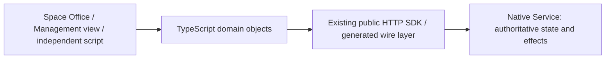

# AgentX TypeScript domain object SDK

The user selected the direction: make the AgentX domain model an independent, reusable TypeScript surface before formal UI integration. An upper layer can wrap a Workspace as an Office, add layout, people presentation and interaction methods, and delegate resource work to the lower object. Agent objects should provide semantic operations (such as reading or sending messages) while hiding HTTP request assembly. Decide how to use inheritance and composition from each model's actual responsibilities and substitutability. Public signatures and the full object model remain to be designed and proven.

The [native model](../model/README.md) and [current Service → OpenAPI → SDK projection](../api-panorama/service-contract-design.md) stay authoritative for server behavior and wire contracts. [Current SDK](../../packages/agentx-client/README.md) already exposes generated HTTP calls plus named methods, codecs, exact identity checks and original operation recovery. The missing layer owns domain addressing, explicit snapshots and relationships, consumer-facing operations and the stable context needed to use them consistently. Presentation owns UI selection, drafts, animation, disclosure, spatial metadata and display state; no UI or framework dependency runs downward.

The first complete path is: explicitly select a management service scope → discover Workspace and Role → locate an exact Agent associated with that context → read its snapshot and bounded messages → prepare and send one message → observe the original Operation including after an interrupted response. Model first, then materialize typed signatures and module boundaries, then implement and run a real isolated consumer. Keep other domains, formal migration of Web consumers and installed/live rollout outside this first slice.

Key distinctions to preserve: workspace membership versus process cwd and directory-route lookup; valid global membership versus missing information; effective RoleDefinition versus adopted Role snapshot; current execution versus stopped record and same-name successor; immutable identifiers and observed state versus current authorization; submitted/admitted result versus execution, delivery or reply; definite rejection versus outcome unknown. Keep source coverage and bounded reads. Do not promise a complete server-filtered workspace member page if only a partial projection of globally paged rows exists.

A thin hand-authored consumer projection atop the existing package is the initial direction. An additive domain subpath is a candidate, not a binding name. Preserve the public HTTP/CLI surface and generated/native ownership. Consider further generation only for mechanically repeated structure once proven; no new toolchain or general superclass framework. Use a presentation-independent script and two small consumer sketches to show the object layer works with different upper-layer vocabularies. A real isolated daemon replay, separate from author checks, will establish the selected behaviors and actual limits.

## Complete the object model

The user selected implementation of the full object model after the [source audit](../model/typescript-domain-sdk-review.md). The [Delivery](../../.controller/typescript-domain-sdk/completeness.delivery.md) owns implementation order and scope. This section is the target; the [current model](../model/typescript-domain-sdk.md) describes implemented behavior.

| Object boundary | Owns | Caller guarantees |
| --- | --- | --- |
| Selected scope | Listener/scope/generation binding; discovery; top-level resources and operations | Scope selection is explicit; neither refresh nor fallback silently rebinds an existing address. |
| Workspace and Role | Adopted membership, current effective role definitions, scoped creation context | A path used to work or route a message is not a membership claim. An adopted role is historical fact. Server-filtered pages and the older global projection have distinct coverage and cursors. |
| Agent | Exact current or stopped identity; facts, AgentX events, Provider transcript, launch provenance, lifecycle and applicable exact writes | Handles and observations are separate. Share only genuine read/command capabilities across current and stopped. Live capability hints can expire; the server decides admission. Do not upgrade a name into an address. |
| Prepared commands and operations | Original address, intended action and input, observation and typed result | Preparation is inert. Submission is explicit. Recovery reads the original operation, even if the target is no longer available. Receipt uncertainty is not failure; observation cancellation is not command cancellation. A result may carry a new exact Agent only if native supplies it. |
| Attachments, human inbox and directory route | Independent resources bound to the selected scope | Attachment registration and explicit send are separate. Human read and handling are separate. Directory inspection does not guarantee later routing. Do not make these surrogate Agents or Workspaces. |

Application code consumes object methods and composable domain values. Internal adapters own generation fields, native DTO variants, codecs and endpoint assembly. Model values according to differences that matter to a caller, without mandating a second copy of identical semantic types or a generic CRUD hierarchy. New APIs must be additive to existing package, HTTP and CLI callers; disclose older-listener capability where native support is needed. Keep presentation, caching policy and command persistence in callers. Contract Canvas visualizes the implemented contracts and separately marked proposals; it does not own them.

Use Space as the concrete consumer: select an exact conversation → read either event history or Provider transcript → see creation provenance and navigate to an available related conversation → submit deliberate commands and recover their original results. Add workspace discovery/membership, role adoption, attachments, inbox, directory and activity where the scenario calls for them. Independent Workbench, Observation and Inspector domains retain their own contracts. Verify with tiny fixtures for competing same-name identities, wrong cursor/address, lost response and old-generation recovery, and one complete consumer run after the source composes. No load or large-data testing on the shared machine.
