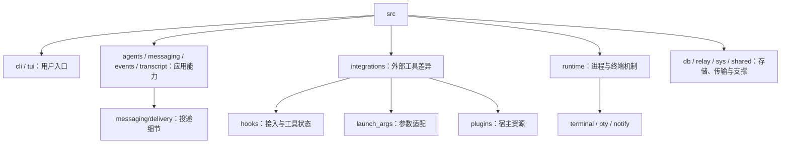

# 源码目录迁移方案

范围：当前 `src` 的全部 196 个文件，及直接引用源码位置的构建配置、测试和维护文档。保持程序行为、CLI、配置、存储格式和插件安装位置不变；不拆函数、改算法、引入依赖或拆 crate。

## 目标与边界

| 目录 | 负责的上下文 | 内部细节与边界 |
| --- | --- | --- |
| `cli` | 命令解释、命令执行入口和 CLI 反馈 | 命令专属细节归入具体命令，如 `commands/reset`；通用业务规则不在此新增 |
| `tui` | 交互界面、显示状态、输入与动作 | 渲染在 `render`；输入在 `input`；子进程动作请求在 `rpc` |
| `agents` | 参与者记录、身份解析、绑定、命名与生命周期 | 与真实进程运行机制分开；文件名在目录上下文中表达各自职责 |
| `messaging` | 消息路由、校验、上下文包和投递 | `delivery` 承接投递循环与工具特有投递细节 |
| `integrations` | 外部 AI 工具的身份、元数据及适配 | `hooks` 处理调用；`launch_args` 处理启动参数；`plugins` 是外部宿主加载的资源 |
| `runtime` | 启动流程、运行环境、终端、PTY 与唤醒 | `terminal` 管终端启动及预设；`pty` 管进程 I/O；`notify` 管进程唤醒 |
| `events` | 事件查询及订阅共同使用的筛选能力 | 当前保留完整 `filters` 文件，包含 SQL 生成；不宣称是纯领域层 |
| `transcript` | 统一转录读取、解析及显示详细程度 | 各工具解析器保留于此，不与 Hook 或插件资源混放 |
| `relay` | 跨设备同步、传输及远程控制 | 保留现有子模块归属 |
| `db` | 本地数据库、实体读写与订阅记录 | 保留存储责任；此次不抽象数据库接口 |
| `workflows` | 随产品分发的 shell 工作流 | 与仓库根 `scripts` 的开发检查脚本区分 |
| `sys` | 操作系统相关 I/O、进程、网络、信号和文件封装 | 保留现有平台适配 |
| `shared` | 现有跨模块的状态常量、错误、通用文本/时间能力及公共值类型 | 将归属明确的运行上下文、工具识别、终端预设迁出；剩余混合文件不为目录整理而拆函数 |

根层保留 `main.rs`、`config.rs`、`paths.rs`、`log.rs`，分别负责进程入口、全局配置、应用路径和日志。它们都是项目级支撑，既不并入模糊的 `core`，也不新增空壳目录。

目录表示维护归属及复杂度范围。现有调用和双向引用保持；本迁移不把现有实现描述成已经强制单向依赖的分层架构。

此图是目标归属关系，不是运行依赖图。Rust 声明和实际调用拥有接口的最终定义。

## 命名与粒度

- 使用目录给出主题，文件名表达该主题下的职责：`agents/binding.rs`、`cli/commands/reset/preview.rs`。
- 去掉被父目录完整表达的重复前缀：`launch_args/codex.rs`、`terminal/presets.rs`。
- 以 `mod.rs` 统一已有多文件模块入口；入口本身已有实现时保留实现，不拆函数或改成全量转发层。
- 单一且完整的根层能力仍可用一个文件；不机械追求统一深度或文件数量。
- `hooks/claude` 和 `hooks/hermes` 分别收拢各自已有多文件实现；已有 `kimi`、`omp` 模块结构保留。
- 插件中宿主规定的 `__init__.py`、`plugin.yaml`、`.claude-plugin/plugin.json`、`agentx.ts` 等保持原名。
- `core` 清空后删除；不保留旧根模块别名或转发文件。工具为保证已有局部绑定而生成的 `use` 是正常导入，不是兼容模块。

## 精确映射和执行顺序

[完整目标目录树](target-tree.txt)、[完整逐文件对照表](file-map.tsv)和[机器可读映射与原始哈希](file-map.json)覆盖全部 196 个原文件，包含路径保留项。[完整迁移计划](migration-plan.json) 定义整批执行范围、顺序和校验方式；逐文件映射直接给出最终位置，不要求经过临时路径或依赖特定迁移工具。

1. 按完整映射搬迁和改名，创建各能力的模块入口。
2. 一次性调整模块声明、可见性、导入、重导出、宏路径和相对路径，保留原有业务实现。
3. 同时更新嵌入资源、测试、构建脚本与维护文档中的路径；删除清空的 `core`。
4. 整批完成后检查映射兑现与资源完整，再统一执行格式、Clippy、Rust 测试、插件类型与投递测试和发布构建。
5. 检查失败时由 Agent 直接修复具体问题，再运行受影响检查。

仓库根 `plugin/`、`skills/` 和无关实验不参与迁移。整批修改后统一验证，不设置逐文件分析器或编译门禁。

### 指南修订依据

原指南把工具的逐步校验限制变成了目录迁移的默认流程，造成反复加载、编译、容量等待，并让无关符号链接阻挡主体任务。用户需要的是完整、清晰的源码组织；Agent 已有完整映射及最终修复权限。修订后的 [Rust 迁移指南](../../.agent-guides/scenarios/rust-module-migration.md) 默认整体修改、统一检查、直接修复，把语义工具作为可选辅助，保留用户改动及行为兼容约束。

## 维护场景验收

- 新增插件：从 `integrations/plugins/<tool>` 定位宿主资源，从相邻 `hooks` 和 `launch_args` 定位对应适配，不在 `src` 根层继续新增工具目录。
- 修改参与者绑定：进入 `agents/binding.rs`；生命周期和命名在同级，进程启动机制在 `runtime`。
- 修改 reset：在 `cli/commands/reset` 内理解入口、操作及预览，不向命令列表平铺内部文件。
- 修改终端：在 `runtime/terminal` 找启动与预设，在同级 `pty` 找字节流与屏幕状态。

## 执行记录

迁移已落位：126 个原文件调整位置或名称，69 个文件路径保留，清空后的 `core/mod.rs` 删除；新增 6 个能力入口和 `src/README.md`。路径保留不代表文件内容不变，其导入按新归属接线。

| 验证 | 当前结果 |
| --- | --- |
| 196 项源文件映射 | 全部目标存在；旧位置无多余文件；无目的路径冲突 |
| 插件与 shell 资源 | 所有非 Rust 原文件与迁移前 SHA-256 完全一致 |
| 根 `plugin/`、`skills/` | Git diff 为空 |
| `cargo check --all-targets --locked` | 通过，无编译警告 |
| `just package` | 通过；`.bin/agentx --version` 为 `agentx 0.7.31` |
| `just ci fmt clippy test` | 格式与 Clippy 通过；Rust 单元测试 2711 通过、3 失败、1 忽略；3 个失败均在原始基线复现 |
| Rust 集成测试 | 83 通过、11 忽略、0 失败；覆盖 CLI、内置工作流、消息投递、PTY 和安装 |
| 插件 TypeScript 类型检查 | `node node_modules/typescript/bin/tsc --noEmit` 通过 |
| 插件投递回归 | `npm run test:plugins`：25 通过、0 失败 |
| Hermes 插件回归 | `python3 -I tests/hermes_plugin.py`：71 通过、0 失败 |
| `git diff --check` | 通过 |

原始基线为 `d11c43e`。从该提交导出原始源码，分别执行以下三个测试，均复现同样的断言失败；因此不在目录迁移中修改其业务逻辑或断言：

- `commands::help::tests::overlong_usage_wraps_description_to_its_column`：帮助文本列间距断言。
- `relay::broker::tests::mqtt_probe_sends_private_broker_credentials`：MQTT 连接凭据字节断言。
- `pty::vt_compat::tests::agy_wake_echo_with_backtab_renders_in_place`：终端回显空格断言。

集成验证命令为 `just test --test cli_smoke --test bundled_scripts --test send_delivery --test pty_backpressure --test test_pty_delivery --test uvx_install`。被忽略的真实工具 PTY 用例未执行；此次没有验证 Windows 或 Android 实机运行。

`just ci typecheck` 的依赖安装阶段持续下载大型 ONNX 原生运行库；使用已就绪的编译器和类型声明直接完成上表三项源码检查后，停止该安装。因此插件源码检查通过，完整配方的依赖安装阶段未完成。本机使用 Node `24.21.0`、Python `3.15.0`；未运行固定 Node 22 的远程 CI。

迁移不新增依赖、不改业务流程、不提交或发布。

## 旧迁移工具清理

2026-11-18 按用户要求，已将未纳入版本控制、没有当前产品构建引用的 `tools/rust-module-migration` 移出仓库，并移除其根目录 `prod-code.toml`。外部下载源码、补丁、包装脚本和历史日志一起保留为可恢复归档；位置与依据见[清理记录](../../.controller/source-hygiene-diagnosis/controller.task.md#external-source-cleanup-result)。前面的迁移验证属于历史证据，不要求恢复该工具才能维护当前源码。实际使用的第三方发行资源保留在各自模块，由其构建入口和许可证记录说明来源。
