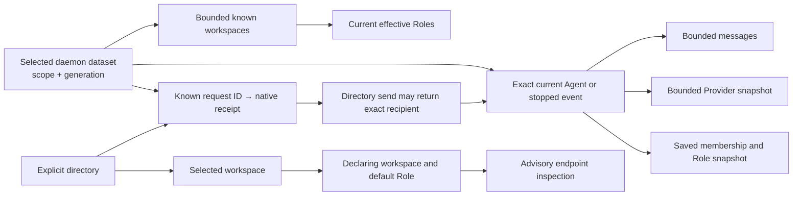

# Management: from diagnosis to a known result

Management serves an operator of one selected daemon dataset. Start at **Agents**, where lifecycle state and exact identity are next to the work they govern. **Workspaces** owns catalog and directory routing, even for a workspace with no members. **Operations** owns recovery of original requests across targets, pages and reloads. Use a contextual receipt on the originating page so routine actions do not incur a page jump. The following is the first usable target contract for the synthetic candidate. Concrete route encoding belongs to the prototype; production compatibility is separate.

## Navigation and named regions

| Destination | Main task and named regions | Local disclosures and return |
| --- | --- | --- |
| **Agents** (default) | Scope Bar (selected endpoint/project and scope); Agent Index (loaded search, native label filters if supported, workspaces, live/stopped, row state and pagination); Agent Work Area (pinned exact identity + native affordances); Messages and Transcript views | Selected agent provenance, label editor, action confirmation, and exact receipt stay local. Narrow screens use a picker and a pinned subject bar; close returns to the same agent/filter/scroll. |
| **Workspaces** | Workspace Index (bounded known paths and coverage; explicit global/path selector); Workspace Work Area (current effective Roles, related loaded Agents, Directory Route); directory supplied separately from workspace | Role source and exact adopted facts are separate. Route preview is read-only; compose/send uses the original directory, then shows the actual receipt. Launch a displayed Role through the same Launch dialog with its workspace prefilled. |
| **Operations** | Browser Journal (pending, unresolved and terminal retained entries); Receipt Work Area (original request, scope, subject, result, recovery) | Originating pages show a compact contextual receipt. Operations can reopen an exact associated Agent when resolved; returning restores previous state. This is the local journal, with native lookup by known request ID; no daemon-wide enumeration. |

The scope bar exposes **Launch** and the local unresolved operation count from every page. Do not require an Agent selection to navigate Workspaces, inspect routing, launch, or recover an operation. No separate Overview, History or Trends route: put actionable state beside the resource, show stopped history in Agents, and keep unexplained time series out. Use local tabs or a panel for Messages and Transcript, a modal for launch/stop confirmation, and a focused drawer for receipts. Keep the primary controls and selection visible at narrow size; independently scroll records and return keyboard focus to the opener.

## Scenario anchors

- **MG-01 — Investigate and act on an exact Agent.** Filter/select an Agent → inspect reported status, capabilities and membership → read bounded messages; send when allowed → read admission receipt → observe any reply separately. View a bounded Transcript snapshot as a separate operation. Adverse: an identically named stopped execution cannot inherit current messages, gates, or draft; transient refresh is stale, and exact ref loss requires explicit reselection.
- **MG-02 — Inspect and contact a directory route.** Select a workspace, see effective Roles and loaded members → inspect an explicit directory → read requested directory, selected workspace, declaring workspace/Role and endpoint state → send after reviewing potential routing effects → read actual recipient and operation result. Adverse: missing/ambiguous/stale route or unavailable subject; do not infer a recipient from the member list or present preview as a promise. Native execution re-resolves.
- **MG-03 — Recover a write with a lost reply.** Submit exactly once → retain original request ID, generation and command → navigate away/reload → lookup original receipt → see terminal result or explicit unresolved state. Replay is explicit and uses the identical saved request only after a successful same-scope/generation lookup reports the receipt absent and no receipt/effect is known; a returned native Unknown must never be replayed as new work. Wrong scope/generation and definitive conflict show a recovery barrier; no automatic resend.
- **MG-04 — Manage lifecycle and classification.** Launch by Role/workspace or explicit tool/profile → read returned name(s) and any failure → find and explicitly select an exact current record → stop with confirmation → inspect exact stopped history and resume when allowed → read the new launch receipt and explicitly select an exact record. Launch/resume receipts currently return names, not execution refs. Edit scalar labels only for advertised support; show revision conflict and preserve the draft for rebase. Never treat a kill receipt as task completion.

Common fixture needs: same-name successor and stopped reference; an adopted workspace member whose cwd differs; a known empty workspace; unassigned/global, legacy and unavailable membership; a Role definition whose profile is unspecified; a directory with preview-versus-execution divergence or a denied send; one deterministic lost response with recoverable original ID; one native unknown receipt; partial and empty collections. Label them synthetic and keep all calls within the preview.

## Operator model and key decisions

The actor is an **operator with access to the selected Management listener**. This is an inferred work role grounded in the existing console and native API, not an interview finding or an authorization tier. The same person may switch to Space to participate in a conversation. Management keeps Messages because checking actual communication and sending corrective work can be critical to diagnosing an execution; a spatial or unified conversation inbox belongs to Space.

| Operator question | Facts needed together | Decision and finish condition |
| --- | --- | --- |
| Which Agent needs attention and what can I do? | Current vs stopped, name/title, reported state, exact reference, membership, available native actions; optional request error or pending-message count with coverage | Choose the intended execution, inspect the evidence and take an allowed action; verify the operation and any later observed effect separately. |
| Who would receive work for this directory? | Requested directory, selected workspace, declaring workspace and default Role source, advisory binding state, any exact participant and reason | Decide whether to send routed work or inspect/configure the target first; reconcile the actual receipt after submission. |
| What did my last action do? | Originating scope/generation, immutable request ID and command, known result/uncertainty, exact subject when supported | Recover the existing request or keep uncertainty explicit; avoid duplication and preserve where work can be resumed. |

Grouping around **Agents / Workspaces / Operations** addresses three independent tasks. The old Office tab requires navigating through Agent detail for work that can start without an Agent; promoting Workspaces fixes that mismatch. A single all-purpose drawer makes unresolved work harder to find across subjects; Operations gets its own page and keeps a small contextual receipt. A separate Overview was considered; the loaded roster and local journal already carry the actionable signals with clearer coverage. Keep the live roster, inactive current rows and stopped history in Agents with visible row kinds; a separate History product would add navigation without a new authority.

## Subject and scope model

- **Identity:** fence on selected endpoint/dataset and generation, with native canonical Agent name plus exactly one of incarnation or stopped-event ID. Keep strings opaque and lossless. Distinguish reachability of the endpoint from the selected dataset; same URL may later serve a reset dataset. A namesake successor does not satisfy a stale selection. Retain the old reference visibly; link to a find/select flow when appropriate. Read late results only into their initiating scope/query/subject. Current is a record type, not a guarantee of running; a killed/failed/inactive status and a retained stopped event have different meaning.
- **Four independent outcomes:** API/collection freshness, Agent lifecycle, operation admission/execution and communication delivery or work completion. An accepted/running receipt is pending. A successful send returns a message ID; a reply or other evidence is needed to infer further effect. A successful kill receipt may mean a signal was sent; poll the exact lifecycle or surface uncertain retirement. A succeeded launch with an error/empty result does not guarantee a running Agent.
- **Workspace knowledge:** membership is saved adoption; cwd is execution context. Explicit global, legacy without recorded adoption and unavailable are distinct; a recorded null Role means confirmed roleless. Known paths come from marked discovery or adoption and may be empty/deleted; the current effective catalog is a bounded host read with native precedence, not a saved Role mutation. Preserve path/namespace, nullable profile and default declaration; never infer inherited effective default from one flag. Follow [workspace policy](../proposals/workspace-discovery.md) and [office contract](../agent-management/offices.md#facts-and-identities).
- **Operation identity:** persist the original endpoint/dataset/generation, kind, ID and exact command before POST; on failure to persist, show “not sent.” Protect pending and Unknown records across views/reload and show their scope even when it is unavailable. Journal storage is browser-local and can be cleared/unavailable; no cross-device sync or daemon enumeration. Hide/dismiss is local only. Current [browser journal](../../web/management/model.ts) persists generation and intent; endpoint/scope partitioning and clear old-scope presentation are target browser work, not a claim about the current key.
- **Continuity:** page, filters, selected exact key, tab and relevant scroll survive intra-app navigation and contextual return while valid. Message/label drafts key by endpoint/dataset/generation/exact ref; directory drafts key by dataset and explicit directory; launch forms retain draft while reviewing related input within the app. Keep compose and receipts separate: application reload recovers original request regardless of UI draft lifetime. Never carry a message/reply/label draft, capability state, or receipt across exact subjects. Keep URL state compatible with the existing document and `managementUrl` (query or hash state can work without new server paths); no draft, command body or tokens in URLs.

## Page composition and truthful state

| Page | Facts and controls visible together | Disclosure and continuation |
| --- | --- | --- |
| **Agents** | Agent Index: loaded search, current/history selector, workspace and label filters, row exact kind/status and title/name, applied filter and coverage, Load more. Agent Header: selected name/title, current/stopped distinction, lifecycle and membership, primary action availability; pinned while Messages or Transcript scrolls. | Identity/Provenance reveals full ref, reported cwd, adopted Role/profile, status context and request error if reported. Messages shows sender, time, intent and reply affordance next to composer; advanced thread/reply inputs local. Transcript carries snapshot reason and coverage. Labels edit, process termination confirmation and request details open locally. |
| **Workspaces** | Known workspace paths and provenance/coverage; explicit path or global query independent of roster. Work Area shows current effective Roles, bounded related members, Directory Route. Route shows requested directory → selected workspace → declaring workspace/Role → endpoint; native names and states remain readable without following a graph. | A related Agent opens exact Agents view; Back returns to the previously selected workspace, draft/route and scroll. Role source details and Launch this Role are local. Route result and composer are adjacent; contextual receipt compares preview when retained with the actual result. Directory input change invalidates old preview; failed/stale preview cannot imply no endpoint. |
| **Operations** | Browser journal grouped or filterable by unresolved/pending/finished; show original kind, target or directory, local submitted time, scope and state; result and recovery next to original request. | Request ID and exact body as readable/copyable diagnostic disclosure; typed result is primary. Open exact result only when supplied and revalidated; name-only result offers Find in Agents. Return to the initiating view via retained context where available. Known older entries remain distinguishable from current scope. |

On a wide screen, keep one collection and its work area side by side; avoid a persistent third column that squeezes working records. At narrow size, keep scope, navigation and selected subject discoverable; the collection becomes a local picker or, with no selection, the initial view. Use touch/keyboard accessible controls with focus return; a receipt drawer can become a modal-height sheet without evicting the underlying work. Keep scroll within the main working content when practical and avoid horizontal page scroll. Essential scope, consequences, and recovery controls must survive long paths/IDs, open disclosures, and enlargement. Use compact labels when an icon would be ambiguous.

### Graphics that support decisions

- **Roster:** a compact clickable current/history and reported-state summary is justified only if each bucket scopes the visible roster and counts distinct rows with explicitly labeled coverage. Pending-message counts are per exact current Agent when supplied; `null` is unknown/unavailable, not zero. Use text and exact counts, including “loaded only” and visible continuation; never title the loaded count “all Agents.” The table or grouped rows are sufficient if a chart repeats them.
- **Directory route:** a directional strip with named nodes lets the operator see when a directory under one workspace uses an inherited Role or exact participant elsewhere. Show the resolved route in the receipt as actual execution data; preserve preview/execution distinction even when they agree. At narrow width, use an ordered stack with the same semantics.
- **Operations:** use ordered rows of observed state/result and a local unresolved count. If an operation has only a receipt status and local submitted time, avoid invented transition timestamps, completion percent or duration. No throughput, uptime, health trend, fleet-wide counts or inference from Inspector data. Useful current Agent evidence stays local; Observability is deferred.

## Acceptance and flow bindings

Each row is a scenario criterion and path to the supported native fact. The synthetic fixture needs deterministic effects for these paths; automation can assert controls, scope, navigation and authored effects. Human comprehension, concurrency/durability of native systems, and installed behavior remain separate. The prototyper owns reset and concrete selector/producer paths in the [prototype Task](../../.controller/web-product-design/tasks/management-prototype.task.md); the [evaluation Task](../../.controller/web-product-design/tasks/evaluation.task.md) owns independent runs.

| Criterion | User sequence and observable result | Boundary and adverse continuation |
| --- | --- | --- |
| **MG-01.a** Identify and diagnose | Agents → scope + filters → exact record; inspect status, workspace versus cwd and ability to act; if using loaded search and no match, show coverage and Load more/clear filters. | [Agent reads](../../src/management/contract.rs), including optional pending count/error. Current vs stopped, no selection, no matches vs readable empty, transient read failure vs stale ref; never fall through to another record. |
| **MG-01.b** Communicate and return | Select exact current record → read ordered messages → Reply/compose with visible exact target → Send → see admission and later actual response separately → change tab/target and return to the correct draft. | [Exact send and bounded messages](../agent-management/design.md#http-contract). Disable submission for stale detail or missing capability; if same-name history exists, its messages and drafts remain separate. Unresolved send enters MG-03. |
| **MG-01.c** Inspect model evidence | Read Transcript snapshot on demand → distinguish available with content, successful empty, unavailable with reason, execution failed, and unknown → return to Messages. | [Transcript result](../../src/management/contract.rs), not a live model stream or AgentX message history. Resumed Provider session may contain older exchanges. |
| **MG-02.a** Establish route | Workspaces → known, explicit or global workspace → inspect effective Roles and loaded members → supply exact directory → inspect route; no receipt or membership mutation occurs. | [Pure endpoint inspection](../agent-management/offices.md#pure-endpoint-inspection); show bound/adoptable/absent/ambiguous/role_changed/stale/unknown and reason without interpreting binding as readiness. Missing default, catalog error, scan cap and no loaded members differ. |
| **MG-02.b** Send and reconcile | From Directory Route compose, review directory and “may adopt/create endpoint” consequence → send → see result: resolved route at execution, exact recipient, new/reused endpoint and message ID. Open exact recipient if still available → return to same workspace and directory context. | [Directory send](../agent-management/offices.md#launch-and-directory-send) re-resolves. Preview changes or cannot resolve; surface actual changed destination/unavailability and actionable error, not a guessed target or implicit resend. |
| **MG-03.a** Recover original | Submit → write saved before request → response lost → open Operations from anywhere or reload → query original ID and read original result, with same target scope/body and exactly one effect. | Native [journal admission](../agent-management/design.md#configuration-and-lifetime) + [browser storage](../../web/management/use-management.ts). Read-only polling is safe; storage failure before submission has no outgoing write. |
| **MG-03.b** Separate absent/unknown/denied | An absent receipt on eligible same scope/generation lookup enables explicit same-body, same-ID replay; terminal native Unknown or denied/wrong-scope request has no replay affordance. Keep query/recovery and scope mismatch legible on narrow. | No replay based on timeout, transient lookup error or old generation; no new request ID, no implicit retry, no claim of cancellation. A journal entry for a different endpoint must not query that endpoint without explicit selection. |
| **MG-04.a** Launch and manage lifecycle | Launch from scope bar or current Role → choose effective selector and independent cwd → find returned name explicitly → verify exact current record → Terminate process with exact confirmation → read outcome → select exact stopped event and Resume if offered → find newly named execution explicitly. | Named-only [launch/stop/resume result](../../src/management/contract.rs). Stop may signal before retirement; cannot resume a stopped event when native eligibility is false (e.g. namesake exists). Keep process termination, Stop participation and Fork distinct. |
| **MG-04.b** Classify and repair conflict | With supported current record → edit only changed scalar labels → update by revision; change the fixture revision to force conflict → keep draft and explicitly refresh/rebase → review and resubmit. | [Scalar label contract](../agent-classification.md): absent support, null/unrecorded labels, empty labels and stale revision are distinct. Native filters match current records before pagination. No edit on stopped history, and no rebase while the original write remains unresolved. |

Suggested narrow check: **390 × 844 CSS px**, alongside desktop **1440 × 900**; select a representative long-path or same-name fixture, check the consequential action and recovery using keyboard, and record visible distinct facts/direct actions plus the disclosure steps for overflow actions. Compare current and candidate only for equivalent state and viewport; differences in synthetic data can support structural observations, not a quantitative improvement claim. Prototype self-review is separate from independent evaluation and participant validation.

## Capability disposition and engineering handoff

The coverage denominator is the current Management console's controls, inventoried from [Console](../../web/management/console.tsx) and its business Blocks. Selected SDK-only reads/actions are tracked separately; native availability does not require making new product promises. The static candidate is an experience test and may omit secondary variants if its Task names them explicitly. No existing Web capability is removed by the proposed IA.

| Existing surface | Target binding / implementation landing |
| --- | --- |
| Descriptor/project, connection and refresh, current/stopped roster, loaded search/office filter, pagination and exact detail | Keep the existing component/concurrency boundary in [resources.tsx](../../web/management/resources.tsx) and [use-management.ts](../../web/management/use-management.ts). Promote page/scope state in Console; fence all reads, selection, sorting and drafts by their actual key. Mark partial data rather than ordering beyond loaded rows. |
| Message list/cursors, author/time/recipient, text send, intent, reply/thread, per-ref draft | Preserve [conversation.tsx](../../web/management/conversation.tsx) semantics in the Agent Work Area. Use existing named SDK methods and original journal; distinguish submission, native receipt, actual message and reply. Message attachments are available to other consumers through the API, but Management's current composer supplies text and metadata only. Attachment composition remains outside this redesign. |
| Transcript fetch/refresh, bounded exchanges/actions/files, missing/reason and receipt | Local Transcript view stays under exact Agent. Reuse the native job and bounded result; identify unavailable, empty, failed and Unknown separately. |
| Launch title, Role/workspace or tool/profile, independent cwd/default project, initial task; process stop, resume and retained history | Global and Role-prefilled entries share [launch.tsx](../../web/management/launch.tsx). Agents toolbar uses explicit “Terminate process” labeling for current stop/kill semantics, separates eligibility from display state and uses the original operation. Preserve native defaults and form byte limits; the command response alone cannot support an exact launched/stopped link. |
| Adopted facts, bounded workspace discovery + coverage, explicit workspace/global, Role provenance and launch, directory preview and text send | Move [offices.tsx](../../web/management/offices.tsx) into an independent Workspaces workspace. Adopted facts remain local to the selected Agent. Maintain cancellable, generation-fenced reads in [use-offices.ts](../../web/management/use-offices.ts); no browser-side filesystem resolution. |
| Descriptor-gated scalar editor, conditional partial write, conflict rebase, native label selectors, loaded grouping | Preserve [labels](../../web/management/labels/editor.tsx) in the selected Agent and Agent Index. Current-only filtering, null/unrecorded history, and loaded grouping are explicitly labeled; the revised form remains scoped to the record. |
| Durable browser journal, polling original ID, manual original lookup, same-ID replay, terminal dismissal, raw request/result | Recompose [operations.tsx](../../web/management/operations.tsx) for local receipt and dedicated journal using one [model](../../web/management/model.ts). Preserve prior journal records readably; a legacy entry lacking endpoint attribution is unbound until safely verified, with no replay based on guessing the matching endpoint. Only definitive same-dataset/generation absence permits explicit unchanged replay. Expose local discard semantics for terminal records. |

Related capabilities intentionally left with existing consumers: Space's human mailbox and office activity, exact launch relations UI and attachments; Inspector session detail and diagnosis tools; separate Workbench. SDK already distinguishes Fork and Stop participation from Resume and Kill. They need product-specific evidence and separate confirmation and affordance design before adding to Management; no proxy shell, daemon start/stop, bulk operation, workspace registration, total/fleet analytics, or filesystem/editor scope is implied. Richer provenance (e.g. exact parent/child ref) can enter a local Agent disclosure in a later slice if a decision requires it.

Suggested Management engineering sequence for the Controller:

1. **Fence navigation and recovery first.** Preserve current embedded/explicit endpoint integration, public SDK codec and named calls. Introduce safe descriptor/endpoint-partitioned local state, exact selection and durable receipts; verify reload, old scope, browser Back, duplicate admission and claim/receipt semantics with isolated native and browser cases. The speculative shortcut of inferring an exact result from current name is excluded.
2. **Split working destinations with shared primitives.** Compose Agents, Workspaces and Operations around real existing Blocks. Move Workspaces without tying its fetch/select to Agent detail. Expose contextual receipt and return with stable scope/draft. Start with MG-01 and MG-03 then MG-02 and MG-04; maintain current coverage and add paired narrow/adverse checks before changing labels or visuals.
3. **Consider new data only after gaps prove costly.** Exact newly created/retired identity in operation results is a contract gap if the product eventually requires a one-click exact follow-up from these receipts. Daemon-wide receipt browsing, historical measures, and operator access control are outside this proposal. Keep search/loading coverage, stale flags, optional per-Agent pending count and directory route evidence bounded to currently exposed supply.

This sequence is target guidance only; [Delivery](../../.controller/web-product-design/delivery.delivery.md) owns the combined implementation sequence, acceptance and adoption decisions.
