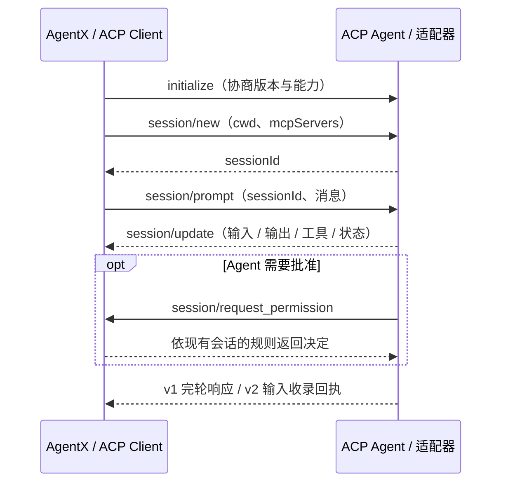

# ACP：谁能找到 Agent，谁能向会话发一轮

要查完整方法表、核心字段和交互示例，从 [ACP 中文参考](acp/README.md) 进入。

## 1. 定义

[Agent Client Protocol](https://agentclientprotocol.com/protocol/v1/overview) 是编辑器、终端宿主或编排器与 Agent 程序之间的双向 JSON-RPC 2.0 协议。编辑器并不是必需：AgentX 也可以当 **ACP Client**；Codex 适配器等程序当 **ACP Agent**，后面再驱动真正的模型和工具。它统一的是创建、继续、取消会话与接收进度；它没有定义 AgentX 的 `@名字`、跨 Agent 路由或可靠信箱。MCP Agent 宿主和 ACP Client 可以是同一个程序，也可以分开，名字里的 “Client” 所在层不同。

## 2. 发现：分三件事

| 要找什么 | 怎么找 | 边界 |
| --- | --- | --- |
| **程序：这个工具怎么安装、怎么启动？** | [ACP Registry](https://agentclientprotocol.com/get-started/registry) 是策展目录；[机器可读 JSON](https://cdn.agentclientprotocol.com/registry/v1/latest/registry.json) 有目录条目 ID、版本和按平台二进制、启动参数、校验和（若条目提供）或 npx 包。也可以直接配置可信本地命令。 | Registry 是安装目录，不是 LAN 扫描，也不列出本机正在运行的会话。生产接入可锁定发行来源与版本，无需启动每个工具前查目录。 |
| **能力：起起来以后会什么？** | AgentX 启动子进程，然后双方 `initialize` 交换协议版本、能力和认证方式；按声明处理权限、文件或终端等返向请求。 | 协商版本或能力不匹配时应降级或拒绝接管，不能靠工具名推断。v1 按能力使用 `session/load`，部分实现也有 `session/resume` 或 `session/list`。 |
| **会话：这封信要给谁？** | 新建时保存 `sessionId`；已有会话在适配器作用域内用已知 ID 加载或恢复，支持时可用 [`session/list`](https://agentclientprotocol.com/protocol/v1/session-list)辅助发现。 | 必须自建 AgentX 参与者 → 后端实例 / 作用域 → ACP session ID 的绑定。目录 ID、OS PID、ACP session ID、AgentX 名称是不同身份。普通 PTY 不能因为名字相同就变成可接管的 ACP 会话。 |

2026-11-22 目录快照中的几个实际入口。它们说明「可发现、可启动」，不替代版本握手和本地验证。

| 工具 | Registry ID | 启动路径 |
| --- | --- | --- |
| Codex | `codex-acp` | [`@agentclientprotocol/codex-acp`](https://github.com/agentclientprotocol/codex-acp) 启动 Codex App Server |
| Claude | `claude-acp` | [`@agentclientprotocol/claude-agent-acp`](https://github.com/agentclientprotocol/claude-agent-acp) 接 Claude Agent SDK |
| Gemini CLI / Qoder CLI / Copilot CLI | `gemini` / `qoder` / `github-copilot-cli` | 各自原生 CLI 加 `--acp` |
| OpenCode | `opencode` / `opencode-v2` | 平台二进制加 `acp` 子命令 |
| Pi | `pi-acp` | 通过独立的 `pi-acp` 包 |

本轮只实测 Codex 和 OpenCode。Qoder、Pi、Claude 和 Gemini 值得按实际使用频率排下一轮，但目录记录本身不能证明它们加载现有历史、处理审批或安全重试。

## 3. 协议：一条本地连接，多个会话 ID

[stdio 传输规范](https://agentclientprotocol.com/protocol/v1/transports)要求每行一个 UTF-8 JSON-RPC 消息，stdout 留给协议，诊断用 stderr；双方都可以发请求。v2 Preview 仍以 stdio 为标准传输，远程 HTTP/WebSocket 在 [RFD](https://agentclientprotocol.com/rfds/streamable-http-websocket-transport) 中。想在不同机器上收信时，AgentX 可以先用自己的通信把消息带到目标机器，再由当地宿主使用 ACP；没有必要把 ACP stdio 暴露成网络端口。



图最后一行是对结果语义的对照：**v2 接受响应可以早于输出和业务结束**，并不排在所有 update 之后。[v1](https://agentclientprotocol.com/protocol/v1/prompt-turn)的 `session/prompt` 等轮次停止，返回 `stopReason`；客户端需要在等待响应期间持续收取更新和处理返向请求。`session/cancel` 可以取消，不能拿取消当忙时送信。[v2 Preview](https://agentclientprotocol.com/announcements/acp-v2-preview) 将收录和执行分开：[prompt](https://agentclientprotocol.com/protocol/v2/prompt-lifecycle) 插入会话后返回 `messageId`，前台执行状态由后续通知报告；忙时可立即插入或延后插入，并不承诺一律 steer 或一律等本轮结束。恢复用 [`session/resume`](https://agentclientprotocol.com/protocol/v2/session-setup)，可请求有限范围的回放；`idempotencyKey` 只有在宿主仍记得时才避免重复插入，不能承诺业务恰好一次。

**根会话与工具原生子会话要区分。** AgentX 自己启动的每个独立 Agent 可以分别建为 ACP 根会话；[ACP 报告的原生子会话](https://agentclientprotocol.com/protocol/v1/subagents#restricted-methods)通常由 Agent 创建和控制，暴露它不代表外层可以对它调用 `session/prompt`。不要把 ACP 观察到的所有 session 都注册成可投递地址。

最小 v1 提交例：

```json
{"jsonrpc":"2.0","id":17,"method":"session/prompt","params":{"sessionId":"example-session","prompt":[{"type":"text","text":"来自 @builder：检查已经完成。"}]}}
```

这里的 `id:17` 只匹配这一条 RPC 响应。AgentX 仍需在信箱保存自身消息 ID，并区分**本地已认领、RPC 已写出、宿主已收录、轮次结束、对方业务回复**。实际证据见[隔离探针](evidence.md)。
