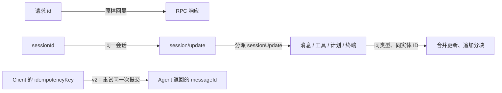

# ACP 核心字段与数据模型

本页按对象解释字段，先以 v1 为例；只在标明 v2 的地方切换语义。表中的 **必需** 指对应报文或变体要求此字段，不代表功能本身必备。未列出的字段、嵌套变体、精确类型及可空性查官方 [v1 Schema](https://agentclientprotocol.com/protocol/v1/schema) / [v2 Schema](https://agentclientprotocol.com/protocol/v2/schema)，可按本文列出的类型名查找。不要把 `null` 等同于省略：二者是否等价由具体字段定义。

## 1. 外壳、方向和标识

| 字段 | 所在位置 | 含义 |
| --- | --- | --- |
| `jsonrpc` | 每个报文 | 固定为 `"2.0"`。stdio 是逐行 UTF-8 JSON，stdout 留给协议，诊断走 stderr |
| `id` | 请求及对应响应 | 建议使用字符串或整数；两方各有自己的出站 ID 空间。通知没有 `id`。v1 Schema 允许但不推荐请求 ID 为 `null`；v2 禁止。无法从坏报文得知 ID 的错误响应可用 `null` |
| `method` / `params` | 请求、通知 | 方法名与该方法定义的入参；如 `session/update` 的 `params` 是 `{sessionId, update}` |
| `result` / `error` | 响应 | 二选一。失败 `error` 有 `code`、`message`，可有 `data`；RPC 失败与工具失败、模型拒绝或取消是不同结果 |
| `_meta` | Schema 允许的各对象内 | 扩展元数据。应按命名空间区分所有者；不能把某实现的私有字段当标准。部分 v2 更新的 `_meta` 是键级补丁 |
| `sessionId` | 会话级方法或更新 | Agent 分配的不透明字符串；标识一条会话，不能推断 PID、用户或工作目录。客户端同时保存所属 Agent/连接作用域 |
| `messageId` | 消息实体和 v2 prompt 收录响应 | Agent 分配。v1 普通流式块可以不带；v2 按 `(sessionId, 实体类型, messageId)` 关联。同号不同类型可以并存 |
| `toolCallId` / `terminalId` / `planId` / `compactionId` | 对应的更新或控制方法 | 工具调用、终端、带 ID 的计划、上下文压缩各自的实体 ID。在会话内关联；不能用来替代请求 `id` |
| `idempotencyKey` | v2 `session/prompt` 入参（可选） | Client 生成的重试键，1–255 字符；原提交重试用相同键和内容，新 RPC 用新 `id`。它不是 Agent 生成的 `messageId` |
| `cursor` / `nextCursor` | `session/list` | 不透明分页令牌；只用于继续列表查询，不是消息或回放游标 |

常见错误：`-32601` 方法不存在或（v2）未广告该能力、`-32602` 参数无效、`-32000` 需认证、`-32002` 资源不存在（v2 也用于会话未在本连接活动）、`-32800` 请求取消、`-32022` v2 版本不支持。错误含义及重试以 [v1](https://agentclientprotocol.com/protocol/v1/error) / [v2](https://agentclientprotocol.com/protocol/v2/error) 为准。

## 2. 握手和会话

| 类型 / 方法 | 字段 | 如何读 |
| --- | --- | --- |
| `InitializeRequest` / `InitializeResponse` | 双方必需 `protocolVersion`；v1 请求用 `clientInfo`、`clientCapabilities`，响应为 `agentInfo`、`agentCapabilities`、`authMethods` | version 是协议整数，不是程序版本。实现信息用 `name`、`version`，可带 `title`。v2 双方改用必需 `info` 和可选 `capabilities` |
| `ClientCapabilities` | `fs.readTextFile`、`fs.writeTextFile`、`terminal`、`auth.terminal`、`elicitation.form/url`、`plan`、`subagents`、`session.configOptions.boolean`、`session.notices`、`session.compaction` | v1：Client 能代读写文件/启动终端，能处理某类认证、表单或更新等。标记有布尔和对象两种，不能统一用布尔 |
| `AgentCapabilities` | `loadSession`、`promptCapabilities.image/audio/embeddedContext`、`mcpCapabilities.http/sse`、`sessionCapabilities`、`auth.logout` | v1：决定能否加载历史、发送非基线内容和提供额外会话操作。会话组包括 list、resume、close、delete、additionalDirectories、systemPrompt |
| `AuthMethod` / 登录 | v1 公布 `id`、`name`，可带 `description`、`type`；终端类型可带 `args`、`env`。登录请求发 `methodId` | v1 未给类型时按 `agent`；`terminal` 用本地可交互进程。v2 公布字段本身也叫 `methodId`。不把登录参数或敏感值写进对话 |
| `NewSessionRequest` | v1 必需 `cwd`、`mcpServers`；`additionalDirectories`、`systemPrompt` 需能力 | `cwd` 是绝对工作目录；附加目录是完整的有序列表；`systemPrompt` 有 `mode`、`content`，`override` 需额外能力。v2 可不发 `mcpServers` |
| `McpServer` | stdio：`name, command, args, env`；HTTP/旧 SSE：`type, name, url, headers`；env/header 项用 `name, value` | 这是 Agent 要连接的 MCP server。v1 stdio 基线示例不带 `type`；数组按 v1 Schema 提供。v2 有显式 stdio marker 和 `type`，可省可选数组，不含旧 SSE |
| `NewSessionResponse` / 恢复 | 新建结果有必需 `sessionId`，可附 `configOptions`，v1 可附 `modes`；v2 可附 `availableCommands` | load/resume 指向已知 `sessionId`、`cwd`，不再分配新 ID。v1 load 还必需 `mcpServers`；v2 恢复可传 `replayFrom` |
| `SessionInfo` / 列表 | 元数据 `sessionId`、`cwd`，可有 `title`、`updatedAt`、`additionalDirectories`；结果 `sessions`、可有 `nextCursor` | `updatedAt` 是时间戳，不能用来推断实时忙闲。列表不返回原生子会话，也不代替 attach |
| `SessionConfigOption` | v1 选项 `id`，v2 `configId`；共用 `name`、`description`、`category`、`type`、`currentValue`；select 附 `options` | UI 文字用名称，设置用 `configId` 和支持的 `value`。select 值为字符串 ID，boolean 为布尔值；v2 设置请求另带必需的 `type` |
| `SessionModeState` / `AvailableCommand` | v1 模式为 `currentModeId, availableModes`；指令为 `name, description, input?` | v1 指令清单用于提示用户；输入仍走 prompt，没有通用 `command/run`。v2 模式归并配置，指令和输入带 `type` 区分形状 |

## 3. 输入、内容块与反馈

`PromptRequest` 的必需字段是 `sessionId`、`prompt: ContentBlock[]`。v1 结果 `PromptResponse.stopReason` 的值是 `end_turn`、`max_tokens`、`max_turn_requests`、`refusal`、`cancelled`；其中 `end_turn` 只说明模型停止请求工具并结束回答，不代表用户的问题已解决。v2 不在 prompt 响应里返回停止原因。

| `ContentBlock.type` | 关键字段 | 何时使用 |
| --- | --- | --- |
| `text` | 必需 `text` | 普通文本或 Markdown。基线输入 |
| `image` | 必需 `data`（base64）、`mimeType`，可有 `uri` | 附图或截图；发送前核对图片能力 |
| `audio` | 必需 `data`（base64）、`mimeType` | 可选音频输入 |
| `resource_link` | 必需 `name`、`uri`；可有 `title`、`description`、`mimeType`、`size` | 基线资源引用，URI 不是文件内容，也不授予读取权限 |
| `resource` | 必需 `resource`；它有 `uri` 和 `text` 或 `blob`，可附 `mimeType` | 直接附上一段文件或 MCP 资源内容；需 embeddedContext 能力 |

内容块可附 `annotations`，如 `audience`、`priority`、`lastModified`，这些是提示性数据。[v1 内容规范](https://agentclientprotocol.com/protocol/v1/content)与 [v2 内容规范](https://agentclientprotocol.com/protocol/v2/content)列出 MIME、编码和扩展限制。

### `session/update`：按 `update.sessionUpdate` 分派

| 事件族 | v1 变体 | 关注字段 |
| --- | --- | --- |
| 输入、回复和可展示的思路 | `user_message_chunk`、`agent_message_chunk`、`agent_thought_chunk` | `content` 单块；`messageId` 若有则用于归并。思路事件用于显示 Agent 实际报告的内容，不能要求未报告的内部推理 |
| 工具 | `tool_call`、`tool_call_update` | `toolCallId`、`title`、`name`、`kind`、`status`、`locations`、`content`、`rawInput/rawOutput`；创建时 `title` 必需。v1 状态为 pending、in_progress、completed、failed。结果可以是通用内容、diff、终端或子会话引用 |
| 计划 | `plan`、`plan_update`、`plan_removed` | 旧式 `entries`；每项 `content`、`priority`、`status`；带 ID 操作用 `plan.planId` 或 `planId`。Markdown 计划和条目计划形状不同 |
| 配置和元数据 | `available_commands_update`、`current_mode_update`、`config_option_update`、`session_info_update` | 对应命令数组、当前模式 ID、完整配置选项列表、标题/最后活跃时间 |
| 用量、通知和压缩 | `usage_update`、`notice`、`compaction_update`、`compaction_summary_chunk` | `used/size` 表示上下文窗口，`cost` 可选；notice 用 `severity/title/description?` 且非历史；压缩用 `compactionId/status/summary/error`，摘要块用 `content` |
| 子会话和会话间消息 | `subagent_update`、`session_message`、`session_message_chunk` | 外层 `sessionId` 是事件归属；子会话公告的内层 `sessionId` 是子会话。消息的 `senderSessionId/recipientSessionId` 是方向，`senderMessageId/recipientMessageId` 是可选的跨视图关联，不假设两边 ID 相同 |

v2 额外将 `messageId` 用于消息整条 upsert；`state_update.state` 是 `running`、`requires_action`、`idle` 或 `unknown`，可带当前 `background`；结束时看 idle 的 `stopReason`。`tool_call_update` 自己可创建工具实体，`tool_call_content_chunk` 追加内容；终端用 `terminal_update` 和 `terminal_output_chunk`；历史边界用 `replay_complete`。详细变化见[版本对照](versions.md)。

## 4. 反向调用与控制

| 方法族 | 关键请求字段 | 响应或后续 |
| --- | --- | --- |
| `session/request_permission` | v1 必需 `sessionId`、`toolCall`、`options`；选项有 `optionId/name/kind`，kind 为 allow_once、allow_always、reject_once、reject_always。v2 改成必需 `title`，可带 `description/subject` | `outcome` 是对象：`{outcome:"selected",optionId}` 或 `{outcome:"cancelled"}`。从同一请求的选项查真实含义，不根据字符串猜是否允许 |
| `elicitation/create` / `elicitation/complete` | `message` 与 `mode`；form 附 `requestedSchema`，url 附 `elicitationId,url`；作用域二选一：`sessionId`（可再关联 `toolCallId`）或 `requestId` | `action` 是 accept / decline / cancel；表单接受时可回 `content`。URL 完成通知只有同一连接的 `elicitationId`，接受打开 URL 不等于操作完成 |
| v1 `fs/*` | 读：`sessionId,path`，可选 `line`（1 起）、`limit`；写：`sessionId,path,content` | 读返回文本 `content`；写成功为空结果（可有扩展元数据）。路径应绝对且在授权范围 |
| v1 `terminal/*` | create：`sessionId,command`，可附 `args,env,cwd,outputByteLimit`；其余用 `sessionId,terminalId` | 创建立即返回 `terminalId`；output 返回 `output,truncated,exitStatus?`；退出状态有 `exitCode/signal`；kill 停进程，release 负责释放句柄，不可混用 |
| 取消 | `session/cancel.sessionId`；`$/cancel_request.requestId`；v2 单项取消用 `sessionId` + `toolCallId` 或 `terminalId` | 前两项是通知。v2 单项取消是 RPC，后续状态仍看对应工具或终端更新 |

结构可记为：**RPC ID 找回执，Session ID 找会话，实体 ID 合并更新，幂等键重试同一次提交**。这些 ID 不能拿来替代 AgentX 的业务消息 ID。
