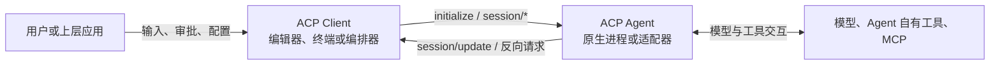

# ACP 接口与契约

这里列出官方基线 Schema 的**全部顶层方法名**：[v1](https://agentclientprotocol.com/protocol/v1/schema) 与 [v2 Preview](https://agentclientprotocol.com/protocol/v2/schema)。表中「请求」有 JSON-RPC 回执；「通知」没有回执。方法存在于 Schema，和对端支持它，是两回事。下面的方向指谁发起，返回报文走反向。具体参数见[字段索引](fields.md)，v2 变化见[版本对照](versions.md)。

## Client → Agent

| 操作 | 形态 | v1 契约 | v2 Preview |
| --- | --- | --- | --- |
| [`initialize`](https://agentclientprotocol.com/protocol/v1/initialization) | 请求 | 连接上的第一项协商；交换版本、能力和认证方式 | 双方统一用 `info`、`capabilities`；首次其他请求前可按规范重复协商 |
| [`authenticate`](https://agentclientprotocol.com/protocol/v1/authentication) / [`auth/login`](https://agentclientprotocol.com/protocol/v2/authentication) | 请求 | 使用已公布且定义了协议式登录流程的认证方式。终端登录按公布的命令参数启动，不调用这条 RPC | 改名；同样先看认证方式类型 |
| `logout` / `auth/logout` | 请求 | 需 `agentCapabilities.auth.logout` | 宣告非空 `authMethods` 就要求提供登录、登出方法 |
| [`session/new`](https://agentclientprotocol.com/protocol/v1/session-setup#creating-a-session) | 请求 | 基线；创建会话，返回 `sessionId`，可附初始配置和模式 | `mcpServers` 可省略；用配置选项替代 modes |
| [`session/load`](https://agentclientprotocol.com/protocol/v1/session-setup#loading-sessions) | 请求 | 需 `loadSession: true`；用 `session/update` 回放会话历史，再返回 | 移除；由 `session/resume` 指定回放 |
| [`session/resume`](https://agentclientprotocol.com/protocol/v1/session-setup#resuming-sessions) | 请求 | 需 `sessionCapabilities.resume`；附着已有会话，不回放历史 | 支持会话的 Agent 必须提供；可选择回放 |
| [`session/list`](https://agentclientprotocol.com/protocol/v1/session-list) | 请求 | 需 `sessionCapabilities.list`；查会话元数据，可按目录过滤、分页 | 支持会话时必备。列表中的会话不等于当前连接已经附着 |
| [`session/close`](https://agentclientprotocol.com/protocol/v1/session-setup#closing-active-sessions) | 请求 | 需 `sessionCapabilities.close`；停止该会话的当前工作并释放本连接的活动资源 | 支持会话时必备；会停止该会话的进行中工作，保留其历史 |
| [`session/delete`](https://agentclientprotocol.com/protocol/v1/session-delete) | 请求 | 可选，需 `sessionCapabilities.delete`；删除可见历史中的会话 | 仍可选，需 `capabilities.session.delete`；活动会话先停止并关闭 |
| [`session/prompt`](https://agentclientprotocol.com/protocol/v1/prompt-turn) | 请求 | 基线；向目标会话提交内容；响应中的 `stopReason` 表示轮次停止 | 响应 `messageId` 表示输入收录；执行结束看 `state_update` |
| [`session/cancel`](https://agentclientprotocol.com/protocol/v1/prompt-turn#cancellation) | **通知** | 基线；请求停止会话当前轮次，原 prompt 最终返回 `cancelled` | 停止前台工作并取消尚未插入的 prompt；看 `idle` 和取消原因 |
| [`session/set_mode`](https://agentclientprotocol.com/protocol/v1/session-modes) | 请求 | 可选；使用 Agent 报告的模式 ID | 移除；模式改为普通配置项 |
| [`session/set_config_option`](https://agentclientprotocol.com/protocol/v1/session-config-options) | 请求 | 有可用配置选项时按声明设置；回传完整配置选项列表 | 仍使用该方法；`type` 必填，使用 v2 的配置项形状 |
| [`tool_call/cancel`](https://agentclientprotocol.com/protocol/v2/tool-calls#cancelling-tool-calls) / [`terminal/cancel`](https://agentclientprotocol.com/protocol/v2/tool-calls#cancelling-terminals) | 请求 | 无此方法 | 单独停止宣告了 `capabilities.cancel` 的工具或 Agent 所有的终端；不用取消整个会话 |

## Agent → Client

| 操作 | 形态 | v1 契约 | v2 Preview |
| --- | --- | --- | --- |
| [`session/update`](https://agentclientprotocol.com/protocol/v1/prompt-turn#session-updates) | **通知** | 报告文本、工具、计划、配置等；也可在 prompt 之外发送 | 仍是主要事件流；新增按 ID 更新整条消息、前台状态、终端和回放边界 |
| [`session/request_permission`](https://agentclientprotocol.com/protocol/v1/tool-calls#requesting-permission) | 请求 | Client 基线；Agent 描述工具调用及可选批准项。Client 返回某个 ID 或 `cancelled` | 请求改为 `title` + 可选 `subject`；拒绝、错误或连接丢失不能当成批准 |
| [`elicitation/create`](https://agentclientprotocol.com/protocol/v1/elicitation) / `elicitation/complete` | 请求 / **通知** | 按 Client 宣告的 `form` 或 `url` 模式提出结构化输入；URL 模式可另发完成通知 | 保留；表单限制有变化。它问用户要信息，不是工具审批 |
| [`fs/read_text_file`](https://agentclientprotocol.com/protocol/v1/file-system) / `fs/write_text_file` | 请求 | Client 分别宣告读写能力后可调用；可访问编辑器缓冲区，不等于 Agent 自己读磁盘 | 移除；如需 Client 提供文件工具，可另通过已配置 MCP 工具 |
| [`terminal/create`](https://agentclientprotocol.com/protocol/v1/terminals) / `terminal/output` / `terminal/wait_for_exit` / `terminal/kill` / `terminal/release` | 请求 | 需 Client 宣告 `terminal`；Client 启进程，Agent 可读输出、等退出、停止和释放句柄 | 这一整组移除。v2 展示 Agent 自己的终端输出；可选 `terminal/cancel` 的方向相反 |

## 双向取消、运行权限与扩展

- [`$/cancel_request`](https://agentclientprotocol.com/protocol/v1/cancellation) 是**双向通知**，`requestId` 指向此前由发送者发起的某条 RPC。它是尽力取消，通知本身没有响应；原请求仍要结算。与面向整个会话、参数为 `sessionId` 的 `session/cancel` 分开。
- `session_message` 是 **Agent 发出的 `session/update` 变体**，用于展示会话之间已经发生的消息；不是 Client 可以调用的发送方法。[原生子会话限制](https://agentclientprotocol.com/protocol/v1/subagents#restricted-methods)不允许 Client 给它发 `session/prompt`。ACP 目录、会话列表和子会话事件也不是同一个发现层。
- 功能协商不授予资源权限：提供文件能力的 Client 仍校验路径与会话范围；支持 terminal 仍要决定能运行什么；审批回执只能从本次请求的 `options` 选取。见[安全模型](https://agentclientprotocol.com/protocol/v1/security)。
- 方法名、传输和功能分层：ACP stdio 是 Client ↔ Agent；在 `session/new.mcpServers` 配置的是 Agent ↔ MCP Server。[自定义扩展](https://agentclientprotocol.com/protocol/v1/extensibility)与 [RFD](https://agentclientprotocol.com/rfds/about)（如 fork、归档、改标题、专用远程传输）不属于上述基线。某工具有同名能力时，先核对其版次及协商方式。
