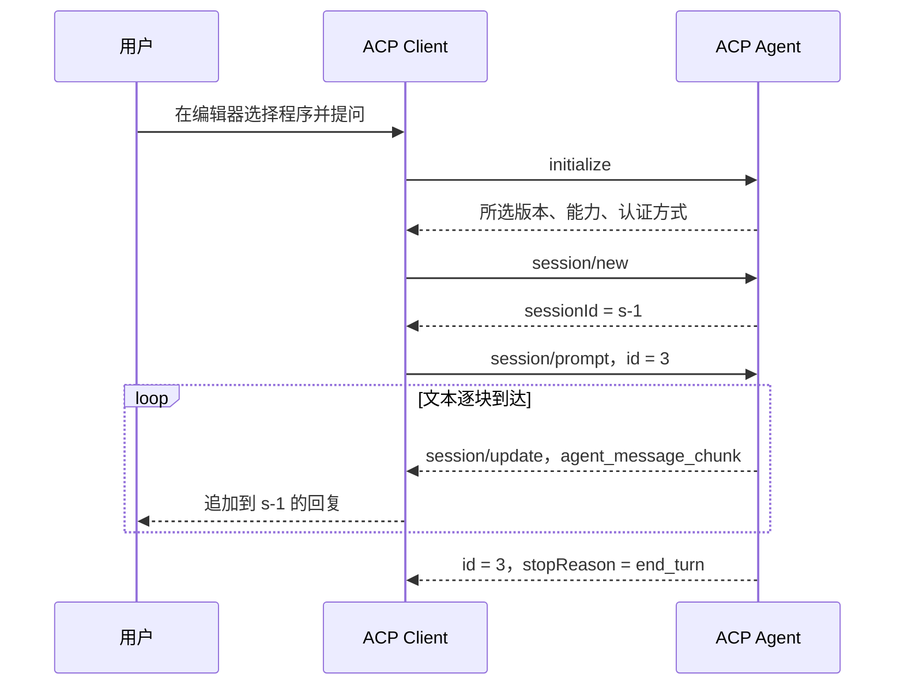
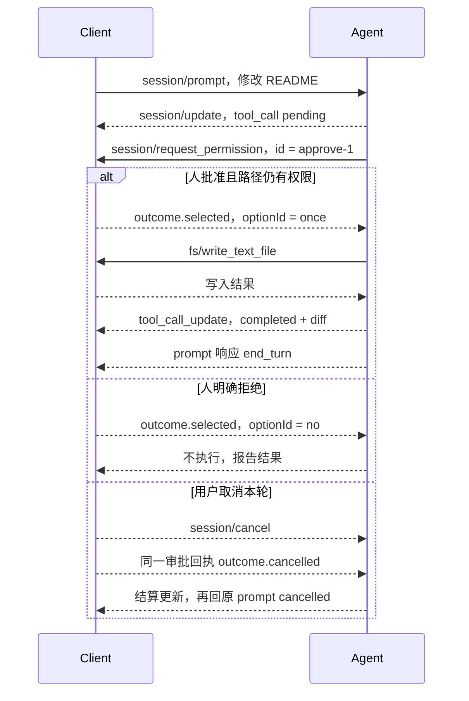
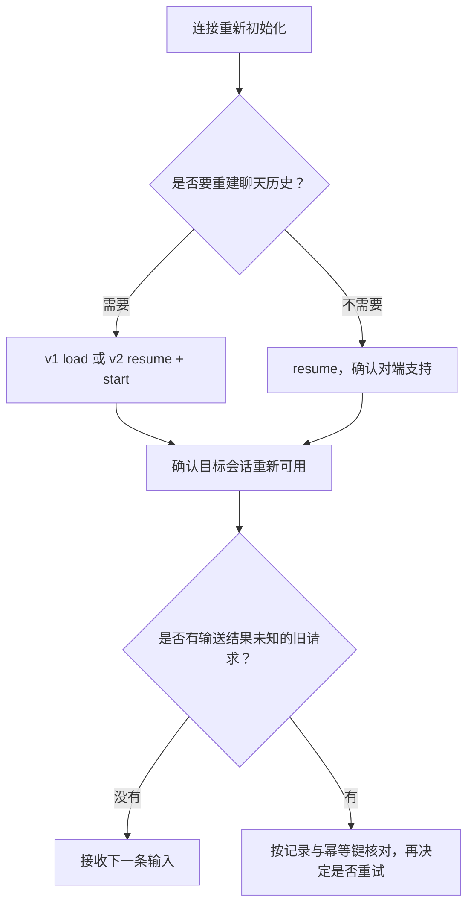

# ACP 使用模式与案例

下面的图和短报文用来说明协议。除标明“隔离实测”的一项，其他是规范推演或官方产品文档，不是额外运行验证。

## 1. 在编辑器问问题，接收流式回复（v1）

用户问“解释这段错误”。Client 启动所选适配器、协商、创建或加载会话，再给该会话发 prompt。Agent 可在响应最终返回之前发送很多 `session/update`；Client 的读循环必须继续运行，不能只等 `id:3` 的回执。对于用户选中的**未保存文件**，可在协商后直接附加内容，或者在 v1 中让 Agent 通过 Client 提供的文件方法读取编辑器缓冲区。只提供 `resource_link` 时，Agent 拿到的是引用。



```json
{"jsonrpc":"2.0","id":3,"method":"session/prompt","params":{"sessionId":"s-1","prompt":[{"type":"text","text":"解释日志里的错误。"},{"type":"resource_link","name":"example.log","uri":"file:///demo/example.log","mimeType":"text/plain"}]}}
```

```json
{"jsonrpc":"2.0","method":"session/update","params":{"sessionId":"s-1","update":{"sessionUpdate":"agent_message_chunk","content":{"type":"text","text":"错误出现在配置读取阶段。"}}}}
```

```json
{"jsonrpc":"2.0","id":3,"result":{"stopReason":"end_turn"}}
```

## 2. Agent 想改文件或运行测试：权限、执行和展示分开（v1）

例子用 v1 文件 API；前提是 Client 在握手时打开 `fs.writeTextFile`，并且有权在这个会话的路径里写。Agent 也可能使用自己的文件工具：工具更新能展示改动，并不说明谁执行了写操作。



```json
{"jsonrpc":"2.0","id":"approve-1","method":"session/request_permission","params":{"sessionId":"s-1","toolCall":{"toolCallId":"tc-1","title":"修改 README","status":"pending"},"options":[{"optionId":"once","name":"允许一次","kind":"allow_once"},{"optionId":"no","name":"拒绝","kind":"reject_once"}]}}
```

```json
{"jsonrpc":"2.0","id":"approve-1","result":{"outcome":{"outcome":"selected","optionId":"no"}}}
```

对于终端测试，v1 Agent 可调用 `terminal/create` → `terminal/output` / `terminal/wait_for_exit` → `terminal/release`，需要停止时先 `terminal/kill`。这只用于 Client 明确提供终端能力的连接。v2 不再通过这些 RPC 让 Client 执行命令：Agent 自己控制终端，Client 看 `terminal_update` / `terminal_output_chunk`；工具权限仍能通过 ACP 询问。若只是询问“要跑单测还是全套测试”，可用 [elicitation 表单](https://agentclientprotocol.com/protocol/v1/elicitation)（需要能力），它不能替代执行授权。

## 3. 继续旧会话：列出、附着、回放是三件事

| 需求 | v1 | v2 Preview |
| --- | --- | --- |
| 显示最近聊天 | 支持时 `session/list`，可以分页 | 同名方法；支持会话的 Agent 必备 |
| 打开旧聊天并重建界面 | `session/load` 回放历史；等该请求结束 | `session/resume` + `replayFrom: {type:"start"}`；等回放边界及恢复响应 |
| 界面已有完整历史，只想重新连接 | 支持时 `session/resume`，不回放 | `session/resume` 不带 `replayFrom`；仍同步当前前台状态 |
| 断线时有 prompt 在途 | 状态未知；根据已记录内容核对，别把新的 RPC ID 当去重键 | 有同一持久键时可核对/重试；若不能确认键或记录保留、且重复会有影响，先核对，不能凭“回放没看到”推断未执行 |



```json
{"jsonrpc":"2.0","id":12,"method":"session/resume","params":{"sessionId":"s-1","cwd":"/demo","replayFrom":{"type":"start"}}}
```

## 4. 编排器管理多个会话，但不接管工具内部的子会话

一个 Client 可以给同一个适配器创建 A、B 两个根会话，也可以用各自连接运行不同的适配器。上层按 `sessionId` 分流输出，分别跟踪工作目录、配置和 pending 请求。一个常见模式是让 A 做阅读、B 做测试，由上层应用在 A 完轮后取其结果，再按用户或工作流的规则为 B 提交一条新 prompt。ACP 没有通用“转发给另一个 Agent”的方法。

如果 Agent 自己派生 A.1，它会发 `subagent_update` 和可能的 `session_message`。Client 显示父子树、照常处理该子会话发来的审批，必要时在子会话显式公布取消能力后取消它；**不能**像给根会话那样向 A.1 发新的 `session/prompt`。

## 5. 可对照的真实产品和实验

| 案例 | ACP 在其中做什么 | 证据边界 |
| --- | --- | --- |
| [Zed：External Agents](https://zed.dev/docs/ai/external-agents) | 编辑器当 Client；在面板选择外部 Agent，也可以配自定义命令 | 官方产品文档；支持哪个具体可选字段取决于实际 Agent 和版本 |
| [JetBrains AI Assistant：ACP agents](https://www.jetbrains.com/help/ai-assistant/acp.html) | IDE 作为 Client，将外部编码 Agent 接入聊天界面，提供目录安装和手动配置路径 | 官方产品文档，本轮未运行 IDE |
| [Codex ACP 与 OpenCode ACP](../evidence.md#acp-v1) | 同一个隔离 Client 发 `initialize`、`session/new`、`session/prompt`、`session/load`；观察会话隔离、等待后投递与重连 | **隔离实测**，使用环回固定模型，不代表付费模型、文件或终端能力已验证 |
| [Codex ACP v2 Preview](../evidence.md#acp-v2-preview) | prompt 被收录后立即返回 `messageId`，重启后同键识别到同一条历史输入 | **隔离实测**，未模拟崩溃或回执丢失 |

完整生态可逛官方 [Clients](https://agentclientprotocol.com/get-started/clients) 与 [Agents](https://agentclientprotocol.com/get-started/agents)。这些目录是产品发现入口，不能替代 `initialize` 能力协商。
