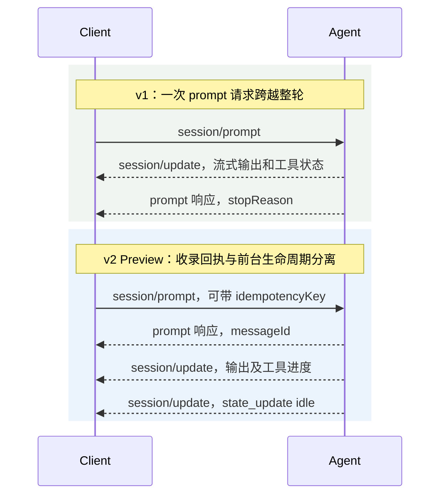

# ACP v1 与 v2 Preview：哪些行为变了

v2 已进入 [Preview](https://agentclientprotocol.com/announcements/acp-v2-preview)，尚未冻结。[官方迁移指南](https://agentclientprotocol.com/protocol/v2/migration)所称“stable v2”指当下 Preview 的**基线 Schema**，相对于 unstable 文件，不是说 v2 已正式发布。两端以 `initialize` 成功响应的版本为准，一条连接不能混用 v1 和 v2 的形状。

## 从发出 prompt 到一轮结束



v2 图只画一条可能的时序：`running`、已插入消息的 `user_message` 更新可能先于成功响应。Agent 处理别的工作时，可立刻插入 prompt，也可先保留、之后按收到的顺序插入；未插入时不回成功。这个规则没有标准化“强制排队”“强制插入当前轮”按钮。

| 要判断什么 | v1 | v2 Preview |
| --- | --- | --- |
| 输入已经进入对话？ | prompt 响应是完轮结果；没有独立、统一的插入回执 | 成功响应中的 `messageId` 表示已插入，错误响应表示该请求未插入 |
| 前台是否忙？ | 跟踪在途 prompt 和相关更新；不能用一条进度事件推断完轮 | `state_update`：`running`、`requires_action`、`idle`、`unknown`；`background` 活动可以在前台 idle 时继续 |
| 执行失败？ | 可能收到 JSON-RPC 错误，或按约定在工具事件/停止原因中体现 | 已插入后仍可在 `idle` 带 `stopReason:"error"` 与 `error`；不能撤回先前的插入回执，也不会回滚已发生的动作 |
| 用户要停止？ | `session/cancel`，持续读更新，等原 prompt 的 `cancelled`；取消未决的审批 | `session/cancel` 停前台、取消未插入的 prompt（`-32800`）；完成看前台状态。可用相应能力取消单个工具/终端 |
| 连接在结果前掉了？ | 不知道已经执行多少；不能凭 request ID 重投 | 同键重试时，保留键则复用原 `messageId`；断线本身不说明成败，未见历史也不证明没有执行 |

```json
{"jsonrpc":"2.0","id":"submit-19","method":"session/prompt","params":{"sessionId":"s-1","prompt":[{"type":"text","text":"汇总测试结果。"}],"idempotencyKey":"submission-19"}}
```

```json
{"jsonrpc":"2.0","id":"submit-19","result":{"messageId":"u-19"}}
```

```json
{"jsonrpc":"2.0","method":"session/update","params":{"sessionId":"s-1","update":{"sessionUpdate":"state_update","state":"idle","stopReason":"end_turn"}}}
```

## 迁移时需要分别处理的五处

| 边界 | 变化 |
| --- | --- |
| 握手和权限 | v2 两端均用必需 `info` 和可选 `capabilities`，支持标志通常是对象 `{}`。支持会话的 Agent 在 `capabilities.session` 宣告，要求实现会话基线；认证方法改名，细节见[初始化](https://agentclientprotocol.com/protocol/v2/initialization)和[接口表](interfaces.md)。 |
| 回放与重连 | `session/load` 被 `session/resume` 取代。基线可用 `replayFrom:{type:"start"}` 回放全部可提供的历史；不带或为 `null` 只同步当前状态。按 `sessionId` 处理 `replay_complete`，并等 resume 响应；不要把空闲快照里的上次 stop reason 当成新一轮结束。基线不保证可从任意事件游标增量回放。 |
| 增量更新 | 消息、工具、终端等按实体 ID 更新；定义为 patch 的字段，省略保留、`null` 清空、值替换；chunks 追加。不是所有对象或字段都承诺相同补丁语义。工具首包就是 `tool_call_update`；v2 支持 `paused/cancelled` 与工具内容分块。计划按 `planId` 整体替换或删除。 |
| Client 工具和 UI | 删除 v1 的 `fs/*` 和 Client 端执行型 `terminal/*`；Agent 自有终端报告显示状态。审批仍经 `session/request_permission`，只是 payload 重构；模式并入配置项。 |
| 可选与未来项 | 主处理路径识别已支持的变体；按[扩展规则](https://agentclientprotocol.com/protocol/v2/extensibility)忽略或降级处理不认识的更新，不能把未知的审批结果当同意。fork、会话标题/归档、MCP-over-ACP、增量游标、统一远程传输等要分别查 RFD、unstable Schema 和双方协商，不能从版本号推出。 |

**幂等键的准确边界**：提交后失去响应，只有 Agent 还认识该键时，重试才不会再插入。它不证明工作已经完成，也不保证已完成的外部动作只发生一次。若 Agent 忘了键，或者历史未落盘，没有足够依据时不要自动重做有副作用的操作。见 [Retrying a prompt](https://agentclientprotocol.com/protocol/v2/prompt-lifecycle#retrying-a-prompt) 与[已有实测的限制](../evidence.md#acp-v2-preview)。
