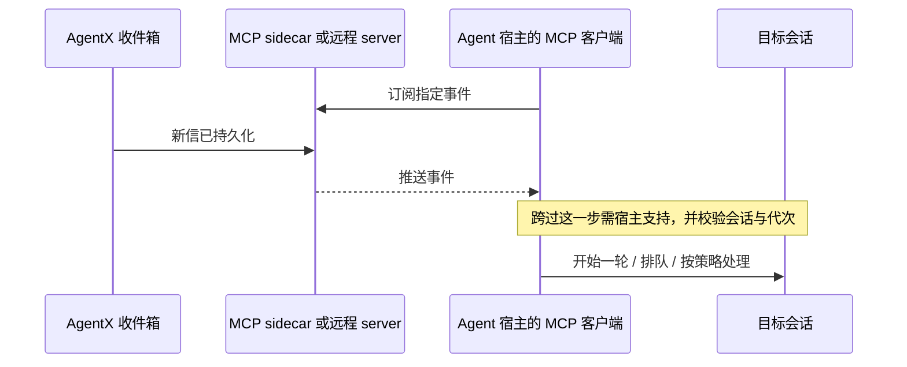

# MCP：服务端能推送，宿主决定会话是否执行

MCP 的对象是 **宿主、MCP 客户端、MCP 服务端**。[架构规范](https://modelcontextprotocol.io/specification/2026-07-28/architecture/index) 说的是一个 MCP 客户端与一个服务端建立连接；它没有规定每条模型会话分配一个 MCP 客户端、一个连接或一个子进程。宿主可以为同一会话配置多个 server，也可以跨线程复用连接。stdio 服务端通常由宿主启动；远程 HTTP 服务端则完全可以由多个宿主或会话共享，客户端不必启动任何本地 MCP 子进程。

**“把消息发到对应会话的 MCP 进程”可以是一种部署拓扑**。例如每个独立启动的 Agent 都加载一个本地 stdio sidecar，AgentX 用私有 socket 把消息送给这个 sidecar。stdin/stdout 属于宿主和 sidecar 的协议连接；AgentX 不应去写它们的管道。sidecar 接到信以后，可以沿 MCP 连接发事件，但仅证明字节到了客户端。要让原会话开始工作，宿主还必须订阅或识别这类事件，把它绑定到正确会话，并显式触发下一轮。sidecar 的 PID 或连接句柄不能代替 AgentX 参与者代次与会话 ID。

| MCP 机制 | 实际语义 | 与唤醒的关系 |
| --- | --- | --- |
| [旧版 Streamable HTTP GET](https://modelcontextprotocol.io/specification/2025-11-25/basic/transports#listening-for-messages-from-the-server) | 客户端可打开 SSE，服务端可发规范允许的请求或通知 | 传输通道不赋予任意消息含义 |
| [新版核心 `subscriptions/listen`](https://modelcontextprotocol.io/specification/2026-07-28/basic/patterns/subscriptions) | 取代旧 GET 通知流和 `resources/subscribe`；订阅工具、提示词、资源清单或指定 URI 的变更 | `resources/updated` 面向数据刷新，不是会话 prompt |
| [Events 扩展](https://modelcontextprotocol.io/extensions/events/overview) | Beta，[SEP-3415](https://modelcontextprotocol.io/seps/3415-events-extension) Final；在 MCP 2026-07-28 或更新版本上双端显式接入；发现事件类型、参数和 payload | `events/stream` 长流推送、`events/subscribe` 注册 HTTPS webhook、`events/poll` 拉取；收到后怎么处理不由扩展规定 |
| [Sampling](https://modelcontextprotocol.io/specification/2026-07-28/client/sampling) / [Tasks](https://modelcontextprotocol.io/extensions/tasks/overview) | 前者请求客户端做模型生成，已弃用；后者管理既有远程请求的异步执行 | 都不负责向既存会话投递新来信 |

Events 的 `eventId` 是去重依据。只有上游保留历史且客户端保存游标，才可以断线补收；无历史的事件类型可能返回空游标，游标过期也可能报告 `truncated`。传输恢复和会话恢复是两回事。Webhook 可以在 Agent 不在线时先到常驻服务，但恢复 Agent 仍须另有宿主；已结束的进程不能靠发事件原地复活。

## 三种产品行为

- **Codex 0.171.0**：[事件订阅源代码](https://github.com/openai/codex/blob/rust-v0.171.0/codex-rs/app-server/src/request_processors/mcp_event_stream.rs)只接 `codex_apps` 托管应用，并将事件发给发起订阅的 App Server 客户端。自建 MCP Server 被拒绝；[隔离探针](evidence.md#codex-stdio-mcp)也显示普通 stdio 通知本身没有启动轮次。该实验没有把自定义通知冒充已协商的 Events 扩展。ChatGPT Plugin [公开的 webhook 支持](https://developers.openai.com/plugins/build/mcp-events)与普通 Codex CLI 是不同端面。
- **Claude Code**：[Channels](https://code.claude.com/docs/en/channels) 可以给仍打开的原会话送事件、忙时排队，使用专属 `notifications/claude/channel` 和 `claude/channel` 能力，处于研究预览，受账户、组织和启动许可约束，[没有应用层送达确认](https://code.claude.com/docs/en/channels-reference#notification-format)。[官方兼容说明](https://code.claude.com/docs/en/mcp#push-messages-with-channels)指出，v2 运行时协商到 MCP 2026-07-28 的 server 不会注册这个旧式 Channel。
- **OpenCode**：[V2 Server 文档](https://opencode.ai/docs/server/)描述按 session ID 送入 prompt、调度执行和实验性 MCP 事件自动化；事件 watch 需在本地会话用 `automation_create` 建立，不是通过 HTTP 知道 session ID 就有权限注册。本轮 ACP 实验使用 npm `opencode-ai@1.19.6`，不能拿来证明 OpenCode V2 的 Events 行为。
