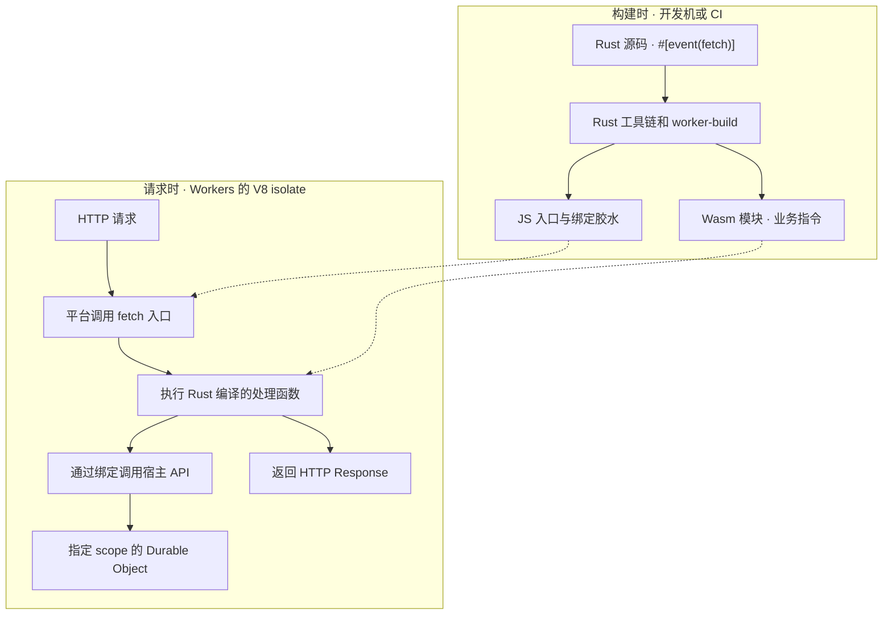
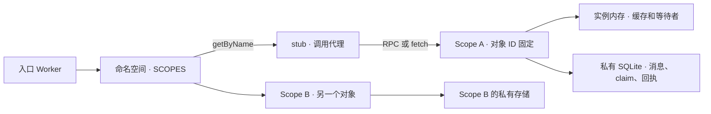
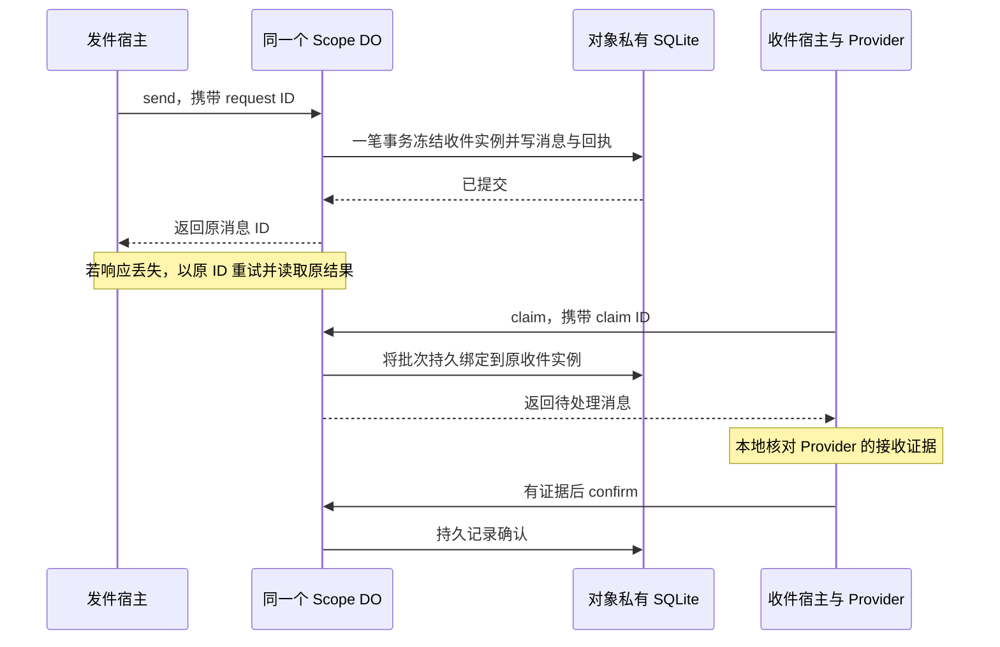

# 从 Rust 源码到一个有记忆的 Worker

**Workers 解决“这段代码在哪里执行”，Durable Objects 解决“谁能对这份状态做决定”。** Rust 是编写代码的语言，WebAssembly（Wasm）是编译产物，Durable Object（DO）是平台提供的有身份的计算与存储单元。这三个选择可以组合。一段 Rust 写的 Worker 可以处理 HTTP，再把一个请求交给对应的 DO；这个 DO 的实现可以独立选择语言。[打开离线图解](runtime-and-objects.html)

## 1 · Workers 为什么能运行 Rust？

2018 年 Cloudflare 已公开演示 Workers 执行 WebAssembly，当时开发者可以把 Rust、C 或 C++ 算法编译成模块，从 JavaScript 调用。2021 年发布的 Rust SDK 又解决了一层工程问题：开发者可以用 Rust 编写完整事件处理函数，构建工具自动生成平台需要的 JavaScript 入口。两个里程碑分别解释了“能执行 Rust 编译出来的代码”和“整个 Worker 可以用 Rust 编写”。[2018 年 WebAssembly 公告](https://blog.cloudflare.com/webassembly-on-cloudflare-workers/) · [2021 年 Rust SDK 公告](https://blog.cloudflare.com/workers-rust-sdk/)

构建使用 Rust 的 `wasm32-unknown-unknown` 目标。`wasm-bindgen` 负责 Wasm 与 JS 对象之间的转换，`worker-build` 生成入口，Wrangler 打包部署。请求进来时，平台把 Request 和环境绑定交给处理函数。`wasm-bindgen-futures` 把 Rust 的 Future 接到 JS Promise 和事件循环上，因此 Rust 可以 `await` 网络或平台调用。编译器只在构建阶段出现；线上收到请求时执行的是已编译模块。[官方 Rust 指南与构建细节](https://developers.cloudflare.com/workers/languages/rust/) · [Workers 执行模型](https://developers.cloudflare.com/workers/reference/how-workers-works/)

| 你手上的代码 | 到 Workers 后怎样使用 |
| --- | --- |
| 消息体校验、地址解析、状态转换、序列化等 Rust 逻辑 | 依赖能编译到该 Wasm 目标时，可以复用。须保留 UTF-8 长度、64 位消息 ID 和原始错误语义。 |
| HTTP 入口与数据访问 | 把“监听端口”等入口改成平台事件；把文件数据库读写接到对象的存储接口。Rust SDK 已提供诸如 `SqlStorage::exec` 的绑定。具体方法、feature 与版本要逐项核对，下文表中采用官方 JS/TS API 名。[Rust SQL API](https://docs.rs/worker/latest/worker/struct.SqlStorage.html) |
| 现有 Linux daemon 可执行文件 | 该文件面向 Linux ABI。多线程 Tokio 监听器、目录锁、磁盘 SQLite WAL，以及宿主侧的子进程和 PTY 都依赖操作系统。要原样运行这类进程，应评估 Linux 宿主或 Containers。把纯计算编成 Wasm 无法补齐这些依赖。[AgentX 服务入口](../../src/cloud/mod.rs) · [目录与文件锁](../../src/cloud/catalog.rs) · [Containers 对照](containers.md) |

也可以只把热路径编成 Wasm，由 TypeScript 继续写 HTTP 与 DO。收益取决于计算量、模块体积和跨语言传值成本。对 AgentX 的消息服务，关键耗时还包括数据库提交、长轮询与跨区往返，选 Rust 本身并不会降低这些开销。[Wasm 使用方式](https://developers.cloudflare.com/workers/runtime-apis/webassembly/) · [AgentX 容量研究](workers-do.md)

## 2 · 一个 Durable Object 里面究竟有什么？

以同一时刻两位用户订最后一个座位为例。把对象按**场次**命名，两次订票会到同一个对象，可以用一笔事务决定谁成功。如果按**用户**命名，最后一个座位的归属就跨了两个对象。这说明选择对象 ID 实际上是在选择一致性边界。[官方订座示例](https://developers.cloudflare.com/durable-objects/tutorials/build-a-seat-booking-app/) · [架构指导](https://developers.cloudflare.com/durable-objects/best-practices/architecture-guidance/)

| 概念 | 结构与生命周期 | 对应的方法 |
| --- | --- | --- |
| Class、namespace、ID、stub | Class 定义行为，namespace 绑定一类对象。一个名字在同一命名空间可确定同一 ID，也可申请随机唯一 ID。stub 是调用代理；取得它无需预先启动对象，发送请求才需要执行实例。 | `getByName(name)`、`idFromName(name)`、`newUniqueId()`、`idFromString(id)`、`get(id)`，再调用类型化 RPC 或 `stub.fetch()`。[Namespace](https://developers.cloudflare.com/durable-objects/api/namespace/) · [Stub](https://developers.cloudflare.com/durable-objects/api/stub/) |
| 实例内存 | 普通字段、Map、等待者列表，适合缓存或通知。恢复运行时构造函数可能再次执行，同一持久 ID 可以先后对应多个内存实例。 | `ctx.id` 标识对象；构造阶段确需异步初始化时可用 `ctx.blockConcurrencyWhile()` 阻止其他事件提前进入。[State API](https://developers.cloudflare.com/durable-objects/api/state/) · [生命周期](https://developers.cloudflare.com/durable-objects/concepts/durable-object-lifecycle/) |
| 对象私有 SQLite | 每个 SQLite-backed 对象拥有自己的表、行、索引和约束。应用建表，查询得到 cursor，可迭代或转为数组。收件箱适合给收件实例与消息顺序建索引。 | `ctx.storage.sql.exec(sql, ...params)`、`cursor.toArray()`、`cursor.rowsRead`、`cursor.rowsWritten`、`sql.databaseSize`。同步消费游标可避免把读取跨到另一次异步交错后。[SQLite API](https://developers.cloudflare.com/durable-objects/api/sqlite-storage-api/) |
| 对象私有 KV | 字符串键到可结构化克隆的值；适合少量配置、处理游标、版本号。SQLite-backed 对象也有 KV 接口。独立产品 Workers KV 有另一套一致性与分布模型。 | 在 SQLite-backed 对象可用同步 `ctx.storage.kv.get/put/delete/list`，也有异步 `ctx.storage.get/put/delete/list`。旧 KV 后端缺少 SQLite SQL 能力，新项目优先选 SQLite。[存储接口](https://developers.cloudflare.com/durable-objects/api/sqlite-storage-api/) · [旧 KV 后端](https://developers.cloudflare.com/durable-objects/api/legacy-kv-storage-api/) |
| 事务与恢复点 | 在同一对象中维护多个字段或表的不变量。SQLite-backed 对象支持书签和时间点恢复；恢复一个对象会连同该时点以后的业务变化一起回退。 | `storage.transactionSync(fn)` 在同步回调内提交或回滚；`getCurrentBookmark()`、`getBookmarkForTime()`、`onNextSessionRestoreBookmark()` 支持单对象恢复。多个对象的一致恢复要由应用协调。[事务与 PITR](https://developers.cloudflare.com/durable-objects/api/sqlite-storage-api/) |
| Alarm | 每个对象同时有一个活动 alarm，可以在对象不活跃时重新唤醒它。多个任务可存成按到期时间排序的表，alarm 处理已到期项，再约下一次。 | `storage.setAlarm/getAlarm/deleteAlarm` 和 `alarm()`。至少一次执行，抛出异常会有限次退避重试；外部效果要能按任务 ID 去重。[Alarms](https://developers.cloudflare.com/durable-objects/api/alarms/) |
| WebSocket 与休眠 | 房间对象可持有多个连接。使用 Hibernation API 时，符合条件的空闲对象可释放内存，平台维持 WebSocket；下条消息到来重新构造对象。小型连接元数据可附在 socket 上。 | `ctx.acceptWebSocket(ws, tags)`、`ctx.getWebSockets(tag)`、`ws.serializeAttachment()`、`webSocketMessage()`。普通 HTTP 长轮询仍有待返回的处理函数，占用其生命周期。[WebSocket 指南](https://developers.cloudflare.com/durable-objects/best-practices/websockets/) · [生命周期](https://developers.cloudflare.com/durable-objects/concepts/durable-object-lifecycle/) |

## 3 · 单线程、事务和重试怎么配合？

对象按单线程执行。同一段没有让出执行权的同步代码可以完成检查和更新；如果检查余额后先 `await fetch(...)` 再扣款，等待外部网络时其他请求可能已修改余额。平台的 input gate 保护存储 I/O 过程中的事件交付，output gate 使依赖持久写入的外发消息等待写入完成。它们都无法把远端 Provider 的副作用包含进本地 SQLite 事务。短事务中决定并记录状态，跨网络之后按原 ID 对账，是两者之间的衔接点。[并发与 gates](https://developers.cloudflare.com/durable-objects/best-practices/rules-of-durable-objects/) · [自动重试边界](https://developers.cloudflare.com/durable-objects/best-practices/automatic-retries/)

图中是 AgentX 候选设计。对象重启时，内存里的“有新信”提示可以丢，数据库中的领取归属必须保留。响应已经丢失时，传输层可能对特定故障重试；业务仍要识别原 request ID，因为客户端也可以独立重发。收件宿主知道 Provider 已接收才确认；证据不明时保留原 claim，避免多发一次造成重复执行。[AgentX 通信契约](../../.controller/cloud-scope/communication-wire.md) · [Cloudflare 重试规则](https://developers.cloudflare.com/durable-objects/best-practices/automatic-retries/)

## 4 · 常见设计模式与取舍

| 模式 | 用什么作对象 ID | 何时值得用，以及代价 |
| --- | --- | --- |
| 每个实体一个协调者 | 一个场次、账户、购物车或 scope | 需要同一事务决定余额、容量、唯一名称时，把相关数据放在一起。不同实体可独立扩展，单个热门实体仍集中在一个对象。 |
| 目录 + 多个业务对象 | 一个部署目录，外加每个 scope 一个对象 | 目录管理名称和发布状态，业务对象管理凭据版本、消息和 claim。跨对象创建分成“保留名称 → 初始化 → 发布”，每步持久记录，可按原请求续做。跨对象没有一笔共享 SQL 事务。[AgentX 跨对象方案](workers-do.md) |
| 每个房间负责广播 | 房间或协作文档 ID | 客户端连同一房间，由房间排序和广播。连接交给休眠 API；需回放的聊天记录写入私有存储。规模过大时分拆广播与写入协调。[架构示例](https://developers.cloudflare.com/durable-objects/best-practices/architecture-examples/) |
| 持久任务表 + 最近一次 alarm | 每个租户或独立工作域 | 任务带到期时间、幂等键和结果。alarm 是唤醒机制，任务表负责恢复。适合超时清理、延迟批处理。[Alarm 示例](https://developers.cloudflare.com/durable-objects/examples/alarms-api/) |
| 按自然边界分片 | 租户、房间、分区键 | 把彼此独立的写入分到不同对象，可并行扩容。拆一个繁忙 scope 之前，先找出要跨分片维护的唯一约束、全序或配额；全局报表可另建读取投影。[架构指导](https://developers.cloudflare.com/durable-objects/best-practices/architecture-guidance/) · [平台限制](https://developers.cloudflare.com/durable-objects/platform/limits/) |

回到 AgentX，**适合复用 Rust 的是消息协议和验证规则，适合放进 DO 的是需要一起提交的数据**。发信回执、实际收件实例与领取批次属于同一个 scope；Provider 会话、工作目录和交付证据属于执行宿主。语言选择可以稍后通过 SDK 覆盖和构建试验证实，这条事务边界应先定下来。[已有验收与状态边界](system.md) · [Cloudflare 方案的待验证项](validation.md)

资料于 2026-11-22 核对。平台行为取自上文链接的官方公告、运行时文档与 SDK API；AgentX 图解属于方案研究，本轮未编译或部署 Worker。
