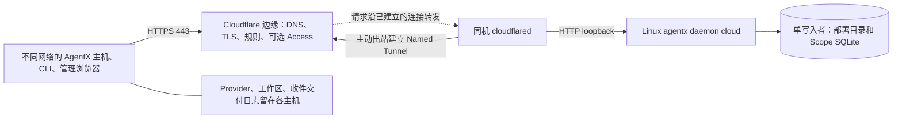

# Cloudflare Named Tunnel：给现有 AgentX 服务加公网入口

**建议：若目标是让不同网络的 Agent 连到现有 Linux 服务，同时不开放源站入站端口，Named Tunnel 是改动最少的候选。** 保留同一个 AgentX 写入者和现有数据根目录；Cloudflare 负责入口，消息、租约和恢复仍由 AgentX 负责。首轮用现有 Bearer 验证兼容性，前提是隔离测试入口获准对公网开放。若生产要求每个请求同时通过 Cloudflare Access，现有原生客户端和管理网页不能原样采用。若目标是关掉 Linux 主机之后还能收发，或主机坏了能自动无损接管，这条路线单独不满足。

**证据边界：** [已验收](../../.controller/cloud-scope/delivery.md)的是 Linux AgentX 经过 HTTPS 的跨网络通信、原生 Provider 和管理消费者；[三主机 LAN 记录](../../.controller/cloud-scope/three-host-lan.md)另有真实远端主机证据。本文所述的当前源码行为、Cloudflare 文档和建议分别标注；官方文档于 2026-11-22 只读查阅。本轮未部署、未创建资源、未探测任何 AgentX 或 Tunnel 实例。

## 候选拓扑和改动面

- **平台文档：** 选远程管理的持久 Tunnel UUID，用自有域名如 `agents.example.com` 发布 HTTP 应用，路由指向同机 `http://127.0.0.1:18755`。发布域名由 Cloudflare 代理，可用 CNAME 指向 Tunnel；客户端用普通 HTTPS。`cloudflared` 通过出站 `7844` 连接（QUIC 使用 UDP，HTTP/2 使用 TCP），无需源站公网 IP 或入站转发。公网 TLS 在边缘终止；边缘至连接器的隧道加密，同机最后一跳走 HTTP loopback。Cloudflare 位于应用数据的信任边界内。参见 [发布流程](https://developers.cloudflare.com/tunnel/get-started/)、[域名及协议路由](https://developers.cloudflare.com/tunnel/concepts/routing/)、[防火墙配置](https://developers.cloudflare.com/tunnel/configuration/)和[边缘证书](https://developers.cloudflare.com/ssl/edge-certificates/universal-ssl/)。
- **复用与变化：** [现有服务](../../src/cloud/mod.rs)强制 loopback；`--public-url` 填稳定的外部 HTTPS origin。原样转发 `/deployment` 和静态资源、`/api/v1/admin/...`、`/scopes/{id}/api/v1/...`，保留方法、路径、查询、JSON 和唯一的 `Authorization`，不加路径前缀。复用现有 daemon、SDK、CLI、Web、数据根和部署凭据。拟新增的运维项是 `cloudflared` 服务及其凭据、DNS/路由、API 缓存绕过及监控。源站成功走中间件的响应带 `no-store`；仍显式给两类 API 配置 [Bypass cache](https://developers.cloudflare.com/cache/how-to/cache-rules/settings/#bypass-cache)，防止现有区域规则覆盖。检查 WAF、速率规则或浏览器验证是否把 API JSON 换成挑战、重定向或 HTML。[公开应用继承域名规则](https://developers.cloudflare.com/cloudflare-one/networks/connectors/cloudflare-tunnel/routing-to-tunnel/dns/#cloudflare-settings)。
- **保留域名是连续性要求：** [原生直连客户端](../../src/cloud/client.rs)按 URL 和主机名选择本地状态目录，安装 ID、注册恢复和 claim 日志都依赖该目录。换 hostname 可能让同名主机被当成另一安装，遇到 `host_conflict`；[目录实现](../../src/cloud/catalog.rs)也会对重放的历史管理写入返回原始 URL，而新查询使用当前 `--public-url`。切换入口优先保留外部 URL、scope generation 和数据根。若必须改 URL，先单独验证客户端状态迁移和旧回执处理；仅改 DNS 或回执不能迁移本地状态。回退也应保留 URL 和数据根，把入口切回原代理，避免把数据回滚误作网络回滚。

## 两层认证怎么配合

AgentX [路由守卫](../../src/cloud/mod.rs)只接受一条 `Authorization: Bearer …`，部署 Bearer 和各 Scope Bearer 分开。Scope Bearer 代表受信任成员资格；installation ID 和 incarnation 用来绑定身份和状态，不能当设备密钥。Tunnel token 只授权连接器运行，Access 凭据只授权经过边缘，三类凭据独立使用和轮换。保管高权限管理 Bearer；日志省略 Authorization、Access 凭据头、含密钥的写入请求体和消息内容。[Tunnel token 文档](https://developers.cloudflare.com/tunnel/reference/tunnel-tokens/)指出，轮换会阻止旧 token 建立新连接，已连上的连接器不会因此立即断开；泄漏应另撤销现有连接。

| 入口策略 | 兼容性与代价 |
| --- | --- |
| 公网 hostname，应用 Bearer | **建议先验证。** 原生、SDK、TUI 和同源管理 Web 预期不用改。源站端口不对外，但公开路由能被任意公网客户端请求；项目必须接受用 AgentX Bearer 做应用准入。若不需要公网管理，候选是只发布 scope 路径，把全部管理 API、页面和资产留在私有入口；仅挡 `/deployment` 不会挡管理员 API。 |
| Access `Service Auth` 加应用 Bearer | 平台支持 `CF-Access-Client-Id` 和 `CF-Access-Client-Secret`，可在设计上与 AgentX Bearer 共存；须验证实际转发和双层拒绝。不要用单头模式占用 `Authorization`，它要求的是 Access 的 JSON 凭据，而 AgentX 要 Bearer。[官方 Service Token 文档](https://developers.cloudflare.com/cloudflare-one/access-controls/service-credentials/service-tokens/#connect-your-service-to-access)。[原生 HTTP](../../src/cloud/client/http.rs)只配置应用 Bearer，不跟随重定向，也禁用代理发现；现有直连客户端/TUI 无 Access 注入点。服务端 SDK 消费者可用[自定义 `fetch`](../../packages/agentx-client/src/cloud-transport.ts)验证双头；生产原生客户端应有明确的凭据配置、轮换以及脱敏方案，不能把机器密钥放进前端。 |
| Access 浏览器登录加应用 Bearer | 页面导航可用 `CF_Authorization`；但[管理 Web](../../web/management/deployment/model.ts)和默认 SDK fetch 显式 `credentials: 'omit'`，页面能打开不代表 `/api/v1/admin/...` 会携带 cookie。候选是为该部署的同源管理调用明确允许 cookie，再保留应用 Bearer，并测试过期、重新登录及禁止跨 origin 重定向。[Access 浏览器 cookie](https://developers.cloudflare.com/cloudflare-one/access-controls/applications/http-apps/authorization-cookie/)。 |

若采用 Access，按[官方自托管应用指南](https://developers.cloudflare.com/cloudflare-one/access-controls/applications/http-apps/self-hosted-public-app/#3-validate-the-access-token)在对应路由启用 `cloudflared` 的 [Protect with Access](https://developers.cloudflare.com/tunnel/reference/origin-parameters/#access) 校验 `Cf-Access-Jwt-Assertion`，或由源站验证；当前 AgentX 不验证该 JWT。边缘和连接器的策略要覆盖相同路由，核对[路径优先规则](https://developers.cloudflare.com/cloudflare-one/access-controls/policies/app-paths/)及同一源站的其他公开 hostname，避免绕过。Access 登录、WAF 拒绝和过期可能返回非 AgentX JSON；当前直连 host 会把心跳的 `401/403/404/409` 视为拒绝并退出，不能把策略变更当成可自动恢复的网络闪断。[现有 host 循环](../../src/cloud/client/host.rs)。

## 长轮询、断线与持久状态

**轮询预算：** 官方 [Connection limits](https://developers.cloudflare.com/fundamentals/reference/connection-limits/#between-cloudflare-and-origin-server)及 [524](https://developers.cloudflare.com/support/troubleshooting/http-status-codes/cloudflare-5xx-errors/error-524/)当前列的默认代理读超时为 **125 秒**；`cloudflared` 到源站的[建连超时 30 秒、空闲连接回收 90 秒](https://developers.cloudflare.com/tunnel/reference/origin-parameters/#connection-settings)是不同计时器。AgentX 的 [`POST /inbox/claim`](../../src/cloud/communication.rs)最长等待 **20 秒**，等待期间不持数据库事务或阻塞 worker，但占请求槽（消息等待 64、部署并发总槽 128）；普通原生 host 请求等待 **1.5 秒**，HTTP 总预算 **8 秒**，显式 `listen` 的单次 claim 等待为 **0**。[原生 host](../../src/cloud/client/host.rs)、[HTTP 客户端](../../src/cloud/client/http.rs)、[显式 listen](../../src/cloud/client.rs)、[服务总请求槽](../../src/cloud/mod.rs)。文档上的边缘余量足够支持尝试；实际端到端仍受客户端、规则、额外反代、队列与源站负载影响。用有至少 30 秒预算的测试客户端验证 20 秒，不给现有 8 秒客户端直接换成 20 秒服务端等待。

| 故障点 | 持久结果和恢复边界 |
| --- | --- |
| 请求发出后断线、524 或其他不确定结果 | 无响应不能证明没提交。发送以原 `request_id` 查 `/operations/{request_id}`，或同 ID、同 payload 重试；目标实例和消息 ID 由事务冻结。claim 用原 `claim_id` 重试或 recover；没有认领过的空等待不占批次。收到本地 Provider 证据后才 confirm；丢 confirm 响应就重试原确认。不要用新 ID 补发、让代理重试有副作用的请求，或在交付不明时释放 claim；claim 不会过期自动重投。[通信协议](../../.controller/cloud-scope/communication-wire.md)与[本地主机日志](../../src/cloud/client/mailbox.rs)。 |
| 单连接、单连接器中断 | 官方说明每个 `cloudflared` 建立 4 条连接、分布在至少 2 个数据中心；同 UUID 可加连接器副本。副本提高的是入口可用性；在途请求仍可能丢失响应，客户端按原 ID 恢复。单进程计划退出默认有 30 秒 drain 期，强杀或断网不能依赖它。[可用性](https://developers.cloudflare.com/cloudflare-one/networks/connectors/cloudflare-tunnel/configure-tunnels/tunnel-availability/)、[grace period](https://developers.cloudflare.com/tunnel/reference/run-parameters/#grace-period)。 |
| 所有连接器断开、DNS/Cloudflare 故障，或源站停机 | 无健康连接器时常见 Cloudflare `1033`；Tunnel 通但连接不到 loopback 源站时常见 `502`。即使 Tunnel 显示 Healthy，也须独立验证应用层。普通 host 失联 60 秒变离线，不释放名字或队列；服务仍可达时，已注册的离线目标仍可收进队列。整个入口或源站不可达时，边缘不替应用接单。故障恢复后先确认 descriptor/generation、心跳及原请求，再报告送达。[Tunnel 常见错误](https://developers.cloudflare.com/cloudflare-one/networks/connectors/cloudflare-tunnel/troubleshoot-tunnels/common-errors/)与[通信协议](../../.controller/cloud-scope/communication-wire.md)。 |
| Linux 主机或磁盘丢失 | 部署目录有排他锁；`deployment.sqlite3` 管部署 ID、scope 凭据版本和变更回执，`scopes/{id}/generation` 与 `communication.sqlite3` 管代次、身份、消息、操作回执及 claims。工作状态使用 SQLite WAL，Scope 写事务启用 `synchronous=FULL`。同机第二个连接器不能替代同机应用、电源、网络或磁盘；异机连接器也必须能接到**同一写入者**（不能把另一台的 `127.0.0.1` 当原服务）。禁止两套独立 SQLite 同时接受同一 scope 流量；Cloudflare LB 的探测和切流不会复制状态，且同 UUID 副本对 LB 是一个端点。[目录锁和目录库](../../src/cloud/catalog.rs)、[通信库](../../src/cloud/communication/store.rs)、[官方 LB 限制](https://developers.cloudflare.com/tunnel/concepts/routing/#replicas-versus-load-balancers)。 |

**恢复方案假设：** 候选用持久本地卷、停写后的整根一致备份或经验证的等价快照，并保留配置、可恢复的管理员/客户端密钥及主机侧交付日志。运行时不能只复制活跃 WAL 模式的 `.sqlite3` 主文件；[SQLite Online Backup](https://www.sqlite.org/backup.html)提供单库快照，跨库目录与通信库的一致点仍需另保证。旧快照会回滚消息、请求 ID、claim 或令牌版本；与活跃客户端的原代次重连前必须对账，不能把旧库当透明接管。单源故障时间取决于恢复时间（RTO），丢失窗口取决于最近可用一致备份（RPO），均没有 Tunnel 保证。

**在建控制面的兼容范围：** [cloud-daemon 入口](../../.controller/cloud-daemon/AGENTS.md)及[控制 wire](../../.controller/cloud-daemon/wire.md)仍在实现中。设计中的原生 daemon 仍主动 HTTPS，请求走同一组 admin/scope 路径，沿用双 Bearer 边界；控制 poll 上限 10 秒、建议 5 秒，约每 5 秒续约、30 秒过期。临界点是执行状态：租约丢失前未 claim 的操作变失败，已 claim 的操作可能变 `uncertain`，只有同安装有确切的本地日志才可上报已知结果；不得交给新租约重复执行。边缘时间预算看似足够，仍需独立验证实际 uplink 截止时间、续约与 Access 凭据注入；现有验收不覆盖这条控制链。

## 决策与最小后续验证

**采用条件：** 已有常开 Linux、可用的 Cloudflare 域名与出站线路；可接受边缘参与数据处理和单写入者故障窗口；公网 Bearer 或双层 Access 的安全取舍已经明确。运维新增 `cloudflared` 的更新和自动启动、DNS/TLS/Access 规则治理、连接器和应用两层告警、凭据轮换及恢复演练。保留现有 Linux、磁盘和备份费用；第二连接器只有进入独立故障域才有对应收益。费用按实际 Zone、[Zero Trust 方案](https://www.cloudflare.com/plans/zero-trust-services/)及可选 [Load Balancing](https://www.cloudflare.com/application-services/products/load-balancing/) 核算，不把 Access、LB、日志保留或源站运维当成 Tunnel 已包含的承诺。[Tunnel 可观测性](https://developers.cloudflare.com/tunnel/observability/)有连接状态与指标；另看应用状态码、尾延迟、lease/收件积压与精确回执。诊断可用时间、`CF-Ray`、状态及不敏感的请求 ID 关联；避免使用会输出请求头的 [`cloudflared` debug 日志](https://developers.cloudflare.com/tunnel/reference/run-parameters/#loglevel)。若必须停掉 Linux、要求跨站自动接管且近零数据丢失，或强制 Access 但无法修改客户端，则当前方案不能直接采用。

后续得到授权后，使用独立 hostname、测试目录和临时凭据，按 [Cloud Scope 验收矩阵](../../tests/cloud_scope/README.md)选两个不同网络的测试客户端；记录 HTTP 状态、耗时、generation、消息/claim ID、确认状态和错误层，省略凭据：

| 验证 | 通过标准；否则失败 |
| --- | --- |
| 路由与认证 | 无或错 Bearer 得 AgentX `401`；管理与 Scope Bearer 互换被拒。正确凭据让原生客户端读取原 generation、管理 Web 的同源 API 返回预期 JSON、两主机各完成一轮精确收发与确认；API 无缓存 `HIT`、登录重定向或挑战页。若选 Access，分别只给任一层凭据均拒绝、两层齐全成功；浏览器在登录后及会话过期各走一次 API，检查全部公开别名和路径。 |
| 轮询与承压 | 30 秒客户端预算下空 `wait_ms:20000` 约 20 秒返回 `200` 空批；另一轮在第 5 秒发送，应在等待到期前得到正确 claim。轮询中管理与发送仍可完成；用合法测试请求重复原生 1.5 秒路径，无 8 秒超时或异常响应。应用侧 Scope token 轮换时，旧凭据等待被解除并拒绝，新凭据能读原回执。 |
| 传输断点与写入者恢复 | 分别在已提交发送、已占用 claim 和确认的响应回程制造一次断线，恢复后只出现一条消息、同 claim 可恢复、confirm 只重复回执且 Provider 没有第二次交付。分别停连接器和源站，观察能区分 1033 与连接器到源站的 502；若选双连接器，停一个后用新请求测量实际恢复时间。重启同一根目录后部署 ID/generation、未确认批次和已提交回执保持一致；从一致备份恢复到隔离目录，核对备份切点及实测 RTO/RPO 后再谈上线。 |

**可复核来源：** AgentX 的契约、源码和验收索引分别见 [Cloud Scope 入口](../../.controller/cloud-scope/AGENTS.md)、[通信 wire](../../.controller/cloud-scope/communication-wire.md)、[部署验收](../../.controller/cloud-scope/delivery.md)；Cloudflare 的 [Tunnel 文档索引](https://developers.cloudflare.com/tunnel/llms.txt)与 [Access 文档索引](https://developers.cloudflare.com/cloudflare-one/access-controls/llms.txt)可用于复查，具体平台声明链接放在相应段落。
