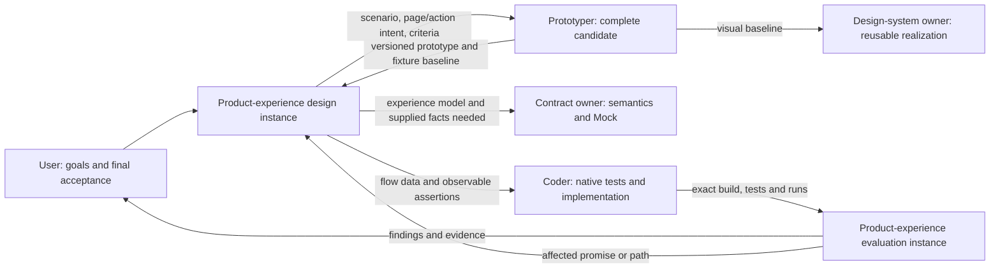

# Product experience: selected design

Publication note: the reusable source has moved to harness and is installed here as managed guidance. The research fingerprints and original publication paths below identify the earlier local candidate; navigational links now lead to the shared replacement. See the [upstream/adoption Task](../../../harness/.controller/agentx-guidance-upstream/implementation.task.md) for current ownership and migration evidence.

Design maturity: candidate, supported by source research and static consumer walkthrough only. The actual steward assignment is the construction of this professional basis; it is not a product-experience runtime trial or usability study. Task progress lives in the [Task](implementation.task.md).

## Situation and decision

The user starts with an uncertain actor, role or need, and wants to see how it becomes a model, pages and operations, then a replayable path and readable evidence. Existing product-design guidance already owns discovery and promises; interaction-modeling owns scenario–domain–UI joins. Neither provides this requested local professional responsibility and explicit native-test/report handoff. Select a focused role composing these authorities, with two workflows, rather than another scenario catalog.

| Alternative | Decision and reason |
| --- | --- |
| Keep design and review as separate professional roles | Rejected by the user; one professional basis supports both, while assignments distinguish instances |
| Extend prototyper to own product discovery and acceptance | Reject: prototype production has a different craft and artifact responsibility; evaluation cannot silently inherit self-review independence |
| One product-experience role plus source-linked method | Selected: owns product meaning, experience decisions and bounded assessment; exchanges artifacts directly with existing specialists |
| Add Skill, universal flow DSL, test generator or report platform | Outside scope; readable local data and explicit native Playwright mapping answer this assignment without duplicate infrastructure |

The same role may be used directly for design or review. An independent review requires an assigned instance that did not author the evaluated candidate; no mandatory new agent is implied. The Controller retains staffing/priorities. The user retains acceptance. Product-experience can propose outcomes and criteria, but cannot redefine domain guarantees, implement production changes without assignment, or relax failed criteria to manufacture success.

## Research and adaptation basis

Inspected 2026-11-16. Local files are the maintenance sources in this checkout; exact content fingerprints and official-page retrieval are recorded in [research evidence](research.md). Existing installed/shared guidance remains unchanged. Links carry methods by reference; no upstream text or code bundle is vendored.

| Inspected source | Mechanism retained | Local adaptation and limit |
| --- | --- | --- |
| [Steward construction](../../.agent-guides/domains/role-methods/AGENTS.md) and harness scenario-design/authoring/validation | Concrete gap, owner/model/source decisions before publication; separate work/maturity/adoption | This topic and one Task; no new status registry |
| [Product design](../../.agent-guides/scenarios/product-design.md), [requirements](../../.agent-guides/domains/product-design/requirements.md), [evaluation](../../.agent-guides/domains/product-design/evaluation.md) | One scenario authority; progressive specificity; condition/action/result; observation versus interpretation | Actor hypotheses remain hypotheses; local workflow joins extend existing owners |
| [Interaction modeling](../../.agent-guides/domains/interaction-modeling/AGENTS.md), sources-and-coverage and checks-and-evidence | Three independent inventories, stable bindings, finite evidence and explicit unknowns | Flow/test/report references form projections; no second domain state or operation registry |
| [Prototyper](../../.agent-guides/roles/prototyper.md), design-system and domain-contracts roles | Whole prototype before detailed review; retained visual/data baseline; contract-owned Mock | Product-experience owns intent and findings, specialists own their deliverables |
| [Native roles](../../.docs/roles-workspaces.md) and existing role TOMLs | Relative prompt file, existing profile, explicit non-default role | Publish local binding; no running-instance refresh |
| Official Playwright test.step, assertions, fixtures, reporters and trace docs | Named steps, locator retry assertions, isolated fixtures, HTML/JSON and trace artifacts | Explicit illustrative native tests; no assumed Playwright package, generator or reporter integration in this repository |

No candidate Skill is needed: relevant professional methods already exist locally and Playwright is a named downstream projection. Researching or installing a Skill would not resolve a missing responsibility here. Root package inspection confirms Playwright is not a declared dependency; existing browser scripts remain usable by their current owners and are not replaced. Subsequent inspection of tests/space_routes/browser.mjs and its verification record confirms prior actual Playwright tracing and screenshots; the missing capability is stable model association and a maintained consumer/report seam, not absence of Playwright experience. Its machine-cache import is not reusable configuration.

## Why the workflow fits

| Perspective | Input → useful output | Failure challenged |
| --- | --- | --- |
| User | “Help me find my task” → scenario and criterion → page/action map → step result and screenshot/trace when executed | A green test summary hiding unvisited requirements or a stale build |
| Agent | Role → focused entry → current uncertainty → existing authority → selected workflow | Requiring complete personas or machine syntax before useful design; inventing research to fill fields |
| Coder | Versioned flow and fixture contract → explicit native tests in existing suite | Treating each click as a separate test, inventing a universal runtime or silently skipping unsupported actions |
| Evaluator | Frozen criterion/build and exact run attempts → finding, owner and recheck | Self-review labeled independent; screenshot interpreted as durable business success |

Progressive models let one slice become executable while surrounding needs remain hypotheses. Stable IDs permit many-to-many mapping and preserve history across layout changes. A new criterion revision invalidates only relevant claims, not old evidence under its original revision. The report is a projection of those joins, so a missing artifact cannot become proof.

## Selected scope and remaining uncertainty

The [example](example/README.md) is a complete design review instance for a read-only task search and no-result recovery. It supplies two executable-path mappings, three criteria including manual comprehension, and a not-run report. It intentionally has no host implementation. Actual host bindings, installed Playwright compatibility, browser execution and user observation remain prerequisites for a future consumer assignment. No claim of measured effectiveness, rendered diagram review or runtime role adoption follows from this construction.

Substantive future changes reopen affected decisions and their evidence. A known broken link or small scenario update reuses its owner and does not restart role research.

## Subsequent user direction

The user explicitly prioritized data-model definition and one relationship-driven platform that refines text into actor/characteristic/scenario/prototype/data/test expression. The selected [platform design](platform-design.md) and [semantic method](../../.agent-guides/domains/product-experience/data-model.md) now own that direction and researched UIUX reuse seams. This extends the design basis; implementation of the tool and exact executable schemas remains a separate assignment.
