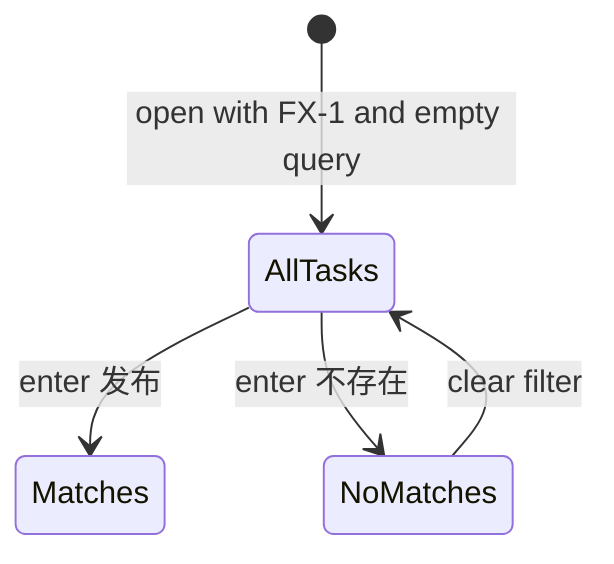

# Task search design example

Source revision `source-v1`. All content here is **design example**, selected solely to exercise the new role/method; it is not an accepted product requirement, research observation or executed behavior. This file is the example's sole promise authority. The JSON references these IDs without duplicating criterion text.

## Actor and need

| ID | Meaning | Basis |
| --- | --- | --- |
| ACT-1 | A workspace member who remembers part of a task title | Hypothesis for this example; no participant evidence |
| CLAIM-1 | ACT-1 remembers a partial title; applicable to task lookup, potentially favoring title search | Hypothesis, ASM-1; no supporting participant evidence |
| NEED-1 | Find the intended task without changing stored tasks | Example design direction |
| ASM-1 | Title search is a useful entry for this actor | Unvalidated hypothesis; ask/observe representative users before claiming value |
| REQ-1 | Find a task and recover from no matches while preserving the initial list | Example selected promise; contributes to NEED-1 |
| SC-1 | From the task list, search by title; if nothing matches, clear the filter and continue | Example use case refining REQ-1 |

## Criteria

| ID | Condition → action → expected observable result | Evaluation boundary |
| --- | --- | --- |
| CR-1 | Given FX-1, enter `发布` → show only task `task-demo-1` with title `发布预览`, keeping the filter value | UI/mock state; no claim about persistent storage |
| CR-2 | Given FX-1, enter `不存在` → show `没有匹配任务` and zero task rows; click `清除筛选` → empty query, both original task rows and no empty message | UI/mock recovery; all AS-2 and AS-3 predicates required |
| CR-3 | Given the neutral goal “找到发布预览；如果没有匹配结果，回到全部任务”, a representative participant independently finds search and recovery and correctly explains that only the view changed | Manual task observation, including assistance and participant account; no automated usability verdict |

## Page and behavior model

`PAGE-1` is the example task-list page, proposed route `/experience-example/tasks`. `CTRL-SEARCH` is a textbox with accessible name `搜索任务`; `CTRL-CLEAR` is a button with accessible name `清除筛选`. An unnamed list uses `data-testid="task-list"`; each task item uses `data-testid="task-row"` and a stable `data-task-id`. Exact visible text is part of this example's binding, not a shared domain rule.

AllTasks contains `task-demo-1` / `发布预览` and `task-demo-2` / `检查合同` in that order. Matches contains only task-demo-1. NoMatches has no task items and displays the empty message. No service operation is needed for the selected read-only in-memory filter. Real search APIs, permissions, persistence and backend outages are outside this illustrative scope; new guarantees would need their real owners.

FX-1 version `fixture-v1` uses those two fixed records, an empty query and no stored browser state. The host's future fixture owner must supply the same immutable records on each page load. A fresh Playwright context resets browser storage; this example performs no domain writes and requires no domain reset. A future persistent implementation would need a separate owned fixture/reset contract.
