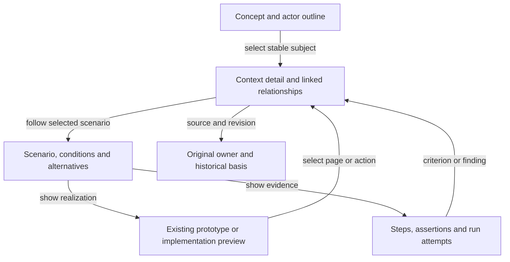

# A connected experience workspace

The user's subsequent direction selects a common platform for progressive concept → actor/characteristics → need/scenario → prototype → E2E/evidence expression. The core is a [semantic data basis](../../.agent-guides/domains/product-experience/data-model.md) and interaction through relationships, rather than detached documents at each stage. This design is consumable planning input; no UIUX change, executable schema, importer, platform screen or runtime integration is implemented in this Task.

## Refine the same subjects

| Initial expression | Useful refinement | Continuous identity and return |
| --- | --- | --- |
| “Members want to find a task quickly” | Actor ACT-1, need NEED-1, characteristic claim about remembered titles and its assumption basis | Narrative and rationale stay attached; new observations can challenge the claim |
| “Search should help” | REQ-1 and SC-1, trigger, initial state, result, no-match recovery and CR-1..3 | Requirement remains at its canonical owner; scenario references it |
| “One search box on the task page” | PAGE-1, search/clear controls, state, navigation and criterion bindings | Link to UIUX's actual page/composition/candidate identities, not another page tree |
| “Try it on the prototype” | FX-1, stable flow steps, native checks and manual comprehension observation | Reuse prototype/Mock data; scenario links remain after reconstruction |
| “Does it satisfy the goal?” | Exact run, per-criterion evidence, screenshots/trace and unresolved finding | Follow back to original actor/need and revise affected sources without erasing old evidence |

Partial precision is normal: an actor can remain hypothetical while one scenario has operable data and assertions. Text, diagrams, structured records and rendered scenes are alternative projections/refinements of related subjects. Conversion must preserve unsupported claims; static type structure cannot create missing research.

## Research actual UIUX seams

Read-only source inspection on 2026-11-16; fingerprints in [research](research.md). UIUX's [entry](../../../uiux/AGENTS.md), [architecture](../../../uiux/docs/architecture.md), [contracts](../../../uiux/docs/contracts.md) and [prototype handoff](../../../uiux/docs/design-system/prototype-data.md) govern any future implementation. No installed version or running support is inferred from this checkout.

| Existing source contract | Selected reuse | Not yet supported by this inspection |
| --- | --- | --- |
| [Sitemap](../../../uiux/framework/sitemap.model.ts): page/layout/block/component IDs, composition instances and separate links, source/draft revisions | Reference existing page and instance identity, path, scene and navigation. Keep hierarchy/composition/navigation distinct | Actor, characteristic, need and experience-scenario entities are not declared here; its strict parser rejects unknown keys |
| [Native contracts](../../../uiux/framework/contract.types.ts): ContractSymbol, source location, references/usages and ContractMockSession fixture/reset/client/renderPreview | Link a behavior/data obligation to its real symbol and source; use same-client Mock and actual consumer for observed prototype effects | A symbol reference is not an executed workflow or a need-to-function association |
| [Candidates](../../../uiux/framework/candidate.types.ts): semantic group + candidate ID, page/block URL or CSF story/resource/scene | Retain design alternatives and exact realization references without using URL as identity | Candidate identity alone does not pin a build or prove interaction success |
| [Resources](../../../uiux/framework/resource.types.ts): state, interaction, scene and source | Bind UI state/interaction illustration to its canonical scene; retain disclosure and reset semantics | ResourceInteraction is a design-system expression, not automatically an end-user scenario, native operation or E2E run |
| Existing visual comparison and contract workspaces | Compose linked views over existing preview, source and comparison surfaces; reuse existing viewer/host patterns | No inspected API provides the entire actor→requirement→run graph, its editor or common selection controller |

Do not add experience fields to strict Sitemap/resource objects informally. A future contract assignment should define an owned experience document/reference boundary, then join existing declarations by explicit namespaced references. Prefer native TS/local client unless a real remote boundary requires more. Formal product code imports the same canonical contracts; no parallel JSON operation schema or fake preview CRUD.

## Core relationship interactions

| User intent | Required interaction and useful information |
| --- | --- |
| Understand who the design serves | Select actor; see context/characteristics, basis labels, supporting/challenging observations and linked goals/scenarios. Unresearched claims remain visibly hypothetical |
| Understand why a function exists | Select requirement or page action; see originating need, actors, applicable scenarios and criterion, plus unrelated/unbound controls without inventing links |
| Follow progressive detail | Expand narrative → structured distinctions → relationships → realized pages; keep subject/revision selection and a return path across views |
| Compare a design | Select scenario and candidate; open the existing page/scene at declared fixture/state, retaining alternative identity and data version |
| Judge satisfaction | Select criterion; show planned path, actual step/assertion result and native artifact, with manual/blocked/missing cases. Preview and evidence links are distinct |
| Improve the design | From finding/observation, navigate to affected source; show related consumers and stale bindings before an owned revision. Preserve old runs and alternatives |

Use a compact outline or table and contextual detail/preview; use a focused graph when relationships answer a question. A global all-nodes graph is not the default. Common selection should be a namespaced subject plus revision and scenario/candidate/run context; do not overload page navigation or a browser URL as the business identity. Deep links resolve through the responsible owner's versioned adapter, display unresolved/access limits and return to the originating selection. Exact routing/persistence/API contracts remain future implementation decisions.

## Bounded next slice

If implementation is commissioned, first agree one native experience model/fixture and render this read-only slice in UIUX: actor/assumed characteristic → need → scenario/criteria → existing page/candidate reference. Selecting either the scenario or page must reveal the reverse relationship and preserve return context. Add flow/native-run evidence as a subsequent refinement of those same subjects, using existing runner artifacts. Product editing, multiuser change semantics, automated extraction/generation and a general test platform are separate decisions.

Acceptance of that future slice should exercise a valid reference, missing reference and stale revision; distinguish hypothesis from observation; and verify that the linked prototype/contract identities are genuine. This Task delivers the design and example, not that future implementation or its acceptance evidence.
