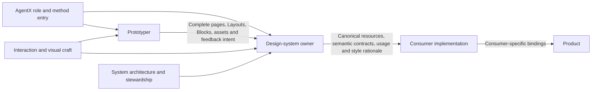

# Prototype and design-system role maintenance

This record describes the earlier AgentX maintenance selection and the 2026-11-16 synchronization of prototype/design-system improvements first authored in DancingAI. The user's subsequent direction moves reusable source ownership to [harness](../../harness/AGENTS.md); see the [upstream/adoption Task](../../harness/.controller/agentx-guidance-upstream/implementation.task.md). AgentX now consumes managed guidance and retains its native bindings and original evidence. The source/decision table below describes the historical selection.

## Selected responsibilities and source basis

| Source | Adopted decision |
| --- | --- |
| User's design-method requests in the originating conversation | Layout explains; structure precedes Blocks; microinteractions and domain artwork are deliberate design responsibilities |
| User's system-role requirements | Layout families, semantic names/tokens, maintainability, progressive indexes and usage; each style has a rationale file and supported switching |
| User's maintenance-location instruction | Maintain reusable roles/methods in AgentX going forward |
| Existing AgentX roles and interface standard | Preserve broad authoring passes, useful resource/action density, local disclosure, native role/profile bindings and authority |
| UIUX `design-system/components`, `structure`, `tokens`, `resources`, `visual-language`, `prototype-workflow` | Reuse maintained contracts; independent brightness/style axes; coherent artwork and geometry; canonical resources; new CSF discovery without duplicating native records |

The initial role files matched the pre-improvement DancingAI versions. Their
changes can be integrated without discarding AgentX-specific interface guidance.
The two local scenarios own procedures; roles own responsibility and routes.
The coder's references keep the handoff intact. Existing UIUX/shared methods
supply capability; another Skill would add duplicate discovery without a distinct
execution capability. Installed shared guidance and UIUX files are unchanged.

The stewardship method is adapted to a consumer-declared source owner. DancingAI's
`packages/ui` and root `uiux/README.md` must not be assumed to exist in AgentX or
other consumers. Native `.agentx/roles/*.toml` keep the same profile/prompt bindings,
with descriptions updated to expose the new responsibility.

## Consumer and Agent fit

A prototyper builds the complete selected composition and its important feedback,
then refines it as a whole. A system owner finds real Layout needs, defines semantic
contracts and style grammar, and maintains the path from system entry through
capability families to native types and examples. A consumer can choose and use
the resource without guessing an undocumented private import.

A new style has its own design file and actual geometry/artwork/feedback treatment.
Switching preserves independent brightness, identity, focus and drafts. A one-line
token fix reuses those decisions and updates only affected references. Backend-only
work does not trigger UI creation. Static artwork keeps its asset scope. These
are static scenario walkthroughs, not observed product usability results.

Color must have another perceptible cue; tooltip disclosure cannot hide essential
consequences or recovery; celebration requires confirmed success. Shared resources
retain one implementation source. These limits preserve meaning while removing
unnecessary explanation and redundant style/component forks.

## Synchronization evidence and limits

Changed two role prompts, both native descriptions, two local methods, root/local
routes and the coder handoff. Validation checks local Markdown references, native
TOML parsing/prompt paths, whitespace and read-only native role resolution.
The diagram is statically reviewed source; no rendered diagram inspection is claimed.
No product implementation, global-role installation, Agent launch, service restart
or refresh of existing role snapshots is part of this synchronization. Guidance
effectiveness remains to be observed in a subsequent actual design task.
