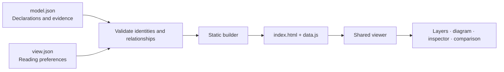

# Architecture and maintenance

[Documentation home](../README.md) · [Agent entry](../AGENTS.md)

The consumer supplies authored facts and display preferences. The reusable tool validates both inputs, builds two static files and renders those files through one viewer. The input project can keep its own source correspondence checks. No renderer component owns project data.



| Responsibility | Authoritative entry |
| --- | --- |
| Record shapes | [schema.d.ts](../schema.d.ts); the [model](model.md) and [view](view.md) guides explain how to author the shapes. |
| Structural and binding checks | [validate.mjs](../validate.mjs) exports `validateModel(model)` (returns the anchor/owner indexes) and `validateView(model, view, index)`. Neither reads project source locations. |
| Static assembly | [build.mjs](../build.mjs) provides CLI and programmatic entry. `prepare(model, view, {viewerPath, dataPath})` validates and returns `{index, html, script}`; its `index` is a validation index. `publish(page, {index, data, write})` takes **filesystem paths** for the generated entry/data, checks freshness by default and replaces changed files with `write: true`. The relative URLs passed to `prepare` must match how those files will be opened. |
| Derived layer lookup | [layers.js](../layers.js) is included in the generated script alongside `globalThis.CONTRACT_MODEL` and `globalThis.CONTRACT_VIEW`. Use `CONTRACT_LAYERS.layer(id)` or `layerForNode(anchorId)` to resolve a layer, and `layerMappings(id)` for its actual incoming/outgoing cross-layer edges. Fields use their owner's layer; an unknown ID yields `undefined` or an empty mapping list. |
| Shared workbench | [Viewer template](../viewer/index.html) and [styles](../viewer/canvas.css) assemble the workspace, directory, canvas, and inspector. [Canvas](../viewer/canvas.js) coordinates selection/scenes; [layout](../viewer/layout.js) owns SVG geometry/routing; [layer workspace](../viewer/layer-workspace.js), [reference preview](../viewer/reference-preview.js) and [walkthrough](../viewer/scenario-walkthrough.js) own their local interactions. |
| Executable example | [Library inputs](../example/) exercise a typed method, cross-layer references and a walkthrough with no external project. [Example design evidence](../example/DESIGN.md) stays alongside those inputs. |

The generated classic script carries data for direct file opening; it does not fetch, import or execute the authored model. JSON strings remain text at script, HTML and SVG boundaries. Source paths remain inert. The viewer has no source extractor, editor, runtime hooks or persistence. Layout coordinates belong to the renderer; changing layout must not add edges or change a declaration's owner/provenance.

## Keep the documentation and behavior in sync

- A schema or validation change updates [the schema](../schema.d.ts), [validator](../validate.mjs), the affected model/view guide and one relevant example when needed. Do not silently change the meaning of existing versioned inputs.
- A CLI, output or hosting change updates the [quickstart](quickstart.md) and this integration contract where relevant. Treat generated files as outputs; regenerate them rather than hand-editing.
- A viewer behavior change updates the relevant [viewer control](viewer.md). Reproduce with the standalone example or the affected consumer instead of copying consumer IDs into reusable modules.
- A consumer-specific rule belongs with that consumer. A new reader should be able to copy only this tool and follow any generic guide without another repository.

After touching the example inputs, shared template or embedded layer helpers, regenerate and verify the example from the tool directory:

```sh
node build.mjs example ../viewer --write
node build.mjs example ../viewer
```

Check the affected path in the browser when presentation or interaction changes. For portability changes, copy only this directory and repeat the relevant build/open steps with the example. A documentation change should verify affected relative links and executable examples.
