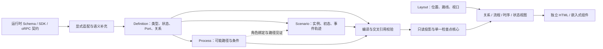
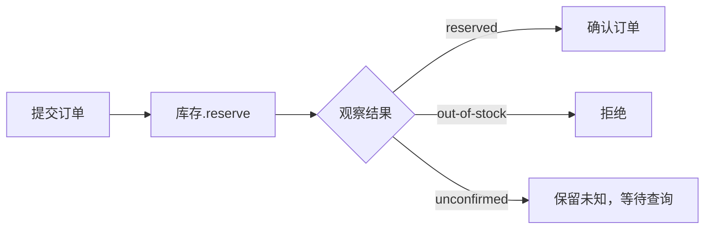

# Flow Atlas：可交互的领域与流程设计工具

针对用户对样式和易用性的反馈，新的[画布体验设计](experience.md)从实际元模型与用户任务梳理信息／动作，再实现[可操作原型](../prototypes/experience/README.md)。[新预览18960](http://192.168.2.178:18960/)与原18959并存；它是体验提案，已走查的操作与尚待用户确认的偏好分别记录，不变更下文的语义契约权威。

当前产品语义以[领域模型设计工作台](workbench.md)为深化入口：领域对象／值／规则／行为是主体，Process补足参数来源，Scenario区分实例、预期和观察。其有限实现已完成[独立验收与发布](../../../.controller/domain-daemon/flow-atlas-workbench-implementation.md#accepted-local-outcome)。下面保留更广目标和早期技术／接口设计；支持范围以已实现契约及实际证据为准。

领域工作台的实际契约权威是[domain/contracts.ts](../domain/contracts.ts)，公共入口是[domain/index.ts](../domain/index.ts)：它复用已有基础词汇与Schema句柄，拥有领域／顺序流程／场景及portable artifact语义。本目录旧接口仍是早期目标草图与共享基础词汇，不能与当前实现分别维护同一字段清单。[领域用法](../domain/README.md)和[工作台用法](../workbench/README.md)持有可调用API、已验收示例和限制。

把产品和 SDK 的**对象、状态、接口与流程**定义一次，生成可拖动的对象画板、流程图、时序图和状态图，让同一份设计既能被代码消费，也能被人理解。核心交付形态是本地 TypeScript 库、可嵌入查看器和独立 HTML 导出；“平台”首先表示一致的模型和工具边界。

这是更大目标的设计基线。较早的[有限轨迹查看器](../../../.controller/domain-daemon/tasks/runtime-atlas-ports.md#accepted-canvas-port-and-state-outcome)、[TS authoring](../authoring/README.md)和[Inspector](../inspector/README.md)保留各自已验收的输入格式与能力。新增领域工作台实现了身份／状态／规则拥有者、显式参数数据流、有限场景检查点与五视图。通用事件／并发／循环、SDK 自动导入与 oRPC 适配仍是目标；布局和相机复用现有模块，未实现通用避障。

早期目标声明在[contracts.ts](contracts.ts)和[api.ts](api.ts)，设计示例在[example.ts](example.ts)和[self-example.ts](self-example.ts)。除共享基础词汇外，这些草图不构成当前领域工作台API；实际入口分别为[domain/index.ts](../domain/index.ts)及较早的[authoring/index.ts](../authoring/index.ts)。两个实现都复用原生Schema／方法引用，流程结构仍需显式设计，避免手工复制方法字段。

## 用户与完整使用路径

| 用户要做的事 | 输入 | 一次完整的结果 |
| --- | --- | --- |
| 设计领域或 SDK | 已有 TS／运行时 Schema、方法契约，加少量领域语义 | 看到对象类型、方法参数、状态、模块归属与依赖；一个类型可实例化多次。 |
| 讲解一个业务或系统流程 | process 定义，以及成功／拒绝／未知的具体场景 | 看整体分支，选一次实际路径，再逐步观察谁调用谁、传什么、何时改变状态。 |
| 调整拥挤的画面 | 当前画板 | 拖动对象、固定位置、重新布线，撤销或导出布局；业务轨迹和播放位置不变。 |
| 复用到另一套产品 | 同样的定义与编译接口 | 无需修改渲染器或写产品 ID 分支，直接生成页面；可离线分享。 |

采用一条“订单请求预留库存”的决定性场景验证模型：库存方法返回成功时，展示预留结果和库存变化；请求发出后断线时，显示结果未知，不补造成功返回，也不声称库存仍是原值。它同时能表达领域设计、跨对象调用、状态、失败分支和不确定性。[示例](example.ts)包含两条具体轨迹和同一个有三种结果的 process。

## 四份数据，各自只有一个事实来源



`Definition` 是稳定设计，`Process` 描述可能发生什么，`Scenario` 见证一条具体路径，`Layout` 是人怎样看它。业务方法内部计算保持不透明；参数、结果和可观察状态由边界契约表达。渲染器不运行被展示系统，也不调用 SDK handler。

## 对象模型与关系语义

| 对象 | 拥有什么 | 与其他对象的关系和不变量 |
| --- | --- | --- |
| Domain | 领域边界与说明 | 可有父域；不能通过画板分组改变领域归属。 |
| Module | 代码／能力模块边界 | 属于一个 Domain，可嵌套；模块包含不等于部署在同一进程。 |
| ObjectType | 种类、结构化状态、公开 Port | 属于领域，可属于模块；Entity、Service、Actor、Store、Process、Logical 是表达角色，不规定实现语言。 |
| ObjectInstance | 场景中一次具体身份 | 引用类型；两个订单、两个 Agent 共享类型，保留独立状态，不能靠名称合并。 |
| StateDefinition | 带 Schema 的字段及可选生命周期转换 | 生命周期是字段的一种约束；其他独立状态不应展开成所有组合。 |
| Port | 命令、查询或发送／接收事件 | 属于对象类型；命令／查询定义输入和允许结果；事件定义方向和 payload。 |
| Relationship | uses、association、event-route | 设计依赖、领域关联和事件路由是不同连线；不会因为关联就生成调用。 |
| Channel | 实例间的传输及连接状态 | HTTP／RPC／IPC 等机制独立于方法；一个通道可承载多次不同方法调用。 |
| Explanation / Source | 简短解释与设计／源码／观测依据 | 解释关联到真实对象、步骤或事件；不是所有内容都要变成长面板。 |

集合内 ID 唯一，Port／字段／转换在其 ObjectType 内唯一，引用必须带足够作用域。实例引用使用 `{objectId, portId}`，类型引用使用 `{typeId, portId}`。ID 承担身份，不用显示标签、数组索引或当前坐标代替。一个功能有多个实例与一份共享接口时，无需复制方法契约。

Port 不是网络端口。方法调用方可以只是一个对象，没有声明输出 Port 时，画板产生**视觉发出点**；它不是新 API。事件是另一种关系：`emit` Port 对应事实发布，`receive` Port 对应事件处理；一个发布可以有多个接收，但必须分别声明，不由一条双向线推断。

结构类型、运行时校验和业务意义分开：TS 检查形状；运行时 Schema 检查外来值；交叉引用编译检查 Port 所属、过程边和事件关联；业务文档说明约束，工具不能证明隐藏业务实现正确。`Json` 不允许函数、循环对象、NaN、裸 BigInt 或 Date 实例；需要时由消费者显式编码，再用 Schema 描述。未知与脱敏使用 `ValueCell` 的独立变体，不能以 null 或空字符串冒充。

## Process 与 Scenario 的行为契约

**Process 是图。** 角色引用对象类型，operation 引用角色的 Port，event 引用发出／接收端口，decision 声明分支条件，start/end 表示边界。fork/join 可表达显式并行区域，但不提供调度器。循环通过回边表达，具体场景用 `ProcessVisit.occurrence` 区分第几次经过；不会复制一份流程节点来冒充循环定义。

**Scenario 是实例与轨迹。** 它绑定 process 角色到具体对象，拥有完整初态、实例通道和离散事件。过程访问节点必须与所引用事件的 `processNodeId`、角色类型及所经 flow 一致；不能只在画面上高亮一条与实际调用无关的流程。没有 process 的调用轨迹也合法，可直接从 SDK 示例开始。

| 轨迹事件 | 意义 | 不得推断 |
| --- | --- | --- |
| call | 一次具名 callId 的命令／查询，输入发给确切目标 Port | 已收到、成功或状态已变。 |
| reply | 同一 callId 的实际返回及允许结果 | 另一调用的结果；接收成功不自动表示业务完成。 |
| outcome | 没有返回数据也可能知道的接受、拒绝、未知等观察 | 缺少回复不等于拒绝；未知不能补造回复。 |
| emit / receive | 一次 emissionId 的发布及明确接收者 | 广播已被所有订阅者处理。 |
| state | 一组对象字段写入，引用原因事件 | 方法内部所有中间状态；未声明的远端副作用。 |
| channel | 连接／断开／未知 | Agent 或业务对象已停止、事务没发生。 |
| checkpoint | 具名说明与观察边界 | 无依据的状态变化。 |

`after` 是因果依赖。`events[]` 是一条与依赖一致的展示顺序；独立事件的先后排列不宣称它们在真实系统里存在先后因果。时序图可显式画依赖／并行标记，process 可以呈现 fork/join；首个播放实现按给定拓扑顺序演示，不能把它叫作真实并行执行。时间只用于展示速度或源事件的记录时间，不由动画时长推算真实延迟。

状态值只有一个来源：完整 initial 加 `state` 事件。call/reply 不再偷偷执行另一份状态更新。状态定义中的 transition 是“允许的边”，具体 state 事件携带 `transitionId` 是“这次发生的边”，新值只在 writes 中。编译器核对前后状态、触发 Port、结果和声明转换；未声明生命周期时保留普通字段语义。条件和 guard 是解释文本，不 eval，不自动选择分支。

`state.writes` 在一个事件中是**模型检查点的原子应用**，不是分布式事务保证。跨对象状态应按真实可区分的边界拆事件；无法确定的字段写为 unknown。未知／拒绝后的观察可以更新所知，但不能据此标记目标调用已成功修改。恢复收到权威结果时保留原 callId 的历史，追加新事件；重试必须是显式的新 callId，工具不自动补发。

### 编译不变量与诊断

数据Schema只检查局部形状；`compile`还必须检查下列关系。任何错误都阻止生成“有效模型”，警告允许带来源继续呈现；诊断包含稳定code和确切字段path，不能只给一个“解析失败”。

| 范围 | 必须满足的约束 |
| --- | --- |
| 身份与结构 | scoped ID唯一，领域／模块父引用无环，所有字段Schema、来源、类型和Port引用存在；同类型多实例各有完整初态。 |
| 值与状态 | 初态覆盖每个实例的全部声明字段，已知值通过字段Schema；unknown/redacted保留独立含义；同一state事件不重复写同一字段；未变化值不产生虚假diff。 |
| 调用与返回 | callId唯一，目标只能为command/query，实际输入通过input Schema；reply/outcome必须引用此前call与允许结果；返回payload匹配对应Schema；unknown事件本身不伪造reply或成功effect，后续权威返回可显式解除未知并保留历史。 |
| 事件 | emissionId唯一，emit只能来自emit Port；receive匹配已有emission和receive Port，payload可接受；未声明的订阅者不产生接收记录。 |
| 因果 | after/causeEventId只引用已有事件且无环；展示顺序是该图的拓扑顺序，state原因属于可见因果历史；未知不能由时间流逝自动升级。 |
| Process | start／node／flow／角色引用存在，目标Port匹配角色类型；分支有说明，fork/join显式配对；visit与events和flow路径一致，循环occurrence单调。 |
| Layout | 数值有限、zoom正数、对象范围正确、内容摘要吻合；折叠和手工路线不删除模型事实，旧异步路由不能覆盖新布局。 |

生命周期transition限定其ObjectType自己的Port作为触发边；跨对象结果要由拥有者明确记录或观察，不把远端返回直接当成本地方法执行。缺少生命周期定义时只验证字段和值，不伪造转换边。分支条件不执行；编译验证结构和场景对齐，作者仍负责条件解释是否符合实际业务。

`snapshot/changes/interactions`只接受已编译模型里的scenario/event ID，不存在的索引抛出带上下文的RangeError；`snapshot`省略event表示初态。交互查询省略event时返回空集，只投影截止当前事件已出现的调用；未知后追加权威结果保留历史。返回快照和投影不能通过调用者修改污染后续结果。`changes`提供前后ValueCell而非重复存储一份新状态。编译不读取来源URI、不执行表达式、不访问被建模系统。

### 一个可读的流程与具体轨迹



相同 process 上两条 scenario：成功轨迹是 `call → reply → 观察库存8 → 确认订单`；断线轨迹是 `call → disconnected → unknown outcome → 库存 unknown`。一个可编译的结构示例不意味着工具已证明库存算法或运行过 RPC，所有示例事件明确标为 authored。

## 代码接入与 oRPC 的位置

推荐作者路径：在现有 Schema／契约附近补充领域元信息，通过显式映射生成 Definition，编写少量场景事件，再编译为查看器数据。保持“本来就有的定义”作为其事实来源；不要求把每个 DTO、方法或错误重新抄到图表配置。

| 可以从已有契约得到 | 必须由作者提供 |
| --- | --- |
| 程序路径、输入／输出 Schema、已声明错误、明确 metadata | 领域／模块边界，对象实例、状态字段与生命周期，命令／查询语义，交互顺序、分支、原因、状态变化与解释依据。 |

TS 的 interface 在运行后被擦除，单靠类型名无法得到可检查的数据结构，更不能推断 process。选择运行时 Schema 作为可执行数据契约，TS 类型由它推导；序列化到 portable JSON Schema 加引用，浏览器只消费 JSON，不 import 用户项目，不执行作者脚本。

oRPC 适配器读取 contract-only 对象和显式 procedurePath→type.Port 绑定，复用输入、输出、错误 Schema，不调用 handler。`ContractBinding` 已定义映射格式。适配器把真正的输出映射为 returned payload，声明错误映射为明确 outcome；不能默认把 HTTP200映射为业务完成，也不把未声明错误或断线当成某个业务拒绝。多个可能的业务结果仍由作者给出 discriminant／语义映射。

例如已有服务契约可保持原写法，适配层只补一份关系绑定（以下上游示例是说明，未安装oRPC运行；实际类型示例见example.ts）：

```ts
import { oc } from '@orpc/contract';
import * as z from 'zod';

const ReserveInput = z.object({ orderId: z.string(), quantity: z.number().int().min(1) });
const Reservation = z.object({ reservationId: z.string() });
const stockContract = {
  reserve: oc.input(ReserveInput).output(Reservation),
};

// Flow Atlas authoring metadata; does not duplicate payload field definitions.
const binding = {
  procedurePath: ['reserve'],
  target: { typeId: 'inventory', portId: 'reserve' },
  semanticKind: 'command',
  inputSchemaId: 'reserve-input', outputSchemaId: 'reservation', errors: {},
};
```

Stock自己的代码继续消费 `ReserveInput` 与 `Reservation`；Atlas通过转换器导出同一Schema。声明错误存在时在errors映射中引用相应outcome ID。未提供的状态、过程和业务含义仍由Definition／Scenario定义，不能从这个contract自动编出来。

Standard Schema 的 validation API 不保证可导出完整 Schema。适配器要求明确的 JSON Schema 转换器；不支持的 transform、refinement、日期或私有 Schema 节点返回有路径的诊断，可在作者层提供替代显示 Schema／显式不透明说明。**不能静默输出 `{}` 后宣称接口已完整导入。** oRPC v1 与 v2 的适配器选择及官方依据见[技术选择](technology.md)。

工具自身的 `compile`、`snapshot`、`move`、`seek` 是本地 TS 公共方法。它们不是远程边界，不为采用 oRPC 而绕一层 HTTP。只有后续确实要远程协作／服务化时，才把相同用例包成契约；那时要单独设计权限、修订冲突与保存语义。

## 画板与布局的操作契约

布局算法解决“怎么摆”，路由解决“线怎么绕开”，拖动解决“用户怎样调整”。单纯让矩形可拖动，不能解决其他节点挡线；三者需要独立职责和一致约束。

| 操作 | 直接反馈与状态 | 完成／取消语义 |
| --- | --- | --- |
| 选中对象 | 显示对象边界、相关线及其状态／Port；其余线淡化 | 单击选择；短点击不触发拖动。 |
| 拖动标题区 | 节点与相连边实时跟随；Pin位置随卡片改变 | 超过拖动阈值进入 dragging；pointer capture；释放一次提交；Escape／pointercancel恢复原位置。 |
| 触控／键盘移动 | 触控使用标题握柄，空白区保留平移；选中后快捷键微移 | 不占用 Port／字段点击；Esc取消；每次手势算一个 undo 项。 |
| 固定／取消固定 | 节点显示图钉 | 自动布局尊重固定节点；不偷偷清除固定。 |
| 自动布局 | 预览新排列，保持选择与语义检查点 | 显式应用；支持撤销，不能每步播放都重新布局。 |
| 重新布线 | 固定所有节点，只重新计算折点和标签位置 | 无路径时明确标注“布线未解决”；保留可见选中线，不能当作已避障成功。 |
| 视口平移／缩放／适配 | 保持指针所指位置和选中对象；地图内操作 | 不移动业务对象，不改变播放速度。 |
| 保存／导入／重置 | Local draft或“未保存”提示；可导出布局 JSON | 保存失败保留内存布局；重置是一次可撤销的布局操作。 |

状态机：`idle → pressed → dragging → committing → idle`；取消回到原布局。开始拖动时暂停播放器，固定当前事件／进度；释放后保持暂停，由用户继续。拖动不 reset 场景，不提前应用事件，不丢掉当前选择。若用户在拖动期间切换场景，取消该次拖动再切换；过时的路由异步结果用 layoutGeneration 与内容摘要丢弃。布局状态和语义状态都由各自单一 owner 维护。

用户布局单独保存在 `LayoutDocument`，按 definition、内容摘要、视图 scope、scenario／process 分开。`positions`、`pinned`、`collapsed`、手工 routes 和 viewport 不进入 Scenario。默认先内存可用，再由 `LayoutStorage` 注入浏览器存储或文件保存；独立 HTML支持内存拖动和显式导出，不依赖 file:// 下不可靠的 localStorage。跨模型导入拒绝，内容变更只复用仍匹配的对象位置；失效手工路线丢弃并报告，不能套用到新对象。

### 线、Port 和标签

调用边绑定稳定的 scoped Port ID，与视觉 handle、返回方向、业务意义分别保存。节点移动、折叠、字段行高变化时更新测量值和 handle位置；反向返回仍关联原 callId。Port 的命令／查询／事件形状和文字共同表达类型，颜色只辅助。默认展示当前场景，选中后强调一跳相关线；全模型总览可折叠模块，避免一开始铺满所有可能调用。

路由先给节点边界加 clearance，再按真实 Port位置生成正交路径；路由与文字避障分别计算。拖动中用轻量临时路线反馈，释放后异步完成避障布线。节点尺寸来自实测，不用固定矩形猜测。连接的起终点允许接触所属节点边界，其他节点实体不得穿越；交叉线可以存在，但要用选中高亮／跨线间距区分，不能承诺所有图都平面无交叉。用户固定条件冲突时不偷偷移动固定对象。

## 多视图的信息结构

```text
Workspace
├─ Toolbar：模型 / 场景 / 视图 / 搜索 / 布局 / 分享
├─ Canvas：对象与 Port，或 process / sequence / state 的同源投影
│  └─ 本地详情：选中对象、字段、调用、来源；按需打开
└─ Player：上一步 / 播放暂停 / 下一步 / 速度 / 当前事件 / 状态差异
```

| 视图 | 主体与选择 | 与其余视图的同步 |
| --- | --- | --- |
| 关系画板 | 类型或实例、命名Port、核心状态、模块与关联线 | 选定调用映射到 caller、target.Port 与状态写入。 |
| Process | 全部定义分支、角色泳道、场景走过／未走过的边 | 当前访问节点高亮；未走分支不能显示为已发生。 |
| Sequence | 同一场景的调用、返回、事件、因果和明确并行 | 共用已提交事件检查点；暂时播放位置不被切视图重置。 |
| State | 某个类型的合法状态图，或实例的实际状态路径 | 声明边和已见证边分开；未知值不强塞到成功／失败状态。 |

场景、选择、检查点是 workspace 状态；拖动位置是每视图布局；详情展开是瞬时 UI 状态。地图保持主要面积，状态在对象内部，底部操作条保持紧凑。手机上标题握柄、画布平移和 Port触控各自有明确目标；详情抽屉关闭后回到同一对象。设计阶段不新增大段常驻教程或把所有字段堆进统一面板。

## 模块、公共方法与依赖方向

精确签名见[api.ts](api.ts)。下面列出方法的语义和副作用，而不是第二份参数清单。

| 模块／拥有者 | 能力 | 副作用与失败 |
| --- | --- | --- |
| Contract + Authoring | define、scenario、bundle、编译诊断 | 作者草稿可未解决引用，compile必须拒绝关键错误；不改输入，不访问网络。 |
| Semantic Core | compile、snapshot、changes、interactions | 单一状态折叠；错误包含对象路径和代码；不读DOM、文件或时钟。 |
| Process Projection | 图、角色绑定、visit校验、声明／见证状态投影 | 不能执行 guard或补造trace；首版不支持的过程结构明确诊断。 |
| Player | play、pause、next、seek、speed、subscribe、dispose | 唯一展示时钟；seek只重建已有检查点，dispose释放帧与监听。 |
| Layout | move、pin、route、arrange、undo、reset、import/export | 仅调整布局；异步结果可取消；保存失败不丢内存状态。 |
| Viewer | mount、select、setView、fit、exportHtml、dispose | 拥有DOM／worker／监听，不拥有业务进程。 |
| Adapters | oRPC／Schema／旧v1输入映射 | 只能读取显式输入，未映射语义给诊断；不运行handler，不猜业务流程。 |

拟定实现目录保持在现有 `tools/flow-atlas/` 模块内：

```text
src/
  contract/     运行时 Schema 与推导类型；公共数据边界
  core/         规范化、引用编译、snapshot/call/process投影
  authoring/    typed builders与作者诊断
  player/       演示状态机、时钟与订阅
  layout/       几何、布局／路由provider、用户布局session
  viewer/       Workspace、图节点/边、局部详情与交互适配
  adapters/     orpc、schema、legacy-v1的明确映射
  export/       独立HTML打包，文件I/O只在CLI侧
```

这是目标目录，不是已存在源码。先一个 package，按 public entry导出 `contract`、`core`、`viewer`和需要的适配器，不先建多仓库或一排独立发布包。核心只依赖契约；viewer通过Layout／Player接口组合；oRPC、React Flow、ELK和文件I/O不进入核心域。类型引用和方法所有权变更必须先更新契约，再改实现。

## 实现切片与验收

本次[Delivery](../../../.controller/domain-daemon/flow-atlas-design.md)只交付设计及可编译契约。下面是后续实现的粗粒度顺序，每一片都有用户可使用的结果；不把一次改字段拆成多个确认任务。

| 顺序 | 完整结果 | 核心验收 |
| --- | --- | --- |
| A 现有画板可调整 | 在现有v1里拖动、固定、撤销、导出布局，连线正确跟随并给出路由诊断 | 播放中拖动先暂停；Port落点不变；业务JSON哈希不变；取消恢复；390px与键盘可操作；无可用路线时有反馈。 |
| B 通用 typed契约与核心 | 从Schema和示例编译Definition+Scenario+Process，输出同源关系／时序／流程／状态投影 | 两个同类型实例不串状态；分支／循环／未知／错误Schema有诊断；相同checkpoint可确定重建；业务handler调用计数为0。 |
| C SDK导入与离线交付 | 一个固定版本的真实oRPC contract-only示例和另一套领域模型，使用同一查看器生成独立HTML | 方法输入／输出／错误不手抄；不支持转换明确失败；设计语义显式补充；无AgentX ID；离线打开并保存布局导出。 |

B的领域／core与viewer可在接口可用后并行开发，最终接受完整例子；A不必等待完整模型重写。oRPC适配独立于核心，不因为适配器还没完成就阻止手写typed模型使用。首版限制process为显式图和给定场景，不承诺自动运行所有分支；复杂层级statechart、在线协作、实时遥测、分布式编辑、BPMN全规范、任意TS AST反推和插件市场均不进入这三片。

### 本轮检查与剩余风险

本轮类型检查覆盖[实际示例](example.ts)、公共方法引用及[非法组合](type-cases.ts)。它证明声明的结构可被TS消费，不能证明运行时Schema校验、oRPC读取、ELK固定布局布线或拖动可用。技术选择中的边界探针属于相应实现切片：尤其是ELK在固定已有坐标时的可用路由能力，以及超大图、嵌套组和移动端拖动的实际表现。若机制不满足，改布局provider或降级为明确的临时路线，不改变领域契约来迁就渲染器。

运行 `node_modules/.bin/tsc -p tools/flow-atlas/design/tsconfig.json` 可检查本轮声明、自身职责示例、业务成功／未知轨迹及编译期非法组合。项目当前已有TS7.0.2工具链，本轮不新增依赖。另一个消费者可以定义自己的对象、Schema和process，而不修改这些公共类型；跨ID／Schema／因果的正确性仍由未来compiler负责，不能把 `satisfies` 误当成运行时证明。

保留现有v1查看器与已验收产物。新核心替换前，legacy-v1 adapter必须保留原实例身份、初态／补丁、49步索引与未知边界；缺少的领域类型／Schema不得自动伪造，可映射为带legacy说明的不透明类型。只有现有消费者和另一个独立示例都贯通，才替换默认构建入口。具体交付状态与证据见[设计Task](../../../.controller/domain-daemon/tasks/flow-atlas-platform-design.md)。

## 源定义接入与首个实现

[来源对应设计](source-binding.md)补齐模块策略、元信息／设计文档及process与实现的关系。当前[authoring](../authoring/README.md)复用Schema和方法句柄，生成[设计Inspector](../inspector/README.md)，并检查显式调用轨迹。共享结果含义补充failed与no-response，与rejected和unknown区分。两者已进入本设计的共同OutcomeMeaning，避免实现私有扩展成为第二套含义。

[实施Delivery](../../../.controller/domain-daemon/flow-atlas-implementation.md)同时交付现有画板的独立布局编辑。它不是完整目标编译器／oRPC importer／state projection，也不把viewer v1布局交换格式冒充本目录更丰富的LayoutDocument。新实现的精准范围与证据由该Delivery拥有，前述设计期声明的事实边界保持有效。
