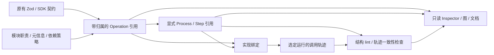

# TS 设计与实现如何保持对应

用户要把已有模块、方法、契约直接拿来展示，并检查常见设计问题。最容易失真的地方是业务流程：函数的输入／输出说明“能做什么”，通常不能说明“谁先调用谁、什么条件下走哪条分支”。本工具保留显式流程设计，并让它引用实现使用的同一组操作和步骤句柄；不从签名猜业务流程。

本页早期已实现机制由[authoring](../authoring/README.md)持有；已验收的[领域工作台](../../../.controller/domain-daemon/flow-atlas-workbench-implementation.md#accepted-local-outcome)补足语义值、状态／规则拥有者、参数绑定和场景预期，其精确契约在[domain/contracts.ts](../domain/contracts.ts)。两者共享原生Schema句柄及基础词汇，但有各自明确的输入／输出范围；旧ObservedStep的顺序检查不能冒充新参数值的来源证明。领域工作台通过`bindNativeMethod`保存真实原生方法与输入／输出Schema引用；签名移除／不兼容、伪造句柄和静态导出零调用均有[独立证据](../../../.controller/domain-daemon/tasks/flow-atlas-domain-acceptance.md#accepted-final-derivatives-and-publication)。方法内部实现与完整业务符合性仍需明确场景及实际记录。

## 每类事实只设一个拥有者

| 事实 | 唯一作者／来源 | 工具消费方式 | 能发现的偏离 |
| --- | --- | --- | --- |
| 方法输入、输出、声明错误 | 项目原生 contract-only Schema／SDK契约 | 引用真实Schema对象，再通过显式adapter转换可展示结构 | 删除／重命名、类型不匹配、不能转换的Schema。 |
| 模块边界、职责、公开方法 | TS模块设计声明 | 原生方法句柄关联所属模块及metadata | 重复归属、缺失目标、违反显式依赖策略。 |
| 合法业务流程和分支 | TS process声明 | 步骤引用公开方法句柄；分支引用方法结果 | 悬空边、不可达步骤、无出口、未处理结果。 |
| 实际实现调用了什么 | 实现显式使用的步骤绑定／调用记录 | 测试或选定运行生成轨迹，检查与声明图是否一致 | 未绑定步骤、错误操作、错误顺序、非法分支、未结束路径。 |
| 实际对象状态 | 明确状态记录或权威观察 | 领域工作台将拥有者见证归约为检查点，调用方知识独立记录；不从成功返回推算状态 | 非法拥有者／字段、查询写状态、未声明状态转换及预期不匹配。有限Schema／声明式规则按当前诊断范围检查。 |
| 职责说明、设计文档、来源 | 所属概念的metadata | 惰性文字／链接；HTML用安全DOM呈现 | 缺失文档目标、危险链接、不可序列化扩展值。 |
| 图中位置、折叠与固定 | 独立LayoutDocument | 只改变空间投影，不回写业务模型 | 过期内容、跨模型／视图套用、遮挡连线。 |

生成JSON／HTML是投影，不是第二份手工维护的定义。它可以删除后重建。稳定ID供引用和历史对应；名称和参数由原定义读取，避免多处复制。

## 实现策略：先把对应关系变成可检查的对象

第一片不调度业务，不执行guard，不接管重试／事务／并发。实现依然是普通TS函数，在真正调用处使用步骤绑定；检查和展示不会调用handler。流程图无需再抄方法签名，方法变化由共享引用和类型检查暴露。流程改变时，必须更新声明和对应路径测试。

已有代码无法全部迁移时，声明“仅观测这些边界”，保留未覆盖边界。一次测试通过只能证明本次记录的路径；不能证明没执行过的分支或未使用wrapper的任意源码都符合设计。工具不能给出“无漂移”的全项目保证。重要流程在项目CI中要求结构检查通过、关键结果路径均有有效轨迹，未覆盖项可直接作为诊断。

若某个项目本来就有可执行process／statechart，其定义应该成为该项目的唯一流程源，由adapter导入；不能再写一份同义图。只有项目确实需要工具来拥有编排时，才考虑受限可执行流程DSL；本轮不新建工作流执行引擎。

## Lint 职能与专业判断

结构错误阻止导出：悬空引用、重复ID／归属、错误Schema、不安全／非JSON元数据、错误步骤绑定。设计策略检查关注明确的问题：模块依赖环、越界依赖、不可达／无出口步骤、声明结果缺少处理。跨模块依赖或循环不是所有系统都错误，因此依赖策略必须由项目声明；默认诊断不能伪装成普适架构法则。

职责是否清晰、事务边界是否合适、某个模块是否过大，不能只靠字段计数决定。工具提供证据位置、引用关系和可配置规则，不输出无依据的架构评分。需要豁免时说明理由并限定规则与对象，不隐藏全部诊断。

## 元信息与文档

对象、方法、模块、流程和步骤共享稳定ID、名称和说明。metadata补充职责、标签、源码引用、设计文档引用与命名空间扩展值。oRPC／Zod中已有的说明可读入；本工具专属语义放在显式扩展中，不能反过来污染业务输入／输出Schema。

文档引用是数据，不是远程抓取命令。离线产物显示文档名称和来源；相对源码／文档路径保留为可选择文字，消费者提供的HTTP(S)文档URL可主动打开；单文件服务不会假设自己能托管仓库相对路径。HTML不能执行Schema中的函数、扩展值、Markdown HTML、javascript/data URL。构建端运行TS入口是受信代码执行：应选择无副作用的contract-only入口，而不是任意应用启动模块。

## 本轮实施范围

[实施Delivery](../../../.controller/domain-daemon/flow-atlas-implementation.md)建立可运行的TS authoring／Schema adapter／process绑定与lint，以及原画板的独立布局交互。完整Definition／Scenario compiler、任意SDK自动导入、持续文件监听、实际遥测和全部静态源码依赖分析不由本轮结果推断。实时查看的可演进路径是构建／watch同一TS入口再刷新投影；不能用一份手工JSON宣称已经做到源码实时同步。
