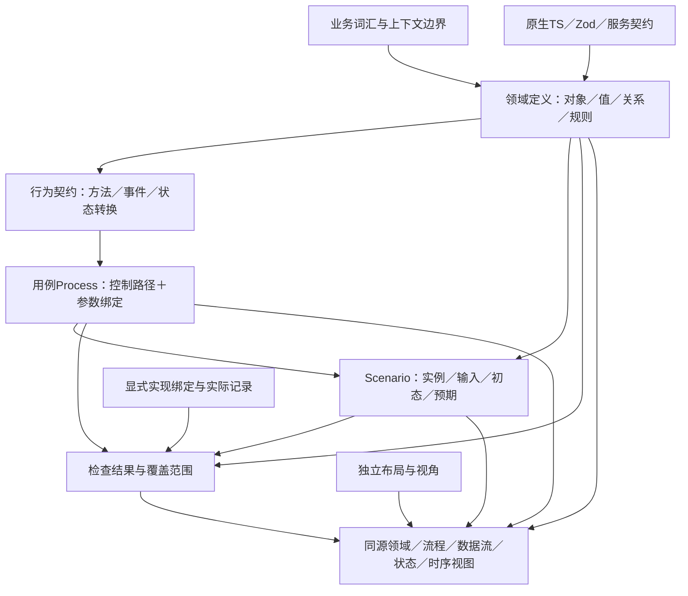

# Flow Atlas：领域模型设计工作台

产品的中心是可被代码引用、可以解释和检查的领域设计。对象图、流程图、状态图、时序动画是这份设计的不同观察方式。工作台帮助设计者回答：这个概念是什么意思，谁拥有它，哪些操作可以改变它，一项用例怎样跨对象完成，数据和状态变化的依据是什么。

本文拥有领域工作台的语义与产品设计。对应的有限实现已完成[本地验收与发布](../../../.controller/domain-daemon/flow-atlas-workbench-implementation.md#accepted-local-outcome)；实际API、诊断和支持范围由[domain](../domain/README.md)与[workbench](../workbench/README.md)拥有。较早authoring、Inspector、轨迹查看器仍保留其[实施结果](../../../.controller/domain-daemon/flow-atlas-implementation.md)。本目录的旧[TS声明](contracts.ts)是早期骨架；不能把它与本文更广目标当成另一份已实现API。

当前实现的精确原生模型由[domain/contracts.ts](../domain/contracts.ts)拥有，继承已有基础词汇／Schema句柄后定义领域语义及检查点；本文继续拥有含义、取舍与用户路径。早期目标接口不作为同一实现的第二份契约。顺序无环流程、有限Schema／规则检查与显式场景已实现；通用并发／循环、任意源码推断和图形语义回写仍在本片范围之外。

## 1. 从早期模型识别的语义缺口

| 现有表达 | 可以回答 | 仍缺少的领域设计问题 |
| --- | --- | --- |
| Domain／Module分组、ObjectType.kind | 一个对象放在哪里、是什么类别 | 业务边界与术语含义、实体身份、值语义、模块与部署的区别。 |
| 对象的字段、Port和Schema | 能调用什么、形状是什么 | 哪些业务约束必须保持、状态由谁改变、拒绝与未知意味着什么。 |
| Process节点和结果边 | 哪个操作之后可能做什么 | 后续参数来自哪里、属于哪个结果分支、转换是否丢失含义。 |
| Scenario初态与事件 | 作者安排的一条路径 | 实例身份与归属、预期断言、实际观察及规则覆盖。 |
| before／after与动画 | 哪些展示值变化了 | 这是领域变化还是知识更新，由谁保证，以及依据是什么。 |

因此不能把节点加一个“实体”标签、给边加一段参数文本，就称为完整领域模型。首要改动是补齐语义、引用和责任；画板随后消费这些事实。

## 2. 一个设计，几个相互关联的部分



这些部分组成一份有稳定引用的设计，不是若干套分别手画的图。原有Definition／Process／Scenario／Layout分层继续成立：Definition补足领域含义，Process补足数据依赖，Scenario补足实例、知识与预期，检查结果保留依据。通道与部署仅在需要解释运行机制时加入，不能反过来决定领域对象。

### 2.1 领域、模块和对象

| 概念 | 应当表达 | 关键限制 |
| --- | --- | --- |
| Domain | 业务问题与子域，例如销售、库存 | 不直接等于代码目录、一个进程或数据库。 |
| Bounded Context | 一套术语和规则成立的边界 | 同名“订单”在销售和配送中可以是不同模型；跨边界需要明确的公共契约／映射。 |
| Module | 可实现、可依赖的职责单元 | 属于明确上下文或通用技术范围；部署位置另行映射。 |
| Entity | 有持续身份的数据与行为 | 业务标识、字段、关系和允许操作；两个实例不能因同类型而合并。 |
| Value | 以内容相等、整体替换的值，例如数量、金额 | 复用原生Schema与单位约束；没有必要为每个string新造类。 |
| Aggregate | 确实需要共同维护不变量的一致性边界 | 声明根、成员关系与规则；不把整个业务流程当作事务。 |
| Domain Service | 不自然属于单一实体的领域能力 | 说明涉及的领域规则，不代替所有对象承担状态。 |
| Application Service／Process | 组织一次用例、调用各方能力 | 调用拥有者的方法，保留失败与未知；不绕过领域对象直接改字段。 |
| Adapter／External Actor | 外部能力、协议和系统参与者 | 领域依赖其能力契约；网络传输和远端状态不伪装成内部方法实现。 |

DDD语义按需使用：一个纯查询SDK不必声明聚合；技术生命周期也可以用通用对象、Port和状态表达。实体、值、聚合等语义是可检查的模型约束，不能只是任意显示标签。聚合成员按实例关系归属，例如订单42的条目，不是把所有OrderItem类型实例装进同一个订单。

Domain可以在确实拥有独立术语与公共翻译边界时注明其上下文角色；不要求每个项目再填一层固定的Domain→Subdomain→BoundedContext目录。业务实体的OrderId、场景对象的Atlas ID、一次调用的callId各司其职，不能混用。同一个订单在多个场景里可以有不同的展示引用，但业务身份的含义保持明确。

### 2.2 一个对象应当有完整的设计画像

对象包含：身份或值语义、职责、结构化字段及单位／Schema、对象关联及基数、所拥有的状态与规则、公开行为、源码和设计文档。核心信息在对象画板上呈现；完整Schema和说明按需展开。

方法契约引用已有输入／输出Schema，补充命令／查询／事件含义、前置条件、可能结果、可观察效果及关联规则。命令表达意图，可以被拒绝；事件表达已经发生的事实，声明发布与接收关系。查询可以更新调用者所知，但不能因此声称修改了被查询对象的领域状态。

规则是第一等设计元素，应有身份、业务说明、拥有者和适用范围。例如“可用库存不得为负”属于库存一致性边界；“订单只能在已获得预留凭据后确认”属于订单操作。文字规则、复用已有可执行谓词的规则、经某个场景检查的规则要区分。文字或源码链接本身不构成已验证结论；默认不执行作者函数。

状态写入必须有因果来源和拥有者。Process只能请求拥有者执行操作，不能用一条跨对象赋值边绕过其规则。方法声明的可能效果不是一份重复的nextState，也不是执行成功的证据；具体值仍由权威场景／观察记录提供。

## 3. 流程必须同时表达控制、数据与状态依据

### 3.1 控制路径

Process描述某项用例的边界、角色、调用及事件步骤、结果分支与终点。步骤引用原有方法身份，流程结果使用方法已声明的结果身份。分支条件仅有文字时可用于解释，不能自动声称已计算出正确分支。业务拒绝、调用异常、结果未知与无响应保持区别。

### 3.2 参数绑定与数据来源

参数绑定附着在同一Process步骤上。控制边回答“什么时候可以执行”；数据绑定回答“拿什么数据执行”。它们共用步骤身份，不能维护两套互不对应的节点。

每个绑定至少说明目标方法的输入字段、来源及字段路径、允许出现的结果分支。来源可以是Process输入、角色身份、前一步某个结果的payload、已显式获得的查询／事件数据，或作者声明的常量。不能凭空读取另一个对象的私有字段；需要的数据通过公开查询、快照输入或明确观察进入流程。

数据项自身要保留语义和契约引用：例如quantity的数量单位、reservationId的业务身份，不能仅凭“都是number／string”认定可以接线。原生Schema约束能复用时直接复用；没有声明单位或身份语义时显示缺失，不能靠字段名猜测。领域关联也不是数据传输：订单关联预留记录，并不代表预留凭据已经传给确认步骤。

| 例子 | 声明的意义 | 应当检查 |
| --- | --- | --- |
| `placeOrder.input.intentKey → Order.beginReservation.input.intentKey` | 用例输入关联到这次预留意图 | 源／目标字段存在、必填完整、Schema兼容；这个目标字段需要真实契约补充。 |
| `Order.beginReservation.ready.payload → reserveInventory.input` | 从订单自身产生的请求作为下一步输入 | ready分支确实产生结果，目标步骤可达时来源已可用。 |
| `reserveInventory.reserved.payload.receipt → Order.confirm.input.receipt` | 成功凭据传给确认操作 | 仅reserved路径可消费；unknown路径没有这个值；凭据的语义与上游契约必须对应。 |

转换需要引用有名字的映射设计及其输入／输出契约，例如单位换算；设计文档解释语义，显式实现绑定提供来源，案例检查其结果。JSON里不塞任意JS字符串来执行，渲染器也不替用户执行转换。复杂Schema无法证明兼容时给出“不支持／需显式映射”，不能静默放行。

首个数据流编译切片限定单输入、显式结果分支和顺序／无环流程。虽然原目标声明包含fork／join／循环，但跨循环轮次、分支汇合和并发值的来源选择需要额外明确语义；未实现时诊断为不支持，不能错误地绑定到“最近一个同名结果”。

定义中的数据绑定指向步骤及结果；具体场景必须进一步解析到某次visit／call出现，保留实际采用的值及来源。当前authoring的ObservedStep只记录方法、顺序、状态与结果身份，没有参数／返回payload见证，因此现有轨迹检查尚不能证明数据按设计传递。扩展时应由消费者明确选择有界见证和脱敏策略，不能默认采集全部敏感payload。

### 3.3 状态转换及调用方所知

对象的生命周期由自身规则拥有，Process通过方法触发它。独立字段保持独立，不把所有字段组合强行展开为一个巨大状态枚举。图可以同时展示合法转换与某个实例在场景里走过的路径。

领域状态与观察者所知必须分开：可用库存实际已从20变成18，调用方仍可能因丢失响应而不知道预留结果。超时更新调用观察结果，不能把库存重置为20，也不能将订单领域状态直接替换成“unknown”。先明确“哪个调用的哪个观察者不知道结果”，订单仍可合法停留在等待预留确认。更完整场景可同时记录远端权威变化和调用方所知，但必须标明展示视角；首片不建立通用多观察者知识引擎，也不混写不同视角的事实。

重试、补偿、取消和后续查询都是有前置条件的行为设计。缺少响应不能自动证明重试安全；补偿需要单独的领域命令和结果，不能用播放器倒放状态冒充。

## 4. 场景是可检查的用例实例

Scenario绑定具体角色实例、输入、初态、选定结果路径、事件与状态变化，并声明预期：哪个结果可见，哪些规则应保持，哪些值应相同／不同／仍未知。预期与实际观察不能放进同一字段。具体演示数据不进入类型定义；同类型两个订单保持独立身份和状态。

场景的“执行”有两种不同含义：作者给定的行为示例可以播放并做结构一致性检查；消费者显式运行绑定实现后，可以导入实际记录并与预期比较。播放示例不会调用业务handler，也不会变成一套工作流执行引擎。若项目已有statechart／可执行流程，优先导入其原定义，避免再手写一份同义流程。

### 决定性示例：下单并预留库存

Schema优先复用现有[native-contracts.ts](../authoring/examples/native-contracts.ts)的OrderRequest／ReserveRequest／ReserveResult。当前fixture只有原生方法和内存库存，并没有下面的完整订单聚合、事务、幂等或丢响应后的恢复机制。尤其是当前`lost`分支在库存变更前返回unknown，不是“已提交、回复丢失”的实际证据。目标如果补充意图标识／凭据字段，必须让真实上游契约也对应；不能把新增字段偷偷塞进已有绑定后宣称复用了相同协议。

设计角色是结账用例、订单42、订单43、库存能力；订单与库存分别拥有自身规则。以下是统一业务设计的最小拥有者，内部存储／运输适配不必全部展开在主图。

| 拥有者 | 业务身份与状态 | 行为与规则 |
| --- | --- | --- |
| Order | OrderId；订购行sku／quantity；draft／awaiting／confirmed／rejected、预留意图及所关联凭据 | beginReservation从订单自己的行构造请求；confirm核对凭据属于本订单及请求；reject消费权威拒绝。未知投递不改变为业务拒绝。 |
| StockPosition | Sku；onHand和预留记录；available是派生量 | reserve在本边界内维护预留及可用量不为负；不足则拒绝。独立的恢复查询与幂等保证需要真正的上游机制。 |
| Checkout | 本次用例及角色绑定 | 按结果调用两方公开行为，不直接写两方字段，不声称跨对象事务。 |

例如onHand20、预留数量2时，可用量为18；onHand仍为20。onHand、预留记录和派生available不能作为三份无约束的真值分别patch。公式是设计含义，实际查看器需要明确的只读投影或带依据的示例注解；本片不引入通用公式执行语言。

流程为Order.beginReservation构造请求→库存能力预留→按结果处理，成功时通过Order.confirm消费匹配的凭据；拒绝时由Order.reject处理。它们都是需实现／绑定的目标能力，不能把当前只验证和返回DTO的prepareOrder当成完整订单行为，缺少实现时工作台应显示未绑定。参数表使用目标的intentKey／receipt语义；当前原生ReserveRequest没有intentKey，ReserveResult也没有完整receipt字段，真实契约演进和对应绑定是这条目标流程的实施前提，不能只在设计投影上补字段。

| 场景 | 输入／预期路径 | 状态、知识与责任 |
| --- | --- | --- |
| 成功 | book、quantity2、初始库存20；得到reserved和reservationId | 库存权威状态18；订单42由确认操作进入已确认；订单43不变。数据线能追溯确认凭据的来源。 |
| 业务拒绝 | 请求量超过可用量；得到rejected | 没有成功预留凭据，不进入确认操作；库存不因该拒绝变化；订单的后续处理由明确拒绝规则决定。 |
| 已提交但丢失响应 | 远端已完成预留，调用方未收到结果 | 库存实际可能为18；调用方结果未知，确认操作缺少凭据而不能执行。保留历史，不能宣称未发生或自动再次预留。 |
| 后续权威确认 | 显式查询／回执取得原预留结果 | 在新的场景事件中更新所知，再决定是否确认订单；这是目标能力，当前fixture没有对应查询实现。 |

confirm也可能因凭据不匹配或本地状态已变化而拒绝；不能一收到库存成功结果就直接跳到用例成功终点。需要有“另一订单的凭据”和“请求数量与订单行不符”反例，检查相同Schema形状之外的业务含义。恢复查询返回未找到，单独看也不证明原请求已经不可能提交。

该示例同时检验领域归属、操作约束、数据依赖、结果分支、实例隔离、状态变化和未知边界。另用工具自身的“拖动先暂停、布局变化不修改业务模型”检查技术领域适用性；不要求它虚构业务聚合。独立[领域语义分析](../../../.controller/domain-daemon/tasks/flow-atlas-workbench-semantics.md)记录推导和被排除的过度抽象；本文拥有综合后的产品设计。

## 5. 工作台围绕设计任务组织

```text
顶部：模型／搜索／当前视图／场景／检查结果
左侧：领域与上下文 → 模块 → 对象；规则／用例／场景可切换
中央：同源画板；对象上直接显示关键字段、方法入口和关联规则
局部：选中字段／Port／数据线／规则时打开就地详情
底部：仅在场景模式显示步骤、速度、当前参数和状态差异
```

| 用户当前的问题 | 主要视图和操作 |
| --- | --- |
| “系统里有哪些概念，各归谁负责？” | 上下文／领域关系图；折叠模块，定位依赖与边界映射。 |
| “这个对象保护什么规则、暴露什么行为？” | 对象画像；选字段看值契约，选方法看输入／结果／规则，跳转相关用例和源码。 |
| “这个用例怎样完成？” | Process图；显示结果分支和角色，选步骤查看引用的方法。 |
| “这个参数从哪里来？” | 在同一Process画板切换／突出数据流；定位来源结果、目标参数及映射，沿依赖追踪。 |
| “它为什么能进入这个状态？” | 对象状态图；合法转换、触发操作／事件和规则；叠加场景实际路径。 |
| “换一个结果会怎样？” | 选成功／拒绝／未知场景，以同样的对象和步骤演示具体值；未来可编辑场景输入并显式重新检查。 |
| “哪里有设计问题？” | 诊断定位到字段／方法／流程边；查看规则、实际依据和未覆盖范围。 |

画板默认只展示当前任务需要的关系；不一次堆满所有控制线、关联线、事件线、参数线。选择对象时突出一跳关系，选择数据字段时突出其来源和消费方。领域关联、方法调用、参数映射与传输通道有独立图例和语义。无限画布解决观察空间，不能代替分层、折叠和有意义的默认投影。

先采用源码优先的工作台：TS定义是作者源，工作台提供检查、追溯、场景比较、设计文档与布局操作。图形语义编辑不能只改生成JSON；后续要支持时，应限定可回写的authoring子集，展示源码变更并明确写回，无法无损表达的原生代码保持只读。任意TS双向编辑不在首片承诺内。

## 6. 代码、设计和检查如何保持一致

| 事实 | 唯一拥有者 | 工作台的职责 |
| --- | --- | --- |
| 参数、结果、原生值约束 | 项目既有TS／运行时Schema／服务契约 | 原样引用并导出，不再手抄字段。 |
| 业务语义、责任、规则归属 | 类型／方法的显式设计声明 | 查引用、展示规则与证据，不从名字猜含义。 |
| 用例控制路径与参数绑定 | 原项目已有可执行流程，或显式Process定义 | 引用同一方法／步骤；若只是声明，结合实现绑定和路径案例检查。 |
| 实际调用与状态变化 | 消费者明确采集的运行记录／权威状态 | 展示与设计的符合或偏离，保留缺失和观察范围。 |
| 图中位置与相机 | 独立展示布局 | 不回写业务模型；生成物可重建。 |

所谓单一事实源不是从任意函数签名里推导整个业务。无法推导的业务编排必须设计，并说明它和代码怎样对应；已有可执行定义则直接适配。watch可以及时重建投影，但不提供源码符合设计的保证。

当前[lint实现](../authoring/lint.md)已检查显式模块依赖、引用、绑定、结果分支和选定串行轨迹。下面属于新增目标，必须由真实实现与反例建立后才可在UI标为已支持：

| 新检查组 | 有意义的问题 | 不能据此宣称 |
| --- | --- | --- |
| 领域／所有权 | 实体身份缺失，成员归属冲突，修改绕过状态拥有者 | 所有聚合边界都专业合理。 |
| 方法／规则 | 查询声明领域写入，转换没有合法触发，规则无拥有者 | 任意业务不变量都已被证明。 |
| 数据绑定 | 必填参数无来源，字段／单位不匹配，未产生或错误分支的结果被消费 | 所有复杂Schema语义自动可判定。 |
| 场景／预期 | 同实例串状态，实际记录偏离预期，未知被提前当成已知 | 没运行的代码和分支也符合设计。 |
| 设计覆盖 | 关键结果没有场景，规则只有文字但无可检查依据 | 无案例就等同业务实现错误。 |

诊断显示位置、原因、严重级别、依据和修复方向；项目可配置的策略与结构错误分开。规则没有可执行检查时显示“已声明，未检查”，不能给出虚假的绿色通过。

## 7. 落地顺序与完成标准

### 实现的职责边界

| 模块 | 拥有的事实／操作 | 不应代替的职责 |
| --- | --- | --- |
| Contract／Authoring | 原生Schema引用、领域语义、规则、Process参数绑定及Scenario预期 | 不导入应用启动入口或自动调用业务handler。 |
| Semantic Compiler | 引用解析、类型／参数／所有权／路径检查、统一语义工件 | 不通过图形坐标推断语义，不为每种视图复制模型。 |
| Scenario Core | 单一检查点、事件因果、实际／预期比较与知识投影 | 不把演示时间当真实时间，不充当业务调度器。 |
| Source／Trace Adapter | 现有契约／可执行流程／显式记录的映射与覆盖声明 | 不宣称能还原任意源码内部逻辑。 |
| Workspace／Views | 同源选择、视图切换、来源追踪、局部编辑／检查反馈 | 不拥有一套另行保存的业务定义。 |
| Layout／Viewport | 对象位置、路线、折叠、视角 | 不修改对象状态或Process执行顺序。 |

这些职责延续已有authoring／core／viewer／layout分层；落地时修改其拥有的契约与实现，不为了“工作台”先新建一排服务或发布包。生成工件和检查报告应关联准确输入摘要；输入改变后旧报告保留历史身份，不能继续冒充当前设计的通过结果。

### 首个完整结果

首个完整结果是“可检查的订单／库存领域设计”：同源类型／方法、规则与状态归属、Process参数绑定、成功／拒绝／未知三个场景，贯通对象→方法→数据来源→结果→状态→规则→源码。先将这些语义并入现有原生契约和编译器，产出统一可检查工件，再让现有画板投影消费它；不先重写所有UI，也不把运行时图作为领域模型的存储格式。

第一片明确不承担通用并发／循环数据流、任意TS图形回写、业务调度、远程协作或全项目无漂移证明。oRPC是契约适配器，不是前置的平台架构；Schema和原生方法引用已经能支撑首个结果。

完成标准：两个同类型实例不串状态；每个必填参数可追溯；错误分支不能读取成功结果；状态变化有合法拥有者和依据；拒绝不冒充成功，断线不冒充撤销；文字规则与已执行检查有区分；检查／导出零业务调用；同一数据供对象／流程／数据／状态／时序视图使用；新技术示例无需在渲染器增加产品ID分支。下一片再接真实上游契约和项目自有流程适配，以实际兼容证据扩展。
