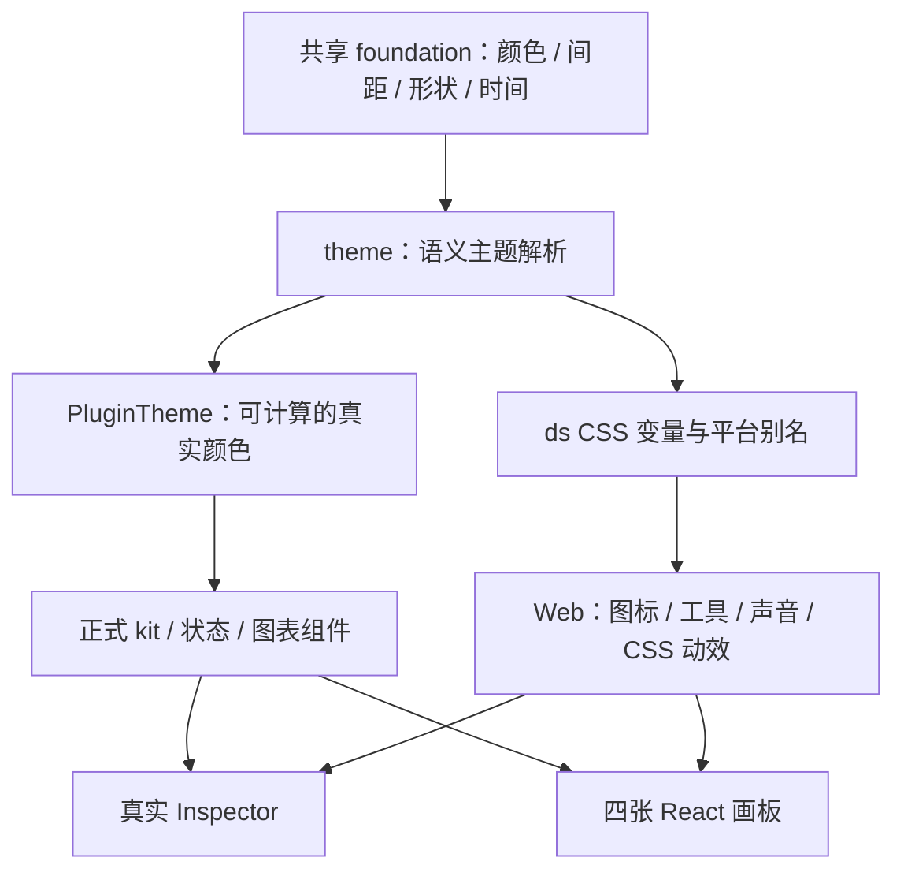

# 四板 Canvas 入口

当前正式源码、资源规范和工作台已迁入 [uiux](../../uiux/README.md)，局域网入口 **http://192.168.2.178:4192/**。本目录保留原生 Canvas 的 design.json、用户批注／参数、历史 HTML／SVG 及其证据。四个 react-*.html 是 uiux 构建生成的入口，不是另一套组件源码。构建请在 uiux/ 执行 npm run build。

以下是上一轮工作台与视觉评审记录，旧入口由跳转转到新工作台；时长、边框和事实边界继续适用。

# Inspector 设计系统工作台

使用 **Vite + React + TypeScript** 的真实组件展示平台。局域网入口：**[http://192.168.2.178:4192/](http://192.168.2.178:4192/)**；[直接试锤子与图标](http://192.168.2.178:4192/#tools)。原生 Canvas slug 保持 `inspector-pixel-motion`，四板使用同一 React 构建产物。

四板可在一个面板内总览或单独操作，切换画板与外观保留草稿、搜索、选择和本地方块。右上角切换原版／鲜彩像素、浅色／深色；变量面板实时调整强调色、切角、硬阴影和动效时长。形状、工具反馈与声音目前只在像素风中表达。声音默认关闭，系统减少动态优先。

## 启动与构建

工作台引用相邻 `plugin/` 与 `web/` 的源码和既有适配依赖，因此先完成这两个包的依赖安装；在本目录执行：

```sh
npm ci
npm run dev
npm run build
npm run test:studio
npm run test:canvas
```

开发服务监听 `0.0.0.0:4190`；`npm run preview` 可在 `0.0.0.0:4191` 预览构建。测试默认访问 4190，可通过 `STUDIO_URL` 指定地址。构建生成 `dist/index.html` 及设计目录内的四个 `react-*.html` Canvas 页面；没有插件注册、业务请求或模拟 RPC。

## 同一组件与变量系统



| 所有者 | 正式来源 |
| --- | --- |
| 基础值、语义映射、对比度 | `plugin/client/design-system/{foundation,theme,color}.ts` |
| 按钮、输入、选择、面板、提示边界 | `uiux/systems/inspector/components/kit/kit.native.tsx`、`presentation.tsx`、`overlay.tsx` |
| 状态、已有事实图表 | `plugin/client/status.tsx`、`charts.tsx` |
| SVG 图标与单次马赛克微动 | `web/client/host/{adapter,pixel-icons}.tsx/ts`、`appearance/system.css` |
| 工具矢量、光标与试敲 | `web/client/appearance/{tool-assets,tool-cursors,tool-playground}` |
| Web 声音、动效偏好及清理 | `web/client/appearance/{feedback,sound}` |
| 工作台布局、场景、变量编辑 | `studio/`；只做组合，不复制生产控件 |

颜色、轮廓、阴影、背景和时长通过语义变量映射；SVG path 和音色是资源角色，不把整幅图像硬塞进颜色变量。主题解析同时产生 native 可计算的色值与 Web CSS 变量，避免两套真值。主题编辑在本地，不写回产品偏好或源文件。原生 App 沿用宿主主题，未增加 App 换肤入口；显式 `?experience=recovery` 的既有 Web 控件仍是独立实现，本工作台消费完整 Inspector 的正式 kit。

## 四张画板

| 画板 | Canvas 构建入口 | 主要场景 |
| --- | --- | --- |
| 基础组件 | `react-frames.html` | 按钮完整状态、输入草稿、选择、真实 Panel |
| 图标与反馈 | `react-tools.html` | 斜锤向下敲落、五粒碎屑、原生工具指针、单次马赛克、显式声音 |
| 状态与图表 | `react-signals.html` | 运行节奏与加载分开、停止/未知静态、固定事实图表 |
| 恢复调查样例 | `react-investigation.html` | 明确停止／工具错误／效果未知／宿主接受、本地动作 Sheet |

鲜彩 v2 与阶梯内切角属于已接受的视觉方向；当前代码展示了采用的实现，时长、碎屑密度、工具指针和声音仍是可评审参数，不等于用户最终接受。图表只使用已接受 v2 中的总量 488、子 Agent 420、派生主会话 68；缺少逐日事实，不补点或制造趋势。调查状态属于标明的本地样例，不声称是当前主机状态。

## 边框与动效契约

横竖阶梯内切角，2px 网格；紧凑控件切角 2px、按钮 4px、面板 6px，轮廓 2px。空心外轮廓与内填充使用相同 cut，内层仅 inset 2px；保留原点击盒，焦点和子浮层不裁剪。

| 触发／状态 | 当前表现与默认参数 | 减少动态／事实边界 |
| --- | --- | --- |
| hover | 边框换色 80ms；信息布局不动 | 即时换色 |
| 图标 hover / focus | 三块 SVG 局部错开 1px，240ms，单次拼回 | disabled / busy / 减少动态时静态 |
| pointer / Space 按住 | 下沉 2px / 90ms；释放 110ms | 即时颜色反馈；取消恢复 |
| 工具试敲 | 原创斜锤，锤头向下 200ms；5 粒 6px 碎屑 360ms | 立即更新本地缺口，不创建摆动或碎屑；非业务成功 |
| 执行中 | 三档信号长度，1200ms | 最终静态标记，离屏／隐藏暂停 |
| 未知进度加载 | 四格扫描，800ms | 静态四格＋文字，不显示假进度 |
| 停止／错误／效果未知 | 静态标记、事实文字 | 无成功动画或成功音，不扩大操作权限 |
| 图表 | 既有几何 180ms 显露，数字直接显示最终值 | 不生成新值；减少动态完整显示 |
| 可选声音 | 默认静音；显式开启；40ms 短敲、100ms 限流 | 禁用／输入不敲击，关闭／隐藏释放音源 |

Canvas 原有四个 Tweaks 保留；`studio/canvas.ts` 将其映射到同一主题解析器。变量面板的显式编辑覆盖 Canvas 默认值，重置后恢复。用户拥有 `comments.json`、`tweaks.json`、`tweaks.css` 与画板位置，本轮保留这些元数据。

## 验证与边界

React 版的 [studio/verify.mjs](../../uiux/workbench/workbench.verify.mjs) 已在实际 LAN 地址执行，39 项通过，结果见 [react-verification.json](evidence/react-verification.json)。另有 [verify-build.mjs](../../uiux/workbench/canvas.verify.mjs) 的 9 项检查，覆盖四个构建 Canvas 直达入口、连续敲击节点上界、隐藏清理、共享原生指针、触屏与原版切换；见 [构建与工具证据](evidence/react-build-verification.json)。覆盖同树四板、四种主题下 DOM／草稿身份、真实组件变量编辑、禁用与忙碌、按压布局、锤头向下与碎屑、本地重置、马赛克、实际 WebAudio 启停、减少动态、未知与恢复场景、390／320px、零业务 API 请求。截图 `react-*.png` 只证明留存帧，不能替代动效操作证据。

共享主题／偏好有定向单元检查；plugin 与 Web 的类型和构建分别验证，plugin build:check 通过；既有 Web 外观与反馈浏览器回归均通过，零脚本错误与禁止命令。没有执行 daemon reload／restart；没有人工听感、真机触屏、读屏或完整产品页面验收，不把工作台覆盖扩大为全部产品支持。

原 HTML / SVG 原型留作历史参考：`legacy-panel.html`、`frames.html`、`tools.html`、`signals.html`、`investigation.html`、`app.js`、`motion.css`。此前 67 项独立画板与 23 项静态面板检查只对应旧版，不能作为 React 版证据。静态服务仍可通过 [4189/legacy-panel.html](http://192.168.2.178:4189/legacy-panel.html) 查看旧版；新工作台使用 4190。
