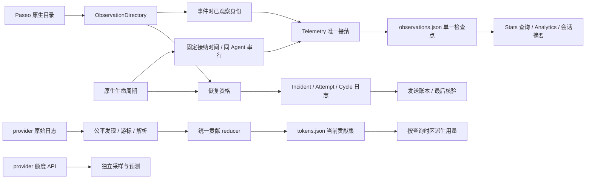

> Historical source reference from `/home/long/works/longwork/paseo-retry`. Relative links describe the original checkout and may not resolve here. Current behavior and provider boundaries are owned by [the migration model](../migration.md).

# 数据、算法与存储架构

Agent Inspector 按事实的来源、身份、时间和丢失后果划分存储。统计、调用用量、外部额度、保存报告和操作证据各自拥有语义；不因为数值相似而合并成一个指标库。当前[交付](../.controller/coherent-system/delivery.md)正在落实下述统一模型，实际加载状态和制品以[工作记录](work.md)为准。

## 责任与数据流

这是责任和依赖图，不是全局事件平台。目录是可重新观察的缓存；Telemetry 是本插件观察事实的接纳者；Stats 不再拥有第二个生命周期账本；Token 是日志中调用事实的派生账本。报告保存材料，恢复保存副作用证据，它们都不能代替原始执行。

| 边界 | 拥有的含义 | 不承担的责任 |
| --- | --- | --- |
| 当前宿主 Adapter | 分页、原生字段校验、SDK/IPC 形状转换 | 不补造 epoch、序号或缺失事实，不决定业务授权 |
| 领域接纳 | 稳定身份、新建/重复/更正/冲突/拒绝、合法状态转换 | 不依赖 React，不让每个消费者各自计数 |
| 查询投影 | 真实窗口裁剪、样本分母、并集/求和/最大值、覆盖 | 不把截断当零，不把旧聚合升级为原始事实 |
| 存储 Adapter | 当前格式、容量、原子提交、写入失败和恢复 | 不在正常读取时兼容多代历史模型 |
| 离线迁移 | 保存原件、可证事实转换、新观察或重建边界 | 不自动授权发送，不把旧累计并入新精确事实 |

## 生命周期与统计

Telemetry 拥有唯一 `observations.json`：接纳身份、会话摘要、展示事件尾部、Analytics 投影、统计点事实、活动/等待区间与累计值一起保存。`StatsStore` 只读取目录和这些事实，维护有界查询 memo；移除独立 `stats.json`、seed、raw hook 计数与跨文件投影交接。

生命周期 hub 在原生入口同步固定 `receivedAt` 和当时已经观察到的身份，早于排队、时间线读取及任何订阅者修改目录健康。同 Agent 的后续事件等待当前读取和消费完成；不同 Agent 独立。结束轮次的时间线只读一次，由所有消费者共享真实 epoch、源序号和采样状态。停止接纳后 drain 已接纳工作，再关闭存储。目录已有完整、新鲜且不晚于接收时刻的缓存才能提供 model/project；后来刷新目录不能回写历史归属。

| 对象 | 接纳与计算规则 | 真实限制 |
| --- | --- | --- |
| Turn | Agent + 源 turnId；同一 start/end 只投影一次，旧 A 的 end 不清新 B | 当前 SDK 的 turnId 可以为空，匿名轮次身份不能证明所有上游重放 |
| Permission request | Agent + requestId，绑定当时轮次；反序 resolve 保留接纳证据 | 没有观察到的请求开始不能反推等待时长 |
| Point fact | 接纳时刻、冻结归属、稀疏指标和工具摘要 | 接纳时间不是源事件时间；SDK 没有提供的时间不猜测 |
| Observed interval | 每 Agent 活动并集和等待并集的半开区间 | 离线不计活动/等待；hook elapsed 与实际观测活动是不同量 |
| Content sample | 每个已接纳 end 一次 complete/partial/failed 样本 | 完整指此次读到轮次边界，不指完整历史或 provider 执行成功 |
| Current summary | stop/reply/ack 等会话展示事实 | 回读可修正展示，不能当成第二份 lifecycle outcome |
| Cumulative | 从当前 `since` 边界接纳的累计值 | 不叫 lifetime；不混入不能证明身份的旧累计 |

统计保留政策为 400 日原时间戳事实和区间，支持 90 日与前期比较、年度日历。容量限制和实际 `retainedFrom` 仍必须公开，400 日政策不保证每个实例已经拥有 400 日完整观察。累计从自己的边界继续，细节滚动不令它下降；保留窗口指标与累计分开。

### 指标的算法与可比条件

| 指标 | 算法 / 分母 | 比较条件 |
| --- | --- | --- |
| 新建会话 | 原生 Agent createdAt，按真实创建时刻归窗 | 目录完整、新鲜；与当前运行数量不同 |
| 完成占比 | completed / (completed + failed) | 取消和未终结不进分母；同来源、同窗口覆盖 |
| 平均轮次时长 | runMs / runSamples | 已知起止样本，样本为零时未知 |
| 轮次时长和 | 在窗口内结束的轮次 elapsed 贡献 | 不是窗口内主机活动墙钟 |
| 主机 busy | 各 Agent 观测活动区间的并集 | 对窗口求交后计算；不能跨 Agent 直接相加 |
| observed active | 各 Agent 活动区间长度之和 | 与 busy 使用相同观测支持域，才可计算平均并发 |
| 并发峰值 | 活动区间端点扫描，半开区间同时刻先结束后开始 | 每个维度独立计算，不借全局峰值或均摊全局 busy |
| 审批等待 | 每 Agent 请求重叠区间的并集，再按需要求和 | 重叠请求不重复计墙钟，离线缺口不连续延长 |
| 工具、消息、编辑 | 已接纳结束轮次的内容样本摘要 | 有样本才能解释零；部分样本不推完整覆盖 |

按查询的 IANA 时区或明确固定 offset 切本地边界，点事实按实际时刻分桶，区间与窗口/日界求交。小时和日是查询结果，不再把 UTC 桶起点当本地午夜事实。源中没有的历史粒度无法靠格式化恢复。

`basis` 必需，分目录、生命周期、内容、并发、归属和工具名称表达来源、粒度、观察/保留边界、缺口和容量；前期、日历、累计分别表达覆盖。complete 只表示所列来源和粒度满足该查询，不能宣传 provider exactly-once。无法证明的零与未知分开，部分覆盖保留已记录正值、禁止无依据差值。

## 调用用量

Token v4 只持久化规范化调用贡献、接纳起点、roots、文件 parser/cursor 和必要质量状态。不再平行持久化 hours/day/seen/mutable/settled/top3。一个统一 reducer 处理 new、duplicate、replace、conflict；稳定或推断身份都是这套规则的输入，不形成第二套算法。

完整贡献包含重算所需的时刻、来源、身份和用量。相同调用在不同文件、轮转、截断或重启后仍由同一接纳者决定；后续更完整贡献可替换原贡献。查询按 revision 派生窗口、维度、极值、速度和时间边界，保留范围内不再依赖有限 top3 猜测替换后的极值。推断身份无法证明上游唯一，必须公开质量原因。

保留上限 400 日，56 MiB 分配目标和 64 MiB 最终文件保护共同约束接纳。满容量暂停新身份，不能删去尚需去重的事实后重导；未接纳记录不能越过持久游标。发现/注册/读取分别有工作预算，按 root/file 轮转；冷注册不能永久占槽令新日志饥饿。字节收费上界不是文件 stat，也不是完整内存占用测量。

派生查询先扫描保留贡献 O(C)，维度排序和完整极值重建使最坏查询为 O(C log C)，结果用 revision 和查询范围 memo。记录接纳只处理受影响贡献，保留期维护每日 O(C)，JSON 检查点提交为 O(S)；读取仍是有界增量，不为每条调用全量重算。单 writer、有界检查点目前不要求更换数据库。若实际读写放大、容量或索引需求超出该模型，再依据测量选择存储方案。

Token DTO 必需 `directoryHealth`、可空 `timeZone`、`providers`、`coverage.ledger` 和 `truncated`。目录未加载时 providers 为空，健康表达未知；日志计数不因此清零。`retainedTotals` 只表示当前保留贡献之和。ledger 区分 accountingFrom/retainedFrom、当前 paused、持久化状态和质量原因；目录健康、日志覆盖与外部额度三者独立。

## 读取与当前宿主契约

目标为 Paseo 0.15.3。Agent 正式时间线返回 `entries`，provider 子任务正式返回 `rows`，两者在唯一 `shared/paseo-timeline.ts` 分别校验并转换到内部 `TimelinePage`。不在通用 normalize 中猜两种格式，不伪造 legacy epoch 或按数组下标补源序号。真实可选的 provider cursor、平台 navigation/openBrowser 仍按现行契约表达。

时间线 ready 发布前释放请求锁，确保订阅者可立即分页；owner 释放/replacement/dispose 后旧请求不能覆盖新代。有限网络请求没有虚假的取消承诺。screen params 唯一拥有计划焦点，删除模块全局总线；正式 useHosts/playAudio/openScreen 直接消费，缺失不静默成功。

## 存储按丢失后果分层

| 类型 | 当前所有者 | 丢失与恢复原则 |
| --- | --- | --- |
| 易失观测 | ObservationDirectory / 查询 memo / IPC 诊断 | 可重新观察，未观察不是健康或零 |
| 插件观察事实 | observations.json | 身份、摘要和投影同检查点；源无完整重放，不能承诺补回停机缺口 |
| 日志派生事实 | tokens.json v4 | 源日志仍可得时重建；游标和贡献一起提交 |
| 保存调查产物 | insight index / report blobs / recap | 用户报告与可过期小结分开；多文件有各自恢复边界 |
| 执行幂等证据 | recovery state.json v3 / deferred / resume | reservation 先于发送；unknown 不因普通保留期消失 |
| 偏好 | read-state / preferences / locales | 展示偏好不产生操作授权 |

JSON 临时文件加 rename 只保证完整替换，不等于所有存储都有同样的断电耐久。恢复 journal 有 fsync 和 PID 锁；发送账本还有跨插件 SQLite 协调和最后核验。不要以万能 Repository/save 抹掉这些差异，也不把全部领域装入同一个事务文件。

## 恢复和历史切换

恢复的投递事实、执行观察、自动链意图独立。AgentPort 发送必需 typed receipt，原生观察 Adapter 没有裸发送能力，scheduler 必须注入账本端口。Attempt.delivery 为显式 nullable：null 是尚无投递证据，不是未发送。unknown 不补发；明确 not_sent 只允许新操作和当前 revision 人工重新核验。

旧 completed 后出现严格更新 generation 的独立 failed hook，且无 Agent 级未决尝试、当前资格/策略/范围均有效时，才结束旧接管并建立新 5 分钟链；同尝试再次失败仍按 20/60/60 递进。持续 error、attention error 或新 incidentId 本身均不足以解除屏障。

正常运行只接当前格式。离线转换保存原件及回执；恢复保留操作身份和实际投递证据，统计不拆旧累计造原始事实，用量从仍可见的日志重建，不能拼入旧 aggregate。迁移步骤和回退含义见[数据切换](data-migration.md)。清理旧兼容不意味着删除用户报告、忘记不确定发送或改自动策略。

续跑由一个意图账本管理，`createdAt` 是取消所核验的稳定意图身份。每次创建宿主 heartbeat 之前先耐久保存 reservation；`creation` 区分未确认、已确认和明确未创建。抛错、畸形回复或暂时空列表都不能证明未创建。归属只能由账本保存的 fingerprint、Agent、创建时刻与 cadence 核验，不能凭中文名称或固定提示词认领普通计划。旧记录缺少证明时离线转换为明确未知，运行期不推定；未知副作用与 cleanup 义务不随普通展示历史被裁掉。

外部 Quota 的账号/产品身份、间隙预测和下降确认仍为独立后续，不因本轮改造完成。真实 provider、物理 App/Hermes 和来源缺失的验收限制继续由[测试记录](testing.md)明确。

## Bots 管理快照

[管理观测首片](bots-inspector.md)拥有独立、非持久的当前目录快照，不接入Telemetry事实或Token贡献账本。`server/bots/sdk-provider.ts`消费固定公开SDK，`shared/domain/bots-observation.ts`拥有消费方投影与纯计算；客户端只消费Inspector的RPC schema。查询共享短TTL/in-flight，并逐来源维护可读/部分/不可用/无权等状态；失败段不会清空其他成功段，也不把原失败段的空数组统计为0。

Bot负载粒度是当前已加载Conversation；Team会话按保存的teamId，成员负载按当前memberIds，不混为同一个指标。普通Agent按runtime-qualified身份去重；managed catalog行不再次作为Agent计数。RoutineRun只属于所查询Bot，按需读取SDK保留记录，未知保留期限持续标partial。记录/页数/来源数量预算、timeout和敏感字段裁剪见[原生Adapter及当前设计](bots-inspector.md#数据与运行边界)。此投影不能重建长期历史，不推导Token/成本/全天趋势，不复制既有store或未决动作。
