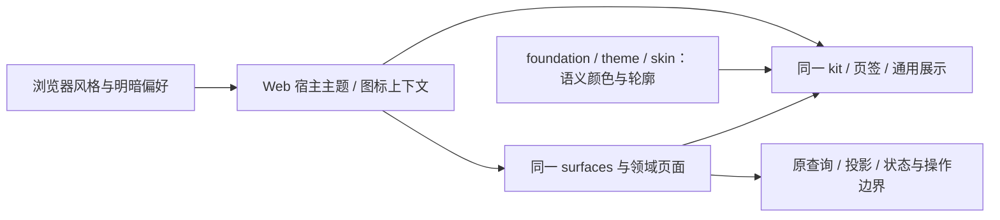
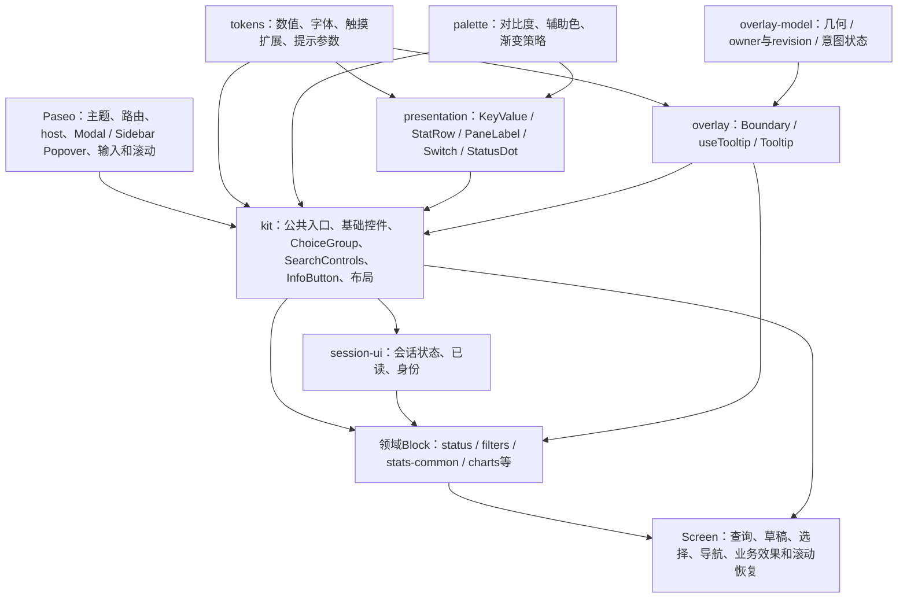
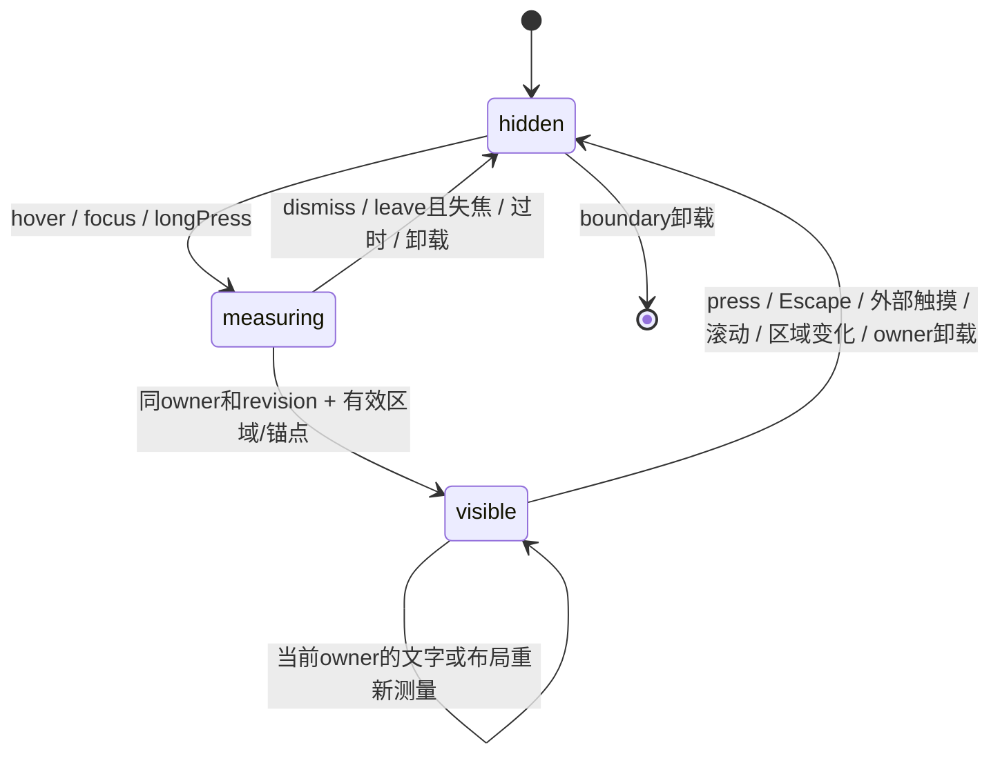

> Historical source reference from `/home/long/works/longwork/paseo-retry`. Relative links describe the original checkout and may not resolve here. Current behavior and provider boundaries are owned by [the migration model](../migration.md).

---
schema: document
description: Agent Inspector 的现行设计系统、组件消费与浮层责任，以及未完成的页面迁移
status: active
links: [./domain-model.md, ./product-review.md, ../.controller/coherent-system/tasks/components.md]
---

# 设计系统与组件责任

## uiux 统一源码与管理工作台

当前唯一设计资源所有者是 [uiux/](../uiux/README.md)，工具链规范见 [uiux.design.md](../uiux/uiux.design.md)，真实系统实现见 [inspector.design.md](../uiux/systems/inspector/inspector.design.md)。已将既有 kit、tokens、palette、presentation、overlay、通用 motion、导航、图表、Web 图标／反馈／工具／声音／背景和四板工作台迁入；产品消费者已改用系统公开入口。旧 `plugin/client` 与 `web/client` 不维护第二套基础组件。

独立工具[@longwork/uiux](../../uiux/README.md)定义资源、状态、交互和场景合同，加载产品相邻resource.json／design.md／scenes.tsx；`systems/inspector` 拥有本产品品牌与组件；`systems/recovery` 拥有此前独立恢复 DOM kit。独立恢复 API 尚未合并为 Inspector RN kit，业务状态／查询／权限继续由原领域拥有。其他项目安装同一工具并初始化本地uiux资源，无需复制工作台或Inspector品牌。

局域网入口 **http://192.168.2.178:4196/**。默认整体同屏组合真实组件，局部检查属性／变量／事件，资源库支持加入和图层重排，文档／接口从 Sheet 查阅；工作台自身的控件、Layout、主题和素材归独立工具项目的 `uiux/systems/workbench`，由同一资源机制读取。系统提供稳定 Provider、Controls、TokenEditor，换肤不重建输入实例。tokens 的实时编辑和 JSON 导入／导出作用本地，不直接写源码。原生 Canvas 继续消费同一个 React 构建，保留用户批注和参数。

Foundation → semantic theme → 平台变量／真实值 → 同一组件。SVG／图片／纹理／音色通过语义资源角色选择，并记录来源和许可；颜色、尺寸和时长使用变量。设计原理、命名、维护工作模式和验证边界由 uiux 自身文档维护；本文保留产品领域责任。原生 App 没有新增风格入口，未 reload／restart 既有服务。

## 原版与像素风的可切换展示（2026-11-13）

用户接受[鲜彩像素 SVG 候选](../design/inspector-pixel-skin-v2/README.md)后，要求保留两套风格，并通过设计系统复用原有功能。完整 Web 现在提供互相独立的 `style=original|pixel` 与 `theme=light|dark`；右上角风格按钮和明暗按钮即时切换，默认保留原版。组件与领域逻辑共用，不复制八个页面，也不依风格重建 React 树。旧 `?experience=recovery` 是此前独立恢复体验，继续保留，不能把它当作完整 Inspector 的像素入口。



| 所有者 | 当前责任 |
| --- | --- |
| `uiux/systems/inspector/themes/skin.native.ts` | 可选展示主题扩展、基础值的兼容导出、按语义角色的样式覆盖；不导入 SDK 运行时或领域服务 |
| `client/palette.ts` 与 `kit.tsx` | 原版策略保留；像素主题消费新类别色、平面色彩、硬阴影、可读填充前景；按钮、图标按钮、标签、选择、搜索/输入及通用展示复用原契约 |
| `client/view-tabs.tsx`、`presentation.tsx`、`status.tsx` | 原导航/状态事件与 tooltip 保持；只选择展示轮廓与颜色 |
| `client/charts.tsx`、统计/Token/分析摘要与恢复样式 | 原卡片、数据、分组与布局继续由各域持有，消费共享皮肤角色；不重算指标 |
| `uiux/systems/inspector/platforms/web/appearance.preferences.ts` | 浏览器本地的 style/theme，URL 显式值优先于已存偏好，再使用 original/dark 默认；读取/写入不可用时继续工作 |
| `web/client/inspector.tsx`、`host/themes.ts` | 组合稳定的四套主题对象；风格变化不进入 route 或 Surface 的 React key；导航保留 URL 的风格/明暗和语言 |
| `uiux/systems/inspector/platforms/web/appearance.context.tsx`、`host/pixel-icons.ts` | 宿主 SVG 图标同步切换；portal 保留 React 上下文，原 Lucide 语义图标作为未绘制项的回退 |
| `uiux/systems/inspector/platforms/web/appearance.styles.css` | 根 `data-style`、`data-theme` 与语义 CSS 变量；只作用于完整 Inspector，浮层仍受原公共边界管理 |
| `uiux/systems/inspector/boards/component-preview/component-preview.web.tsx` | `surface=components` 的本地、可操作 kit 示例，明确标为样例；不连接业务动作 |

两套外观共用组件的输入、选择、禁用、加载、焦点和浮层生命周期。风格只作为展示输入；恢复策略、停止证据、发送身份、未知屏障和浏览器桥接的既有读写范围均不由风格控制。完整 Web 继续是观测模式；像素风不是新增的业务命令通道。本次原生 App 保留原版主题与现有入口，没有 reload 插件或重启 daemon。

开发入口与用法见[皮肤组件说明](../uiux/systems/inspector/README.md)。真实完整页面：`http://192.168.2.178:4187/?style=pixel&theme=light`；[基础组件预览](http://192.168.2.178:4187/?surface=components&style=pixel&theme=light) 可操作按钮、筛选、页签、输入/开关、状态、空态和 Sheet。颜色和控件轮廓已经进入组件，个别领域私有装饰仍保留原表达；这不是所有页面逐像素重绘或原生像素图标适配的声明。

验证场景由 `web/client/verification/appearance.mjs` 维护：1440/390/320px 下切换保留输入 DOM 身份、开关、选择、面板草稿，恢复本地偏好，导航保留风格；真实数据 Web 八页签的只读浏览与恢复搜索连续。偏好测试覆盖 URL 独立覆盖、损坏/受限存储及对象/页签/语言参数保留。原版恢复和公共提示回归复用既有 `recovery.spec.ts`、`overlays.spec.ts`，不以真实恢复命令验收视觉。执行结果见[工作记录](work.md#可切换设计系统2026-11-13)。

### 阶梯框、动效与声音

首轮把 SVG 的轴对齐内切角简化成小圆角，未完整保留已接受视觉。现已恢复双层阶梯轮廓：紧凑标签/输入切角2px、按钮4px、面板6px，边框2px；内层只内缩2px，保持同构切角。外层为空心轮廓，避免半透明危险/警示填充与实心外层叠色。只裁剪装饰伪元素，控件内容、焦点环、点击区域和子浮层不裁剪；不以改padding实现边框。Web的`skinStyle`只传入颜色/轮廓变量，实际形状归`appearance/feedback.css`，原版不应用这些规则。

原生 Design Canvas **Agent Inspector · 像素动效实验台**（`inspector-pixel-motion`）包含边框状态、工具声音、状态图表、恢复调查四张可操作设计板。[设计规范与场景矩阵](../design/inspector-pixel-motion/README.md)拥有完整提案；[真实组件预览](http://192.168.2.178:4187/?surface=components&style=pixel&theme=light)展示当前采用的共享组件实现。Canvas是独立设计样例，不能替代生产组件或真实业务验收。

| 场景 | 当前 Web 实现 | 语义和中断 |
| --- | --- | --- |
| 鼠标/键盘按下 | 面下沉2px、硬阴影收起；90ms按下、110ms释放，离散步进 | 不延迟回调；抬起/取消/失焦移除按下态，disabled/busy不触发 |
| 悬停/焦点 | 80ms轮廓变化；像素操作图标单次160ms轻跳；键盘独立外环 | 不移动文字布局；焦点不被阶梯裁剪 |
| 运行 | `StatusGlyph`在像素主题使用三档高度的`PixelActivity`，1200ms节奏 | 只表达已有运行状态；文字独立，隐藏/离屏暂停 |
| 加载 | busy按钮使用`PixelLoading`四格800ms扫描；原Sweep/Spin按像素离散节奏展示 | 无测量进度含义；busy依旧禁用操作 |
| 等待/已完成 | 原等待标记沿用离散Ping；明确变化的原Pop使用160ms；预览可模拟明确完成 | 不重放所有历史成功；Canvas中1400ms专用等待图标仍是提案 |
| 错误/停止/结果未知 | 静态图标与文字；预览明确展示未知静止 | 不由工具错误推断停止，不奏成功音、不自动重试 |
| 图表 | 原Grow在像素主题180ms分步显露，柱形为方角；数值和选点契约保持 | 不滚动数字、不循环起伏真实数据，不造点或补零；预览固定样例清楚标注 |
| 工具光标 | 原创24px锤子/铲子/凿子或系统光标；仅fine pointer，按下切换姿态 | 输入保留文本光标，disabled/busy保留语义；触屏不追踪光标 |
| 敲击声音 | 默认静音；启用后本地40ms短音，音量独立、100ms限流；可试听木质/金属声 | 不给业务结果背书；输入、禁用、取消长按、原版与隐藏页静音，退出释放资源 |

`pixelShape`、`pixelMotion`为共享基础参数；`motion.tsx`输出纯展示角色，不感知Web偏好或业务服务。`uiux/systems/inspector/motion/feedback.web.tsx`组合浏览器设置、原生光标、WebAudio和资源清理；本地偏好key为`agent-inspector.pixel-feedback.v1`，与风格/明暗及主机偏好分开。只观察DOM交互，不调用/重放业务回调；RN Web会消费冒泡事件，因此采用capture观察后在microtask检查取消，不干预原输入处理。声音不加载外部文件。

系统`prefers-reduced-motion`优先于本地开关，立即移除位移、循环、图标跳动和光标敲击姿态，文字、选中和操作保持。页面隐藏/离屏暂停标记动画，切回原版释放声音并保持其原有样式与动效。新动效验收由`verification/pixel-feedback.mjs`维护，覆盖默认静音、真实音源创建/释放、按下/取消、键盘、减少动态、偏好持久、窄屏与触摸；人工听感与物理App未纳入本轮。

## 审查结论与证据范围

Agent Inspector 以 Paseo 原生宿主主题、RN 控件与本地 kit 为基础。现行公共体系已收拢数值、色彩、通用展示、单选与提示协议，工作台、详情、恢复、执行管理、分析作业和统计等真实页面消费它；各领域仍拥有自己的查询、编辑草稿、导航与内容布局。组件体系的统一以职责和事件契约为准。

审查覆盖全部 `client/*.tsx` 的导入、组件声明位置、公共控件消费、浮层及绝对定位入口；深入追踪 kit、原 ui、恢复、工作台与详情、筛选、统计公共组件、横评、执行管理、分析作业、设置与侧栏注意力浮层。它是全产品结构扫描和代表路径深查，没有逐行证明每个页面、主题、字体比例或事件序列。原始基线中49个页面/组件直接消费kit，27个文件消费混合职责的ui；这些数字只说明修改传播范围。

用户恢复页截图中，筛选图标下方“筛选范围”逐字换行并跨越搜索/分组区。已确认原实现将提示放在32px按钮决定宽度的包含块中，只有maxWidth，没有独立可用宽度；固定top和按钮局部zIndex又无法定义跨滚动与Modal的层级。公共IconButton原先承诺提示但未实现，恢复因而私有实现了显示、定位和触摸状态。单独调宽度或叠放值无法同时解决这些责任缺口。截图确认这个恢复场景，不能证明所有其他页面都存在同样的像素问题。

宿主能力已核对安装的 `@getpaseo/plugin@0.15.3` contracts/client UI类型和当前[官方文档](https://paseo.sh/docs/plugins/reference.md)。Paseo没有公开通用Tokens、页面任意锚点Portal或Tooltip API；侧栏openPopover不能作为任意页面浮层接口。MIT来源保留于LICENSE/NOTICE和[upstream.json](upstream.json)。

## 审查时的结构与现行转换

| 审查时的责任 | 已落源码的现行结构 | 被保留的领域差异 |
| --- | --- | --- |
| kit混合数值、调色与控件 | `tokens.ts`唯一数值源，`palette.ts`唯一主题/类别色策略；kit作为公共控件入口消费并公开这些契约 | 宿主语义颜色继续来自PluginTheme；渐变hero和状态辅助色有明确上下文 |
| ui同时装通用展示、会话语义、选择与时钟 | 删除ui文件和旧import；通用组件从kit消费；会话语义从session-ui消费；通用状态标记归kit；时钟与短时长分别归use-clock/duration | 会话read/stop/waiting语义未被泛化为通用状态控件 |
| filters、execution、jobs各有选择循环，ChoiceList另有行实现 | 单一ChoiceGroup负责受控单选，rows与wrap两个有意的呈现布局；wrap复用Chip；旧Group/Choices/FilterChoices/ChoiceList删除 | 范围联动、缺失范围选项、即时生效、选后关闭、业务草稿仍由页面拥有 |
| execution/jobs重复查询+过滤+清除布局 | 两页直接消费SearchControls；原search/选择样式删除 | host上下文、来源健康、查询和取消反馈仍分别属于原页面 |
| ViewTabs、StatusChip和交互GlassPill私有Pressable绕过提示 | 原控件直接绑定useTooltip，模块级item保持稳定身份 | tablist/tab、状态toggle、hero语境保留；静态GlassPill仍是View |
| 恢复自行拥有局部hint/absolute/zIndex | 公共OverlayBoundary拥有挂载、测量和互斥，kit控件供意图；恢复只声明名称 | 领域筛选、选择、恢复政策与操作反馈仍属于恢复域 |

kit是当前正式入口，其对tokens、palette、presentation的导出是公共API组成。不存在旧ui的兼容导出或第二套旧选择实现；原版/像素外观通过同一组件的皮肤输入选择。此前保留旧入口的渐进设想已经被本轮实际消费者迁移取代。

## 现行层次与唯一职责



箭头表示被上层消费。presentation/palette/tokens不反向导入kit；overlay也不依赖kit，因而不会因通用展示提取而形成循环。`shared/domain`、server、存储和RPC不属于设计系统。`use-clock.ts`只拥有前台时钟，`duration.ts`只格式化紧凑时长，不持有查询或会话对象。

页面实际组合是宿主Surface → 领域Screen → Toolbar/列表与详情或统计内容 → 领域Block → kit/RN primitives。未建立万能Page/Card来收纳所有数据与状态。

### 组件契约与合理差异

| 对象 | 当前公共契约与责任 | 消费/差异边界 |
| --- | --- | --- |
| Button | primary/secondary/ghost/danger，busy/disabled、grow、尺寸、可访问名称；tooltip显式启用 | 完整可见文字默认不重复提示；副作用仍归onPress所有者 |
| IconButton | label必填，默认短提示；active是可选toggle；badge、disabled、尺寸 | 不接受任意页面定位样式；禁用保留名称与状态 |
| Chip/ChipBar | 静态、单动作、点击+移除；双动作为兄弟按钮；disabled保留计数与形态；有界宽度和文字shrink | ChipBar拥有横向滚动；ChoiceGroup wrap拥有换行；两者不能互换滚动责任 |
| ChoiceGroup | `Value extends string | null`，theme/options/value/onChange；layout为rows或wrap，默认rows；label可选 | 无内部选择状态。严格比较并按类型化value建key；null、空串和字面null不同。值须唯一 |
| ChoiceOption | value/label/count/tone/disabled/hint/leading | rows展示备注与前导装饰；wrap用Chip的tone标记，备注进入短提示。rows沿用选项名称，wrap包含计数；有组label时名称添加组上下文 |
| SearchControls | theme/value/onChangeText/label/filtered/onOpenFilters/onClear/filterLabel/clearLabel | 只拥有搜索+过滤+清除横排。搜索词不存内部，清除不自行改值；host、Sheet和来源块留页面 |
| KeyValue/StatRow/PaneLabel/Switch/StatusDot/StateDot | 通用诊断值、数字展示、子标题、受控布尔开关；统一从kit消费 | KeyValue保留可选择/换行路径；Switch保留switch/checked/disabled语义 |
| InfoButton | 局部open状态、IconButton及说明Sheet | 长说明是显式披露；不放进Tooltip。标题/内容仍由领域组织 |
| SectionHeader/PaneLabel | 前者拥有列表展开/尾部动作，后者是详情内的静态子标题 | 两者外形相近仍有不同事件契约，保留两个有意角色 |
| Toolbar/SplitView/BottomBar | 共享空间、间距、分栏和compact安排 | SplitView拥有宽窄布局；Dashboard拥有选择/返回和数据可见性；不合并为全局页面状态 |
| Tabs/Segmented/ViewTabs | 完整文字的详情/分段导航与可收起文字的主导航 | 均保留tab语义；ViewTabs的iconOnly需要公共提示。未要求所有完整文字导航默认再显示提示 |
| StatusChip/GlassPill | 状态筛选的motion/count/pressed；渐变hero的白色文字和标记 | 两者操作均消费公共提示；静态hero不变成交互控件；不换成IconButton丢失状态/hero语义 |
| Sheet/ActionMenu | 使用宿主Modal；Sheet保留open/onClose/scrollable；菜单先关闭后执行 | Modal内有自己的局部boundary，位于内容滚动之外；宿主拥有焦点恢复、返回和safe area |
| Sidebar Popover | 宿主openPopover决定锚定或compact Sheet，内部组合注意力Block | 不是页面通用portal路由；不新建跨产品的浮层管理器 |

### Token边界

`uiux/.../native.tokens.ts`只放跨组件反复使用的space/fontSize/radius/control/hairline/monoFont/touchSlop及公共tooltip参数。`uiux/.../palette.native.ts`使用PluginTheme和辅助类别色，保留对比度回退、hue/toneColor/hueFor/gradient等单一实现；没有复制宿主主题。

组件专用的44px选择行、tab的渐变胶囊尺寸、hero透明度、KeyValue标签列宽等归各组件实现。恢复分组缩进、横评列宽、图表坐标、统计卡密度、execution/jobs上下文与列表排版归相应领域styles。数字相同不代表语义相同，不能把所有字号/布局字面量提升为全局token。图表绝对定位、装饰与选中遮罩是合法的局部坐标；它们与提示浮层的挂载责任不同。

## 公共浮层契约

```tsx
<OverlayBoundary theme={props.theme} scopeKey={props.host.id}>
  <Surface {...props} />
</OverlayBoundary>

<IconButton theme={theme} icon="Filter" label="筛选范围" onPress={openFilters} />
<Chip theme={theme} icon="Layers" label="42" accessibilityLabel="待核实 42"
  tooltip="待核实 42" disabled onPress={openRecords} />
```

`OverlayBoundary({theme?,scopeKey?,mode?,active?,modal?,children})`拥有提示挂载、区域和测量。mode默认为surface（填满可用Surface），content随内容收缩；active默认true，modal默认false；theme从祖先继承。Screen/Surface根包装在初始化期创建一次，不能在render里创建新组件类型。side attention-popover用content模式。每个宿主Modal内另有content+modal+active=open的局部boundary，位于内容滚动区之外；只有原本scrollable=false的填满主体沿用surface模式。

`useTooltip({label?:string|false,onPress?})`与`Tooltip` render prop交付同一套ref、hover/pointer/focus/blur、longPress、press、layout绑定。绑定直接落原Pressable，不增加布局包装或嵌套按钮。业务回调只在普通press执行，Tooltip不解释业务结果、不保存数据、不触发RPC。Button/Chip默认关闭提示，IconButton默认用label；领域控件明确将其名称交给同一绑定。

位置使用同一window坐标测量boundary和锚点，再减去boundary原点。文本宽度先由区域可用宽度决定，再受maxWidth=280限制，与32px按钮宽度无关；优先下方、空间不足翻上方、水平钳位。锚点不可见/无效不显示。提示层pointerEvents=none，不抢焦点、不改变列表滚动高度，也不越过宿主Modal/safe area。

缺少boundary、主题或前台状态时保留控件可访问名称，不回退按钮内absolute提示。Web Escape、捕获scroll/resize只封装于`client/web.ts`，按boundary订阅并释放；native通过布局、触摸、owner与前后台生命周期保持同一职责。公共跨平台模块没有DOM类型，也不引入ReactDOM/Portal包、第二个RN Modal或其他UI框架。

### 提示与组件生命周期



hover与focus是独立来源，关闭一个不覆盖另一个。Escape/press后抑制仍驻留的意图重开，离开再进入解除。长按展示提示并消费本次press；释放后仍可读，后续触摸关闭；下一次普通点击照常执行。无抢焦点，Sheet的焦点恢复仍归宿主。

session持有唯一owner和revision。关闭、替换锚点、host切换、卸载、区域变化使旧测量失效；迟到callback和旧owner清理不能污染新提示。一次最多一个提示，打开局部Modal时暂停祖先提示。

ViewTabItem、ChoiceItem、ChoiceRow及共享组件在模块级声明；选项用唯一value建key，不以显示名或数组下标替代身份。Dashboard依host、详情依host+agent、恢复依host/workspace重建，是领域身份变化。统计下钻保留来源页挂载、范围/展开与滚动，隐藏时暂停查询；政策设置打开时建立草稿、失败不覆写草稿。这些状态不移入kit或overlay。useClock仍只在前台运行并清理计时器。

## 已落消费与后续路线

| 状态 | 当前结果/后续范围 | 判断边界 |
| --- | --- | --- |
| 已落 | 唯一基础tokens/palette、公共浮层、IconButton默认提示、显式Button/Chip提示、Chip disabled和有界内容 | 恢复已删除局部hint/zIndex；Surface/Modal边界由入口集成拥有 |
| 已落 | ViewTabs iconOnly、StatusChip、交互GlassPill同一提示绑定 | 导航、筛选与hero视觉有意保留，不宣称所有Pressable都应该有Tooltip |
| 已落 | 原ui通用能力归kit、会话语义归session-ui；所有生产旧import已迁移并删除旧文件 | 没有双入口兼容期；新导入直接指向当前责任所有者 |
| 已落 | filters/execution/jobs统一ChoiceGroup，项目/范围picker采用rows；两个管理页采用SearchControls | 领域模型仍拥有身份和过滤联动；保存视图、恢复多选与编辑草稿有不同契约，不塞进单选组件 |
| 后续按职责推进 | Dashboard的toolbar/scopes/content及digest、insights-overview私有样式与Block | 尚未全部提炼命名布局。依据真实复用和变化传播处理，不能称整套页面已完全组件化 |
| 需真实证据 | 长Section标题、focus可见性、所有主题对比度、触摸目标与字体缩放 | hero白色前景、rgba与辅助色有语境，但尚未证明每个实际组合。原生手势/读屏需单列验收 |

现行转换有唯一生产路径，不借旧版运行模型维持平行实现。后续工作面向仍存在的结构和交互反例，不依赖恢复服务端改造。

## 定向确认与运行证据限制

本域以源码责任审查为主。已有纯几何/owner-revision/意图检查支持浮层模型；本轮针对真实生产组件树渲染并捕获原控件绑定，确认rows/wrap严格选择null/空串/字面null、disabled不提交、计数/备注/前导保留、受控值不被内部修改，ViewTabs/StatusChip/GlassPill普通点击一次且长按不执行业务，静态hero无按钮，SearchControls只转发查询/过滤/清除意图。execution/jobs模型定向检查支持过滤身份、失踪范围和动作反馈等既有不变量。隔离渲染不证明真实滚动、测量与焦点生命周期。

主控统一执行build/browser/reload与最终类型/边界检查。需要在实际页面验证：桌面明暗、390/320px触摸；iconOnly导航名称、四边提示与中文/长英文；焦点+hover、Escape、滚动、开关Sheet、切tab/host释放；禁用计数；管理过滤后下钻返回时host/草稿/滚动保留。已有恢复浮层矩阵不等于新消费者全部验收，浏览器触摸模拟也不冒充iOS/Android读屏证据。

普通执行记录、READY、主控集成与未决项留在[组件Task](../.controller/coherent-system/tasks/components.md)和[前浮层Task](../.controller/data-architecture/tasks/design-system.md)。本文只描述当前结构与明确未落的迁移。

## 视觉候选：像素案头

2026-11-13 用户要求先纠正视觉方向：保留原版页面结构、功能与操作，只尝试更饱和的配色与像素细节，先看 SVG 再讨论实施。当前评审为[鲜彩像素换肤](../design/inspector-pixel-skin-v2/README.md)，6 张纯 SVG Canvas 画板复用原八页签、恢复分组、会话双栏与看板首屏层级。它没有修改生产 kit、Web、RPC 或当前支持；以下像素案头与并行 Web 描述保留既有探索及实现背景。

用户另选轻像素方向进行产品原型探索，参考bots画布内部的轮廓、物件和色彩语言。[像素案头](../design/inspector-pixel-v1/README.md)提供6张可操作Design Canvas画板、6张可编辑页面SVG及29个原创像素图标；设计源、token、页面层级与适配取舍在该候选目录维护。原生画布已完整读取，未替换本文描述的生产kit、宿主主题或导航。用户已选择以下并行Web实施；原型仍为离线设计候选，其模拟交互不进入真实业务。每个平台的共享视觉决策回到对应token/组件所有者，恢复业务继续由同一个领域服务负责。

## 并行Web：操作导向

用户已授权以像素语言实现[独立Web恢复调查](recovery-web.md)，保留原侧栏界面。两个展示端消费同一恢复领域契约；Web公共token/控件/overlay位于`uiux/systems/recovery/`，恢复专属组合与状态位于`web/client/recovery/`。平台行为分别由DOM和RN实现，不用一个万能组件掩盖宿主差异，也不在Web复建业务服务。

两端持续采用操作优先的设计原则：先确定任务、布局、事实和动作状态，再实现页面。主工作区不得堆放宣传标题、教学说明、没有决策用途的摘要卡或重复状态；图标提供可及名称，次级内容通过锚定浮层/菜单/Sheet展开。必要事实和操作后果留在对应对象旁；未知和旧值必须看得见，不能为了简洁省略。其他页面沿同样方法逐页设计，不把本批恢复实现扩大成已完成全部页面。


集成收口：最终Surface统一包OverlayBoundary后，恢复页面删除此前自带的非Modal根boundary，避免同一Surface嵌套两套提示session。Sheet/ActionMenu仍有意拥有局部modal boundary；独立fixture的scope边界用于受控生命周期场景。


## Bots 管理界面消费

`client/bots/`使用同一kit、Tokens、PluginTheme和surface的OverlayBoundary：Screen拥有查询、tab/搜索/执行筛选和authority限定的选择栈；Boards拥有总览/角色/执行/来源布局；Automation拥有按Bot查询与选择；Details通过Sheet保留关联对象返回。工作负载条仅表达当前可见成员运行会话数，状态分布条仅表达已加载Conversation构成。手机总览将关注队列提前，详情仍就地打开。视觉与交互场景由[Bots设计](bots-inspector.md)、[预览](../design/bots-observation/README.md)和专用UI spec维护。
