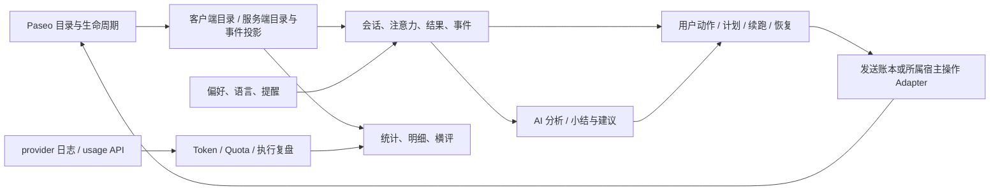
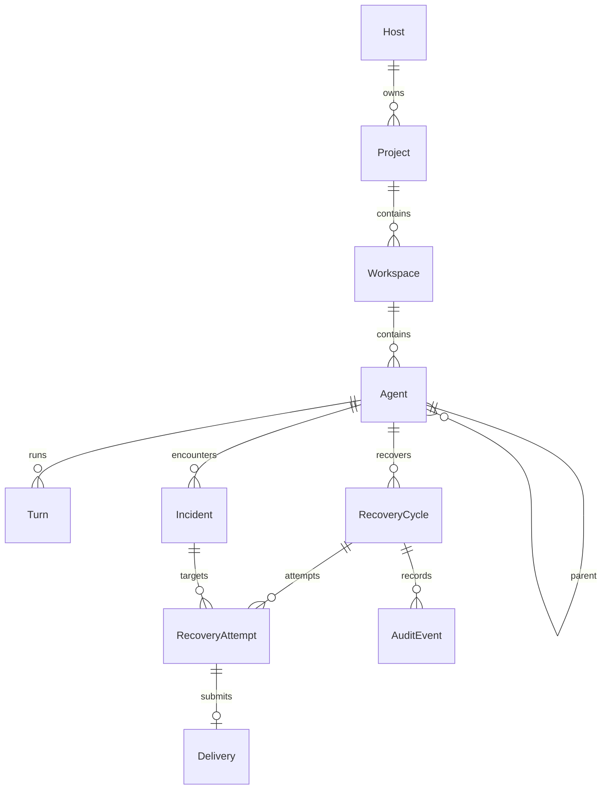
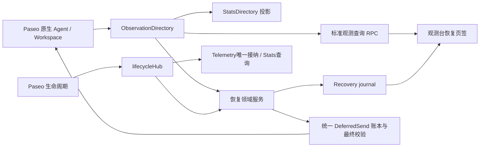
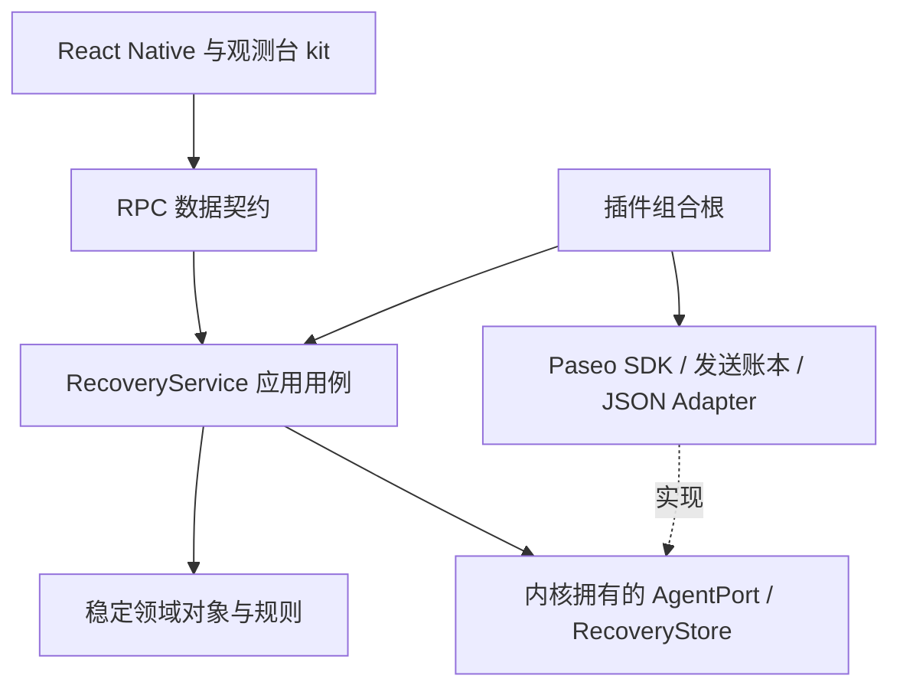

> Historical source reference from `/home/long/works/longwork/paseo-retry`. Relative links describe the original checkout and may not resolve here. Current behavior and provider boundaries are owned by [the migration model](../migration.md).

# Agent Inspector：领域、数据与接口模型

本次选择：以此前安装的 Agent Observatory 2.18.1 为主体，将恢复能力纳入同一个插件和工作台。上游版本、文件校验值见 [upstream.json](upstream.json)，保留插件内的 MIT LICENSE、NOTICE。运行时继续使用 `paseo-retry`，保留原恢复记录；观测数据放入该安装实例的独立目录。原版已退役移除安装，历史数据和私有备份保留为回滚来源，见[退役记录](work.md#原版退役与规划)。

维护范围是完整的 Agent Inspector，涵盖会话、注意力与已读、执行证据、统计/用量/观测、AI 分析与小结、定时与投递、历史与配置。以下先描述全产品现状，再细化已建立纯内核的观测/恢复子域。代码和契约是实际支持依据；统一领域边界的目标不能被表述为全仓已经落实。

数据粒度、读取/计算算法与存储策略由[数据算法模型](data-architecture.md)拥有；组件层次、公共契约及渐进迁移由[设计系统模型](design-system.md)拥有。[当前交付](../.controller/coherent-system/delivery.md)正将统计收敛为单一接纳/检查点、用量收敛为完整贡献集和派生查询，并统一公共组件及当前SDK Adapter。下文描述目标和源码结构，实际加载/验收以工作记录为准。

## 全产品职责与现有入口

| 责任域 | 现有对象、事实所有者 | 原生契约与模块（相对 plugin） |
| --- | --- | --- |
| Bots 管理观测 | Bots 拥有 Bot/Team/Conversation/Runtime/RoutineRun；Inspector 仅查询当前授权范围的观测投影 | `shared/domain/bots-observation.ts`、`shared/bots/rpc.ts`、`server/bots/`、`client/bots/`；[设计与计算](bots-inspector.md) |
| 宿主身份与目录 | Host/Project/Workspace/Agent 由 Paseo 拥有，本插件持有观测；父子关系独立于工作区归属 | `shared/domain/observation.ts`、`shared/observation.ts`、`server/observation-directory.ts`、`client/use-observatory.ts` |
| 会话与注意力 | AgentRecord 是展示投影；待处理/后台/子 Agent、停止原因与待回复是派生事实；ReadReceipt 针对具体完成/轮次 | `shared/model.ts`、`attention.ts`、`background.ts`、`read-state.ts`；`server/attention.ts`、`read-state.ts`、`client/session-list.tsx` |
| 执行与证据 | TimelinePage/Row、AgentResult、Digest 持有窗口/epoch/引用与覆盖；只读结果不代替宿主操作授权 | `shared/timeline.ts`、`results.ts`、`digest.ts`、`provider-subagents.ts`；`server/results.ts`、`digest/`、`turn-timeline.ts` |
| 生命周期与观测 | TelemetryEvent、AgentTelemetry、AnalyticsSnapshot 是插件观察到的事件/状态/时间桶；有观察期和持久化错误 | `shared/telemetry.ts`、`analytics.ts`；`server/telemetry.ts`、`analytics-enrichment.ts`、`lifecycle-hub.ts` |
| 历史统计 | Telemetry唯一接纳/持久化点事实与区间，Stats只查询；required basis、retainedTotals与since累计分开；不拥有宿主执行 | `shared/stats.ts`、`stats-view.ts`；`server/stats-store.ts`、`stats-snapshot.ts`、`stats-directory.ts` |
| Token 与额度 | 规范化调用贡献与游标同checkpoint，查询时派生桶/极值；ledger质量独立；Quota是provider外部窗口采样 | `shared/tokens.ts`、`quota.ts`；`server/tokens/`、`token-source.ts`、`quota.ts` |
| 智能分析 | InsightJob/InsightReport/InsightEvidence、FindingFeedback 和跨 Agent 建议作业由 insights 管理；推断不等于原生执行事实 | `shared/insights.ts`、`insight-overview.ts`；`server/insights.ts`、`insight-*.ts`、`grok-runner.ts` |
| 小结与建议回复 | RecapView/RecapState 指向对应轮次，区分新鲜、过期、更新中；建议发送仍经过投递 | `shared/recap.ts`；`server/recap.ts`、`recap-storage.ts`、`client/quick-replies.tsx` |
| 定时与运行 | 宿主计划/心跳是执行来源，本插件的计划/运行投影与账本用于调查；计划删除不抹除已发生运行 | `shared/schedules.ts`；`server/schedules.ts`、`client/schedule-board.tsx`、`heartbeat-card.tsx` |
| 续跑与错误恢复 | ResumeEntry 表达后续唤醒；Incident/Cycle/Attempt 表达错误恢复；两种策略与状态各自拥有 | `shared/resume.ts`、`domain/recovery.ts`；`server/resume.ts`、`recovery.ts`、`backoff.ts` |
| 投递与动作 | DeferredView/消息账本记录投递和效果；审批回答当前请求，手动/自动动作授权来自所属用例 | `shared/deferred-rpc.ts`、`permissions.ts`；`server/send-ledger.ts`、`deferred-send.ts`、`client/send-check.ts` |
| 历史与还原 | RestoreOutcome/异步作业表达还原原对象；归档、卸载、工作区缺失分别核验 | `shared/history.ts`；`server/history.ts`、`client/use-restore.ts` |
| 个性化与提醒 | ViewPreferences/SavedView/CompletionSnooze、语言与 AlertSettings；保存偏好不能改变执行事实 | `shared/preferences.ts`、`alerts.ts`、`i18n*.ts`；`server/preferences.ts`、`sidebar-labels.ts`、`client/chime.ts` |
| 当前运行与适配 | client stub/懒加载、host SDK/原生 IPC bridge、模块释放和各领域持久化 | 两个 runtime entry、`client/surfaces.tsx`、`lazy-chunk.tsx`、`chunk-loader.ts`、`server/provider-subagents.ts`、`scripts/` |

这些是维护责任，既有物理目录并未全部按此分包。视图、聚合、作业、策略和效果记录是不同对象：Stats/Token/Analytics 的值相似不表示同一指标；InsightReport 不等于 AgentResult；ResumeEntry 不等于 RecoveryCycle；Delivery.sent 不表示业务任务完成。大多数继承类型仍从 Zod 或原模块派生；观测/恢复、来源健康、诊断、执行管理与分析作业管理已提取独立纯领域类型。

图表达职责与信息流，具体数据来源和连接由各模块拥有，不表示所有来源已经经过一个全局管道。跨功能的代表路径与完整入口见[全产品评审](product-review.md#全功能覆盖图)，候选结构调整见[工程与性能提案](proposals/engineering-performance.md)。

## 模型与事实归属

下表与 ER 图细化观测/恢复子域。generation 是恢复服务的本地轮次基线，不能当作全产品 provider turnId 的通用替代。

| 对象 | 标识、归属 | 责任与不变量 |
| --- | --- | --- |
| Host | serverId | 权限、连接、数据来源边界；跨主机引用必须携带 serverId |
| Project | host + projectId | 管理 Workspace；名称不是身份 |
| Workspace | host + workspaceId | 工作目录、分支、归档生命周期；属于一个 Project |
| Agent | host + agentId | 原会话执行主体，属于 Workspace；父 Agent 是独立关系，不等同工作区层级 |
| Turn | agentId + 本地 generation + 可空 provider turnId | 一次执行轮次；provider turnId 不保证跨 session 唯一 |
| Observation | 来源、observedAt、完整性、revision | 原生状态、生命周期、provider 日志分别提供事实；失联不是零活动，旧 lastError 不是当前停止证据 |
| AgentRecord | 客户端投影 | 原生状态加 telemetry/read-state/background 的派生展示；不是执行命令依据 |
| Incident | incidentId + revision | 当前错误停止事实及其证据；分类不改变权限，不自动认定工具失败意味着任务停止 |
| RecoveryCycle | cycleId，单 Agent 当前链 | 等待、核验、恢复、暂停、待核实、结束；明确再次失败推进 5/20/60 分钟 |
| RecoveryAttempt | attemptId + operationId | 一次副作用请求；提交前持久化，unknown 不补发 |
| Delivery | messageId + group | 统一发送账本中的消息；最后时刻检查原会话和权限，不能把 sent 当成恢复成功 |
| Policy / AuditEvent | policy revision / eventId | 用户意图与已经发生的事实分开；策略变更不抹去历史 |

## 已有基础与需要统一的部分

原观测台具备客户端 `shared/directory-store.ts` + `useObservatory` 的共享订阅、服务端 `StatsDirectory` 的一分钟缓存、`lifecycleHub` 的单次事件分发，以及 `DeferredSend` 的统一发送账本。持久化由 observations、tokens、read-state、preferences、insights、resume 等领域拥有；Stats不再单独写存储。它不是统一数据库，也不存在可让恢复安全复用的完整原生目录接口：StatsDirectory 已丢掉 lastError、权限详情和 Workspace 归属等字段，客户端投影又不应承担后台恢复。

本次补齐 `ObservationDirectory`：一个服务端分页采集入口，保存完整原生 Agent/Workspace 快照，支持同一时刻请求合并、完整扫描原子发布、失败保留旧快照但拒绝作为新鲜结果。StatsDirectory 只做统计投影，恢复通过端口读取这个来源，页面通过 `observatory.data.snapshot` 获得带版本和健康状态的标准化观测投影。客户端原生实时订阅继续复用宿主，由其已有目录管理；历史、Token、分析保留各自的语义与保留期，不强行装入一个无类型的万能表。

## 契约与持久化

标准化优先选择确定可复用的身份、范围、时间、数据来源、完整性、修订版本和命令结果。可执行契约放 `shared/observation.ts`，恢复契约继续位于 `shared/recovery.ts` 和 `shared/automation.ts`。目录是易失观测缓存，Recovery journal 是耐久操作日志，发送账本是消息效果记录，三者不能互相代替。

恢复读取共享原生来源，发送前仍刷新 Agent/Workspace，发送走原观测台账本的 Agent 锁并再次验证恢复授权。手动继续、自动恢复和其他消息共享最后时刻的竞争控制。发送超时/断线/未知继续保留 unknown，不自动重试该发送；仅新的明确失败推进下一轮退避。自动恢复默认关闭，集成不隐式开启。

### 目录健康与指标投影

最小健康值对象为 [DirectoryHealth](../plugin/shared/domain/source-health.ts)，[Zod 契约](../plugin/shared/source-health.ts)双向检查其类型。它只描述 `paseo-directory`：展示数据的观测时间、最近尝试/成功时间、完整性、健康版本和有限错误码，不携带 SDK 异常或 provider 日志路径。

| 状态 | 含义 | 展示与消费边界 |
| --- | --- | --- |
| unknown | 尚未完成采集或无法证明来源状态 | 不推断健康，不把空值解释为实际零活动 |
| unavailable | 尚无可用快照，且采集失败 | 明确目录不可用；不据此执行恢复或审批 |
| stale | 保留旧值、缓存过期、来源失效或分页不完整 | 保留数据并提示最后成功时间；不作为新鲜完整目录 |
| healthy | 消费者要求的缓存期内采集完整成功 | `complete=true`；不表示 Agent 全部成功或历史数据全覆盖 |

`ObservationDirectory` 拥有原生采集与健康；`StatsDirectory` 将它适配为统计/日志归属使用的目录。共享来源只发布完整分页快照，失败保留上次成功数据；消费者读取自己的缓存也必须看到来源失效。StatsDirectory 必须注入同一 ObservationDirectory，不再自行分页采集或维护另一套来源健康算法。

原生观测查询默认 30 秒时效，Stats/Token 目录采用 60 秒时效，失败后保留 60 秒冷却；共享源在冷却内产生新的失效、尝试、失败或成功仍立即向消费者传播。新成功快照完成归属投影后才标 healthy。采集上限仍为 20 秒，超时后的迟到结果不发布。过龄会改变派生 status/complete，健康事件版本本身不随每次读时钟递增。

当前 `StatsSnapshot.directoryHealth` 与 `TokenSnapshot.directoryHealth` 均为必需字段，未知由对象状态显式表达。Stats 的会话/实时状态与归属依赖此目录；Token 的日志总量、日志回填、覆盖和预算仍由原 `coverage` 拥有，目录健康只约束 Paseo 关联和归属。目录故障不删除 Token 计数，也不将所有日志显示为故障。

健康变化进入 Stats/Token 的 full/unchanged 版本判定，即使计数不变也可返回 full；相同缓存中的重复读取维持 unchanged。健康版本是易失来源状态，不是存储迁移版本或跨领域事务号。`ObservationSnapshot.health.revision` 与原生健康对象一致，失败和恢复会推进健康版本，不再借用旧的目录发布版本。聚合的 `generatedAt` 不充当来源最后成功时间。

### 宿主被动诊断

[诊断领域模型](../plugin/shared/domain/diagnostics.ts)和[RPC契约](../plugin/shared/diagnostics.ts)提供 `observatory.diagnostics.snapshot({})`。目录健康来自 `observation.health()`，桥接证据来自共享 `ProviderBridge.diagnostics()`；查询只读内存，不刷新目录、不发送探针、不读取配置或业务消息。组合根负责注入来源，适配器无法提供合法元数据时返回 null/未知。

| 值对象 | 描述 | 保证与限制 |
| --- | --- | --- |
| BridgeSessionDiagnostics | 当前进程观察到的 unknown/open/closed/disposed、epoch和帧/中断时间 | open只表示最近观察到帧；无连接探针，不宣称宿主能力支持或持续在线 |
| BridgeRequestDiagnostics | 固定16桶的累计尝试/成功/失败、最近结果/错误码及证据epoch | 不存请求ID、payload或自由错误；旧epoch成功不能证明当前会话可用 |
| DiagnosticsSnapshot | 目录、桥接、采集时间与SDK目标/UI制品身份 | SDK目标0.15.3和服务端manifest不等于实际客户端已加载版本；不扩展为全部数据源的健康平台 |

桥接保持原错误对象和请求/排队/关闭行为；只在既有边界被动记事实。复制通过相同Zod白名单递归剥除额外字段，输出机器摘要，不含标题、Agent身份、路径或凭据。UI入口为工作台“更多→运行诊断”及Command Center，历史与制品说明局部展开，按host隔离本地状态。

### 恢复投递事实与执行结果

[RecoveryDelivery](../plugin/shared/domain/recovery.ts)是恢复端口拥有的值对象，[账本适配](../plugin/server/recovery-delivery.ts)解释统一投递结果；内核不导入账本DTO或SDK。Attempt必需 `delivery:RecoveryDelivery|null`，拒绝原因和人工后继关系按事件出现；运行journal仅v3，旧格式独立离线转换。

| 投递事实 | 执行phase与后续 | 证据 |
| --- | --- | --- |
| acknowledged | accepted，仍需观察轮次/完成 | 账本view的messageId与agentId均匹配本attempt且state=sent |
| not_sent | not_sent；本reservation仍有效才把incident恢复detected并增加revision；自动链blocked、无nextAt | ledger busy/gone/refused/confirm在SDK调用前返回；拒绝细因用guardReason机器码 |
| unknown | unknown，不补发 | 未决view、其他消息/目标的existing、throw、timeout或中断；不会把其他消息当本次成功 |

同operationId仍返回原Attempt；明确未发送仅允许新operationId+当前revision经完整校验创建后继，关联previousAttemptId；unknown不能通过换operationId绕过。权限、轮次、人工消息、策略版本、范围与链状态继续在送前核验；拒绝原因由恢复服务持久化，不解析翻译字符串。早到hook拥有执行结果优先级，迟到投递结果只追加事实，不回滚observed状态或新incident。

null表示尚无投递证据，不从说明文案推导确认。发送端口仅允许 `Promise<RecoveryDelivery>`，原生观察Adapter无发送方法；scheduler必须注入账本端口。旧字段缺失仅在离线迁移解释，运行不兼容void端口。已保存的ack不等于恢复完成，重载后未核实执行仍按保守语义处理。not_sent不隐式推进5/20/60退避，只有明确再次失败才推进原链。

### 报告依据与材料可用性

分析引擎继续拥有coverage/source/freshness/reviewContext/usage/runner/report/evidence。[纯展示投影](../plugin/client/analysis-evidence-model.ts)仅组合已有事实，呈现输入窗口是否截断、版本时效、全量/增量、精确Token及USD成本；缺值保持null/unknown，0是已记录零，不按Token估价。

报告摘要后的“分析依据”局部展开保留来源epoch/endSeq/capturedAt、增量基准、runner及各自可未知的用量。窗口未截断只描述本次采集，不声称完整历史。引用材料可用性区分retained/empty/missing，保存片段不证明原文仍可达；“尝试定位”消费原有时间线路径。复制保留原report/evidence文本，并加入runner、usage及同源recordedFacts，不启动额外查询或runner。

### 时间线读取与引用定位

时间线store在发布ready页之前结束当前请求锁，并在提交时基于最新live页合并。消费者收到ready即可请求older，不会合并到已经完成但尚未释放的Promise。ready与loading/refreshing/older标志一次发布，旧收尾不能覆盖监听者刚开启的新读取。

最后一个owner释放、replacement或dispose会退休旧请求代次；迟到成功、失败和finally不能发布到新上下文、清掉新锁或安排额外轮询。未给transport增加不存在的取消承诺；已发出的网络请求仍可能返回，只是其结果被隔离。同方向请求合并、分页节流、历史缓存与原证据引用身份保留。

### 执行管理投影与取消意图

[执行管理纯模型](../plugin/shared/domain/execution.ts)定义 `ExecutionSnapshot`、`ExecutionSource<T>` 与 `ExecutionTarget`；[RPC](../plugin/shared/execution.ts)以 `observatory.execution.snapshot({})` 读取两个领域的原生事实。投影已由组合根注册、客户端管理页消费并在本机重载；准确制品与现场只读证据见[本批交付](../.controller/execution-management/delivery.md)。

| 对象/边界 | 事实与责任 | 不应推断的含义 |
| --- | --- | --- |
| DeferredView | messageId；发送账本中的排队、保留、发送中及近半小时回执 | sent 只证明投递，不证明任务完成；held 不等于明确未发送 |
| ResumeEntry | agentId + createdAt 标识同一续跑意图；scheduleId 可随重试替换；creation 单独表达创建副作用 | reservation 先耐久保存再创建；唯一 attempt marker 的完整 fingerprint 证明本次提交，名称不能授权归属 |
| ExecutionSource | available / partial / unavailable / unknown，complete、truncated、total与有限错误码 | complete 只覆盖各领域管理窗口；空来源失败不代表零意图 |
| ExecutionTarget | 仅返回记录引用的 Agent 及 Workspace/Project 真实身份，有限名称 | 名称不是身份；关联缺失保留记录，不猜 project 或 workspace |
| directoryHealth | 关联缓存的时效与健康，与两个账本的质量独立 | 旧关联不授权取消，也不意味着原账本失败 |
| 取消命令 | 使用各自领域操作；续跑只接 agentId + 必需 expectedCreatedAt，并在 Agent 锁内核验 | 列表读到的状态不是授权；客户端再次读也不能替代命令内的竞争检查 |

管理投影不保存第三份账本，不绑定 SDK、不刷新目录、不触发续跑检查、不发送或重放消息；存储适配可被动读取文件，目录关联消费已有缓存。内容 revision 包含来源质量与目标关联，读取时刻 generatedAt 不参与版本。最多600条待发记录、400条续跑记录，是否完整/被截断在各来源分别表示；这不是跨领域事务或无限历史查询。

现有待发 list 会读取并清理/回退损坏存储；管理适配使用独立 `DeferredSend.snapshot()`，读取上限4MiB，不 prune/rename/change，坏行/损坏/截断与旧损坏回退分别标明质量。原 SDK Agent 快照函数命名为 snapshotAgent，避免与管理读取混淆。`ResumeLedger.snapshot()` 读取已加载状态并保留 load/write 质量；旧 read 的唤醒行为保持，构造期与原生命周期的自主调度仍归原ledger。

管理页只提供单项取消和原 Agent 调查，发送中/效果未知不承诺撤回。取消回应为空、未取消、过时或网络结果未知要分别保留；未知时不自动重发取消命令。原计划页和恢复页保留各自职责，管理入口只导航，不合并其计数或改变后台策略。

### 指标比较的事实与依据

横评继续消费 `StatsSnapshot`，没有新评分、采集来源或统计存储；[纯投影模型](../plugin/client/stats-compare-model.ts)拥有对象选择、指标读取与 A−B 差值。模型/框架/厂商按原始 key 选择，名称仅作展示；各维度保留各自 A/B，范围变化时只保留仍存在且不同的身份。比较是描述性的，不能从样本数量、代码量或完成率推导能力、交付质量或因果结论。

| 指标/边界 | 当前口径 |
| --- | --- |
| 完成率 | completed / (completed + failed)，取消和未终结不入分母；分母为零是未知 |
| 平均轮次时长 | runMs / runSamples；有样本的 0ms 是已知零，没有样本是未知 |
| 内容计数 | 保留原始累计值；没有内容事实时不能区分未采集和零。不用全部 turns 伪造内容采集分母 |
| 工具失败率 | toolFailures / toolCalls；工具调用为零时未知 |
| 编辑与文件 | 工具参数估计可含失败调用；文件按每轮去重后求和，不是全窗口唯一文件数 |
| 采集边界 | observedSince/contentSince 是主机起点；不证明单行覆盖完整。目录健康与内容覆盖独立 |
| 显示 | 精确计数、毫秒、百分比和百分点差；最多两位小数。basis缺失/partial时保留正记录、未证明的零为未知且禁差值，不设置赢家 |

界面复用主题和 kit，A/B及精确指标在同一视图，逐指标与采集依据局部展开。实现与验收见[第四批交付](../.controller/insight-management/delivery.md)；本机已加载，真实App/runner操作的限制另行保留。

### 分析作业的被动管理

[纯领域管理窗口](../plugin/shared/domain/insight-jobs.ts)和[原生 RPC](../plugin/shared/insight-jobs.ts)提供 `observatory.insights.jobs.snapshot({})`，严格空输入。作业事实复用 `InsightJobSummary`；`InsightManager.jobsSnapshot()` 只等待既有初始化并投影现有作业，不 attach SDK、发现 runner、唤醒调度或写入新账本。构造期存储恢复与迁移仍是原 manager 的生命周期，不是查询承诺的全局无写入。

快照包含最多140条作业、来源质量和保留策略；complete只描述当前保留窗口，不代表全历史。source 部分/截断/存储错误与 jobs 自身的分析失败分别表示，revision只随内容变化，generatedAt不参与。报告与状态保留数量、报告字节预算来自原存储所有者，不由管理页调整。

`jobId` 标识作业，`agentId` 标识原 Agent；原 projectName 仅作显示/搜索，不能推测 Workspace/Project 身份。归档和目录缺失不删除作业，打开原 Agent 带 serverId。管理页缓存以host隔离，保留筛选/展开/滚动和取消反馈，后台暂停查询。报告入口将jobId交既有分析Hub/Panel，并保留保存的依据/费用；建议作业与每轮小结继续属于各自入口。

单项取消继续使用原 `cancelInsight(jobId)`，命令所有者核验当前作业。只有同jobId且明确canceled才显示已取消；completed/failed/skipped表示抢先终结，异常、错ID或非终态回包保留unknown。一次取消意图不自动重发，刷新不清除未知，也不启动runner或改变自动分析设置。

## 界面与迁移验收

保留会话、看板、Token、明细、横评、事件、分析，新增“恢复”页签。恢复使用同一导航、主题与 kit 尺寸 token，复用图标操作、紧凑分组和局部弹层，显示醒目的自动关闭/开启状态，避免再次混淆插件运行与自动恢复开启。原恢复 Screen 仅保留兼容深链接入口，不重复注册侧栏。

本批将历史统计范围明确标为全主机，Workspace 面板的实时数量另标当前 Workspace；Token 使用“全主机本地日志”，目录提示只描述会话关联。时间范围属于指标查询，不能暗示已消费会话页的 Project/Workspace 筛选。额度以局部摘要展开保留 provider 窗口、失败和刷新入口；明细保留精确榜单并去掉重复前三名；分析无报告时只留一个有效空态。

看板、明细、Token、分析到本地已载入 Agent 详情采用当前来源页保持挂载、详情独立展示的方式，返回保留该页时间窗、指标、展开和滚动位置。隐藏时暂停对应统计/Token/分析查询，并保持响应式组件结构与最后有效宽度，避免零宽重排重建状态。只保留当前来源 tab，不常驻全部页面；对象不在当前载入目录时沿用宿主跳转，不据此宣称已建立全局 Router 或统一 ViewContext。

验收包括：上游测试、原恢复协议、共享采集只调用一次、目录失败不自动发送、发送账本竞争和授权变化、原日志保留、宽屏/手机明暗主题下页签与设置/记录操作。真实 provider 故障不能用现有业务 Agent 人为制造。

### 客户端加载所有权

[chunk-loader.ts](../plugin/client/chunk-loader.ts) 拥有无 UI 运行时依赖的传输/初始化逻辑，`lazy-chunk.tsx` 负责加载、错误、重试和语言变化的展示。先读取首段确认兼容版本，再最多三路获取剩余分片并按编号拼接；后续 API/hash/name/part/parts 必须一致。失败后停止派发，等待已发请求结束，再允许重试。

只有传输、语言准备、求值和 surface 校验都成功，才共享完整源码文本。同一 loader 合并 pending 并复用已初始化 surface；替换安装或 client 上下文可复用相同 hash 的文本，但重新求值并绑定自己的 client，不共享在途 Promise 或已初始化组件。hash 校验延续 RPC 元数据一致性语义，不额外承诺客户端内容摘要校验。三路上限减少的是传输等待，真实 App 的求值和首个有效渲染仍须单独量测。

## 内核稳定性与适配边界

产品名与 Paseo 项目显示名统一为 **Agent Inspector**，npm package 为 `agent-inspector`。源码路径暂留 `paseo-retry`，运行安装 ID 仍为 `paseo-retry`，二者属于部署兼容信息，不充当领域身份。改显示名称不迁移项目 ID、Agent ID、去重记录或数据文件；以后迁移安装 ID 应另做停写、备份、迁移、回读验证和回退。

依赖方向是“接口与适配器 → 应用用例 → 领域”，纯内核不反向导入 SDK、React、Zod、RPC 或文件存储。本轮已收敛共享目录、统计接纳、Token 贡献和恢复/续跑意图的所有权及当前契约；统计与用量算法见[数据架构](data-architecture.md)。分析和计划等模块继续拥有各自应用逻辑，不能把整个产品声称为已全面重写的纯领域内核。

| 层 | 唯一责任与实际入口 | 允许变化 |
| --- | --- | --- |
| 领域对象与规则 | `shared/domain/observation.ts`、`recovery.ts`、`source-health.ts`：身份、观测事实、Scope 交集、异常分类、恢复对象、退避策略值与目录健康 | 业务含义变化，必须先改模型与不变量 |
| 内核所需端口 | `shared/domain/recovery-ports.ts`：AgentPort、RecoveryStore、最终发送观测 | 表达用例所需能力，不暴露 SDK 或文件格式 |
| 应用用例 | `server/recovery.ts`、`backoff.ts`：扫描归并、策略、状态转换、发送前后核验与并发控制 | 组合领域规则与端口；不导入 SDK 或存储实现 |
| SDK / 生命周期 Adapter | `server/paseo-recovery-adapter.ts`：SDK → 最小 Agent/Workspace/Turn 事实，原会话操作 | Paseo 版本和 provider 结构变化在此吸收 |
| 采集 Adapter | `server/observation-directory.ts`：完整分页、时间上限、并发合并、失效与失败状态 | 原生查询方式、缓存策略 |
| 投递 Adapter | `server/recovery-module.ts` 的 recoveryPort：统一发送账本与领域尝试 ID 关联 | 消息传输与锁；不能改变恢复授权规则 |
| 持久化 Adapter | `server/store.ts`：JSON v2、旧数据迁移、锁与原子写 | 可替换 SQLite 等；先满足串行、耐久、失败不提交的端口语义 |
| 数据 / 接口契约 | `shared/recovery.ts`、`automation.ts`、`observation.ts`：Zod 与 defineRpc | 验证、序列化和查询投影；schema 与领域输出双向类型检查 |
| 展示 Adapter | `client/recovery-screen.tsx`、`recovery-model.ts`、kit | 分组、筛选、主题、语言和布局；不把页面筛选当后台授权 |
| 组合根 | `index.server.ts`、`index.client.tsx` | 选择实现、注册入口和管理资源生命周期 |

这是一组实际边界，不要求给每个对象都建 class、Repository 或万能 Entity 基类。Project、Workspace、Agent 是宿主拥有的对象，本插件保存观测投影；Incident、RecoveryCycle、Attempt 才是恢复领域拥有的记录。跨主机通过 `{serverId, agentId}` 引用，当前实例的持久化以安装主机隐含 serverId；全局范围目前指当前主机的全部项目。

### 领域、数据与存储表示

| 含义 | 内核表示 | 外部 / 存储表示与转换 |
| --- | --- | --- |
| Agent 能否行动 | AgentObservation 的 status、hasActiveTurn、pendingPermissionCount、lastError、时间基线 | SDK activeTurn 对象、pendingPermissions 正文在 Adapter 转成布尔和数量；不传入完整配置和审批内容 |
| 轮次证据 | TurnStartedFact / TurnEndedFact，完成、失败、取消显式区分 | 生命周期事件抽取 agent identity、turnId、outcome；timeline 不进入恢复内核 |
| 当前异常 | Incident 的证据、generation、revision、fingerprint | RPC 与日志保留结构字段；message 仅做展示与分类，分类不能授权审批 |
| 恢复提交 | Attempt 的 operationId、phase、baselineGeneration、policyRevision | Adapter 用 attempt.id 作为发送账本 messageId，以 incidentId 分组；发送结果与恢复结果分开 |
| 可恢复状态 | RecoveryState 领域聚合 | 文件 Adapter 的 RecoveryJournal 增加 `version: 3`；存储版本不进入领域对象 |
| 观测健康 | source、observedAt、complete、revision、error | 查询返回明确的旧快照或未完成状态；采集失败不能发布部分结果作为正常全量 |
| 用户意图 | Policy revision + 范围、单 Agent 管理操作 | 命令携带预期 revision，提交前和投递锁内重新校验；页面临时筛选独立 |
| 展示文案 | 明确的状态字段是机器判断依据，reason/message 为说明 | 采用现有双语消息目录；历史说明保留写入时语言，切换语言不改历史事实 |

恢复内核不再依据“权限”“提供商”等中文文案做控制分支，而使用结构化数量和可用性标记。新业务若需要机器可读原因，应新增明确的 reason code 并通过契约迁移，不能解析历史 reason 文本推导状态。迁移保留已记录说明文案供调查，不从文案推导机器事实。

### 接口契约与演进规则

- 查询 `observatory.data.snapshot({projectIds, workspaceIds})` 返回标准观测投影、来源目录与健康信息；`recovery.list({})` 返回异常、尝试、恢复链、策略和审计摘要。两个查询共享服务器原生来源，不宣称 App 实时订阅和后台连接是同一条网络连接。
- 命令 `recovery.continue` 指定 operationId 和 incident revision；`recovery.configure` 指定 policy revision；`recovery.manage` 对明确 cycle 执行 pause/resume/stop。结果均通过原生 defineRpc/Zod 契约校验，不增加与其争夺权威的手写协议。
- 当前契约以领域含义为准，required/nullable/optional分别表达真实必需、未知和值不适用。两端同步更新；旧格式转换仅在离线工具，不在核心读取默认升级。调用契约与存储版本分别管理。
- 原生 SDK 升级先修改 Adapter 与映射测试；替换数据库先实现 RecoveryStore 端口并验证耐久/并发/重载场景。内核语义不因 SDK 类型调整而改动。
- 读模型可聚合多个领域，但不能直接修改领域存储；所有状态变化通过所属用例。模块自己拥有存储路径、保留期和损坏处理；统一接口不等于共享可写文件。
- `server/domain-contract.test.ts` 保证领域层没有外部运行时导入、应用用例没有反向依赖 Adapter，RPC schema 输出与领域类型双向一致，并验证 Adapter 只传入最小事实。协议与状态测试继续验证真实行为。

### 扩展顺序

新增诊断规则先定义输入事实、证据来源和结论；接入采集 Adapter 后向标准查询增加投影，再由界面使用。新增恢复动作先定义授权与状态转换，再扩展内核端口，最后接入 Adapter。统计、Token 和分析领域逐步补齐来源健康、身份和数据版本；只有实际查询或事务需求出现时再引入统一查询仓库或数据库。

全产品优先级见 [roadmap](roadmap.md)，问题依据见[全产品评审](product-review.md)。目标变化由[工作台体验](proposals/workbench-experience.md)、[工程与性能](proposals/engineering-performance.md)、[数据契约](proposals/data-contracts.md)与[恢复可靠性](proposals/recovery-reliability.md)提案拥有。统一 ViewContext、全域纯内核、目录以外的统一来源健康、历史分页、RecoveryDecision、故障簇与调度预算尚未实现，不能将提案字段作为当前 RPC 或存储格式使用。每片落实后更新本模型和原生契约，仅将已成立的部分归入当前支持。

## Bots 管理观测的现行边界

六板块界面及SDK只读Adapter已落源码，详见[Bots 管理观测](bots-inspector.md)。领域端口`BotsObservationProvider`只接收稳定投影，不导入SDK/存储/UI。身份由单authority快照限定：Bot/Team/Conversation用各自ID，普通/foreign Agent同时需要runtimeId、agentId；source generation用于读取接纳，不能从Conversation反推原生Agent句柄。

当前角色关系与Conversation保存的teamId分开计算。SDK catalog中的managed Conversation只补attention，不重复加入Agent集合。Unavailable、无权限与未配置保持未知；partial数量只覆盖已加载记录。自动化按Bot单独查询，RoutineRun的accepted与succeeded分离，保留窗口缺口明确。

本片没有共享原Paseo目录/用量/恢复的可写store，也不改变原Paseo入口。数据获取已通过Bots公开SDK实现，UI仍在Paseo插件宿主；这不等于全产品无宿主依赖或Bots内置能力已完成。真实连接、已运行插件版本和隔离验证分别由[交付记录](../.controller/bots-observation/tasks/implementation.md)说明。

## 局域网 Web 展示 Adapter

完整 Web 现支持原版/像素风和独立明暗主题，复用同一 surfaces/kit/业务状态；浏览器偏好不写主机设置或恢复策略。展示契约和当前覆盖由[设计系统模型](design-system.md#原版与像素风的可切换展示2026-11-13)拥有，原有限桥接的业务读写权限保持不变。

默认 Web 通过 `web/client/inspector.tsx` 直接组合原 `plugin/client/surfaces.tsx`，沿用八页签、kit、主题和领域计算。`web/server/inspector-contracts.ts` 明确有限查询，gateway 通过官方本机 SDK 读取运行中同安装的事实；不读 journal、不复制 store、不从 Bots 替代原 Paseo 指标。目录和选中对象时间线用真实 observation/SSE，并保持原断线轮询与健康展示。只有原 view 浏览偏好可写，业务操作不经此新端口；显式像素恢复入口仍由原恢复四 RPC 和原守卫拥有。Bots 单独复用公开 SDK Adapter。详见[Web 当前边界](../web/README.md)。
