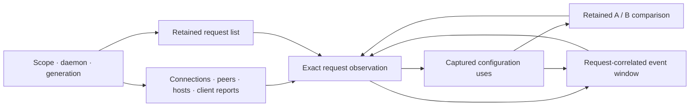

# Investigation workspace

## Task and structural model

An operator needs to distinguish queue/application/reply delay, explain captured configuration differences and inspect related observation events without losing the originating request. The [canonical scenarios](../../.docs/observability/scenarios.md) remain authoritative. The [API](../../.docs/observability/browser-api.md) already supplies the finite read vocabulary; this design adds presentation and page lifetime only.

Edges mean explicit native references; PID, names, adjacent timestamps and logical request IDs do not substitute for observation refs. Host registration with zero peer connections remains registration evidence, not proof of a live process or full census.

## Layout and navigation

The light workbench has a persistent scope header with daemon/generation/connection identity, a compact runtime strip, a subject rail and a split investigation body. The left pane selects requests or related connections/peers/hosts/reports. The right pane retains the selected request with local Overview / Configuration / Events tabs and a return-to-request control. Configuration operands live at workspace lifetime, so selecting another request can supply operand B while A remains retained. Configuration comparison and event reading never replace the request identity.

At wide sizes, the request list and evidence panel share the available viewport; each scrolls locally. At narrow sizes a local `请求列表` / `调查详情` disclosure chooses the main pane while scope, status and selected-subject label stay visible. Secondary facts use native `details`; all controls have text labels and native focus behavior. No generic dashboard, business controls, decorative chart or raw JSON page is needed. Request chronology is an observed milestone list; configuration is an aligned field/source comparison; events use a correlated chronological journal with exact frontier and explicit loss rows.

## Native projection and file contracts

| Layer | Files | Contract |
| --- | --- | --- |
| Direct connection | `entry.ts` | Invoke actual `ObservationApi.connect()` to read launch-selected scope without credentials; load the external bundled stylesheet and defer application module until scope is available. Every visit and reload connects independently. |
| State/effects | `state.ts` | `Investigation` owns actual API, selected exact request, retained pages/configs/event windows, channel operation versions, daemon binding and era boundaries. Effects always use captured expected daemon. |
| Presentation | `presentation.ts`, `elements.ts` | Bigint-preserving formatters, same-clock durations only, evidence and enum meaning, safe textContent and native semantic DOM. |
| Workspace composition | `app.ts` | `ScopeHeader`, `RuntimeStrip`, `SubjectNavigation`, `InvestigationLayout` compose cohesive subject/evidence regions. |
| Evidence blocks | `subjects.ts`, `configuration.ts`, `events.ts` | Native typed data and callbacks; no networking or authority. |
| Build | `tsconfig.json`, `build.mjs` | TypeScript + existing root Vite bundles public SDK into hashed finite manifest assets; explicit new disposable output. |

No framework is installed because the view is a bounded read-only workspace with a small central state owner and native accessible controls. React remains unnecessary; root Vite now solves the concrete SDK npm-module bundling requirement. The current SDK adoption uses root Vite to bundle SDK npm dependencies into hashed finite assets; `/api/` remains reserved for HTTP. Public SDK schema aliases replace the older standalone DTO closure. Type-only imports disappear on emit. No exported TSX exists.

## State and lifetime decisions

| Trigger | Accepted state / action | Evidence retained / invalidation |
| --- | --- | --- |
| First snapshot | Bind returned daemon after successful actual response | No implicit current daemon before read. Scope always comes from the adapter scope endpoint. |
| Read completes | Only current operation version accepts result | Per-channel tokens prevent late request/config/event results replacing another subject. |
| Tab/list/subject changes | Retain selected request and loaded evidence | No route/storage serialization; local return preserves selection and operands. |
| Adapter disconnect / rejected read | Keep adapter transport loss distinct from HTTP read denial | Keep all displayed evidence historical; never assert daemon stopped. Retry is explicit. |
| Native LocalFailure | Mark daemon read unavailable with stage/kind | Adapter remains reachable; existing evidence historical. |
| Different daemon | Fence current reads and offer explicit new binding | Old request/config/event data remains historical; no cursor/ref rebinding. |
| Changed generation | Fence dataset joins; expose explicit fresh inspection | Runtime request chronology may remain useful; old config/event windows stay historical. |
| Event gap | Preserve exact missing range, stop window | Explicit continue-retained action starts from returned oldest minus one; gap stays visible. |
| Stream/epoch replacement | Stop old window | Explicit reopen gets a new head; no automatic continuity. |
| Hidden/close | No polling timer; cancel browser reads on close | Native daemon/application lifetime remains independent. |

Reads are user-triggered, finite and serialized by UI channel plus an overall busy guard. There is no timer or default simulated backend. An event window freezes `through` and native filter; next-page continues the exact returned window. Different filters require opening a new window, preserving old evidence as a labeled historical window. Individual reads never imply a globally atomic snapshot.

## Evidence and limitations

Show native ready/receive/sample clocks, generation, origin and capture purpose next to their evidence; monotonic times retain clock IDs. Unknown, absent, withheld, not evaluated, missing retention, dropped capture, evicted projection and event gaps remain separate meanings. Domain commit refs can be disclosed as evidence, but there is no unsupported domain-detail link. Values are rendered through `textContent`, never HTML or arbitrary diagnostic strings. All integer refs/counters/frontiers stay bigint.

The [case source](cases.md) owns authored consumer steps and selectors. Consumer integration owns compilation, browser screenshots/interactions, wide/narrow density evidence and actual native path; the [original Task closure](../../.controller/observability/implementation-tasks/web.md#actual-browser-outcome-and-final-release) links the actual passing build, nine state cases and real browser path. The Web owner directly inspected its wide/narrow screenshots and sanitized interaction steps. Full configuration fields require local scrolling; narrow screenshot visibility alone does not establish every field comparison, which has separate driver evidence. No representative user participated. No executable command, process, server or build output is owned by the Web author.
